<!-- SPDX-License-Identifier: CC-BY-SA-4.0 -->
<picture>
  <source media="(prefers-color-scheme: dark)" srcset="docs/img/luxlibre_banner_dark.png">
  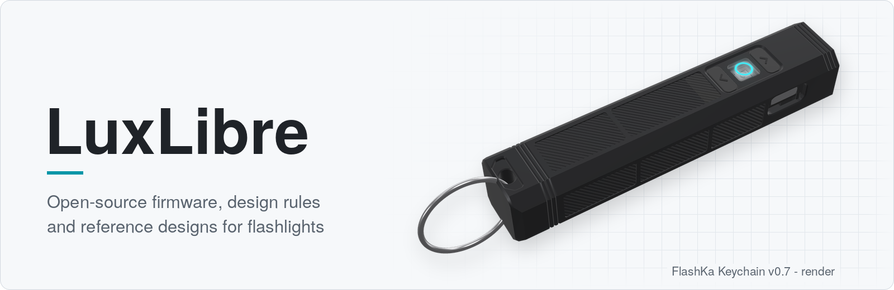
</picture>

# LuxLibre

[](https://github.com/DomPka/LuxLibre/actions/workflows/firmware.yml)
[](https://github.com/DomPka/LuxLibre/actions/workflows/flashka.yml)
[](https://github.com/DomPka/LuxLibre/actions/workflows/pages.yml)
[](CHANGELOG.md)
[](LICENSING.md)
[](LICENSING.md)
[](LICENSING.md)

**Open-source flashlights, from the first requirement to the finished light.** LuxLibre is a
firmware, a set of design rules, a guide to choosing parts and test procedures for any kind of
flashlight (keychain lights, everyday-carry lights, headlamps, throwers, bicycle and dive lights),
and complete reference designs, so far the FlashKa keychain light. Anyone may build, change and
sell lights made with it, companies included ([LICENSING.md](LICENSING.md)).

**[Try the FlashKa web app](https://dompka.github.io/LuxLibre/flashka/flashka-app.html)** (demo
mode, no light needed) · **[FlashKa v0.7](hardware/flashka-keychain-v07/README.md)** ·
**[Build guide (PDF)](hardware/flashka-keychain-v07/FlashKa_v0.7_Build_Guide.pdf)** ·
**[Design rules](docs/design-rules.md)** · **[Firmware](docs/firmware/README.md)**

## FlashKa Keychain v0.7


*Render made from the design files. FlashKa has not been built yet: everything below is checked
by software, and the first prototype is the next step.*

The first reference design is a 99.2 × 20 × 18 mm aluminium keychain light with a laser pointer
and a **presenter mode**: the light is a Bluetooth keyboard meant for PowerPoint, Keynote, Google
Slides, Impress and PDF viewers (not yet tried with a real light), and the laser stays the
pointer. Version 0.7 is the **1000 lm FlashKa**: an SST-20 Gen 2 LED behind a TIR optic and a 4 A
driver give about 1,045 lm (G1 bin) and a 162.5 m throw at switch-on, about 600 lm on High for
about three and a half minutes and about 280 lm after that, for more than two hours from one 14500
Li-ion cell (simulated). The three keys sit on the centre line of the
bottom face: a clear acrylic main key whose frosted ring glows in the ring colour, between two
wide black rubber keys whose chevrons point along the light. The switches sit on a small key board
that six gold spring contacts join to the main board. No part of the light is 3D-printed, there is
no writing on it, and the body is a faceted octagon with textured panels.

| | |
|---|---|
| **Light** | Luminus SST-20 Gen 2 white LED under a LEDiL TIR optic, from a 3 mA moonlight (2 mA in the Endurance profile) to a 2,850 mA turbo: about 1,045 lm out of the front at switch-on (966 lm with the LED at 85 °C), 6,605 cd, 162.5 m of throw; full turbo for about 58 s, High (about 601 lm) for about 210 s, then a temperature regulator holds about 280 lm; turbo dims as the cell empties, about 775 lm from a half-full cell (simulated, not yet measured) |
| **Laser** | 520 nm, Class 2 (≤ 1 mW), switched off in hardware by a slide switch |
| **Keys** | on the centre line of the bottom face, a little below its surface: ^ next and v previous in black rubber with a chevron along the light, ● main in clear acrylic with a glowing ring |
| **Presenter mode** | Bluetooth LE keyboard (HID over GATT): Page Down / Page Up or the arrow keys, F5, Esc, B for a black screen; up to 4 paired computers, no dongle, no driver |
| **Power** | one 14500 Li-ion cell (Vapcell INR14500 F15, 1,500 mAh) with welded nickel strips, protected on the main board (after a protection trip the light stays off until USB is plugged in); about 137 min from turbo to the low-voltage step-down (simulated); USB-C charging at about 500 mA (about 3.5 h), battery and temperature protection |
| **Electronics** | ESP32-C3 module and a 4 A LED driver on a 24 × 16.5 mm four-layer board, and a 19.0 × 14.8 mm key board joined to it by six pogo pins; both boards in one JLCPCB panel with black solder mask, assembled on both sides |
| **Firmware** | open Rust firmware, the same code built per board: 0.7.0 for v0.7 (166 unit and 9 thermal simulation tests), 0.6.0 for v0.6 (153 host tests); reproducible images; LuxLibre's board header as an alternative |
| **Web pages** | control app over Web Bluetooth and firmware installer over Web Serial, each a single HTML file |
| **Body** | CNC-machined 6061-T6, black anodised, a faceted octagon (20 × 18 mm), recessed panels with a diagonal texture, no marking; clear PMMA and black POM-C parts; rubber keys cast at home in a printed resin mould |
| **Cost** | about 859 USD for one light, 507 USD per light for two and 299 USD per light when five are made, with every fee, shipping and VAT; 60 USD less for one light than the first v0.7 design ([workbook](hardware/flashka-keychain-v07/FlashKa_Parts_List_v0.7.xlsx)) |

| 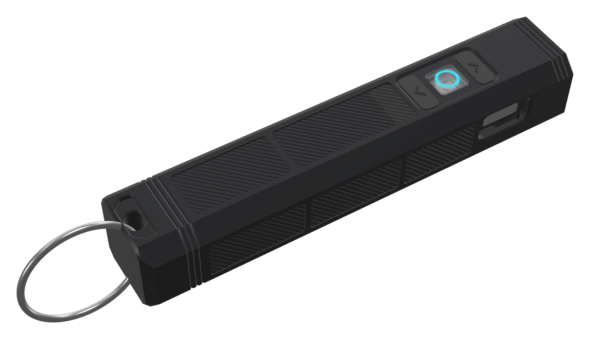 | 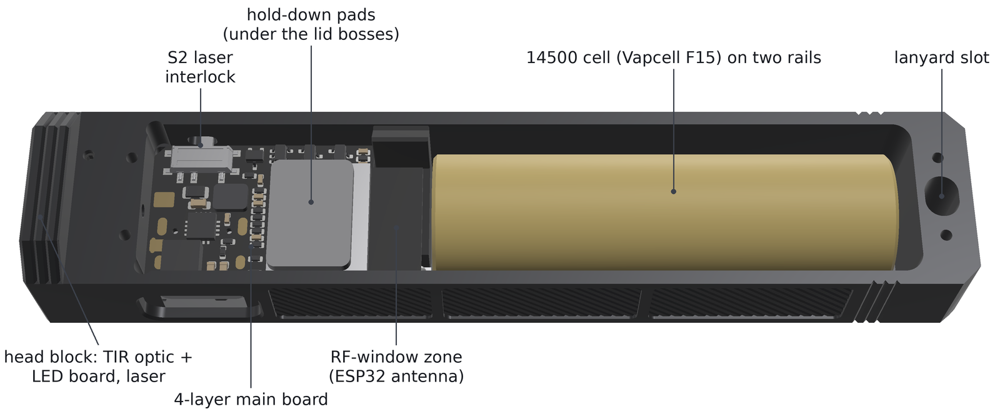 | 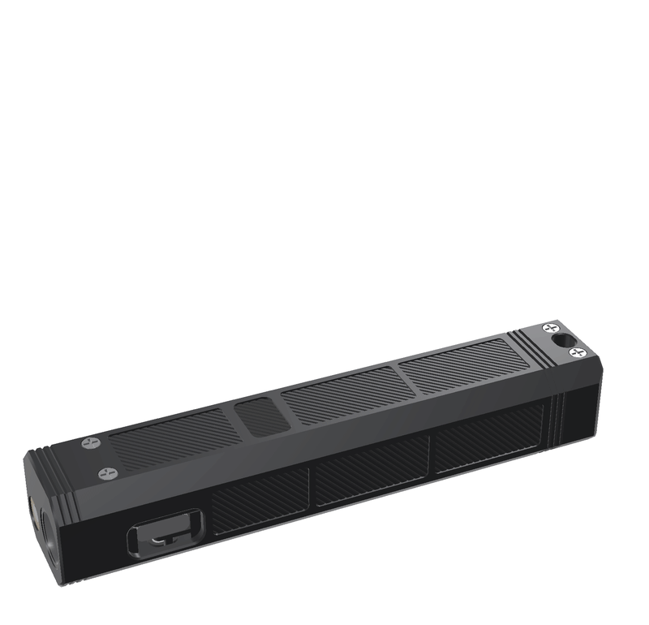 |
|---|---|---|
| Bottom face: v ● ^ and the lit ring | Inside: the real board, the cell and the pads | Exploded: TIR optic, key board, pogo pins, every part |
| 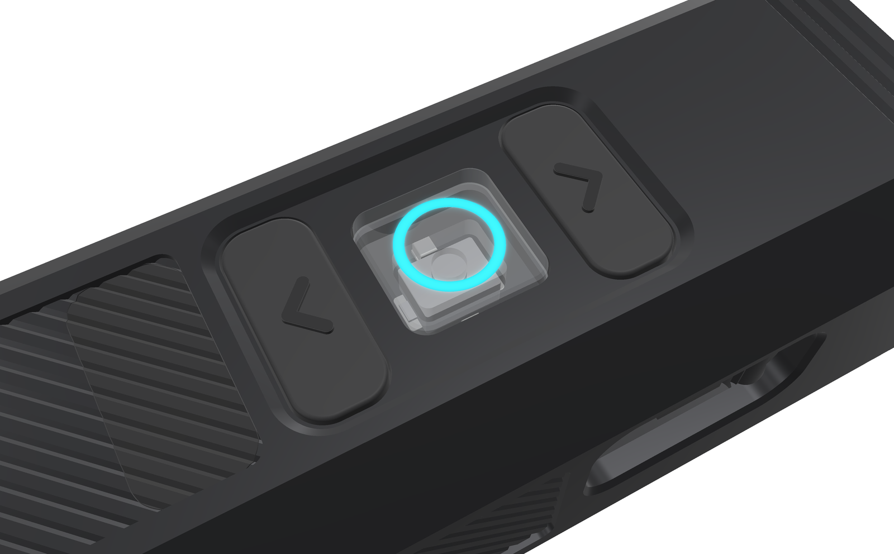 | 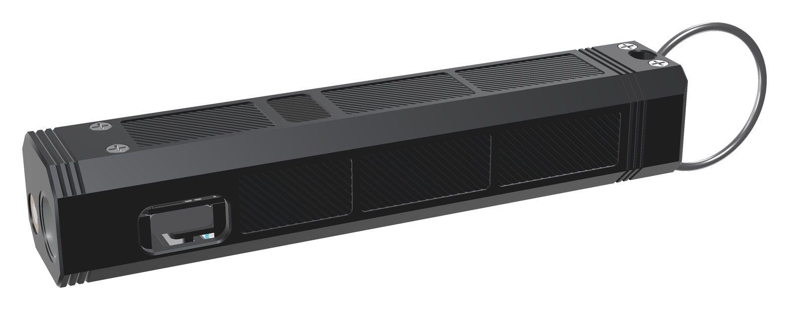 | 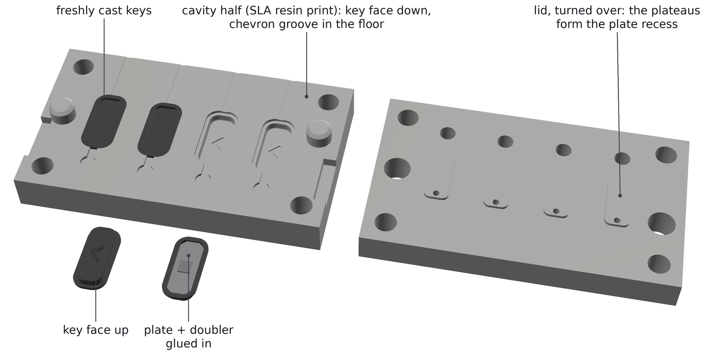 |
| The keys: clear PMMA and rubber | Control side: USB-C, textured panels | Casting mould for the rubber keys |

Everything needed to make one is in [hardware/flashka-keychain-v07/](hardware/flashka-keychain-v07/README.md):
upload-ready files for the shops (the circuit-board panel; the aluminium, acrylic and POM-C parts
with the resin casting mould in one merged order), the casting files of the rubber keys, the parts
and cost workbook, a
41-page [build guide](hardware/flashka-keychain-v07/FlashKa_v0.7_Build_Guide.pdf) for
people without electronics experience, and the 57-page
[hardware package](hardware/flashka-keychain-v07/FlashKa_v0.7_Hardware_Package.pdf) that explains
every design decision and check. Every design file comes from scripts in the repository (KiCad
schematic and boards, CadQuery housing and mould, drawings, renders, comparison pictures, cost
workbook), so a change to the design is a change to code that can be reviewed and rebuilt.

## FlashKa compared with the RovyVon Aurora A2

<picture>
  <source media="(prefers-color-scheme: dark)" srcset="hardware/flashka-keychain-v07/assets/v07/comparison_combined_dark.png">
  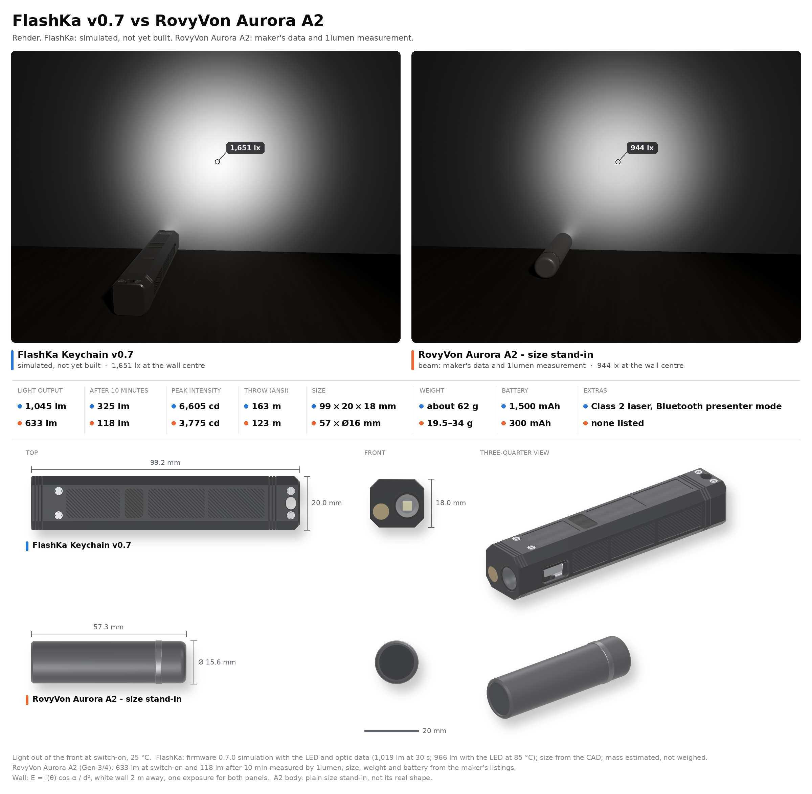
</picture>

*Render. FlashKa: simulated, not yet built. RovyVon Aurora A2: maker's data and the
[1lumen measurement](https://1lumen.com/review/rovyvon-a2/). Every number and its source:
[sources_comparison.md](hardware/flashka-keychain-v07/assets/v07/sources_comparison.md).*

| | FlashKa v0.7 (simulated) | RovyVon Aurora A2 (measured by 1lumen) |
|---|---|---|
| Light out of the front at switch-on | 1,045 lm (966 lm with the LED at 85 °C) | 633 lm |
| After 30 s / after 10 minutes | 1,019 lm / 325 lm | 394 lm / 118 lm |
| Peak intensity / throw | 6,605 cd / 162.5 m | 3,775 cd / 123 m |
| Size / mass | 99.2 × 20 × 18 mm / about 62 g | 57.3 × Ø15.6 mm / 19.5 to 33.9 g |
| Battery | 1,500 mAh (one 14500 cell) | 300 mAh |
| Runtime from turbo to the ANSI end point | 137 min | 1 h 04 min |

With its TIR optic FlashKa now throws further than the A2 (162.5 m against 123 m) and gives about
1.65 times its light at switch-on, about 2.6 times as much after 30 s and about 2.8 times after ten
minutes. It has five times the battery capacity, runs about twice as long from turbo and adds a
laser and the presenter mode, but it is longer and heavier. FlashKa's
figures are simulated from the LED and optic datasheets; the A2's are measured.

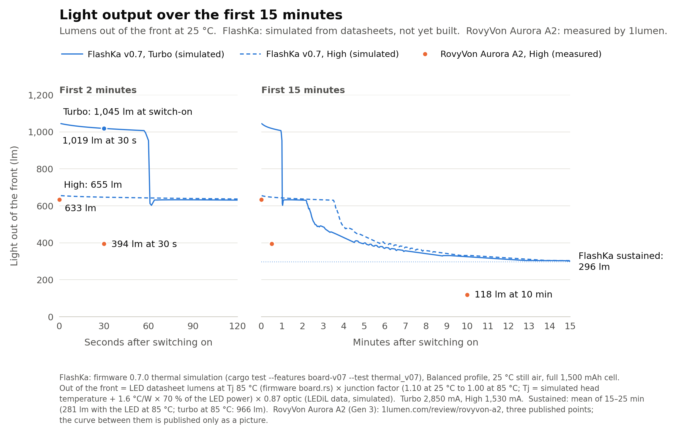

## The FlashKa web app

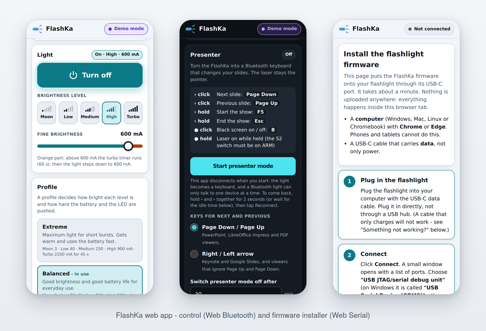

| Page | What it does | Needs |
|---|---|---|
| **[Control app](https://dompka.github.io/LuxLibre/flashka/flashka-app.html)** | battery, temperature and runtime; light on and off, levels and exact current; profiles with an editor; presenter settings and paired computers; a demo mode with a simulated light | Chrome or Edge on Android, Windows, macOS or ChromeOS (on Linux, Chrome may need the Web Bluetooth flag); Bluefy on iPhone and iPad |
| **[Firmware installer](https://dompka.github.io/LuxLibre/flashka/flashka-flasher.html)** | writes the firmware through the light's USB-C port and checks what it wrote; the firmware image is inside the page | Chrome or Edge on a computer and a USB-C data cable |

Both pages run entirely in the browser: nothing is uploaded and there is no account. They serve
FlashKa v0.7 and v0.6: the installer holds the firmware of both and asks which light you have, the
app recognises the board by itself. They are published from
[hardware/flashka-keychain-v06/app/](hardware/flashka-keychain-v06/app/) with GitHub Pages
([site/](site/) holds the start page).

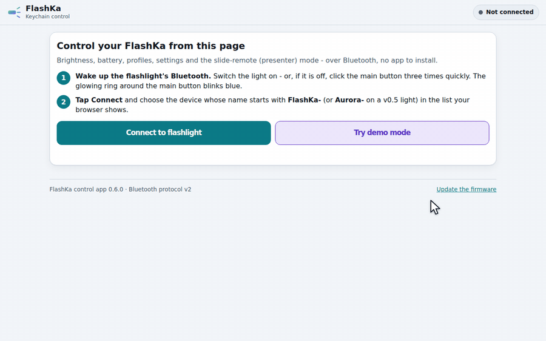

*Recording of the control app in its demo mode; the light is simulated inside the page.*

## What is inside

| Folder | What it gives you |
|---|---|
| [firmware/](docs/firmware/README.md) | One firmware for many lights: C++17, ported to ATtiny1616, CH32V003 and ESP32-C3 (not yet run on hardware), with 150 levels, three button layouts, thermal regulation that never flickers, battery protection, lockout, laser support, 50 ArduPilot-style parameters and a text console, all tested in a PC simulator |
| [docs/](docs/README.md) | [Design rules](docs/design-rules.md) (69 rules with reasons and checks), [choosing parts](docs/choosing-parts.md) with a worked 1200 lm example, [flashlight types](docs/flashlight-types.md), [testing](docs/testing.md) |
| [hardware/](hardware/README.md) | Reference designs with complete sources: [FlashKa Keychain v0.7](hardware/flashka-keychain-v07/README.md) (current), [v0.6](hardware/flashka-keychain-v06/README.md) (previous; it holds the FlashKa firmware of both versions and the web pages) and [v0.5](hardware/flashka-keychain-v05/README.md) |
| [tools/](tools/README.md) | `lux_calc.py`: standby budget, runtime, cell current, throw, heat, trace width, voltage divider, NTC |
| [templates/](templates/README.md) | Requirement sheet, design log, decision matrix, BOM, design-review checklist, test report |
| [site/](site/) | The start page of the project's GitHub Pages site |

## Quick start

**Try the FlashKa web app without a light:** open the
[control app](https://dompka.github.io/LuxLibre/flashka/flashka-app.html) and press *Try demo mode*.

**Try the LuxLibre firmware without hardware** (Linux, macOS, or Windows with WSL):

```sh
cd firmware
make test                                    # unit and behaviour tests
make sim
build/luxsim --set TURBO_S=0 "2C W600000"    # double click for turbo, then 10 minutes
make sim BOARD=flashka-keychain-v07          # the simulator with the FlashKa v0.7 board header
build/luxsim-flashka-keychain-v07 --set TURBO_S=0 "2C W600000"
```

<picture>
  <source media="(prefers-color-scheme: dark)" srcset="docs/img/thermal-regulation-dark.png">
  
</picture>

*The LuxLibre firmware in its simulator: turbo, then smooth thermal regulation at 50 °C for a
keychain light and an 18650 light ([how this was made](docs/firmware/simulator.md)).*

**Design a light:** start with the requirement sheet
([templates/requirements.md](templates/requirements.md)), then follow
[docs/choosing-parts.md](docs/choosing-parts.md) and check the result against
[docs/design-rules.md](docs/design-rules.md). [docs/README.md](docs/README.md) suggests a reading
order.

**Put LuxLibre on your board:** [docs/firmware/porting.md](docs/firmware/porting.md).

**Build a FlashKa:** read the
[build guide](hardware/flashka-keychain-v07/FlashKa_v0.7_Build_Guide.pdf) once from start to end,
then use the files in [order_files/](hardware/flashka-keychain-v07/order_files/README.txt).

## Status

LuxLibre 0.3.0 is new. What has been tested so far:

| Part | State |
|---|---|
| LuxLibre firmware core | tested in the simulator (47 unit and behaviour tests, run by CI) |
| ATtiny1616 and CH32V003 ports | build and link; not yet run on hardware |
| ESP32-C3 port | experimental, including the resistor-ladder buttons of FlashKa; checked against the ESP-IDF API and with stub headers, CI build configured; not yet compiled with ESP-IDF or run on hardware |
| Design rules, guides, tools | complete for version 0.3; numbers from standards and datasheets carry sources |
| FlashKa v0.7 | designed and checked by software: netlist across both boards with the new power stage, KiCad DRC with 0 errors, both boards' 3D models inside the housing, the optic seat and the cell bay, pogo-pin heights and the hold-down, key travel, drawings against the CAD, both casting moulds, cost; light output, temperatures and runtime simulated with the firmware's own controller; not yet built |
| FlashKa firmware and web pages (0.7.0 for v0.7, 0.6.0 for v0.6) | 166 unit and 9 thermal simulation tests (v0.7 build), 153 host tests (v0.6 build); 165 unit tests, and 71 control-app and 33 installer and start-page checks in a browser against simulated hardware; not yet run on a real light |

The first hardware results will be added as test reports. Measurements from your builds are the
most valuable contribution: the [build report](https://github.com/DomPka/LuxLibre/issues/new?template=build_report.yml)
issue form asks for exactly what is needed. See [CONTRIBUTING.md](CONTRIBUTING.md).

## Safety and security

Lithium cells, bright LEDs, hot surfaces and lasers can hurt people. Read [SAFETY.md](SAFETY.md)
before building or testing. Security problems (for example in Bluetooth pairing or the web pages)
are reported privately as described in [SECURITY.md](SECURITY.md).

## Licences

Like ArduPilot, LuxLibre may be used, changed, built and sold by anyone, companies included, as
long as the shared parts stay open:

- firmware and tools: [GPL-3.0-or-later](LICENSES/GPL-3.0-or-later.txt)
- hardware design files: [CERN-OHL-W-2.0](LICENSES/CERN-OHL-W-2.0.txt)
- documentation: [CC-BY-SA-4.0](LICENSES/CC-BY-SA-4.0.txt)
- the FlashKa Rust firmware, web pages and web tools: MIT or Apache-2.0

What that means in practice, including for products you sell: [LICENSING.md](LICENSING.md).
How to use the names LuxLibre and FlashKa: [TRADEMARKS.md](TRADEMARKS.md).

## Background

LuxLibre stands on the shoulders of the enthusiast flashlight community: the
[Anduril](https://github.com/ToyKeeper/anduril) firmware (GPL-3.0) showed how much a single
button can do, early open lights such as the
[HexBright](https://techcrunch.com/2011/07/06/kid-tested-grant-imahara-approved-hexbrite-open-source-flashlight)
showed that people want to change their lights, and the community keeps asking for exact
levels, visible settings and configuration without a command line
([BLF discussion, 2026](https://budgetlightforum.com/t/hey-folks-i-want-to-drag-flash-lights-into-2026/234210)).
LuxLibre adds what a design team needs around the firmware: rules, a part-selection method,
tests, a simulator and complete reference designs. Its parameter system and its licensing follow
ArduPilot.

The name: Latin *lux*, light, and *libre*, free as in freedom.
