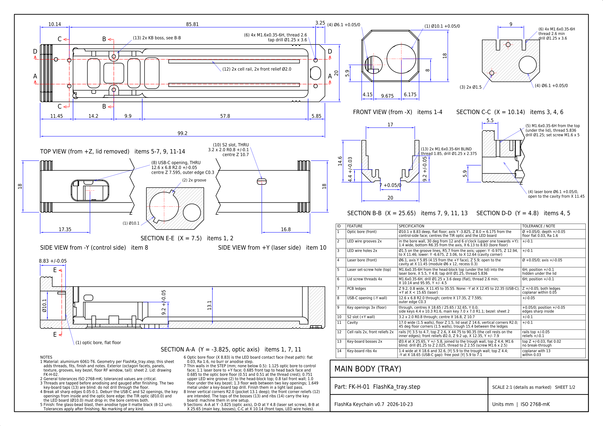
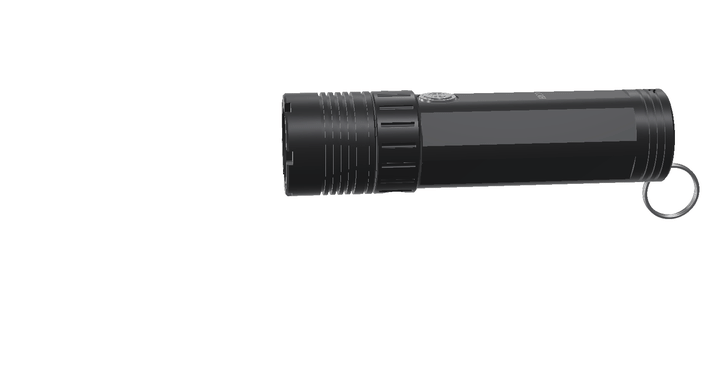

<!-- SPDX-License-Identifier: CC-BY-SA-4.0 -->
<picture>
  <source media="(prefers-color-scheme: dark)" srcset="docs/img/luxlibre_banner_dark.png">
  
</picture>

# LuxLibre

[](https://github.com/DomPka/LuxLibre/actions/workflows/firmware.yml)
[](https://github.com/DomPka/LuxLibre/actions/workflows/flashka.yml)
[](https://github.com/DomPka/LuxLibre/actions/workflows/pages.yml)
[](CHANGELOG.md)
[](LICENSING.md)
[](LICENSING.md)
[](LICENSING.md)

**Open-source flashlights, from the first requirement to the finished light.** LuxLibre has four parts:

* one firmware for many lights;
* a set of design rules;
* a guide to choosing parts, and test procedures;
* reference designs: the FlashKa keychain light with a laser, and the EDCO family of sealed everyday-carry
  lights, from 69 mm to 98 mm long and up to about 1,760 lm.

Every design comes with its CAD, dimensioned drawings, renders, a firmware board header and simulated light
output. Anyone may build, change and sell lights made with it, companies included ([LICENSING.md](LICENSING.md)).

## Choose a light

<picture>
  <source media="(prefers-color-scheme: dark)" srcset="docs/img/lineup_dark.png">
  
</picture>

*All seven at true scale (render). The [web site](https://dompka.github.io/LuxLibre/) has the same lineup: pick a
light there to see its details.*

<table>
<tr>
<td width="33%" valign="top">
<a href="hardware/flashka-keychain-v07/README.md"></a>
<h3><a href="hardware/flashka-keychain-v07/README.md">FlashKa v0.7</a></h3>
<b>Keychain light with a laser and a Bluetooth presenter mode.</b><br>
99.2 × 20 × 18 mm · one 14500<br>
about 1,045 lm · 162 m throw · 2 h 17 min from turbo<br>
<sub><a href="hardware/flashka-keychain-v07/FlashKa_v0.7_Build_Guide.pdf">build guide</a> · <a href="hardware/flashka-keychain-v07/cad/FlashKa_tray_drawing.pdf">drawings</a> · <a href="https://dompka.github.io/LuxLibre/flashka/flashka-app.html">web app</a></sub>
</td>
<td width="33%" valign="top">
<a href="hardware/edco-prism/README.md"></a>
<h3><a href="hardware/edco-prism/README.md">EDCO Prism</a></h3>
<b>A beam that is white or any colour.</b><br>
Ø28 × 83 mm · one 18350<br>
about 1,250 lm turbo · red, green, blue and any mix<br>
<sub><a href="hardware/edco-prism/cad/EDCO_Prism_body_drawing.pdf">drawing</a> · <a href="hardware/edco-prism/cad/">CAD</a> · <a href="https://dompka.github.io/LuxLibre/luxlibre/">settings page</a></sub>
</td>
<td width="33%" valign="top">
<a href="hardware/edco-mini/README.md"></a>
<h3><a href="hardware/edco-mini/README.md">EDCO Mini</a></h3>
<b>Sealed keychain light with red and UV side lights.</b><br>
Ø22 × 73.5 mm (16340) or Ø19 × 69.4 mm<br>
about 950 lm · keyring tab · magnet version<br>
<sub><a href="hardware/edco-mini/cad/EDCO_Mini-16_body_drawing.pdf">drawings</a> · <a href="hardware/edco-mini/cad/">CAD</a> · <a href="firmware/boards/edco-mini-16/board.h">firmware</a></sub>
</td>
</tr>
<tr>
<td width="33%" valign="top">
<a href="hardware/edco-v02/README.md"></a>
<h3><a href="hardware/edco-v02/README.md">EDCO v0.2</a></h3>
<b>The bright one: an SST-40 at up to 5.7 A.</b><br>
Ø26 × 97.8 mm (18500) or Ø22 × 95.6 mm (14500)<br>
about 1,760 lm · USB-C under a twist collar<br>
<sub><a href="hardware/edco-v02/cad/EDCO-18_body_drawing.pdf">drawings</a> · <a href="hardware/edco-v02/cad/">CAD</a> · <a href="firmware/boards/edco-v02-18/board.h">firmware</a></sub>
</td>
<td width="33%" valign="top">
<a href="hardware/edco-v01/README.md"></a>
<h3><a href="hardware/edco-v01/README.md">EDCO v0.1</a></h3>
<b>A plain sealed tube with USB-C in the tail.</b><br>
Ø20 × 93.5 mm · one 14500<br>
about 966 lm · 2 h 21 min from turbo<br>
<sub><a href="hardware/edco-v01/cad/EDCO_body_drawing.pdf">drawing</a> · <a href="hardware/edco-v01/cad/">CAD</a> · <a href="firmware/boards/edco-v01/board.h">firmware</a></sub>
</td>
<td width="33%" valign="top">
<a href="docs/comparison.md"><picture><source media="(prefers-color-scheme: dark)" srcset="docs/img/compare_light_dark.png"></picture></a>
<h3><a href="docs/comparison.md">Compare them</a></h3>
<b>Every design against 14 popular lights</b>, from the RovyVon A3 Pro to the Fenix PD36R Pro: light, throw,
runtime, size and price, with sources.
</td>
</tr>
</table>

*Every picture is a render made from the design files. None of these lights has been built yet: every light figure
is simulated with the LuxLibre simulator (out of the front, LED at 85 °C) or estimated, and every page says
which.*

## Where to go next

| I want to | Go to |
|---|---|
| see how the designs compare with lights I can buy | [docs/comparison.md](docs/comparison.md) |
| look at a design in detail: specifications, renders, how it is built, cost, open points | the design pages above, or [hardware/](hardware/README.md) for all of them |
| get drawings and CAD to make parts | each design's `cad/` folder: STEP files and A3 drawings (DXF, PDF, PNG) |
| try the FlashKa control app without a light | the [FlashKa web app](https://dompka.github.io/LuxLibre/flashka/flashka-app.html), *Try demo mode* |
| change the settings of a LuxLibre light from the browser | the [LuxLibre settings page](https://dompka.github.io/LuxLibre/luxlibre/) (Web Serial over USB-C; demo mode without a light) |
| run the firmware without hardware | [Quick start](#quick-start) and [docs/firmware/simulator.md](docs/firmware/simulator.md) |
| design my own light | [docs/README.md](docs/README.md): requirement sheet, choosing parts, design rules, testing |
| put LuxLibre on my board | [docs/firmware/porting.md](docs/firmware/porting.md) |
| build a FlashKa | the [build guide](hardware/flashka-keychain-v07/FlashKa_v0.7_Build_Guide.pdf) and [order files](hardware/flashka-keychain-v07/order_files/README.txt) |
| report a build, measurements or a problem | [CONTRIBUTING.md](CONTRIBUTING.md) and the [build report form](https://github.com/DomPka/LuxLibre/issues/new?template=build_report.yml) |

## The lights at a glance

| Light | Size (mm) | Cell | Light at 30 s | After 10 min | Throw | From turbo to the end point | What sets it apart |
|---|---|---|---|---|---|---|---|
| [FlashKa v0.7](hardware/flashka-keychain-v07/README.md) | 99.2 × 20 × 18 | 14500, 1,500 mAh | 966 lm | about 280 lm | 6,605 cd, 162 m | 2 h 17 min | Class 2 laser, Bluetooth presenter mode, glowing key ring |
| [EDCO Prism](hardware/edco-prism/README.md) | Ø28 × 83.0 | 18350, 1,200 mAh | 1,248 lm | about 280-350 lm | about 3,000 cd (est.) | 1 h 29 min | colour beam, RGB-lit button, settings page over USB-C |
| [EDCO Mini-16](hardware/edco-mini/README.md) | Ø22 × 73.5 | 16340, 650 mAh | 944 lm | about 230 lm | about 11,000 cd (est.) | 1 h 07 min | red and UV side lights, keyring tab, magnets in the M version |
| [EDCO Mini-14](hardware/edco-mini/README.md) | Ø19 × 69.4 | 14350 made to order, about 400 mAh | 978 lm | about 195 lm | about 5,600 cd (est.) | 51 min | the smallest; needs a cell made to order |
| [EDCO-18](hardware/edco-v02/README.md) | Ø26 × 97.8 | 18500, 1,500 mAh | 1,759 lm | about 330-390 lm | about 18,000 cd (est.) | 1 h 39 min | the brightest; USB-C under a twist collar |
| [EDCO-14](hardware/edco-v02/README.md) | Ø22 × 95.6 | 14500, 1,000 mAh | 1,561 lm | about 260-320 lm | about 11,000 cd (est.) | 1 h 18 min | the same in a slimmer body |
| [EDCO v0.1](hardware/edco-v01/README.md) | Ø20 × 93.5 | 14500, 1,500 mAh | 966 lm | about 290 lm | 6,605 cd, 162 m | 2 h 21 min | sealed USB-C socket in the tail |

All figures are simulated, out of the front, with the LED at 85 °C in 25 °C still air. "est." marks an estimate
from the optic's beam angle. The end point is ANSI FL1: 10 % of the 30 s output.

## Against popular flashlights

<picture>
  <source media="(prefers-color-scheme: dark)" srcset="docs/img/compare_light_dark.png">
  
</picture>

* **Keychain size.** The EDCO Mini gives more than twice the light of a 60 mm RovyVon A3 Pro at 30 s. The best
  16340 lights, the Olight Baton 4 and Fenix E18R V2.0, are shorter and still brighter.
* **14500 and 18350 size.** EDCO-18 and EDCO-14 are the brightest at 30 s and run the longest from turbo, but
  they are about 17-20 mm longer than the Skilhunt MiX-7 or Emisar D3AA.
  * EDCO Prism gives about 10 % less white than the MiX-7, the only other colour-beam light of its size. It runs
    longer and charges from any USB-C cable.
* **18650 size** is still the territory of lights like the Fenix PD36R Pro: no LuxLibre design is that big yet.

Every number, its source and what was left out: [docs/comparison.md](docs/comparison.md). The other lights were
measured by independent reviewers; the LuxLibre lights are simulated, and their measured numbers will replace these
once they are built.

## FlashKa Keychain v0.7


The first reference design is a 99.2 × 20 × 18 mm aluminium keychain light with a laser pointer and a **presenter
mode**: the light is a Bluetooth keyboard meant for PowerPoint, Keynote, Google Slides, Impress and PDF viewers
(not yet tried with a real light), and the laser stays the pointer. Version 0.7 is the **1000 lm FlashKa**:

* An SST-20 Gen 2 LED behind a TIR optic and a 4 A driver.
* About 1,045 lm (G1 bin) and a 162.5 m throw at switch-on.
* About 600 lm on High for about three and a half minutes, then about 280 lm.
* More than two hours from one 14500 Li-ion cell.

All of these are simulated. The three keys sit on the centre line of the bottom face. No part is 3D-printed, there
is no writing on it, and the body is a faceted octagon with textured panels.

| | |
|---|---|
| **Light** | Luminus SST-20 Gen 2 white LED under a LEDiL TIR optic, from a 3 mA moonlight to a 2,850 mA turbo: about 1,045 lm out of the front at switch-on (966 lm with the LED at 85 °C), 6,605 cd, 162.5 m of throw; then a temperature regulator holds about 280 lm (simulated, not yet measured) |
| **Laser** | 520 nm, Class 2 (≤ 1 mW), switched off in hardware by a slide switch |
| **Presenter mode** | Bluetooth LE keyboard (HID over GATT): Page Down / Page Up or the arrow keys, F5, Esc, B for a black screen; up to 4 paired computers, no dongle, no driver |
| **Power** | one 14500 Li-ion cell (Vapcell INR14500 F15, 1,500 mAh), protected on the main board; about 137 min from turbo (simulated); USB-C charging at about 500 mA |
| **Electronics** | ESP32-C3 module and a 4 A LED driver on a 24 × 16.5 mm four-layer board, and a key board joined to it by six pogo pins; both boards in one JLCPCB panel |
| **Body** | CNC-machined 6061-T6, black anodised, a faceted octagon (20 × 18 mm), recessed textured panels; clear PMMA and black POM-C parts; rubber keys cast in a printed resin mould |
| **Cost** | about 859 USD for one light and 299 USD per light when five are made, with every fee, shipping and VAT ([workbook](hardware/flashka-keychain-v07/FlashKa_Parts_List_v0.7.xlsx)) |

|  |  | [](hardware/flashka-keychain-v07/cad/FlashKa_tray_drawing.pdf) |
|---|---|---|
| Bottom face: v ● ^ and the lit ring | Exploded: TIR optic, key board, pogo pins, every part | Drawings FK-H-01 to FK-H-08 for every machined and cast part |

Everything needed to make one is in [hardware/flashka-keychain-v07/](hardware/flashka-keychain-v07/README.md):

* upload-ready files for the shops;
* the casting files of the rubber keys;
* the parts and cost workbook;
* a 41-page [build guide](hardware/flashka-keychain-v07/FlashKa_v0.7_Build_Guide.pdf) for people without
  electronics experience;
* the 57-page [hardware package](hardware/flashka-keychain-v07/FlashKa_v0.7_Hardware_Package.pdf), which explains
  every design decision and check.

The FlashKa page also compares it beam to beam with the RovyVon A2.

## The EDCO family

EDCO lights are round, sealed everyday-carry lights with **no laser and no radio**. Charging, firmware updates and
settings all go through one waterproof USB-C socket. The battery and the electronics slide in from the front, and
a bezel screws on over the LED holder. Every EDCO runs the LuxLibre firmware on an ESP32-C3. All of them are
concepts:

* the housing is modelled in CadQuery and checked for fits, walls and interference;
* each design has dimensioned drawings, renders and a firmware board header;
* the light output is simulated;
* the circuit boards are not drawn yet, and nothing has been built.

### EDCO Prism: white or any colour

|  |  |
|---|---|
| The colour list: white turbo, red, green, blue, yellow, cyan, magenta, white from the three colours, a custom colour | Bezel, quad optic, the four LEDs, head insert, button, main board, 18350 cell, body |

Four LEDs share one 24 mm quad TIR optic: a white Luminus SST-20 and red, green and blue LEDs. Turbo runs all four
for about 1,250 lm (simulated). Five clicks turn on the colour beam, two step through the colours, and holding sets
the brightness. The button glows in the beam's colour. The colours, the custom colour and every other setting can
be changed on the [settings page](site/luxlibre/index.html) over USB-C. It is 83 mm long with a keyring tab, and
the M version has two magnets in the tab.
[More, with the drawing](hardware/edco-prism/README.md).

### EDCO Mini: a sealed keychain light

|  | [](hardware/edco-mini/cad/EDCO_Mini-16_body_drawing.pdf) |
|---|---|
| Bezel, optic, LED board, head insert, button and light rods, main board, 16340 cell, body with magnets | The body drawing: top view, section, bottom view, end views, feature table |

The Mini comes in two sizes:

* **Mini-16:** a 16340 cell in a Ø20 tube with a Ø22 head, 73.5 mm long.
* **Mini-14:** Ø17 with a Ø19 head and 69.4 mm long. It needs a cell made to order.

Both have an SST-20 behind a TIR optic, about 950 lm (simulated), red and UV side lights, a waterproof USB-C socket
in the side of the head, and a keyring tab with an obround hole. The M versions add two magnets in the end of the
tab. [More](hardware/edco-mini/README.md).

### EDCO v0.2: about 1,760 lm

|  | [](hardware/edco-v02/cad/EDCO-18_body_drawing.pdf) |
|---|---|
| Bezel, optic, SST-40 board, head insert, twist collar, button, main board, 18500 cell, body | The EDCO-18 body drawing |

A Luminus SST-40 at up to 5.7 A comes in two sizes:

* **EDCO-18:** an 18500 cell, 97.8 mm, 1,759 lm out of the front (simulated).
* **EDCO-14:** a 14500 cell, 95.6 mm, 1,561 lm.

The USB-C port sits on the side of the head under a fluted twist collar. The bezel is crenellated and finned,
the body has six flats, and the stainless button glows. [More](hardware/edco-v02/README.md).

### EDCO v0.1: the first one

|  | [](hardware/edco-v01/cad/EDCO_body_drawing.pdf) |
|---|---|
| Bezel ring, optic, LED board, head, button parts, main board, 14500 cell, tail board, body | The body drawing |

A Ø20 × 93.5 mm tube with a closed tail and one 14500 cell. A sealed USB-C socket sits in the centre of the tail.
It uses the FlashKa v0.7 light engine: about 966 lm and 162.5 m of throw, then about 290 lm for more than two hours
(simulated). [More](hardware/edco-v01/README.md).

## In your browser

| Page | What it does | Needs |
|---|---|---|
| **[LuxLibre settings page](https://dompka.github.io/LuxLibre/luxlibre/)** | reads and changes every parameter of a LuxLibre light over USB-C (Web Serial), and for the EDCO Prism the beam's colour and the custom colour; a demo mode with the EDCO Prism's settings | Chrome or Edge on a computer and a USB-C data cable |
| **[FlashKa control app](https://dompka.github.io/LuxLibre/flashka/flashka-app.html)** | battery, temperature and runtime; light on and off, levels and exact current; profiles with an editor; presenter settings and paired computers; a demo mode with a simulated light | Chrome or Edge on Android, Windows, macOS or ChromeOS; Bluefy on iPhone and iPad |
| **[FlashKa firmware installer](https://dompka.github.io/LuxLibre/flashka/flashka-flasher.html)** | writes the firmware through the light's USB-C port and checks what it wrote; the firmware image is inside the page | Chrome or Edge on a computer and a USB-C data cable |

All three run entirely in the browser: nothing is uploaded and there is no account. The
[start page](https://dompka.github.io/LuxLibre/) links them all. They are published from [site/](site/) and
[hardware/flashka-keychain-v06/app/](hardware/flashka-keychain-v06/app/) with GitHub Pages.


## What is inside

| Folder | What it gives you |
|---|---|
| [firmware/](docs/firmware/README.md) | One firmware for many lights in C++17. **Ports:** ATtiny1616, CH32V003 and ESP32-C3 (not yet run on hardware). **Features:** 150 levels, three button layouts, thermal regulation that never flickers, battery protection, lockout, laser support, side lights and a colour beam, 57 ArduPilot-style parameters and a text console. All of it is tested in a PC simulator. |
| [hardware/](hardware/README.md) | Reference designs with complete sources: FlashKa [v0.7](hardware/flashka-keychain-v07/README.md), [v0.6](hardware/flashka-keychain-v06/README.md) and [v0.5](hardware/flashka-keychain-v05/README.md), and EDCO [Prism](hardware/edco-prism/README.md), [Mini](hardware/edco-mini/README.md), [v0.2](hardware/edco-v02/README.md) and [v0.1](hardware/edco-v01/README.md). The [tools](hardware/tools/) make the EDCO drawings and animations. |
| [docs/](docs/README.md) | [Design rules](docs/design-rules.md) (69 rules with reasons and checks), [choosing parts](docs/choosing-parts.md) with a worked 1200 lm example, [flashlight types](docs/flashlight-types.md), [testing](docs/testing.md), and the [comparison](docs/comparison.md) with popular lights |
| [tools/](tools/README.md) | `lux_calc.py`: standby budget, runtime, cell current, throw, heat, trace width, voltage divider, NTC; `comparison_charts.py` |
| [templates/](templates/README.md) | Requirement sheet, design log, decision matrix, BOM, design-review checklist, test report |
| [site/](site/) | The project's web site: the start page and the LuxLibre settings page |

## Quick start

**Try the web pages without a light:** open the
[settings page](https://dompka.github.io/LuxLibre/luxlibre/) or the
[FlashKa control app](https://dompka.github.io/LuxLibre/flashka/flashka-app.html) and choose the demo mode.

**Try the LuxLibre firmware without hardware** (Linux, macOS, or Windows with WSL):

```sh
cd firmware
make test                                    # unit and behaviour tests
make sim BOARD=edco-prism                    # the simulator with the EDCO Prism's board header
build/luxsim-edco-prism --preset board "2C W600000"            # double click for turbo, then 10 minutes
build/luxsim-edco-prism --preset board "5C W2000 2C W2000"     # colour beam on, then the next colour
make sim BOARD=edco-mini-16                  # the same for any board in firmware/boards/
build/luxsim-edco-mini-16 --preset board --set TURBO_S=0 "2C W600000"
```

<picture>
  <source media="(prefers-color-scheme: dark)" srcset="docs/img/thermal-regulation-dark.png">
  
</picture>

*The LuxLibre firmware in its simulator: turbo, then smooth thermal regulation at 50 °C for a keychain light and an
18650 light ([how this was made](docs/firmware/simulator.md)).*

**Design a light:** start with the requirement sheet ([templates/requirements.md](templates/requirements.md)), then
follow [docs/choosing-parts.md](docs/choosing-parts.md) and check the result against
[docs/design-rules.md](docs/design-rules.md). [docs/README.md](docs/README.md) suggests a reading order.

**Put LuxLibre on your board:** [docs/firmware/porting.md](docs/firmware/porting.md).

**Build a FlashKa:** read the [build guide](hardware/flashka-keychain-v07/FlashKa_v0.7_Build_Guide.pdf) once from
start to end, then use the files in [order_files/](hardware/flashka-keychain-v07/order_files/README.txt).

## Status

LuxLibre 0.5.0. What has been tested so far:

| Part | State |
|---|---|
| LuxLibre firmware core | 13 unit tests with 529 checks, and 47 behaviour tests with 263 checks in the simulator on three test boards; all run by CI |
| ATtiny1616 and CH32V003 ports | build and link in CI; not yet run on hardware |
| ESP32-C3 port | built with ESP-IDF 5.3.1 in CI for every FlashKa and EDCO board header; not yet run on hardware |
| LuxLibre settings page | checked in a browser in demo mode and against a simulated serial port; not yet used with a real light |
| FlashKa v0.7 | designed and checked by software: netlist across both boards, KiCad DRC with 0 errors, both boards' 3D models inside the housing, key travel, drawings against the CAD, both casting moulds, cost; light output and runtime simulated; not yet built |
| FlashKa firmware and web pages (0.7.0 for v0.7, 0.6.0 for v0.6) | 166 unit and 9 thermal simulation tests (v0.7 build), 153 host tests (v0.6 build); control app, installer and start page checked in a browser against simulated hardware; not yet run on a real light |
| EDCO Prism, Mini, v0.2 and v0.1 | concepts. Each housing is modelled in CadQuery and checked for fits, walls and interference. The body drawings are checked against the solids. Each has a firmware board header, and its light output, temperatures and runtime are simulated. The circuit boards are not drawn yet, and nothing has been built |
| Design rules, guides, tools | complete; numbers from standards and datasheets carry sources |

The first hardware results will be added as test reports. Measurements from your builds are the most valuable
contribution: the [build report](https://github.com/DomPka/LuxLibre/issues/new?template=build_report.yml) issue
form asks for exactly what is needed. See [CONTRIBUTING.md](CONTRIBUTING.md).

## Safety and security

Lithium cells, bright LEDs, hot surfaces and lasers can hurt people. Read [SAFETY.md](SAFETY.md) before building or
testing. Security problems (for example in Bluetooth pairing or the web pages) are reported privately as described
in [SECURITY.md](SECURITY.md).

## Licences

Like ArduPilot, LuxLibre may be used, changed, built and sold by anyone, companies included, as long as the shared
parts stay open:

- firmware and tools: [GPL-3.0-or-later](LICENSES/GPL-3.0-or-later.txt)
- hardware design files: [CERN-OHL-W-2.0](LICENSES/CERN-OHL-W-2.0.txt)
- documentation: [CC-BY-SA-4.0](LICENSES/CC-BY-SA-4.0.txt)
- the FlashKa Rust firmware, web pages and web tools: MIT or Apache-2.0

What that means in practice, including for products you sell: [LICENSING.md](LICENSING.md). How to use the names
LuxLibre and FlashKa: [TRADEMARKS.md](TRADEMARKS.md).

## Background

LuxLibre stands on the shoulders of the enthusiast flashlight community:

* The [Anduril](https://github.com/ToyKeeper/anduril) firmware (GPL-3.0) showed how much a single button can do.
* Early open lights such as the
  [HexBright](https://techcrunch.com/2011/07/06/kid-tested-grant-imahara-approved-hexbrite-open-source-flashlight)
  showed that people want to change their lights.
* The community keeps asking for exact levels, visible settings and configuration without a command line
  ([BLF discussion, 2026](https://budgetlightforum.com/t/hey-folks-i-want-to-drag-flash-lights-into-2026/234210)).

LuxLibre adds what a design team needs around the firmware: rules, a part-selection method, tests, a simulator
and complete reference designs. Its parameter system and its licensing follow ArduPilot.

The name: Latin *lux*, light, and *libre*, free as in freedom.
