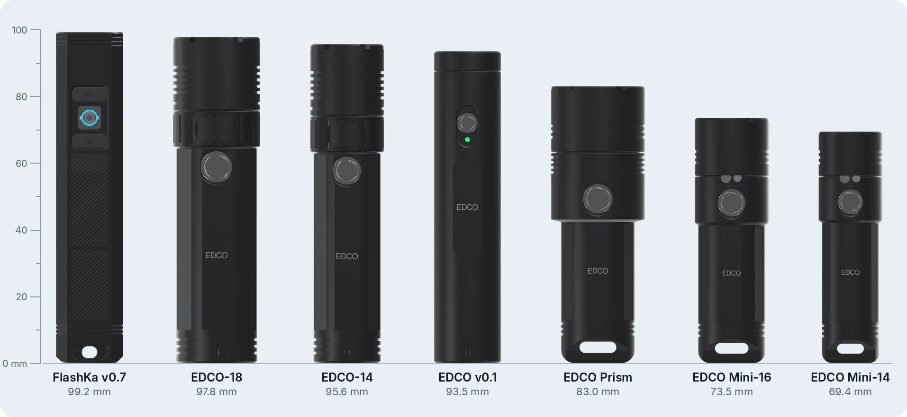
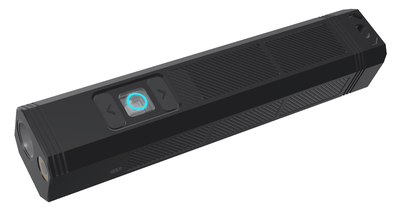
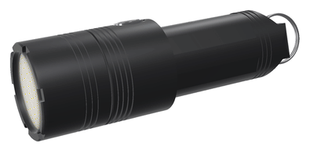
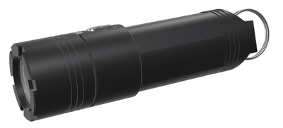
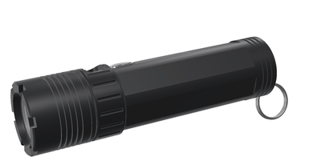
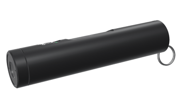
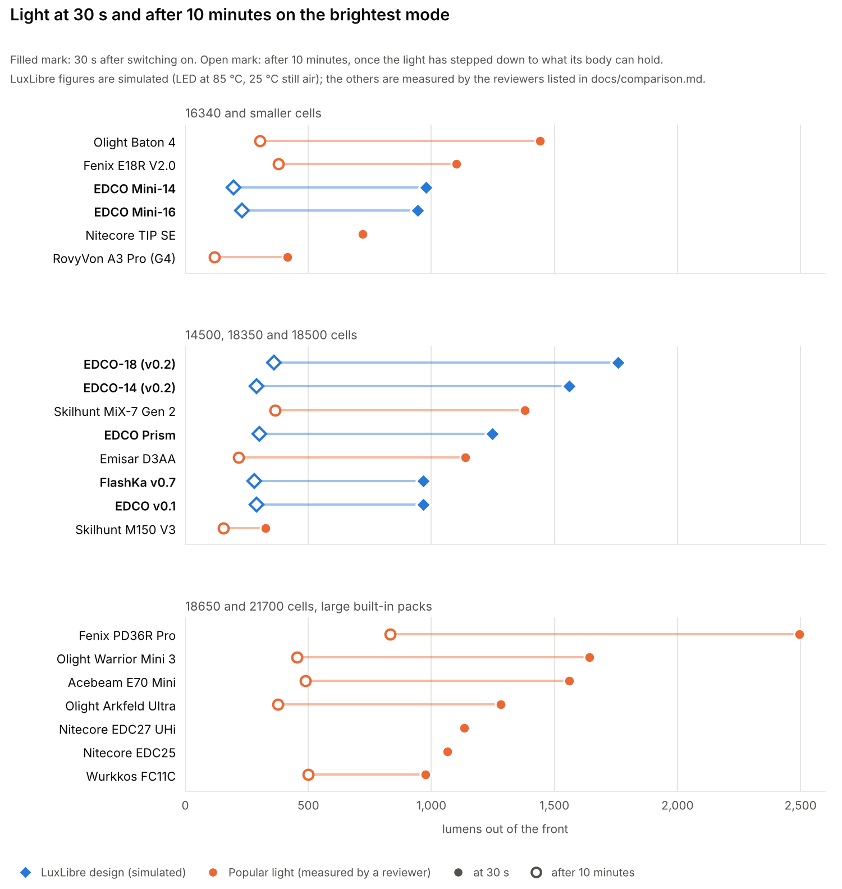

<!-- SPDX-License-Identifier: CC-BY-SA-4.0 -->
<picture>
  <source media="(prefers-color-scheme: dark)" srcset="docs/img/luxlibre_banner_dark.png">
  
</picture>

# LuxLibre

[](https://github.com/DomPka/LuxLibre/actions/workflows/firmware.yml)
[](https://github.com/DomPka/LuxLibre/actions/workflows/flashka.yml)
[](https://github.com/DomPka/LuxLibre/actions/workflows/pages.yml)
[](CHANGELOG.md)
[](LICENSING.md)
[](LICENSING.md)
[](LICENSING.md)

<p align="center"><b>
<a href="#pick-a-light">Pick a light</a> &nbsp;·&nbsp;
<a href="docs/comparison.md">Compare</a> &nbsp;·&nbsp;
<a href="#in-your-browser">Web apps</a> &nbsp;·&nbsp;
<a href="docs/firmware/README.md">Firmware</a> &nbsp;·&nbsp;
<a href="docs/README.md">Design your own</a> &nbsp;·&nbsp;
<a href="hardware/flashka-keychain-v07/FlashKa_v0.7_Build_Guide.pdf">Build a FlashKa</a> &nbsp;·&nbsp;
<a href="#repository-map">Repository map</a> &nbsp;·&nbsp;
<a href="CONTRIBUTING.md">Help</a>
</b></p>

**Open-source flashlights, from the first requirement to the finished light.** LuxLibre is one firmware for many
lights, a set of design rules, a guide to choosing parts and testing them, and seven reference designs: the FlashKa
keychain light and the EDCO family of sealed everyday-carry lights. Every design comes with CAD, dimensioned
drawings, renders, a firmware board header and simulated light output. Anyone may build, change and sell lights
made with it, companies included ([LICENSING.md](LICENSING.md)).

## Pick a light

<picture>
  <source media="(prefers-color-scheme: dark)" srcset="docs/img/lineup_dark.png">
  
</picture>

*All seven at true scale (render). The [web site](https://dompka.github.io/LuxLibre/) has the same lineup: pick a
light there to see its details.*

<table>
<tr>
<td width="33%" valign="top">
<a href="hardware/flashka-keychain-v07/README.md"></a>
<h3><a href="hardware/flashka-keychain-v07/README.md">FlashKa v0.7</a></h3>
<b>Keychain light with a laser and a Bluetooth presenter mode.</b><br>
99.2 × 20 × 18 mm · one 14500<br>
about 1,045 lm · 162 m throw · 2 h 17 min from turbo<br>
<sub><a href="hardware/flashka-keychain-v07/FlashKa_v0.7_Build_Guide.pdf">build guide</a> · <a href="hardware/flashka-keychain-v07/cad/FlashKa_tray_drawing.pdf">drawings</a> · <a href="https://dompka.github.io/LuxLibre/flashka/flashka-app.html">web app</a></sub>
</td>
<td width="33%" valign="top">
<a href="hardware/edco-prism/README.md"></a>
<h3><a href="hardware/edco-prism/README.md">EDCO Prism</a></h3>
<b>A beam that is white or any colour.</b><br>
Ø28 × 83 mm · one 18350<br>
about 1,250 lm turbo · red, green, blue and any mix<br>
<sub><a href="hardware/edco-prism/cad/EDCO_Prism_body_drawing.pdf">drawing</a> · <a href="hardware/edco-prism/cad/">CAD</a> · <a href="https://dompka.github.io/LuxLibre/luxlibre/">settings page</a></sub>
</td>
<td width="33%" valign="top">
<a href="hardware/edco-mini/README.md"></a>
<h3><a href="hardware/edco-mini/README.md">EDCO Mini</a></h3>
<b>Sealed keychain light with red and UV side lights.</b><br>
Ø22 × 73.5 mm (16340) or Ø19 × 69.4 mm<br>
about 950 lm · keyring tab · magnet version<br>
<sub><a href="hardware/edco-mini/cad/EDCO_Mini-16_body_drawing.pdf">drawings</a> · <a href="hardware/edco-mini/cad/">CAD</a> · <a href="firmware/boards/edco-mini-16/board.h">firmware</a></sub>
</td>
</tr>
<tr>
<td width="33%" valign="top">
<a href="hardware/edco-v02/README.md"></a>
<h3><a href="hardware/edco-v02/README.md">EDCO v0.2</a></h3>
<b>The bright one: an SST-40 at up to 5.7 A.</b><br>
Ø26 × 97.8 mm (18500) or Ø22 × 95.6 mm (14500)<br>
about 1,760 lm · USB-C under a twist collar<br>
<sub><a href="hardware/edco-v02/cad/EDCO-18_body_drawing.pdf">drawings</a> · <a href="hardware/edco-v02/cad/">CAD</a> · <a href="firmware/boards/edco-v02-18/board.h">firmware</a></sub>
</td>
<td width="33%" valign="top">
<a href="hardware/edco-v01/README.md"></a>
<h3><a href="hardware/edco-v01/README.md">EDCO v0.1</a></h3>
<b>A plain sealed tube with USB-C in the tail.</b><br>
Ø20 × 93.5 mm · one 14500<br>
about 966 lm · 2 h 21 min from turbo<br>
<sub><a href="hardware/edco-v01/cad/EDCO_body_drawing.pdf">drawing</a> · <a href="hardware/edco-v01/cad/">CAD</a> · <a href="firmware/boards/edco-v01/board.h">firmware</a></sub>
</td>
<td width="33%" valign="top">
<a href="docs/comparison.md"><picture><source media="(prefers-color-scheme: dark)" srcset="docs/img/compare_light_dark.png"></picture></a>
<h3><a href="docs/comparison.md">Compare them</a></h3>
<b>Every design against 14 popular lights</b>, from the RovyVon A3 Pro to the Fenix PD36R Pro: light, throw,
runtime, size and price, with sources.
</td>
</tr>
</table>

*Every picture is a render made from the design files. None of these lights has been built yet: every light figure
is simulated with the LuxLibre simulator (out of the front, LED at 85 °C) or estimated, and every page says
which.*

## Where to go next

| I want to | Go to |
|---|---|
| see how the designs compare with lights I can buy | [docs/comparison.md](docs/comparison.md) |
| look at a design in detail: specifications, renders, how it is built, cost, open points | the design pages above, or [all the lights](hardware/README.md) |
| get drawings and CAD to make parts | each design's `cad/` folder: STEP files and A3 drawings (DXF, PDF, PNG), e.g. [EDCO Prism](hardware/edco-prism/cad/README.md), [FlashKa v0.7](hardware/flashka-keychain-v07/cad/README.md) |
| try the FlashKa control app without a light | the [FlashKa web app](https://dompka.github.io/LuxLibre/flashka/flashka-app.html), *Try demo mode* |
| change the settings of a LuxLibre light from the browser | the [LuxLibre settings page](https://dompka.github.io/LuxLibre/luxlibre/) (Web Serial over USB-C; demo mode without a light) |
| run the firmware without hardware | [Quick start](#quick-start) and [docs/firmware/simulator.md](docs/firmware/simulator.md) |
| design my own light | [docs/README.md](docs/README.md): requirement sheet, choosing parts, design rules, testing |
| put LuxLibre on my board | [docs/firmware/porting.md](docs/firmware/porting.md) |
| build a FlashKa | the [build guide](hardware/flashka-keychain-v07/FlashKa_v0.7_Build_Guide.pdf) and [order files](hardware/flashka-keychain-v07/order_files/README.txt) |
| report a build, measurements or a problem | [CONTRIBUTING.md](CONTRIBUTING.md) and the [build report form](https://github.com/DomPka/LuxLibre/issues/new?template=build_report.yml) |

## The lights at a glance

| Light | Size (mm) | Cell | Light at 30 s | After 10 min | Throw | From turbo to the end point | What sets it apart |
|---|---|---|---|---|---|---|---|
| [FlashKa v0.7](hardware/flashka-keychain-v07/README.md) | 99.2 × 20 × 18 | 14500, 1,500 mAh | 966 lm | about 280 lm | 6,605 cd, 162 m | 2 h 17 min | Class 2 laser, Bluetooth presenter mode, glowing key ring |
| [EDCO Prism](hardware/edco-prism/README.md) | Ø28 × 83.0 | 18350, 1,200 mAh | 1,248 lm | about 280-350 lm | about 3,000 cd (est.) | 1 h 29 min | colour beam, RGB-lit button, settings page over USB-C |
| [EDCO Mini-16](hardware/edco-mini/README.md) | Ø22 × 73.5 | 16340, 650 mAh | 944 lm | about 230 lm | about 11,000 cd (est.) | 1 h 07 min | red and UV side lights, keyring tab, magnets in the M version |
| [EDCO Mini-14](hardware/edco-mini/README.md) | Ø19 × 69.4 | 14350 made to order, about 400 mAh | 978 lm | about 195 lm | about 5,600 cd (est.) | 51 min | the smallest; needs a cell made to order |
| [EDCO-18](hardware/edco-v02/README.md) | Ø26 × 97.8 | 18500, 1,500 mAh | 1,759 lm | about 330-390 lm | about 18,000 cd (est.) | 1 h 39 min | the brightest; USB-C under a twist collar |
| [EDCO-14](hardware/edco-v02/README.md) | Ø22 × 95.6 | 14500, 1,000 mAh | 1,561 lm | about 260-320 lm | about 11,000 cd (est.) | 1 h 18 min | the same in a slimmer body |
| [EDCO v0.1](hardware/edco-v01/README.md) | Ø20 × 93.5 | 14500, 1,500 mAh | 966 lm | about 290 lm | 6,605 cd, 162 m | 2 h 21 min | sealed USB-C socket in the tail |

All figures are simulated, out of the front, with the LED at 85 °C in 25 °C still air. "est." marks an estimate
from the optic's beam angle. The end point is ANSI FL1: 10 % of the 30 s output.

## Against popular flashlights

<picture>
  <source media="(prefers-color-scheme: dark)" srcset="docs/img/compare_light_dark.png">
  
</picture>

* **Keychain size.** The EDCO Mini gives more than twice the light of a 60 mm RovyVon A3 Pro at 30 s. The best
  16340 lights, the Olight Baton 4 and Fenix E18R V2.0, are shorter and still brighter.
* **14500 and 18350 size.** EDCO-18 and EDCO-14 are the brightest at 30 s and run the longest from turbo, but
  they are about 17-20 mm longer than the Skilhunt MiX-7 or Emisar D3AA.
  * EDCO Prism gives about 10 % less white than the MiX-7, the only other colour-beam light of its size. It runs
    longer and charges from any USB-C cable.
* **18650 size** is still the territory of lights like the Fenix PD36R Pro: no LuxLibre design is that big yet.

Every number, its source and what was left out: [docs/comparison.md](docs/comparison.md). The other lights were
measured by independent reviewers; the LuxLibre lights are simulated, and their measured numbers will replace these
once they are built.

## In your browser

| Page | What it does | Needs |
|---|---|---|
| **[LuxLibre settings page](https://dompka.github.io/LuxLibre/luxlibre/)** | reads and changes every parameter of a LuxLibre light over USB-C (Web Serial), and for the EDCO Prism the beam's colour and the custom colour; a demo mode with the EDCO Prism's settings | Chrome or Edge on a computer and a USB-C data cable |
| **[FlashKa control app](https://dompka.github.io/LuxLibre/flashka/flashka-app.html)** | battery, temperature and runtime; light on and off, levels and exact current; profiles with an editor; presenter settings and paired computers; a demo mode with a simulated light | Chrome or Edge on Android, Windows, macOS or ChromeOS; Bluefy on iPhone and iPad |
| **[FlashKa firmware installer](https://dompka.github.io/LuxLibre/flashka/flashka-flasher.html)** | writes the firmware through the light's USB-C port and checks what it wrote; the firmware image is inside the page | Chrome or Edge on a computer and a USB-C data cable |

All three run entirely in the browser: nothing is uploaded and there is no account. The
[start page](https://dompka.github.io/LuxLibre/) links them all. They are published from [site/](site/) and
[hardware/flashka-keychain-v06/app/](hardware/flashka-keychain-v06/app/) with GitHub Pages.


## Repository map

| Folder | What is in it | Start with |
|---|---|---|
| [hardware/](hardware/README.md) | the lights: design pages, CAD and drawings, renders, circuit boards, order files | [the lights](hardware/README.md) |
| &nbsp;&nbsp;[flashka-keychain-v07/](hardware/flashka-keychain-v07/README.md) | FlashKa v0.7, the keychain light with a laser and a presenter mode | [build guide](hardware/flashka-keychain-v07/FlashKa_v0.7_Build_Guide.pdf), [drawings](hardware/flashka-keychain-v07/cad/README.md) |
| &nbsp;&nbsp;[edco-prism/](hardware/edco-prism/README.md) | EDCO Prism, white or any-colour beam | [drawing](hardware/edco-prism/cad/README.md), [pictures](hardware/edco-prism/assets/README.md) |
| &nbsp;&nbsp;[edco-mini/](hardware/edco-mini/README.md) | EDCO Mini-16 and Mini-14, sealed keychain lights | [drawings](hardware/edco-mini/cad/README.md), [pictures](hardware/edco-mini/assets/README.md) |
| &nbsp;&nbsp;[edco-v02/](hardware/edco-v02/README.md) | EDCO-18 and EDCO-14, about 1,760 lm | [drawings](hardware/edco-v02/cad/README.md), [pictures](hardware/edco-v02/assets/README.md) |
| &nbsp;&nbsp;[edco-v01/](hardware/edco-v01/README.md) | EDCO v0.1, the first EDCO | [drawing](hardware/edco-v01/cad/README.md), [pictures](hardware/edco-v01/assets/README.md) |
| &nbsp;&nbsp;[flashka-keychain-v06/](hardware/flashka-keychain-v06/README.md), [v05/](hardware/flashka-keychain-v05/README.md) | older FlashKa designs; v0.6 also holds the FlashKa firmware and web pages | |
| &nbsp;&nbsp;[tools/](hardware/tools/README.md) | scripts for the drawings, animations, lineup and banner | |
| [firmware/](firmware/README.md) | the LuxLibre firmware source: core, ports, board headers, tests, simulator | [firmware guide](docs/firmware/README.md), [board headers](firmware/boards/README.md) |
| [docs/](docs/README.md) | design rules, choosing parts, flashlight types, testing, the comparison, the firmware guide | [reading paths](docs/README.md) |
| [tools/](tools/README.md) | `lux_calc.py` (runtime, throw, heat, trace width, NTC...) and the comparison charts | |
| [templates/](templates/README.md) | requirement sheet, design log, decision matrix, BOM, review checklist, test report | [requirement sheet](templates/requirements.md) |
| [site/](site/README.md) | the web site: start page and LuxLibre settings page | [live site](https://dompka.github.io/LuxLibre/) |

At the top level: [CHANGELOG](CHANGELOG.md), [CONTRIBUTING](CONTRIBUTING.md), [SAFETY](SAFETY.md),
[SECURITY](SECURITY.md), [LICENSING](LICENSING.md) (what the licences mean), [TRADEMARKS](TRADEMARKS.md) and the
[licence texts](LICENSES/). Every page has a path at the top (LuxLibre › Lights › EDCO Prism) to find your way back.

## Quick start

**Try the web pages without a light:** open the
[settings page](https://dompka.github.io/LuxLibre/luxlibre/) or the
[FlashKa control app](https://dompka.github.io/LuxLibre/flashka/flashka-app.html) and choose the demo mode.

**Try the LuxLibre firmware without hardware** (Linux, macOS, or Windows with WSL):

```sh
cd firmware
make test                                    # unit and behaviour tests
make sim BOARD=edco-prism                    # the simulator with the EDCO Prism's board header
build/luxsim-edco-prism --preset board "2C W600000"            # double click for turbo, then 10 minutes
build/luxsim-edco-prism --preset board "5C W2000 2C W2000"     # colour beam on, then the next colour
make sim BOARD=edco-mini-16                  # the same for any board in firmware/boards/
build/luxsim-edco-mini-16 --preset board --set TURBO_S=0 "2C W600000"
```

<picture>
  <source media="(prefers-color-scheme: dark)" srcset="docs/img/thermal-regulation-dark.png">
  
</picture>

*The LuxLibre firmware in its simulator: turbo, then smooth thermal regulation at 50 °C for a keychain light and an
18650 light ([how this was made](docs/firmware/simulator.md)).*

**Design a light:** start with the requirement sheet ([templates/requirements.md](templates/requirements.md)), then
follow [docs/choosing-parts.md](docs/choosing-parts.md) and check the result against
[docs/design-rules.md](docs/design-rules.md). [docs/README.md](docs/README.md) suggests a reading order.

**Put LuxLibre on your board:** [docs/firmware/porting.md](docs/firmware/porting.md).

**Build a FlashKa:** read the [build guide](hardware/flashka-keychain-v07/FlashKa_v0.7_Build_Guide.pdf) once from
start to end, then use the files in [order_files/](hardware/flashka-keychain-v07/order_files/README.txt).

## Status

LuxLibre 0.5.0. What has been tested so far:

| Part | State |
|---|---|
| LuxLibre firmware core | 13 unit tests with 529 checks, and 47 behaviour tests with 263 checks in the simulator on three test boards; all run by CI |
| ATtiny1616 and CH32V003 ports | build and link in CI; not yet run on hardware |
| ESP32-C3 port | built with ESP-IDF 5.3.1 in CI for every FlashKa and EDCO board header; not yet run on hardware |
| LuxLibre settings page | checked in a browser in demo mode and against a simulated serial port; not yet used with a real light |
| FlashKa v0.7 | designed and checked by software: netlist across both boards, KiCad DRC with 0 errors, both boards' 3D models inside the housing, key travel, drawings against the CAD, both casting moulds, cost; light output and runtime simulated; not yet built |
| FlashKa firmware and web pages (0.7.0 for v0.7, 0.6.0 for v0.6) | 166 unit and 9 thermal simulation tests (v0.7 build), 153 host tests (v0.6 build); control app, installer and start page checked in a browser against simulated hardware; not yet run on a real light |
| EDCO Prism, Mini, v0.2 and v0.1 | concepts. Each housing is modelled in CadQuery and checked for fits, walls and interference. The body drawings are checked against the solids. Each has a firmware board header, and its light output, temperatures and runtime are simulated. The circuit boards are not drawn yet, and nothing has been built |
| Design rules, guides, tools | complete; numbers from standards and datasheets carry sources |

The first hardware results will be added as test reports. Measurements from your builds are the most valuable
contribution: the [build report](https://github.com/DomPka/LuxLibre/issues/new?template=build_report.yml) issue
form asks for exactly what is needed. See [CONTRIBUTING.md](CONTRIBUTING.md).

## Safety and security

Lithium cells, bright LEDs, hot surfaces and lasers can hurt people. Read [SAFETY.md](SAFETY.md) before building or
testing. Security problems (for example in Bluetooth pairing or the web pages) are reported privately as described
in [SECURITY.md](SECURITY.md).

## Licences

Like ArduPilot, LuxLibre may be used, changed, built and sold by anyone, companies included, as long as the shared
parts stay open:

- firmware and tools: [GPL-3.0-or-later](LICENSES/GPL-3.0-or-later.txt)
- hardware design files: [CERN-OHL-W-2.0](LICENSES/CERN-OHL-W-2.0.txt)
- documentation: [CC-BY-SA-4.0](LICENSES/CC-BY-SA-4.0.txt)
- the FlashKa Rust firmware, web pages and web tools: MIT or Apache-2.0

What that means in practice, including for products you sell: [LICENSING.md](LICENSING.md). How to use the names
LuxLibre and FlashKa: [TRADEMARKS.md](TRADEMARKS.md).

## Background

LuxLibre stands on the shoulders of the enthusiast flashlight community:

* The [Anduril](https://github.com/ToyKeeper/anduril) firmware (GPL-3.0) showed how much a single button can do.
* Early open lights such as the
  [HexBright](https://techcrunch.com/2011/07/06/kid-tested-grant-imahara-approved-hexbrite-open-source-flashlight)
  showed that people want to change their lights.
* The community keeps asking for exact levels, visible settings and configuration without a command line
  ([BLF discussion, 2026](https://budgetlightforum.com/t/hey-folks-i-want-to-drag-flash-lights-into-2026/234210)).

LuxLibre adds what a design team needs around the firmware: rules, a part-selection method, tests, a simulator
and complete reference designs. Its parameter system and its licensing follow ArduPilot.

The name: Latin *lux*, light, and *libre*, free as in freedom.
