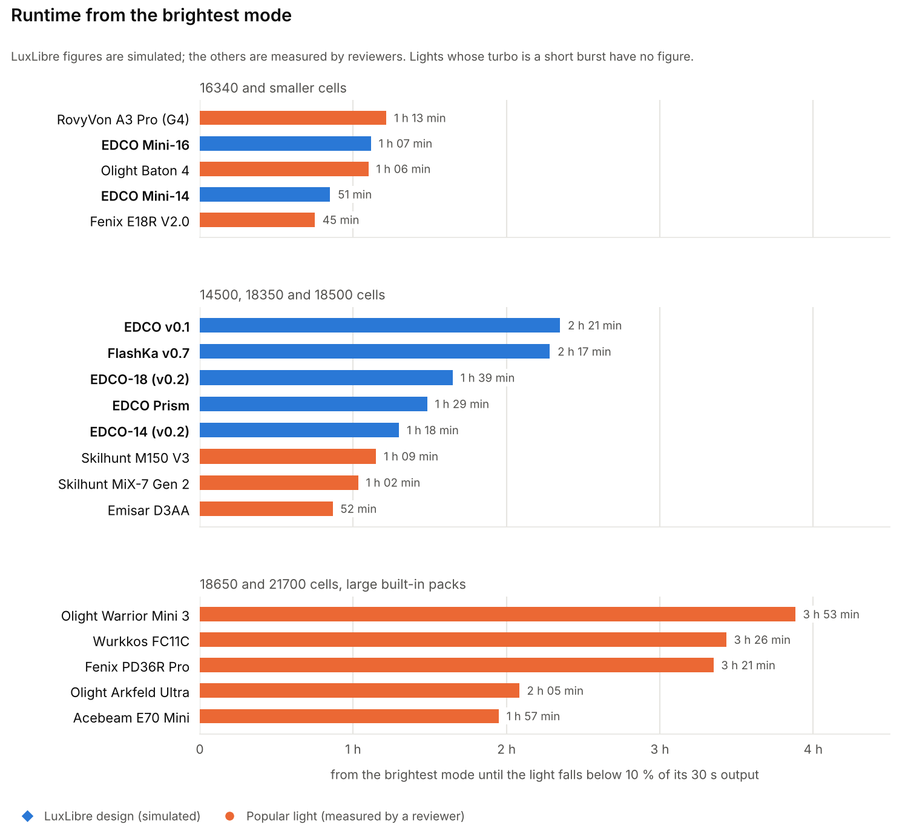

<!-- SPDX-License-Identifier: CC-BY-SA-4.0 -->
[LuxLibre](../README.md) › [Documentation](README.md) › LuxLibre lights against popular flashlights

# LuxLibre lights against popular flashlights

**On this page:** [Light](#light-at-30-s-and-after-10-minutes) · [Runtime from the brightest mode](#runtime-from-the-brightest-mode) · [Small lights](#small-lights-16340-and-smaller-cells) · [Mid-size lights](#mid-size-lights-14500-18350-and-18500-cells) · [Large lights](#large-lights-18650-and-21700-cells-large-built-in-packs) · [What is not in the tables](#what-is-not-in-the-tables) · [Sources](#sources)

This page compares the LuxLibre reference designs with popular everyday-carry lights of the same cell size. It
shows how much light each one gives, how long it lasts, how far it throws, and what it costs.

> **Read this first.** None of the LuxLibre lights has been built yet.
>
> * **LuxLibre figures are simulated** with the [LuxLibre simulator](firmware/simulator.md). They are lumens
>   out of the front with the LED at 85 °C, in 25 °C still air. Throw marked "est." is an estimate from the
>   optic's beam angle.
> * **The other lights' figures were measured** by the independent reviewers listed under
>   [Sources](#sources), each with their own set-up. Mostly this is 1lumen, using an integrating sphere or a lumen
>   tube.
>
> A simulation is not a measurement, so treat the LuxLibre numbers as targets that a built light still has to
> meet. When a LuxLibre light is built, its measured numbers will replace the simulated ones here.

The data is in [data/flashlights.json](data/flashlights.json) and the charts are made by
[tools/comparison_charts.py](../tools/comparison_charts.py). Prices are US retail prices seen in October 2026 and
they change often. For a LuxLibre design the price column gives the estimated cost to build one light in a batch
of five, with all fees, shipping and VAT included. That is a prototype cost, not a retail price.

## Light: at 30 s and after 10 minutes

<picture>
  <source media="(prefers-color-scheme: dark)" srcset="img/compare_light_dark.png">
  
</picture>

Each line goes from the light at 30 s (filled mark) to the light after 10 minutes (open mark). The 10-minute
figure is what the body can hold once it is warm, so it matters more than the peak for anything longer than a
quick look.

## Runtime from the brightest mode

<picture>
  <source media="(prefers-color-scheme: dark)" srcset="img/compare_runtime_dark.png">
  
</picture>

Runtime is measured from switching on the brightest mode until the light falls below 10 % of its 30 s output
(the ANSI FL1 end point). Every light steps down on the way, so this is not time at full brightness.

## Small lights: 16340 and smaller cells

| Light | Length × Ø (mm) | Weight (g) | Cell | Light at 30 s (lm) | After 10 min (lm) | Throw (cd) | Runtime | Charging | Water | Extras | Price (USD) |
|---|---|---|---|---|---|---|---|---|---|---|---|
| Olight Baton 4 | 63 × 21 | 54 | 16340 (Olight), 650 mAh | 1,441 | 303 | 7,075 | 1 h 06 min | magnetic cable | IPX8 | – | 54.99 |
| Fenix E18R V2.0 | 67 × 22 | 56 | 16340 (Fenix), 700 mAh | 1,101 | 378 | 5,000 | 45 min | USB-C | IP68 | – | 59.95 |
| **[EDCO Mini-14](../hardware/edco-mini/README.md)** | 69.4 × 19 | 33 (est.) | 14350 LiPo made to order, about 400 mAh | 978 | about 195 | 5,600 (est.) | 51 min | USB-C | IPX8 target | red and UV side lights; settings page | about 220-250 to build |
| **[EDCO Mini-16](../hardware/edco-mini/README.md)** | 73.5 × 22 | 54 (est.) | 16340, 650 mAh | 944 | about 230 | 11,000 (est.) | 1 h 07 min | USB-C | IPX8 target | red and UV side lights; settings page | about 220-250 to build |
| Nitecore TIP SE | 60 × 24.5 × 13.8 (flat) | 26 (claimed) | built-in, 500 mAh | 721 | – | 3,003 | – | USB-C | IP54 | – | 29.95 (sold out) |
| RovyVon A3 Pro (G4) | 61 × 16 | 20 | built-in LiPo, 330 mAh | 416 | 119 | 3,025 | 1 h 13 min | USB-C | IPX6 | – | – |

**Where the EDCO Mini stands.**

* **Against the 60 mm keychain lights** it was designed to beat, the Mini gives more light.
  * Against the RovyVon A3 Pro, the Mini-16 gives more than twice the light at 30 s and almost twice after
    10 minutes, from twice the battery.
  * Against the Nitecore TIP SE, it gives about a third more light at 30 s.
* **The best 16340 lights do better on light.** The Olight Baton 4 and Fenix E18R V2.0 are 6-11 mm shorter. The
  Baton 4 gives about 50 % more light at 30 s. Both hold 300-380 lm after 10 minutes, where the Mini holds about
  230.
* **What the Mini adds:**
  * red and UV side lights;
  * a standard USB-C port and a settings page for every parameter;
  * a sealed body aimed at IPX8;
  * an open design you can build and change.

## Mid-size lights: 14500, 18350 and 18500 cells

| Light | Length × Ø (mm) | Weight (g) | Cell | Light at 30 s (lm) | After 10 min (lm) | Throw (cd) | Runtime | Charging | Water | Extras | Price (USD) |
|---|---|---|---|---|---|---|---|---|---|---|---|
| **[EDCO-18 (v0.2)](../hardware/edco-v02/README.md)** | 97.8 × 26 | – | 18500, 1,500 mAh | 1,759 | about 330-390 | 18,000 (est.) | 1 h 39 min | USB-C | IPX8 target | settings page | about 230-250 to build |
| **[EDCO-14 (v0.2)](../hardware/edco-v02/README.md)** | 95.6 × 22 | – | 14500, 1,000 mAh | 1,561 | about 260-320 | 11,000 (est.) | 1 h 18 min | USB-C | IPX8 target | settings page | about 230-250 to build |
| Skilhunt MiX-7 Gen 2 | 79 × 32.5 | 96 | 18350, 1,100 mAh | 1,380 | 366 | 2,695 | 1 h 02 min | magnetic cable | IPX8 | red, green, blue and UV LEDs | – |
| **[EDCO Prism](../hardware/edco-prism/README.md)** | 83 × 28 | 80 (est.) | 18350, 1,200 mAh | 1,248 | about 280-350 | 3,000 (est.) | 1 h 29 min | USB-C | IPX8 target | colour beam: red, green, blue and any mix; RGB button; settings page | about 240-280 to build |
| Emisar D3AA | 78 × 24 | 68 | 14500 or AA (not supplied) | 1,138 | 216 | 4,142 (at switch-on) | 52 min | external charger | IP67 | RGB aux LEDs; Anduril 2 | 35.81 |
| **[EDCO v0.1](../hardware/edco-v01/README.md)** | 93.5 × 20 | 65 (est.) | 14500, 1,500 mAh | 966 | about 290 | 6,605 | 2 h 21 min | USB-C | IPX8 target | settings page | about 235 to build |
| **[FlashKa v0.7](../hardware/flashka-keychain-v07/README.md)** | 99.2 × 20 × 18 | – | 14500, 1,500 mAh | 966 | about 280 | 6,605 | 2 h 17 min | USB-C | not rated | RGB key ring; green laser; Bluetooth app and presenter mode | – |
| Skilhunt M150 V3 | 84 × 21 | 55 | 14500, 800 mAh | 327 | 155 | 2,808 | 1 h 09 min | magnetic cable | IPX8 | – | 49.00 |

**Where they stand.**

* **EDCO-18 and EDCO-14 are the brightest lights in this group** at 30 s, and they throw the furthest.
  * After 10 minutes the EDCO-18 holds about the same as the MiX-7, and the EDCO-14 a little less.
  * Both run longer from turbo than any measured light here.
  * The price is length: they are 96-98 mm long, about 20 mm longer than the MiX-7 and the D3AA.
* **EDCO Prism against the Skilhunt MiX-7 Gen 2**, the only other light of this size with a colour main beam:
  * The Prism gives about 10 % less white light at 30 s and a little less after 10 minutes.
  * It runs longer from turbo and should be lighter (about 80 g, an estimate, against 96 g).
  * It uses a standard USB-C port instead of a magnetic cable.
  * It mixes any colour at any brightness in one optic, and a settings page sets every parameter.
* **EDCO v0.1 and FlashKa v0.7** give less light at 30 s than the D3AA. They hold more after 10 minutes and run
  more than twice as long as the D3AA, because their 1,500 mAh cell is large for the class.

## Large lights: 18650 and 21700 cells, large built-in packs

No LuxLibre design is this size yet. These lights are here for context: a bigger body holds more light for
longer.

| Light | Length × Ø (mm) | Weight (g) | Cell | Light at 30 s (lm) | After 10 min (lm) | Throw (cd) | Runtime | Charging | Water | Extras | Price (USD) |
|---|---|---|---|---|---|---|---|---|---|---|---|
| Fenix PD36R Pro | 146 × 27 | 171 | 21700 (Fenix), 5,000 mAh | 2,494 | 832 | 34,200 | 3 h 21 min | USB-C | IP68 | two tail buttons | 119.95 |
| Olight Warrior Mini 3 | 111 × 23 | 121 | 18650 (Olight), 3,500 mAh | 1,643 | 453 | 14,075 | 3 h 53 min | magnetic cable | IPX8 | side and tail buttons | 89.99 |
| Acebeam E70 Mini | 111 × 26 | 124 | 18650, 3,100 mAh | 1,561 | 488 | 4,500 | 1 h 57 min | USB-C on the cell | IP68 | – | 79.90 |
| Olight Arkfeld Ultra | 120 × 27 × 16 (flat) | 120 | built-in, 1,500 mAh | 1,282 | 377 | 3,429 | 2 h 05 min | magnetic cable | IPX7 | UV LED; green laser | 119.99 |
| Nitecore EDC27 UHi | 135 (flat) | 121 | built-in, 1,700 mAh | 1,133 | – | 27,326 | – (turbo is an 8 s burst) | USB-C | IP54 | OLED screen | 89.95 |
| Nitecore EDC25 | 136 × 31 × 14 (flat) | 105 | built-in, 1,700 mAh | 1,066 | – | 6,425 | – (turbo is a 15 s burst) | USB-C | IP54 | – | 74.95 |
| Wurkkos FC11C | 116 × 24 | 112 | 18650, 3,000 mAh | 975 | 499 | 6,100 | 3 h 26 min | USB-C | IPX8 | – | 22.99 |

The Nitecore EDC25 and EDC27 UHi start at 3,278 lm and 3,099 lm but hold that for only a few seconds.
Their 30 s figure is what they give after the burst.

## What is not in the tables

* **The Emisar D4V2 and the Sofirn SC31 Pro.** The reviewers disagree too much: one D4V2 test used fan cooling,
  and the SC31 Pro's 30 s output differs by about half between two reviewers.
* **The Sofirn SC13A, the Wurkkos TS11 and the RovyVon A8 G4.** No independent measurements were found, only the
  makers' claims.
* **The Wurkkos TS10 V2.** The only measured one is the titanium version, which steps down to 66 lm within
  30 s, so it does not stand for the aluminium light.

## Sources

Every figure for another light comes from the review named here, as read on 24 October 2026. Measured figures
were checked against the review pages.

* **Olight Baton 4:** [1lumen](https://1lumen.com/review/olight-baton-4). The Premium Edition was tested; the
  light is the same.
* **Fenix E18R V2.0:** [1lumen](https://1lumen.com/review/fenix-e18r-v2).
* **Nitecore TIP SE:** [zeroair](https://zeroair.org/2020/08/03/nitecore-tip-se-flashlight-review/). The weight
  is Nitecore's figure.
* **RovyVon A3 Pro (G4):** [1lumen](https://1lumen.com/review/rovyvon-a3-pro-g4/). Its brightest mode is
  called High.
* **Emisar D3AA:** [1lumen](https://1lumen.com/review/emisar-d3aa). Tested with a Vapcell H10 14500.
* **Skilhunt MiX-7 Gen 2:** [1lumen](https://1lumen.com/review/skilhunt-mix-7-v2).
* **Skilhunt M150 V3:** [1lumen](https://1lumen.com/review/skilhunt-m150-v3/). Nichia 519A version.
* **Acebeam E70 Mini:** [1lumen](https://1lumen.com/review/acebeam-e70-mini/).
* **Olight Warrior Mini 3:** [1lumen](https://1lumen.com/review/olight-warrior-mini-3/).
* **Wurkkos FC11C:** [1lumen](https://1lumen.com/review/wurkkos-fc11c).
* **Olight Arkfeld Ultra:** [1lumen](https://1lumen.com/review/olight-arkfeld-ultra).
* **Nitecore EDC25:** [1lumen](https://1lumen.com/review/nitecore-edc25).
* **Nitecore EDC27 UHi:** [1lumen](https://1lumen.com/review/nitecore-edc27-uhi).
* **Fenix PD36R Pro:** [1lumen](https://1lumen.com/review/fenix-pd36r-pro).

The LuxLibre figures come from each design's page:
[EDCO Mini](../hardware/edco-mini/README.md), [EDCO Prism](../hardware/edco-prism/README.md),
[EDCO v0.2](../hardware/edco-v02/README.md), [EDCO v0.1](../hardware/edco-v01/README.md) and
[FlashKa v0.7](../hardware/flashka-keychain-v07/README.md). Each page shows how its figures were simulated.
