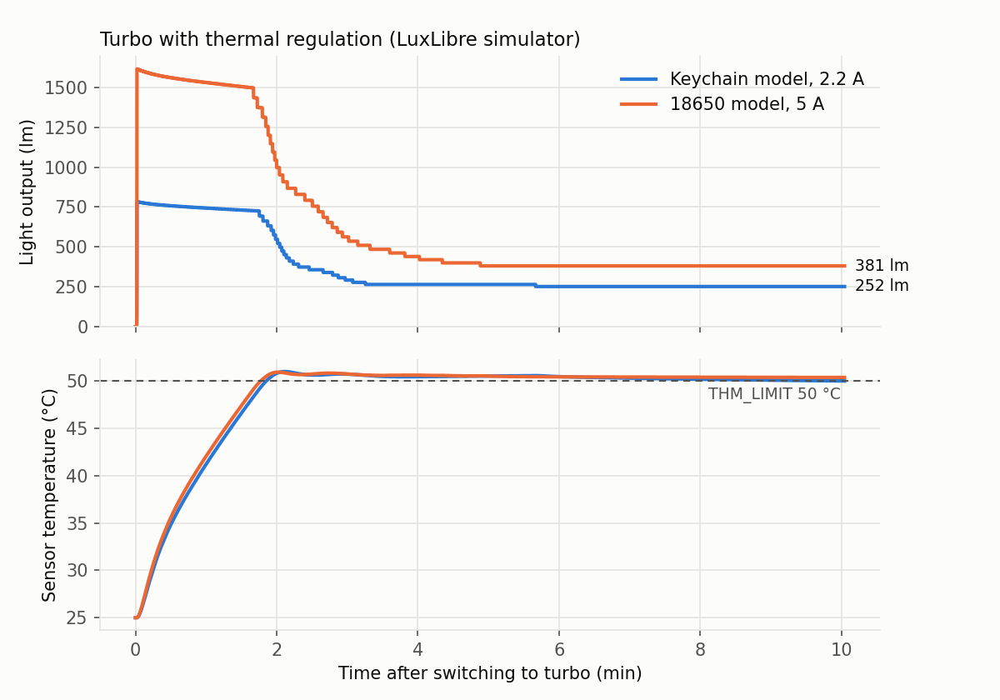

<!-- SPDX-License-Identifier: CC-BY-SA-4.0 -->
# Design rules

These rules apply to any flashlight built with LuxLibre, from a keychain light to a
multi-cell searchlight. Each rule has a stable ID (for example `THM-1`) so that design logs,
reviews, test reports and code comments can point to it.

How to read a rule:

- **Must** rules protect people, cells and the product. Break one only with a written reason
  in the design log ([REQ-3](#req-3)) and a test that shows the risk is handled.
- **Should** rules are good practice. Skipping one is fine when the design log says why.
- **Why** gives the reason and the source. Numbers from standards and datasheets carry a
  link. Numbers marked *LuxLibre rule* or *LuxLibre default* are project choices, made to be
  safe and simple; change them only with data.
- **Check** says how to prove the rule is met. Most checks are procedures in
  [testing.md](testing.md).
- **Firmware** names the LuxLibre parameter or feature that helps (all parameters:
  [firmware/parameters.md](firmware/parameters.md)).

The review checklist [templates/design-review-checklist.md](../templates/design-review-checklist.md)
has one line per rule. Standards and laws change, and this page is not legal advice: check
the current text for the market you sell in.

**Categories:** [REQ](#req--requirements-and-documentation) requirements ·
[BAT](#bat--battery-and-power-path) battery · [CHG](#chg--charging-and-usb) charging ·
[LED](#led--emitters-and-optics) emitters and optics · [DRV](#drv--driver-and-electronics)
driver and electronics · [THM](#thm--thermal) thermal · [MEC](#mec--mechanical) mechanical ·
[FW](#fw--firmware) firmware · [LAS](#las--lasers) lasers ·
[DFM](#dfm--manufacturing-and-cost) manufacturing and cost

---

## REQ – Requirements and documentation

| ID | Rule | Level |
|---|---|---|
| [REQ-1](#req-1) | Write measurable requirements before choosing parts | Must |
| [REQ-2](#req-2) | Rate output the ANSI/PLATO FL 1 way, plus sustained output | Should |
| [REQ-3](#req-3) | Keep a design log of every important decision | Should |
| [REQ-4](#req-4) | Every hardware revision and firmware build has a readable version | Must |
| [REQ-5](#req-5) | Publish complete, editable sources | Must |

### REQ-1

**Rule.** Write the requirements down as numbers before you choose a single part: what the
light is for, size and weight, output (peak, at 30 s, after 10 min), runtime per mode,
battery and charging, user interface, water and drop rating, touch-temperature limit,
colour, safety features, markets, budget per unit and quantity.

**Why.** Every later choice is a trade-off (output against heat, size against runtime, cost
against features). Without targets you cannot judge a trade-off, and "as bright as
possible" ends in a light that overheats in seconds.

**Check.** A filled [templates/requirements.md](../templates/requirements.md) where every
line has a target value and a verification method.

### REQ-2

**Rule.** Publish ratings the way ANSI/PLATO FL 1 measures them: output 30 s to 2 min after
switch-on, runtime from the 30 s value until the output falls to 10 % of it, peak intensity
in candela (cd), beam distance, impact resistance and water resistance. Add the sustained
output after 10 min (LuxLibre rule).

**Why.** FL 1 measures output in an integrating sphere between 30 s and 2 min, computes peak
intensity as cd = lux × d², beam distance as the distance to 0.25 lx (= 2 √cd metres), drops
the light at least 1 m onto concrete 6 times and tests water after the impact
([Lupine](https://www.lupine.de/about_lupine/fl1-standard),
[Streamlight](https://www.streamlight.com/docs/default-source/ansi-documents/ansi-pres.pdf)).
The 2025 edition adds a test for short turbo phases, dust ratings and a stopwatch icon
([Business Wire](https://www.businesswire.com/news/home/20260216389772/en)). A rating at
switch-on hides thermal step-down: in independent measurements, one light claimed 1400 lm
and gave 129 lm at 30 s, another claimed 4000 lm and gave 701 lm at 30 s
([1Lumen](https://1lumen.com)).

**Check.** [testing.md: output and runtime](testing.md#output-and-runtime) and
[intensity and beam distance](testing.md#intensity-and-beam-distance).
[tools/lux_calc.py](../tools/lux_calc.py) `throw` and `runtime` give estimates before you
build.

### REQ-3

**Rule.** Keep a design log: one record per important choice with the question, at least
three options, the criteria, the data with sources, the decision, the reasons, the risks and
how it will be verified.

**Why.** Six months later nobody remembers why a part was chosen. A log stops the team from
repeating old mistakes, lets reviewers check the reasoning, and makes the design
reproducible by others, which is the point of open hardware.

**Check.** [templates/design-log.md](../templates/design-log.md) and
[templates/decision-matrix.md](../templates/decision-matrix.md);
[choosing-parts.md](choosing-parts.md) explains the method.

### REQ-4

**Rule.** Every board revision carries its name and revision on the silkscreen, and every
firmware build reports its version and board name.

**Why.** Test reports, bug reports and spare parts are useless when nobody knows which
version they belong to.

**Check.** Read the silkscreen; on boards with a console, `ver` prints for example
`LuxLibre 0.4.0 / FlashKa Keychain v0.6`.

**Firmware.** `LX_FW_VERSION` (firmware/core/lx_version.h) and `LX_BOARD_NAME` (board header).

### REQ-5

**Rule.** When you distribute a light or a design based on LuxLibre, publish the complete,
editable sources: schematic and PCB sources (not only Gerbers), the BOM with manufacturer
part numbers, mechanical CAD (STEP plus the native files or generator scripts), the
firmware board header and changes, and the test reports.

**Why.** It is what the licences ask for when you share modified versions
([LICENSING.md](../LICENSING.md)), and it is what makes the project useful: the next
designer starts from working, tested files instead of from scratch.

**Check.** A stranger can rebuild the light from the published folder alone. The FlashKa
folder [hardware/flashka-keychain-v05/](../hardware/flashka-keychain-v05/README.md) is the
example.

---

## BAT – Battery and power path

| ID | Rule | Level |
|---|---|---|
| [BAT-1](#bat-1) | Known cells; cell current at most 70 % of the rated maximum | Must |
| [BAT-2](#bat-2) | Prefer standard, user-replaceable cells | Should (Must in the EU from 18 Feb 2027) |
| [BAT-3](#bat-3) | Built-in cells have their own protection circuit | Must |
| [BAT-4](#bat-4) | A reversed cell causes no damage and no output | Must |
| [BAT-5](#bat-5) | Low-voltage protection set for the chemistry | Must |
| [BAT-6](#bat-6) | Standby drain at most 3 % of capacity per month | Should |
| [BAT-7](#bat-7) | Pocket safety: lockout, and a stuck button must not leave the light on | Must |
| [BAT-8](#bat-8) | Contacts and springs carry the turbo current | Should |
| [BAT-9](#bat-9) | Battery voltage measured to 1 % after calibration | Should |

### BAT-1

**Rule.** Use cells from a known maker with a datasheet, and keep the continuous cell current
at or below 70 % of the datasheet's maximum continuous discharge current (LuxLibre rule).

**Why.** The datasheet rating is measured on a fresh cell in good cooling; in a warm
flashlight, with an aged cell, the margin is used up. Ratings differ a lot between cells of
the same size: the Molicel P28A 18650 is rated 35 A
([datasheet](https://www.rosebatteries.com/hubfs/INR18650P28A-V2-80093.pdf)), the Samsung 30Q
18650 15 A ([datasheet](https://e2e.ti.com/cfs-file/__key/communityserver-discussions-components-files/196/samsung_5F00_30q_5F00_data_5F00_sheet.pdf)).
Cells without a maker's datasheet, or "high capacity" claims far above the known cells of
that size, are a sign of a relabelled or fake cell.

**Check.** Cell current in turbo with a clamp meter, or `cell_mA` from the console `status`
command; [tools/lux_calc.py](../tools/lux_calc.py) `cellcurrent` before you build.

**Firmware.** `BAT_MAX_MA` caps the output so that the estimated cell current stays below the
limit (needs the board's LED model: `LX_MAIN_MAX_MA`, `LX_LED_VF0_MV`, `LX_LED_RS_MOHM`,
`LX_DRIVER_EFF_PCT`).

### BAT-2

**Rule.** Prefer standard cell sizes the user can buy and replace (10440, 14500, 18350, 18650,
21700 and others). If a cell must be built in, make it replaceable with common tools: a
connector instead of solder, screws instead of glue.

**Why.** Cells wear out before the rest of the light. In the EU, Regulation (EU) 2023/1542
Article 11 requires, from 18 February 2027, that portable batteries in products are
"readily removable and replaceable by the end user at any time during the lifetime of the
product", with commercially available tools and without heat or solvents. A partial
exemption for products used in wet environments still requires replacement by independent
professionals and written evidence; an IP rating alone is not enough
([Cooley summary of the Commission guidance](https://products.cooley.com/2025/02/13/european-commission-publishes-guidance-on-eu-batteries-regulation-removability-requirements/)).
A "portable battery" in the regulation is a sealed battery of 5 kg or less that is not an
industrial, electric-vehicle, light-means-of-transport or starter battery.

**Check.** Can a user replace the cell with a screwdriver in five minutes, without
soldering, heat or glue? Record the answer in the design log.

### BAT-3

**Rule.** A built-in Li-ion or LiPo cell has a protection circuit for over-charge,
over-discharge, over-current and short circuit, which works even when the firmware does not.

**Why.** Firmware can hang, and a short circuit is faster than any firmware. A protection IC
with two MOSFETs (for example a DW01A with an FS8205A, or an integrated part such as the
XB5333A) cuts the cell off by itself. Typical DW01A thresholds are 4.30 V for over-charge and
2.40 V for over-discharge; check the datasheet of the exact part you buy.
Removable cells: use protected cells, or put the protection on the driver.

**Check.** On the bench, with a current-limited supply in place of the cell: raise and lower
the voltage past the thresholds and short the output through a fuse
([testing.md: battery and charging](testing.md#battery-and-charging)).

### BAT-4

**Rule.** If the user inserts the cells, a reversed cell must not damage anything and must
not switch anything on.

**Why.** Users insert cells the wrong way round, especially in the dark. Without protection
the MCU, the driver and the charger see a negative supply.

**How.** A P-channel MOSFET in the supply path (low loss, good for high currents), a series
Schottky diode for low-current parts of the circuit, or a mechanical guard that only lets the
positive button touch the contact.

**Check.** Reversed supply at cell voltage with a 100 mA limit first, then the real cell
([testing.md: battery and charging](testing.md#battery-and-charging)).

### BAT-5

**Rule.** The firmware protects the cell from deep discharge with settings for its chemistry:
warn and step down first, then switch off, and stay off until the cell is charged or has
recovered.

**Why.** Li-ion cells are damaged by deep discharge; the datasheet cut-off of the P28A and the
30Q is 2.5 V. The voltage under load is lower than the resting voltage, so the warning and
cut-off are set on the loaded voltage with margin, and the light must not restart as soon as
the voltage recovers a little.

**Check.** [testing.md: firmware tests](testing.md#firmware-tests) (bench supply ramped down).

**Firmware.** `LVP_WARN` (default 3200 mV per cell, under load) steps the light down 10 levels
every 5 s; `LVP_CUT` (default 2900 mV) switches off and latches; `LVP_RESUME` (default
3300 mV, resting) or USB power releases the latch. `BAT_CHEM` selects Li-ion, LiFePO4 or NiMH.
Whatever is set, the cut-off never goes below a floor for the chemistry (2700 mV per cell for
Li-ion, 2000 mV for LiFePO4, 900 mV for NiMH; LuxLibre rule), and the warning level is always
at least 200 mV above the cut-off, so the light steps down before it switches off.

### BAT-6

**Rule.** When the light is off, it uses at most 3 % of the cell capacity per month (LuxLibre
rule). With a month of 730 h: at most 33 µA for 800 mAh, 123 µA for 3000 mAh.

**Why.** A light that is empty after a few months in a drawer is not a reliable tool, and a
deeply discharged built-in cell may be damaged. The drain comes from the MCU's sleep mode,
regulator quiescent currents, voltage dividers, the charger and the protection IC. A buck
converter such as the TLV62585 draws 35 µA when it is enabled
([TI](https://www.ti.com/product/TLV62585)), which alone breaks the budget of an 800 mAh
light, so its enable pin must switch it off when the light is off.

**Check.** [testing.md: measuring standby current](testing.md#measuring-standby-current-without-resetting-the-mcu);
[tools/lux_calc.py](../tools/lux_calc.py) `standby`.

**Firmware.** The core sleeps whenever the light is off or locked and idle (`hal::sleep`). The
ports use power-down (ATtiny1616), standby with periodic wake-up (CH32V003) and light sleep
(ESP32-C3). Light sleep on the ESP32-C3 does not meet this rule for small cells yet; see
[ports/esp32c3/README.md](../firmware/ports/esp32c3/README.md).

### BAT-7

**Rule.** The light offers a lockout that survives a reboot and a cell change, and a button
pressed for a long time in a pocket or bag never leaves the light on. Lights with removable
cells should also lock mechanically (a quarter turn of the tail breaks the circuit).

**Why.** A light that switches on in a pocket drains the cell and can get hot enough to damage
fabric or burn skin.

**Check.** [testing.md: firmware tests](testing.md#firmware-tests) (stuck button with a
clothes peg).

**Firmware.** 4 clicks lock and unlock. A button held for 10 s while the light is dark stops
all reactions until it is released. A button held for `POCKET_S` seconds (default 30) while
the main LED is on switches the light off and locks it. `AUTOLOCK` locks after a set time off.

### BAT-8

**Rule.** Springs, contacts and the path through the body carry the turbo current with low
resistance. Above about 3 A, bypass springs with a copper wire or braid, or use solid
contacts (LuxLibre rule of thumb).

**Why.** Steel springs have a resistance of tens of milliohms. At 5 A, 50 mΩ costs 0.25 V of
the cell's voltage and turns 1.25 W into heat in the spring.

**Check.** Measure the voltage at the driver input and at the cell in turbo; the difference
divided by the current is the path resistance.

### BAT-9

**Rule.** The battery voltage measurement is accurate to 1 % after calibration.

**Why.** At 3.0 V, 1 % is 30 mV, which already moves the low-voltage protection and the
battery check noticeably. Resistor dividers with 1 % parts can be off by more than 1 %
together, and MCU references have their own tolerance.

**Check.** Compare `cell_mV` (console `status`) with a good multimeter at two voltages
([testing.md: bring-up](testing.md#bring-up-of-a-new-board)); [tools/lux_calc.py](../tools/lux_calc.py)
`divider` shows the worst-case error of a divider.

**Firmware.** `BAT_CAL` adds a correction in mV. Calibration values survive the factory reset
and firmware updates (they have their own storage block).

---

## CHG – Charging and USB

| ID | Rule | Level |
|---|---|---|
| [CHG-1](#chg-1) | USB-C: one 5.1 kΩ resistor on each CC pin | Must |
| [CHG-2](#chg-2) | CC/CV to 4.20 V ±1 % at no more than the standard charge current | Must |
| [CHG-3](#chg-3) | Charge only inside the cell's temperature window | Must |
| [CHG-4](#chg-4) | Protect VBUS against spikes and faulty chargers | Must |
| [CHG-5](#chg-5) | ESD protection at every exposed conductor | Should |
| [CHG-6](#chg-6) | Show the charge state; limit the light while on USB | Should |

### CHG-1

**Rule.** A USB-C receptacle on a device that only takes power (a sink) has a 5.1 kΩ pull-down
resistor (Rd) on CC1 and another one on CC2. Never share one resistor between both pins.

**Why.** A USB-C charger switches 5 V on only after it sees Rd on a CC pin
([Infineon](https://community.infineon.com/t5/Knowledge-Base-Articles/Termination-Resistors-Required-for-the-USB-Type-C-Connector/ta-p/253544)).
With one shared resistor, the 1 kΩ resistor inside an electronically marked cable appears in
parallel; the charger sees about 836 Ω, decides that an audio adapter is connected and never
switches on. This is what happened with the first Raspberry Pi 4
([Hackaday](https://hackaday.com/2019/07/16/exploring-the-raspberry-pi-4-usb-c-issue-in-depth/)).
USB-A to USB-C cables always supply 5 V, so they hide the mistake.

**Check.** Charge with a C-to-C cable from a USB-C charger, in both plug orientations
([testing.md: battery and charging](testing.md#battery-and-charging)).

### CHG-2

**Rule.** Li-ion and LiPo cells are charged with constant current, then constant voltage
(CC/CV) to 4.20 V ±1 %, at no more than the standard charge current in the cell's datasheet
(LuxLibre rule; datasheets often allow more, up to their maximum charge current; other
chemistries: follow the datasheet).

**Why.** Over-voltage ages the cell quickly and is a fire risk; a charge current above the
standard value also ages it faster. Examples: Samsung 30Q 4.20 ± 0.05 V, standard charge
1.5 A; Molicel P28A standard charge 2.8 A (datasheets linked in [BAT-1](#bat-1)). Small
pouch cells often allow much less; read their datasheet.

**Check.** End-of-charge voltage at the cell terminals and the charge current over time
([testing.md: battery and charging](testing.md#battery-and-charging)).

### CHG-3

**Rule.** Charging happens only while the cell temperature is inside its charge window
(LuxLibre default 0-45 °C).

**Why.** Charging Li-ion below 0 °C plates lithium metal on the anode, which damages the cell
and can cause internal shorts. Datasheet windows differ: Molicel P28A 0-60 °C, Samsung 30Q
0-50 °C (datasheets in [BAT-1](#bat-1)). The default is inside both.

**Check.** Move the limits towards room temperature and warm or cool the light
([testing.md: battery and charging](testing.md#battery-and-charging)).

**Firmware.** `CHG_TMIN` (0-20 °C) and `CHG_TMAX` (30-50 °C) gate the charger through
`hal::set_charge(enable, allowed)`; with a broken temperature sensor there is no charging at
all. While charging is not allowed, a port must not let any current into the cell, not even
to detect USB power. If the charger IC has its own NTC input, use it as well.

### CHG-4

**Rule.** The USB input survives hot-plug spikes and a wrong or faulty charger: a TVS diode on
VBUS and, for products, a charger or input stage with over-voltage protection.

**Why.** Many small linear chargers have an absolute maximum input of only 6.5 V (for example
the TP4057), so a spike or a faulty supply destroys them. Parts with a high input rating exist:
the BQ24075 power-path charger tolerates 28 V.

**Check.** Datasheet review of the input path; plug and unplug many times while watching VBUS
with an oscilloscope if you have one.

### CHG-5

**Rule.** Every conductor a user can touch is protected against electrostatic discharge: USB-C
pins, the button, a metal body that connects to the circuit.

**Why.** A spark from a finger can reach several kilovolts and destroys MCU pins. A low-
capacitance ESD diode array next to the connector costs cents. The test levels for products
come from the EMC standard of your market (IEC 61000-4-2 describes the method).

**Check.** Schematic review: one ESD diode per exposed line, placed at the connector.

### CHG-6

**Rule.** The user can see that the light is charging and when it is full, and the main LED is
limited while USB power is connected.

**Why.** The charger and the LED heat the same small body; charging a hot cell ages it, and a
light running on turbo while charging can exceed the charge temperature window.

**Firmware.** The indicator LED shows charging (`STATUS_CHARGING`) and charged
(`STATUS_CHARGED`); `CHG_MAXLVL` caps the level while USB is present.

---

## LED – Emitters and optics

| ID | Rule | Level |
|---|---|---|
| [LED-1](#led-1) | Choose the emitter by the beam you need | Should |
| [LED-2](#led-2) | At most 80 % of the LED's maximum current; rate flux at 85 °C | Should |
| [LED-3](#led-3) | LED on a direct-thermal-path copper board | Should |
| [LED-4](#led-4) | Specify colour temperature, CRI and R9 | Should |
| [LED-5](#led-5) | Assess photobiological safety; warn and label | Must |
| [LED-6](#led-6) | No visible flicker | Must |
| [LED-7](#led-7) | The lowest mode is stable and repeatable | Should |
| [LED-8](#led-8) | Protect the emitter and the optic | Should |

### LED-1

**Rule.** Pick the emitter from the beam the requirements ask for. For throw (high candela)
use a small emitting area with high luminance; for flood use a large or multi-die emitter.

**Why.** With a given optic, peak intensity grows with the luminance of the source
(lumens per emitting area), not with the total lumens. Luminus describes the SFT-40 as a
"narrow beam angle, long beam distance" part
([datasheet](https://download.luminus.com/datasheets/Luminus_SFT-40-WExx_Gen2_Datasheet.pdf));
the ams OSRAM KW CSLNM1.TG has an emitting area of only 0.96 × 0.96 mm². Flood emitters such
as the Cree XHP50.3 HI (5 × 5 mm) give many lumens over a wide angle
([datasheet](https://downloads.cree-led.com/files/ds/x/XLamp-XHP50.3.pdf)).

**Check.** [tools/lux_calc.py](../tools/lux_calc.py) `throw --lumens --die-mm2 --optic-mm`
gives an upper bound for the intensity; [choosing-parts.md](choosing-parts.md#leds) compares
emitters.

### LED-2

**Rule.** Drive the LED at no more than 80 % of its datasheet maximum current (LuxLibre rule),
and use the flux at a junction temperature of 85 °C, not 25 °C, for your estimates.

**Why.** The maximum current is an absolute limit at a defined temperature; a hot flashlight
head is not that. Efficacy also falls with current and temperature, so the last 20 % of
current gives much less than 20 % more light and a lot more heat. Maxima vary: SST-20 3 A,
SST-40 6 A, SFT-40 8 A, Nichia 519A 2.2 A, Samsung LH351D 3 A, XHP50.3 HI 3 A in the 6 V
configuration (datasheets linked in [choosing-parts.md](choosing-parts.md#leds)). Luminus bins
its flux at 85 °C; some makers state 25 °C pulsed values, which are higher than anything a
flashlight reaches.

**Check.** LED current per level ([testing.md: bring-up](testing.md#bring-up-of-a-new-board)).

**Firmware.** The board header sets the current at level 150 (`LX_MAIN_MAX_MA`): make that
full-scale current at most 80 % of the LED's maximum, so that no setting can exceed it. Use
`RAMP_CEIL` and `TURBO_LVL` for the user-facing levels below it.

### LED-3

**Rule.** Mount the LED on a copper board with a direct thermal path (DTP: the LED's thermal
pad is soldered straight to the copper core, not through a dielectric layer), and give that
board a short, solid path into the housing.

**Why.** At several watts in a few square millimetres, every thermal resistance between the
LED and the air raises the junction temperature, which lowers the light output and the life.
An aluminium board with a dielectric layer can add several kelvin per watt.

**Check.** Solder voids and thermal paste: inspect, and compare the LED board temperature with
the head temperature in a long test.

### LED-4

**Rule.** The requirement sheet specifies the colour: correlated colour temperature (CCT) and
colour rendering (CRI, and R9 for reds). LuxLibre suggests 4000-5000 K and CRI 90 or more for
everyday-carry lights.

**Why.** High-CRI versions cost some efficacy and sometimes current: the Luminus SST-20 in its
CRI 95 version is limited to 2 A instead of 3 A
([datasheet](https://mm.digikey.com/Volume0/opasdata/d220001/medias/docus/5344/SST-20-W_Rev09_7-6-20.pdf)).
The Nichia 519A is offered with Ra 70, 80 and 90 (R9 ≥ 80 in the Ra 90 version)
([datasheet](https://www.ledrise.eu/amfile/file/download/file/10835/product/11566/)). Whether
that trade is worth it depends on the use: colour matters for first aid, wiring, cooking and
nature; it matters less for a searchlight.

**Check.** The LED bin code on the order matches the requirement.

### LED-5

**Rule.** Assess the photobiological safety of the light (IEC 62471), give the eye warning that
fits the result, and do the same for UV and IR emitters.

**Why.** IEC 62471 sorts sources by blue-light hazard: Exempt (no hazard in 10 000 s), RG1
(100 s), RG2 (0.25 s, protected by the aversion reflex) and RG3 (hazardous even briefly).
Flashlights are assessed at 200 mm; above RG1 at that distance, the hazard distance is marked
(IEC TR 62778); IEC 62471-7:2023 is the newer part for products emitting visible light
(secondary source; check the standard text). The optic concentrates the beam, so a thrower can
fall into a higher group than its LED.

**Check.** [testing.md: optical safety](testing.md#optical-safety). Without a lab: use the LED
maker's photobiological data, label high-intensity lights "do not stare into the beam", and
never claim a risk group you have not measured.

### LED-6

**Rule.** No visible flicker at any level: drive the LED with constant current, or with PWM at
3 kHz or more, and stay inside the no-observable-effect region of IEEE 1789 (LuxLibre rule).

**Why.** IEEE 1789-2015 recommends, for no observable effect, a modulation depth
Mod% = 100 (Lmax - Lmin)/(Lmax + Lmin) below 0.01 × f under 90 Hz and below 0.0333 × f from 90
to 3000 Hz, with no limit from 3000 Hz
([standard copy](https://lee.org/flicker/wp-content/uploads/2024/12/IEEE-2015-STANDARDS-1789-Standard-Free-Download.pdf)).
IEEE has listed the standard as inactive since 26 March 2026
([IEEE](https://standards.ieee.org/ieee/1789/4479/)), but it is still the common reference.
Flicker causes headaches, makes moving things appear to stop (dangerous near machines) and
shows as stripes in videos.

**Check.** [testing.md: flicker](testing.md#flicker), at the lowest, a middle and the highest
level and during thermal regulation.

**Firmware.** The ports run PWM at 9.8 kHz (ATtiny1616), 23 kHz (CH32V003) and 9.77 kHz
(ESP32-C3, filtered to a DC current set point on the FlashKa). The thermal regulator has a
test that fails if the level oscillates ([FW-4](#fw-4)).

### LED-7

**Rule.** The lowest mode (moon) is stable, flicker-free and the same from unit to unit.

**Why.** A moon mode is used for long periods in the dark; at very low currents, PWM duty
cycles of a few counts and driver offsets make it unstable. A current-controlled low range, or
a filtered set point as on the FlashKa, is better than switching a FET.

**Check.** Measure the moon current on several units; film it with a phone camera.

**Firmware.** `LX_OUT_MIN_Q16` in the board header sets the output of level 1 (the lowest
setting that is still stable on that hardware); `RAMP_FLOOR` sets the user's moon level.

### LED-8

**Rule.** The emitter sits behind a lens (glass with anti-reflection coating, or polycarbonate)
and is centred in its optic by a gasket or the optic itself; nothing presses on the LED dome.

**Why.** Dust and fingerprints on the optic lower the output; a pressed or scratched dome
changes the beam and can damage the bond wires; an off-centre LED makes a crooked hotspot.

**Check.** Visual inspection of the beam on a white wall; drop test ([MEC-3](#mec-3)).

---

## DRV – Driver and electronics

| ID | Rule | Level |
|---|---|---|
| [DRV-1](#drv-1) | Pick the driver topology from cell and LED voltages | Should |
| [DRV-2](#drv-2) | Regulate LED current with a sense resistor and a closed loop | Should |
| [DRV-3](#drv-3) | Check efficiency and quiescent current | Should |
| [DRV-4](#drv-4) | Derate MLCCs for DC bias | Must |
| [DRV-5](#drv-5) | Size copper for the current | Must |
| [DRV-6](#drv-6) | Tight power loop, Kelvin sense, quiet analog traces | Should |
| [DRV-7](#drv-7) | Every light and laser output is off by default | Must |
| [DRV-8](#drv-8) | Watchdog and brown-out detection on | Must |
| [DRV-9](#drv-9) | Programming and test access | Should |

### DRV-1

**Rule.** Choose the driver topology by comparing the cell voltage over the whole discharge
with the LED's forward voltage at the planned current.

**Why.** A single Li-ion cell runs from 4.2 V down to about 3.0 V; a white LED needs roughly
2.7-3.2 V depending on current and temperature. That overlap decides everything:

| Topology | How it works | Good for | Weak points |
|---|---|---|---|
| FET direct drive | The cell drives the LED through a switch, brightness by PWM | Maximum output, cheapest | Output falls with the cell voltage; no current control; PWM at low levels |
| Linear regulator | A transistor burns the extra voltage (for example AMC7135: 340-380 mA each, 120 mV dropout) | Simple, regulated while the cell is above Vf + dropout | Efficiency = Vf / Vcell, poor on a full cell |
| Buck (step-down) | Switching regulator, output below input (for example TLV62585: 2.5-5.5 V in, 3 A, 100 % duty) | Efficient on one Li-ion cell with a white LED | Falls out of regulation when the cell nears Vf |
| Boost (step-up) | Output above input (for example TPS61088, TPS61288; MP3429) | 6 V or 12 V LEDs (XHP50.3 6 V) from one or two cells | Higher currents on the cell side; inductor size |
| Buck-boost | Up or down as needed (TPS63020, TPS63802) | Constant output over the whole discharge | More complex; current limited to a few amps |

Part data: [TLV62585](https://www.ti.com/product/TLV62585),
[TPS63020](https://ti.com/product/TPS63020); others from their datasheets, summarised in
[choosing-parts.md](choosing-parts.md#drivers).

**Check.** A decision matrix ([templates/decision-matrix.md](../templates/decision-matrix.md)
has this exact example) and a plot of Vcell against Vf over the discharge.

### DRV-2

**Rule.** Regulate the LED current, not the voltage: a low-value sense resistor in series with
the LED, measured by the regulator or an amplifier, closes the loop. Specify the accuracy at
the lowest and the highest level.

**Why.** An LED's forward voltage changes with temperature and from part to part; a fixed
voltage gives an unpredictable current. The FlashKa adds a current loop to its buck converter
with an op-amp (TLV333) and a 20 mΩ sense resistor
([board header](../firmware/boards/flashka-keychain-v05/board.h)).

**Check.** LED current per level against the board header's model
([testing.md: bring-up](testing.md#bring-up-of-a-new-board)).

### DRV-3

**Rule.** Calculate and then measure the efficiency in the modes people use most (not only in
turbo), and add up every quiescent current against [BAT-6](#bat-6).

**Why.** Runtime in the middle modes decides how the light feels every day. A regulator that is
efficient at 3 A can waste most of the power at 30 mA.

**Check.** Input power against LED power at three levels; standby current measurement.

### DRV-4

**Rule.** Choose ceramic capacitors (MLCCs) by their effective capacitance at the working
voltage: a voltage rating at least twice the working voltage and a large enough case, checked
against the maker's DC-bias curve (LuxLibre rule).

**Why.** Class 2 ceramics (X5R, X7R) lose capacitance with DC voltage. A 10 µF 6.3 V X5R in
0603 keeps only about half its value at 3.3 V
([TI](https://www.ti.com/document-viewer/lit/html/SLAAEI3/GUID-F4E3369C-1D27-4872-93EB-A93FB10F2CE3)),
a 10 µF 6.3 V X5R in 0805 loses about 60 % at 5 V
([EPCI](https://passive-components.eu/high-cv-mlcc-dc-bias-and-ageing-capacitance-loss-explained-2/)).
Regulators can become unstable when their capacitors are smaller than the datasheet assumes.

**Check.** For every regulator's input and output capacitor: datasheet minimum against the
effective value from the capacitor maker's online tool.

### DRV-5

**Rule.** Size traces, pours and vias for the current they carry. IPC-2221, 1 oz outer copper,
10 °C rise: 0.30 mm for 1 A, 1.37 mm for 3 A, 2.77 mm for 5 A.

**Why.** Narrow traces heat up and drop voltage. Values from the IPC-2221 formula
([Farnell calculator](https://uk.farnell.com/pcb-trace-width)). Inner layers cool worse and
need about 2.6 times the width: 0.78 mm for 1 A, 3.56 mm for 3 A, 7.19 mm for 5 A (1 oz,
10 °C, same formula). IPC-2152 is the newer, more detailed method.

**Check.** [tools/lux_calc.py](../tools/lux_calc.py) `trace`; review the high-current path from
cell to LED including vias (use several vias in parallel).

### DRV-6

**Rule.** Keep the switching loop of a converter small (input capacitor right at the IC's power
and ground pins), connect the sense resistor with separate Kelvin traces from its pads, and
route feedback and ADC traces away from the switch node and the inductor.

**Why.** Loop area radiates noise and causes voltage spikes; a sense trace that shares current
with the power path measures the trace instead of the resistor; noise on ADC lines becomes
battery and temperature errors.

**Check.** Layout review against the regulator datasheet's layout example.

### DRV-7

**Rule.** Every output that can emit light (main LED driver enable, PWM, laser) is off by
default: a pull-down (or pull-up, for active-low parts) holds it off while the MCU is in reset,
unprogrammed or starting.

**Why.** MCU pins are inputs (floating) during reset and programming. A floating driver enable
can switch on a laser or a 10 W LED. The FlashKa has 100 kΩ pull-downs on the LED enable and
laser pins.

**Check.** [testing.md: bring-up](testing.md#bring-up-of-a-new-board), default-off check with a
blank MCU and in reset.

**Firmware.** `hal::init()` switches the outputs off before anything else ([FW-1](#fw-1)).

### DRV-8

**Rule.** The MCU's watchdog and brown-out detector are enabled, and a firmware hang ends with a
reset to the off state.

**Why.** A hang with the LED on at high power is a heat and safety problem; a brown-out on a
weak cell can corrupt memory and execution.

**Check.** Console `wdtest` ([testing.md: firmware tests](testing.md#firmware-tests)); the
brown-out setting of each chip in its port documentation.

**Firmware.** The ports enable the watchdog: 1 s (ATtiny1616), 4 s (CH32V003), 3 s task
watchdog with panic reset (ESP32-C3). The core feeds it once per 10 ms tick. Brown-out: on the
ATtiny1616 only a fuse can enable it (`make tiny1616-fuses`, 2.6 V; the factory setting is
off); the CH32V003 relies on its built-in power-on and power-down reset; the ESP32-C3 port
enables ESP-IDF's brown-out detector.

### DRV-9

**Rule.** The board has programming access (UPDI pad for the ATtiny1616, SWIO pad for the
CH32V003, USB for the ESP32-C3) and test points for the cell voltage, the LED current (sense
resistor) and ground.

**Why.** Boards that cannot be measured cannot be debugged, and boards that cannot be
reprogrammed after assembly cannot be fixed.

**Check.** The test points appear on the assembly drawing and are reachable with the board in
its housing or in a simple jig.

---

## THM – Thermal

| ID | Rule | Level |
|---|---|---|
| [THM-1](#thm-1) | Touchable surface at most 48 °C continuous, never above 51 °C | Must |
| [THM-2](#thm-2) | Estimate the sustainable heat from the outer surface | Should |
| [THM-3](#thm-3) | Estimate the turbo time from the thermal mass | Should |
| [THM-4](#thm-4) | Sensor close to the heat, calibrated | Must |
| [THM-5](#thm-5) | Active thermal regulation, not only a timer | Must |
| [THM-6](#thm-6) | Verify with a 10-minute test per mode and a turbo test | Must |

### THM-1

**Rule.** The hottest surface a user touches stays at or below 48 °C in continuous use and
never goes above 51 °C, including the overshoot after turbo (metal surfaces).

**Why.** ISO 13732-1 gives the burn thresholds for contact with hot surfaces:

| Contact time | Metal | Plastic |
|---|---|---|
| 1 s | 65 °C | 85 °C |
| 10 s | 55 °C | 70 °C |
| 1 min | 51 °C | 60 °C |
| 10 min | 48 °C | 48 °C |
| 8 h | 43 °C | 43 °C |

Sources: 1 min to 8 h from CENELEC Guide 29
([CENELEC](https://boss.cenelec.eu/media/Guides/CLC/29_cenelecguide29.pdf)); 1 s and 10 s from
EN 13202 via IEEE PSTC
([slides](https://ewh.ieee.org/r4/chicago/pstc/content/Accessible-hot-surfaces-and-burn-hazards.pdf)).
A flashlight is held for minutes, so the 10-minute value sets the continuous limit and the
1-minute value the short peak. Plastic housings may run hotter for short contact, but the
continuous limit is the same.

**Check.** [THM-6](#thm-6).

**Firmware.** `THM_LIMIT` is the temperature the regulator holds at the sensor. The sensor sits
inside, near the LED, and reads hotter than the outer surface; set `THM_LIMIT` = 48 °C + the
measured sensor-to-surface difference ([testing.md: thermal](testing.md#thermal-and-touch-temperature)).

### THM-2

**Rule.** Before choosing the LED current, estimate how much heat the housing can lose
continuously: P = h × A × ΔT, with A the outer surface, ΔT the allowed rise above ambient
(48 - 25 = 23 K) and h ≈ 11 W/m²K for anodised aluminium or 6.5 W/m²K for bare aluminium in
still air.

**Why.** In still air, free convection gives 2-25 W/m²K
([typical values](https://pages.mtu.edu/~fmorriso/cm3120/typical_values_heat_transfer_coefficient.pdf))
and radiation about 5-6 W/m²K at around 50 °C for a high-emissivity surface
([Electronics Cooling](https://www.electronics-cooling.com/2001/02/dont-underestimate-radiation-in-electronic-cooling/)).
For a 25 mm cylinder at 45 °C in 25 °C air this adds up to about 11 W/m²K anodised and
6.5 W/m²K bare (derived). An 18650 light of 25 × 120 mm (about 104 cm²) can therefore lose
about 2.6 W at a 23 K rise: that is the sustained heat budget, whatever the turbo rating.

**Check.** [tools/lux_calc.py](../tools/lux_calc.py) `thermal`; the simulator
([firmware/simulator.md](firmware/simulator.md)) shows the same effect over time.

### THM-3

**Rule.** Estimate how long turbo can run from the thermal mass, and state that time honestly
in the specification.

**Why.** Until the heat reaches the surface, the metal stores it: t ≈ m × c × ΔT / P for the
first estimate (aluminium c ≈ 0.90 J/gK). A 30 g aluminium body taking 6 W heats by 25 K in
about two minutes. The lumped model in `lux_calc.py thermal --mass-g --heat-w` includes the
losses. Turbo ratings that ignore this are the reason for the large differences between
claimed and measured 30-second output ([REQ-2](#req-2)).

**Check.** Measured turbo time against the estimate ([THM-6](#thm-6)).

**Firmware.** `TURBO_S` (turbo timer) and `TURBO_DOWN` (level after the timer) give a second
limit next to the thermal regulator.

### THM-4

**Rule.** Place the temperature sensor where it sees the heat quickly (close to the LED board
or the driver, with a good thermal path to the housing), and calibrate it.

**Why.** A sensor that lags behind the LED lets the head overshoot. NTC thermistors next to the
heat source are the best option; an MCU's internal sensor is acceptable when the MCU sits on
the LED board or the driver. Both need a calibration offset.

**Check.** Calibrate at room temperature after the light has rested for an hour
([testing.md: thermal](testing.md#thermal-and-touch-temperature)).

**Firmware.** `THM_OFFSET` corrects the sensor reading (kept by the factory reset).
[firmware/hal/lx_ntc.h](../firmware/hal/lx_ntc.h) converts NTC readings with a table computed at
compile time; [tools/lux_calc.py](../tools/lux_calc.py) `ntc` shows the resolution per ADC step.

### THM-5

**Rule.** The firmware regulates the output by temperature. A timer alone is not enough, and the
regulation must not be visible as flicker or jumps.

**Why.** Ambient temperature, wind, a hand or a glove change the cooling by a factor of two or
more; only a temperature measurement handles that. Sudden big steps annoy users and hide
the real sustained output.

**Firmware.** LuxLibre runs a PI regulator on a predicted temperature (reading + rate of rise ×
`THM_LEAD`). The output has hysteresis, and after a change it does not move back the other way
for 5 s (unless it is more than 2 °C too hot), so a noisy or coarse sensor cannot make the level
flip. `THM_FLOOR` is the lowest level it may force, `THM_UP` limits the recovery speed, and
`THM_SHUTDN` switches the light off as a last resort (and refuses to switch on until 5 °C
cooler). A broken sensor limits the light to `THM_FLOOR`.

<picture>
  <source media="(prefers-color-scheme: dark)" srcset="img/thermal-regulation-dark.png">
  
</picture>

**Check.** The simulator test `thermal_regulation_does_not_flicker`, and [THM-6](#thm-6).

### THM-6

**Rule.** Verify the thermal design with a 10-minute test in each mode and a turbo test until the
output is regulated, at 25 °C in still air, with a thermocouple on the hottest touchable point.

**Why.** Models ([THM-2](#thm-2), [THM-3](#thm-3)) are estimates; the real housing, contact
resistances and the hand decide.

**Check.** [testing.md: thermal and touch temperature](testing.md#thermal-and-touch-temperature);
results in [templates/test-report.md](../templates/test-report.md).

---

## MEC – Mechanical

| ID | Rule | Level |
|---|---|---|
| [MEC-1](#mec-1) | Aluminium above about 1 W sustained | Should |
| [MEC-2](#mec-2) | Designed O-ring glands, sealed switch and USB; verify IPX7/IPX8 | Should |
| [MEC-3](#mec-3) | Survive 1 m drops onto concrete | Should |
| [MEC-4](#mec-4) | Threads with enough engagement; lubricated O-rings | Should |
| [MEC-5](#mec-5) | Bare contact surfaces where current flows through the body | Should |
| [MEC-6](#mec-6) | Button protected against accidental presses | Should |
| [MEC-7](#mec-7) | Strong attachment points, no sharp edges | Should |
| [MEC-8](#mec-8) | Follow the machine shop's rules; drawings with tolerances | Should |

### MEC-1

**Rule.** Use aluminium (6061-T6 or a similar alloy) for lights that dissipate more than about
1 W continuously (LuxLibre rule of thumb). Titanium, stainless steel and plastic housings need
a lower sustained output rating.

**Why.** The housing spreads heat from the head to the whole surface. Aluminium alloys conduct
about 150-200 W/mK, copper about 400 W/mK, austenitic stainless steel about 15-16 W/mK
([Cooltec](https://cooltec.de/en/wissen/waermeleitfaehigkeit/)) and Ti-6Al-4V about
6.7-7.5 W/mK ([Wikipedia](https://en.wikipedia.org/wiki/Ti-6Al-4V)). A titanium head gets hot
near the LED while the tail stays cool, so less of its surface works for [THM-2](#thm-2).
Hard anodising also raises the emissivity of aluminium, which helps radiation.

**Check.** Thermal test ([THM-6](#thm-6)): look at the temperature difference between head and
tail.

### MEC-2

**Rule.** Seal the light with O-rings in glands dimensioned from the O-ring maker's tables, a
sealed switch boot, and a sealed USB receptacle or a cover; verify the IP rating you claim.

**Why.** IEC 60529: IPX7 is 30 minutes with the lowest point 1 m below the surface; IPX8 is
harsher, on the maker's terms ([IP code](https://en.wikipedia.org/wiki/IP_code)). FL 1 tests
water resistance after the drop test, because impacts open seals
([Lupine](https://www.lupine.de/about_lupine/fl1-standard)). A gland that is too shallow
crushes the O-ring; one that is too deep does not seal.

**Check.** [testing.md: durability](testing.md#durability).

### MEC-3

**Rule.** The light survives 1 m drops onto concrete (6 drops) and still works: heavy parts are
supported, boards are fixed, ceramic capacitors stay away from board edges and screw holes.

**Why.** FL 1 requires at least 1 m onto concrete, 6 drops, no cracks and full function
([Lupine](https://www.lupine.de/about_lupine/fl1-standard)). Ceramic capacitors crack when the
board flexes, and a cracked capacitor can short the cell.

**Check.** [testing.md: durability](testing.md#durability).

### MEC-4

**Rule.** Threads have enough engagement for the material and the expected number of cycles;
O-rings are lubricated with a lubricant compatible with their material.

**Why.** Battery tubes are opened hundreds of times. Anodised threads do not conduct, which
allows a mechanical lockout by a quarter turn ([BAT-7](#bat-7)) when the electrical path goes
through bare contact faces instead.

**Check.** Open and close 100 times; inspect the threads and O-rings.

### MEC-5

**Rule.** Where the current flows through the body, the contact faces are bare (masked during
anodising or machined afterwards) and large enough for the current.

**Why.** Anodising is an electrical insulator; a contact that relies on scratching through it is
unreliable and gets hot at high current ([BAT-8](#bat-8)).

**Check.** Resistance of the body path at turbo current (voltage drop / current).

### MEC-6

**Rule.** The button is shrouded or recessed so that it is not pressed by accident, gives a
clear click, and is rated for the presses it will see.

**Why.** Most unwanted activations come from a protruding button. The electronic lockout
([BAT-7](#bat-7)) is the second line of defence, not the first.

**Check.** Pocket test: carry the light locked and unlocked for a week; review the switch
datasheet's life rating.

### MEC-7

**Rule.** Clip, lanyard and keyring attachments are checked for strength, and no edge can cut a
finger or a pocket.

**Why.** A keychain light hangs its whole weight, plus the keys' jerk, on a small loop. A clip
that bends open loses the light.

**Check.** Pull test with a spring scale; run a finger over every edge.

### MEC-8

**Rule.** Follow the machine shop's design rules (minimum wall, inner radii, thread forms) and
send 2D drawings with tolerances for every fit that matters (O-ring glands, bores, threads).

**Why.** A 3D file alone leaves the critical dimensions to chance; shops machine to the
drawing.

**Check.** Drawing review before ordering; measure the first parts. The FlashKa drawings are in
[hardware/flashka-keychain-v05/](../hardware/flashka-keychain-v05/README.md).

---

## FW – Firmware

These rules apply to lights that run LuxLibre firmware ([firmware/README.md](firmware/README.md)).

| ID | Rule | Level |
|---|---|---|
| [FW-1](#fw-1) | Power-up is dark and safe | Must |
| [FW-2](#fw-2) | Every board has its own header with measured limits | Must |
| [FW-3](#fw-3) | Keep the common LuxLibre button grammar | Should |
| [FW-4](#fw-4) | No visible flicker from the firmware | Must |
| [FW-5](#fw-5) | Protections stay on; ranges bound every setting | Must |
| [FW-6](#fw-6) | Lockout survives reboots; a stuck button goes dark | Must |
| [FW-7](#fw-7) | Settings stored with checksums | Must |
| [FW-8](#fw-8) | Every change passes `make test`; every release has a test report | Must |

### FW-1

**Rule.** After power-up or reset the light is dark: outputs are switched off first, settings
are loaded and checked, and only a user action switches anything on.

**Why.** A light that flashes when a cell is inserted can dazzle the user; a laser must never
emit by itself.

**Firmware.** `light::init()` calls `hal::init()` first; every port sets its outputs off before
the clocks and peripherals ([DRV-7](#drv-7)).

### FW-2

**Rule.** Every board has its own board header (`firmware/boards/<name>/board.h`) with values
measured on that board: LED current at level 150, lowest stable output, LED and driver model,
cell current limit, thermal limit, low-voltage thresholds. Never ship a product with the
example values.

**Why.** The firmware protects the cell, the LED and the user only as well as its numbers are
true.

**Check.** The board header cites the test report its values come from; review against the
datasheets. [firmware/porting.md](firmware/porting.md) explains every field.

### FW-3

**Rule.** Keep the common LuxLibre gestures: 1 click on/off, hold to ramp or change mode, 2
clicks turbo, 3 clicks battery check, 4 clicks lockout, 9 clicks factory reset.

**Why.** People who know one LuxLibre light can use all of them, and safety functions such as
lockout are found without the manual. Boards may change the layout (`UI_STYLE`) and defaults,
but should not reassign these gestures.

**Firmware.** [firmware/user-interface.md](firmware/user-interface.md) lists every gesture per
layout.

### FW-4

**Rule.** Nothing in the firmware may cause visible flicker: PWM at 3 kHz or more (or a DC set
point), no oscillating regulators, smooth level changes.

**Why.** See [LED-6](#led-6).

**Check.** `make test` includes `thermal_regulation_does_not_flicker` (noisy 1 °C sensor, a step
up must never follow a step down within 5 s) and `thermal_regulation_calm_at_parameter_limits`;
measure on the board as in [testing.md: flicker](testing.md#flicker).

### FW-5

**Rule.** Users and apps cannot switch off the core protections: thermal regulation and
shutdown, the low-voltage cut-off, the charge temperature window and the laser limits. Every
parameter has a range, and the factory reset restores the board's defaults. Convenience limits
that may be relaxed by a user (`TURBO_S`, `POCKET_S`, `AUTOLOCK`, and the cell current limit
`BAT_MAX_MA`, each 0 = off) must have safe board defaults.

**Why.** Settings are changed by people who do not know the cell or the thermal design.
Examples of LuxLibre ranges: `THM_LIMIT` 30-70 °C (and never above `THM_SHUTDN` - 5 °C),
`THM_SHUTDN` 40-100 °C, `THM_KP` 10-20 and `THM_KI` 1-12 (the regulator cannot be switched
off, and the gains are limited to values tested not to oscillate), `CHG_TMIN` 0-20 °C,
`CHG_TMAX` 30-50 °C, and a
low-voltage floor per chemistry ([BAT-5](#bat-5)). A product that needs narrower limits sets
them in its board header defaults and documents them.

**Check.** `set` with an out-of-range value returns `err range`; [firmware/parameters.md](firmware/parameters.md)
lists every range.

### FW-6

**Rule.** The lockout state is stored and restored after a reboot or a cell change; a button
held down in lockout leaves the light dark.

**Why.** See [BAT-7](#bat-7).

**Check.** Simulator tests `lockout_survives_reboot`, `stuck_button_in_lockout_goes_dark` and
`stuck_button_while_on_switches_off_and_locks`.

### FW-7

**Rule.** Settings are stored with a checksum and a layout check; corrupt or foreign data falls
back to defaults.

**Why.** EEPROM and flash writes can be interrupted by a cell being removed. Loading half-written
data could set a limit to a dangerous value.

**Firmware.** Parameter block with CRC-16 and a hash of the parameter list, calibration block
with CRC-16, state ring with CRC-8 per slot, and a range check of every value
([firmware/core/lx_storage.h](../firmware/core/lx_storage.h)).

### FW-8

**Rule.** Every firmware change passes `make test` (unit and behaviour tests in the simulator,
run by CI), and every board release has a hardware test report.

**Why.** A change that fixes one gesture can break the lockout. The simulator catches most of
that in seconds; the hardware report catches the rest.

**Check.** CI status on the pull request; [templates/test-report.md](../templates/test-report.md).

---

## LAS – Lasers

| ID | Rule | Level |
|---|---|---|
| [LAS-1](#las-1) | Class 1 or Class 2 visible lasers only | Must |
| [LAS-2](#las-2) | Hardware interlock, deliberate activation, emission indicator | Must |
| [LAS-3](#las-3) | Measure the real output; label the class | Must |

### LAS-1

**Rule.** Use only Class 1 or Class 2 lasers (visible, at most 1 mW continuous). Products that
appeal to children use Class 1 only.

**Why.** IEC 60825-1 sets Class 2 at 1 mW for visible continuous lasers and Class 3R at 5 mW.
EN 50689:2021 allows only Class 1, Class 2 or a restricted Class 3R in consumer products, and
only Class 1 in products that appeal to children
([UK government](https://www.gov.uk/government/publications/laser-radiation-safety-advice/laser-radiation-safety-advice),
[UL](https://www.ul.com/insights/understand-new-laser-product-safety-standards-europe)). Many
cheap modules are stronger than their label.

**Check.** [LAS-3](#las-3).

### LAS-2

**Rule.** The laser has a hardware interlock (a switch the user arms) in series with the firmware
control, needs a deliberate gesture, and shows that it is emitting.

**Why.** A firmware fault alone must not be able to fire the laser. The FlashKa has a slide
switch (S2) in the laser supply.

**Firmware.** The laser needs `LASER_EN` = 1 and a click followed by click-and-hold from off; it
is refused in lockout, above `LASER_TMAX`, below `LASER_VMIN` and with a broken temperature
sensor, and stops after `LASER_S`. With `LASER_EN` = 1 a refused laser stays dark (no fallback to
the main LED); with `LASER_EN` = 0 the gesture gives momentary turbo, as on boards without a
laser.

**Check.** [testing.md: optical safety](testing.md#optical-safety).

### LAS-3

**Rule.** Measure the real output power of the laser in the finished light with a laser power
meter, and label the class and warnings as IEC 60825-1 requires.

**Why.** The class of the module as sold is a claim; the measurement is the evidence.

**Check.** [testing.md: optical safety](testing.md#optical-safety); class label files for the
FlashKa are in its CAD folder.

---

## DFM – Manufacturing and cost

The examples come from the FlashKa v0.5 order (one light: $529.63 delivered to Lithuania,
details in [hardware/flashka-keychain-v05/README.md](../hardware/flashka-keychain-v05/README.md)).

| ID | Rule | Level |
|---|---|---|
| [DFM-1](#dfm-1) | All SMD parts on one side if possible | Should |
| [DFM-2](#dfm-2) | Few unique part numbers; prefer basic parts | Should |
| [DFM-3](#dfm-3) | Packages that fit the build method | Should |
| [DFM-4](#dfm-4) | Panelise tiny boards; fiducials as required | Should |
| [DFM-5](#dfm-5) | Plan the landed cost; consolidate orders; build in batches | Should |
| [DFM-6](#dfm-6) | Second sources | Should |
| [DFM-7](#dfm-7) | Fabrication outputs made by a script and checked | Should |

### DFM-1

**Rule.** Put all surface-mount parts on one side of the board when the size allows it.

**Why.** Assembly services charge setup per side. The FlashKa v0.5 board has parts on both sides:
setup cost $51.12 for the two sides, and two stencils.

**Check.** Count the sides before ordering; ask whether a slightly larger board removes the
second side.

### DFM-2

**Rule.** Use as few unique part numbers as possible, and prefer the assembler's basic or
preferred parts.

**Why.** Each non-basic part adds a loading fee. FlashKa v0.5: 33 loading fees of $1.53 =
$50.49, more than all of its electronic parts together ($17.16 for two boards).

**Check.** BOM review: can two resistor values become one? Is there a basic part with the same
function?

### DFM-3

**Rule.** Choose packages that fit how the board will be built. Machine assembly handles 0402
passives well; for hand assembly prefer 0603 or 0805 and leaded or SOT packages. Leadless parts
(QFN, LGA modules, LEDs with a pad underneath) need a stencil, reflow or a hot plate, and
X-ray inspection at the assembler.

**Why.** The FlashKa v0.5 has 38 parts in 0402 (1.0 × 0.5 mm), a 1.0 × 1.0 mm leadless RGB LED,
ESD diodes in SOD-523 (1.2 × 0.8 mm), the TLV62585 in SOT-563 (1.6 × 1.2 mm, 0.5 mm pitch), a
USB-C receptacle with 0.5 mm pitch and a module with pads underneath. That is fine for a
machine and very hard by hand. Its X-ray inspection cost $6.56.

**Check.** Decide the build method in the requirements ([REQ-1](#req-1)) and review the
footprints against it.

### DFM-4

**Rule.** Panelise boards smaller than the assembler's minimum, and add fiducials and tooling
holes or rails where the assembler asks for them.

**Why.** Tiny boards cannot be held by the machines; a panel also lowers the price per board.

**Check.** The assembler's current requirements page, before the layout is finished.

### DFM-5

**Rule.** Plan the landed cost of a build, not only the parts: shipping, VAT, customs duty and
handling fees. Consolidate orders, choose economical shipping, and build in batches.

**Why.** For one FlashKa v0.5, shipping, VAT, duty and fees were $219 of $529.63 (41 %), spread
over 3 parcels from the board and housing makers and 8 parcels from marketplaces. Five lights
cost $196 each, because the setup, loading, stencil and shipping costs are shared.

**Check.** A cost sheet with every fee per order; compare 1, 5 and 10 units.

### DFM-6

**Rule.** Avoid single-source parts where a pin-compatible alternative exists, and list the
alternatives in the BOM.

**Why.** Stock disappears; the ATtiny1616 was out of stock at LCSC when these rules were
written (October 2026). A board that only works with one part stops production.

**Check.** The `alternative_mpn` column of [templates/bom.csv](../templates/bom.csv) is filled
for every active part.

### DFM-7

**Rule.** Generate the fabrication files (Gerbers, drill, BOM, pick-and-place) by script from the
design sources, and check them in the assembler's viewer before paying, especially rotations
and polarity.

**Why.** Hand-edited outputs drift from the design, and wrongly rotated parts are the most common
assembly fault.

**Check.** The FlashKa generators in
[hardware/flashka-keychain-v05/tools/](../hardware/flashka-keychain-v05/README.md) rebuild every
output; compare the assembler's 3D preview with the assembly drawing.
