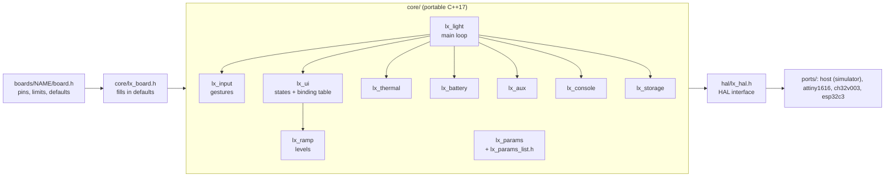

<!-- SPDX-License-Identifier: CC-BY-SA-4.0 -->
# LuxLibre firmware

One firmware for many flashlights. The same core code runs on an 8-bit ATtiny1616, a
RISC-V CH32V003 that costs about $0.13 in quantity, an ESP32-C3, and on a PC, where a
simulated flashlight (battery, LED, heat) runs the unit and behaviour tests.

| Port | MCU | Status |
|---|---|---|
| host | PC (Linux, macOS, Windows with WSL) | simulator and tests; every change is tested here |
| attiny1616 | Microchip ATtiny1616 | builds and links (about 11.4 KB of 16 KB flash); not yet tested on hardware |
| ch32v003 | WCH CH32V003 | builds and links (about 11.8 KB of 15.75 KB flash); not yet tested on hardware |
| esp32c3 | Espressif ESP32-C3 (FlashKa v0.5, v0.6 and v0.7) | experimental: written for ESP-IDF 5.x and checked against its API, CI build configured (allowed to fail until it has passed once); not yet compiled with ESP-IDF or tested on hardware |

Contents: [features](#features) · [why C++17](#why-c17) · [architecture](#architecture) ·
[building](#building) · [flashing](#flashing) · [the console](#the-console) ·
[parameters](#parameters) · [tests](#tests) · [more](#more)

## Features

- **150 brightness levels**, spaced geometrically (each step looks equally bigger), mapped to
  the board's real output range ([LED-7](../design-rules.md#led-7)).
- **Three button layouts:** ramp, modes and simple (`UI_STYLE`), with the common LuxLibre
  gestures ([FW-3](../design-rules.md#fw-3)): 1 click on/off with memory, hold to ramp or
  change mode, 2 clicks turbo with a timer, 3 clicks battery check, 4 clicks lockout, 9 clicks
  factory reset, click and hold for the laser or momentary turbo; beacon, SOS and strobe
  if enabled. Full map: [user-interface.md](user-interface.md).
- **Thermal regulation:** a PI regulator on a predicted temperature, tested against noisy and
  coarse sensors so that it never flickers ([THM-5](../design-rules.md#thm-5),
  [FW-4](../design-rules.md#fw-4)); hard shutdown; safe fallback when the sensor breaks.
- **Battery protection:** low-voltage warning, step-down and cut-off with a latch
  ([BAT-5](../design-rules.md#bat-5)); a cell current limit from the board's LED model
  ([BAT-1](../design-rules.md#bat-1)); Li-ion, LiFePO4 and NiMH charge estimates; 1-4 cells in
  series.
- **Charging control:** temperature window, level cap on USB, indicator colours
  ([CHG-3](../design-rules.md#chg-3), [CHG-6](../design-rules.md#chg-6)).
- **Pocket safety:** lockout that survives reboots, stuck-button protection, optional auto-lock
  ([BAT-7](../design-rules.md#bat-7)).
- **Laser support** with firmware limits on top of a hardware interlock
  ([LAS-2](../design-rules.md#las-2)).
- **ArduPilot-style parameters:** 50 named settings with ranges, stored with checksums,
  changeable over a text console, documented automatically ([parameters.md](parameters.md)).
- **Low power:** the MCU sleeps whenever the light is off ([BAT-6](../design-rules.md#bat-6)).
- **No heap, no floating point at run time** on the small MCUs; tables are computed by the
  compiler.

## Why C++17

The firmware had to run smoothly on very small chips, give fine control over the hardware, and
still be usable in ten years. The options:

| Language | Runs on 16 KB AVR and RV32E | Same code on a PC simulator | Fine hardware control | Long-term support |
|---|---|---|---|---|
| C | yes | yes | yes | excellent, but no namespaces, no compile-time computation, macros everywhere |
| **C++17 (embedded subset)** | **yes** | **yes** | **yes** | **excellent: ISO standard, GCC and Clang on every MCU family** |
| Rust | experimental for 8-bit AVR and RV32E | yes | yes | very good on 32-bit chips (the FlashKa v0.5 firmware is Rust) |
| MicroPython, Arduino | too large or too slow for 16 KB parts | partly | limited | good for prototypes |

LuxLibre uses C++17 with strict limits: no heap allocation, no exceptions, no run-time type
information, no virtual functions (on AVR their tables would live in the 2 KB of RAM), no
standard containers in the core. What it does use: namespaces, `constexpr` to compute lookup tables at compile time
(levels, NTC tables), strong enums and `static_assert` checks of board settings. The result
compiles to about 11-12 KB on both small MCUs and runs unchanged on the PC.

## Architecture



- **core/** is the flashlight: it never touches a register. `lx_light` runs one tick every
  `LX_TICK_MS` (10 ms): read the button, feed the gesture decoder (`lx_input`) and the user
  interface state machine (`lx_ui`), update sensors and protection every 100 ms (`lx_battery`,
  `lx_thermal`), take the lowest of all caps (thermal, low voltage, cell current, USB), smooth
  the level, set the output, run the indicator and console, feed the watchdog, and sleep when the
  light is off.
- **The binding table** in `lx_ui.cpp` maps (layout, state, gesture) to an action. Changing the
  user interface means editing a table, not rewriting logic, and
  [user-interface.md](user-interface.md) is generated from it.
- **hal/lx_hal.h** is the whole contract with the hardware: about 20 functions (time, sleep,
  button, battery voltage, temperature, outputs, storage, console). Units are millivolts,
  deci-degrees Celsius, milliseconds and a Q16 power value (0-65535 of full scale).
- **boards/** hold one header per light: pins, full-scale current, LED model, which hardware
  exists, and default values for any parameter. [porting.md](porting.md) explains every field.
- **ports/** implement the HAL for one MCU family each, plus start-up code and build files
  ([ports/README.md](../../firmware/ports/README.md)).

### How the light decides its output

```text
requested level (UI) -> min(thermal cap, low-voltage cap, cell-current cap, USB cap)
                     -> smoothing (SMOOTH_MS per level)
                     -> ramp::power_of_level()  (150 geometric levels between LX_OUT_MIN_Q16 and full scale)
                     -> hal::set_main(power)     (PWM duty, current set point, or both)
```

### Storage layout

| Block | Contents | Written when |
|---|---|---|
| Parameters | "LX", hash of the parameter list, values, CRC-16 | `save`, factory reset |
| Calibration | `BAT_CAL`, `THM_OFFSET`, CRC-16, in its own 64-byte page | with every parameter save; survives the factory reset and a changed parameter list |
| State ring | 8 slots: lockout, memory level, CRC-8 | when the light goes off after a change (spreads the wear) |

## Building

You need `make` and a C++ compiler for the PC; the cross-compilers only for the MCUs you build.

```sh
# Ubuntu 24.04 (on Windows: install WSL with Ubuntu and use the same commands)
sudo apt install g++ make gcc-avr binutils-avr avr-libc gcc-riscv64-unknown-elf python3-matplotlib

cd firmware
make test                                   # unit and behaviour tests on the PC
make sim                                    # build/luxsim, the simulator
make docs                                   # regenerate parameters.md and user-interface.md
make tiny1616 BOARD=example-tiny1616-pwm    # build/tiny1616-example-tiny1616-pwm.hex
make ch32v003 BOARD=example-ch32v003-buck   # build/ch32v003-example-ch32v003-buck.bin
```

The ESP32-C3 port builds with ESP-IDF 5.x:

```sh
cd firmware/ports/esp32c3
idf.py set-target esp32c3
idf.py -DLX_BOARD=flashka-keychain-v05 build     # or flashka-keychain-v06, flashka-keychain-v07, edco-v01
```

Details and the current limitations of that port: [ports/esp32c3/README.md](../../firmware/ports/esp32c3/README.md).

## Flashing

| MCU | Programmer | Command |
|---|---|---|
| ATtiny1616 | UPDI: a USB-serial adapter with a resistor ("serial UPDI") or a dedicated UPDI programmer | `pymcuprog write -t uart -u /dev/ttyUSB0 -d attiny1616 -f build/tiny1616-<board>.hex --erase`, and once per chip the brown-out fuse: `make tiny1616-fuses UPDI_PORT=/dev/ttyUSB0` |
| CH32V003 | WCH-LinkE on the one-wire SWIO pin | `minichlink -w build/ch32v003-<board>.bin flash -b` |
| ESP32-C3 | USB (built-in USB serial/JTAG) | `idf.py -p <port> flash` |

Before the first flash of a new board, do the bring-up checks in
[testing.md](../testing.md#bring-up-of-a-new-board): a current-limited supply and a check that
every output stays off during reset ([DRV-7](../design-rules.md#drv-7)).

## The console

Boards with `LX_HAS_CONSOLE` (the FlashKa: over USB) accept text commands, one per line. Any
serial terminal works.

| Command | Does |
|---|---|
| `help` | list the commands |
| `ver` | firmware version and board name |
| `status` | state, output and requested level, estimated cell current, temperature, cell voltage, charge %, thermal and low-voltage caps |
| `list` | all parameters with their values |
| `get NAME` | one parameter |
| `set NAME VALUE` | change a parameter (refused outside its range) |
| `save` | store the parameters (and the calibration) |
| `defaults` | parameters back to defaults, calibration kept (not saved until `save`) |
| `defaults all` | the same, calibration included |
| `level N` / `off` | switch the light to level N (1-150) or off; refused in lockout |
| `reboot` | restart the MCU |
| `wdtest` | watchdog test: moon on, then the firmware stops; the watchdog must restart the MCU ([DRV-8](../design-rules.md#drv-8)) |

An example session:

```text
> ver
LuxLibre 0.5.0 / FlashKa Keychain v0.6
ok
> get THM_LIMIT
THM_LIMIT=50
ok
> set THM_LIMIT 47
THM_LIMIT=47
ok
> save
ok
```

The console stays awake for 30 s after the last input; while USB is connected the light does not
sleep and the main LED is capped at `CHG_MAXLVL` (it is also a charger connection).

## Parameters

Every user setting is one line in `core/lx_params_list.h`: name (at most 10 characters), default,
range, unit and description. The list generates the C++ enum, the defaults table, the console
names and [parameters.md](parameters.md). Boards change defaults with `LX_DEF_<NAME>` in their
header. Ranges keep every setting safe ([FW-5](../design-rules.md#fw-5)): for example
`CHG_TMIN` cannot go below 0 °C.

## Tests

`make test` runs three programs:

- **test_units**: levels and their inverse, the NTC table against the beta equation, parameter
  ranges, storage round trips and corruption, the state ring, the gesture decoder.
- **test_sim**: the complete firmware against the simulated full-featured light (RGB indicator,
  laser, charger, NTC, console): every gesture, lockout across a reboot, turbo timer, thermal
  regulation for a keychain and an 18650 light, no flicker with a coarse noisy sensor or at the
  ends of the gain ranges, a short off does not reset the thermal cap, shutdown, sensor fault,
  low-voltage step-down and cut-off with the chemistry floor, charge window (also with a stuck
  button), console, auto-lock, pocket protection, factory reset with calibration kept, sleep.
- **test_basic**: a minimal board (no indicator, no laser): momentary turbo, lockout blinks.

CI runs these on every push, plus the ATtiny1616, CH32V003 and ESP32-C3 builds (the ESP32-C3 job
may fail without failing the run until it has passed once) and a check that the generated
documents are up to date
([.github/workflows/firmware.yml](../../.github/workflows/firmware.yml)).

## More

- [simulator.md](simulator.md): running scenarios, plotting, testing a new board header.
- [porting.md](porting.md): adding a board or a new MCU.
- [parameters.md](parameters.md), [user-interface.md](user-interface.md): generated references.
- [../design-rules.md](../design-rules.md#fw--firmware): the firmware rules FW-1 to FW-8.
