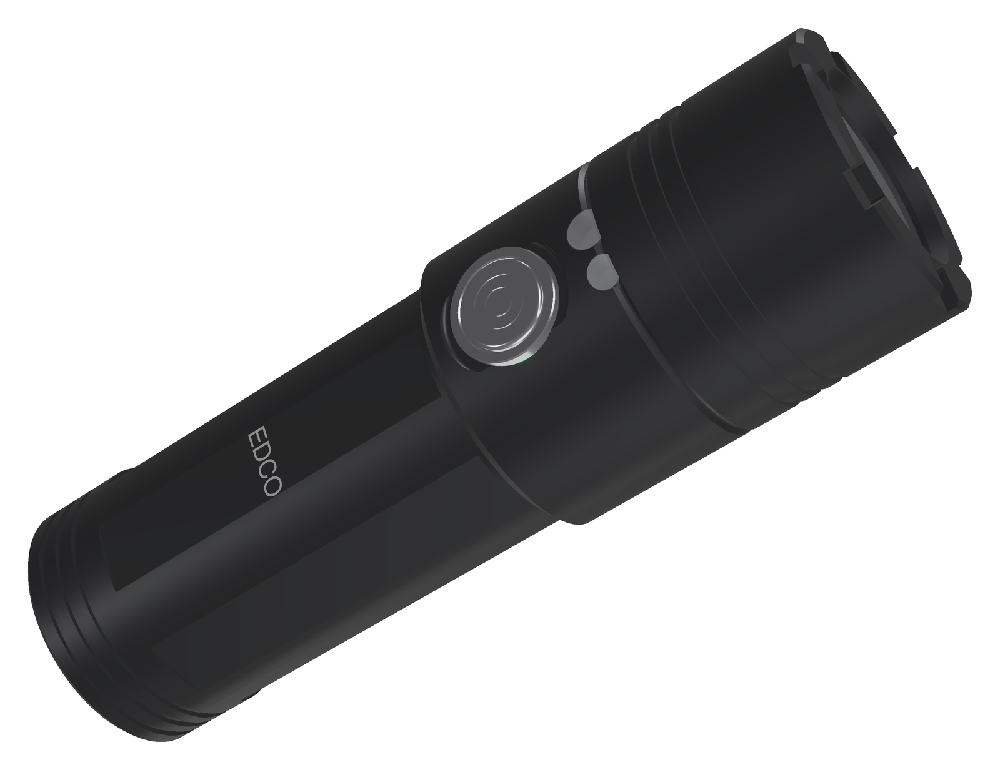
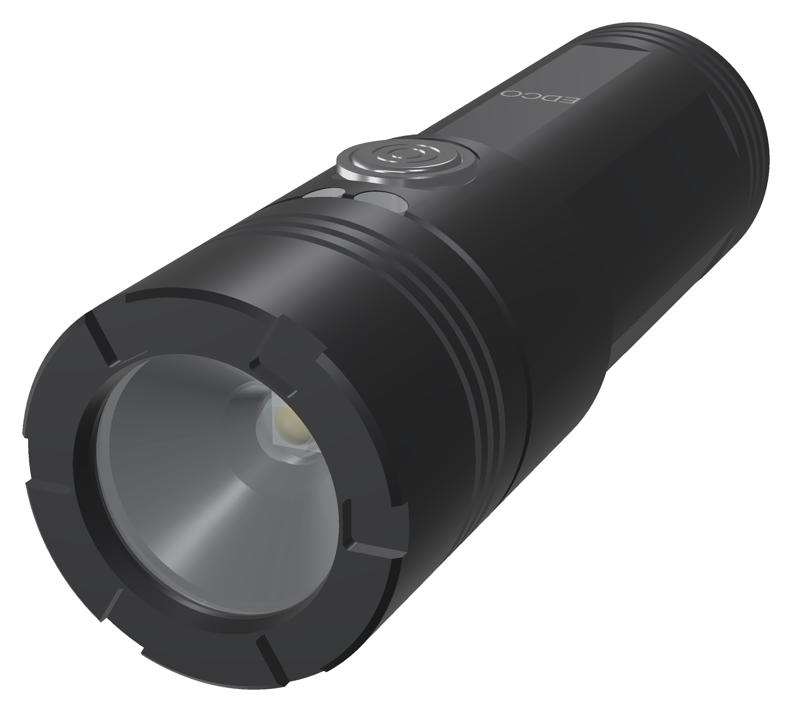
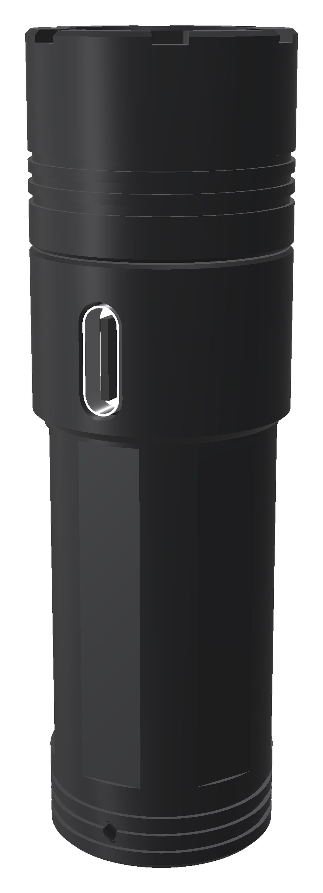
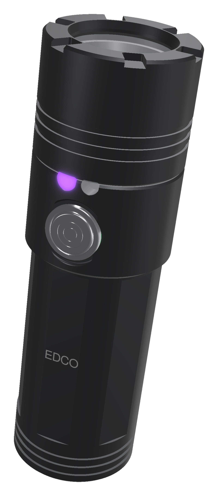
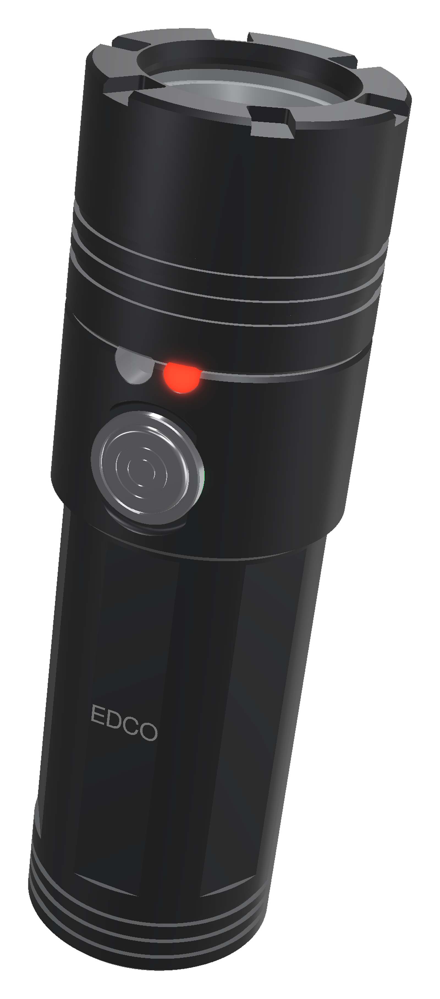
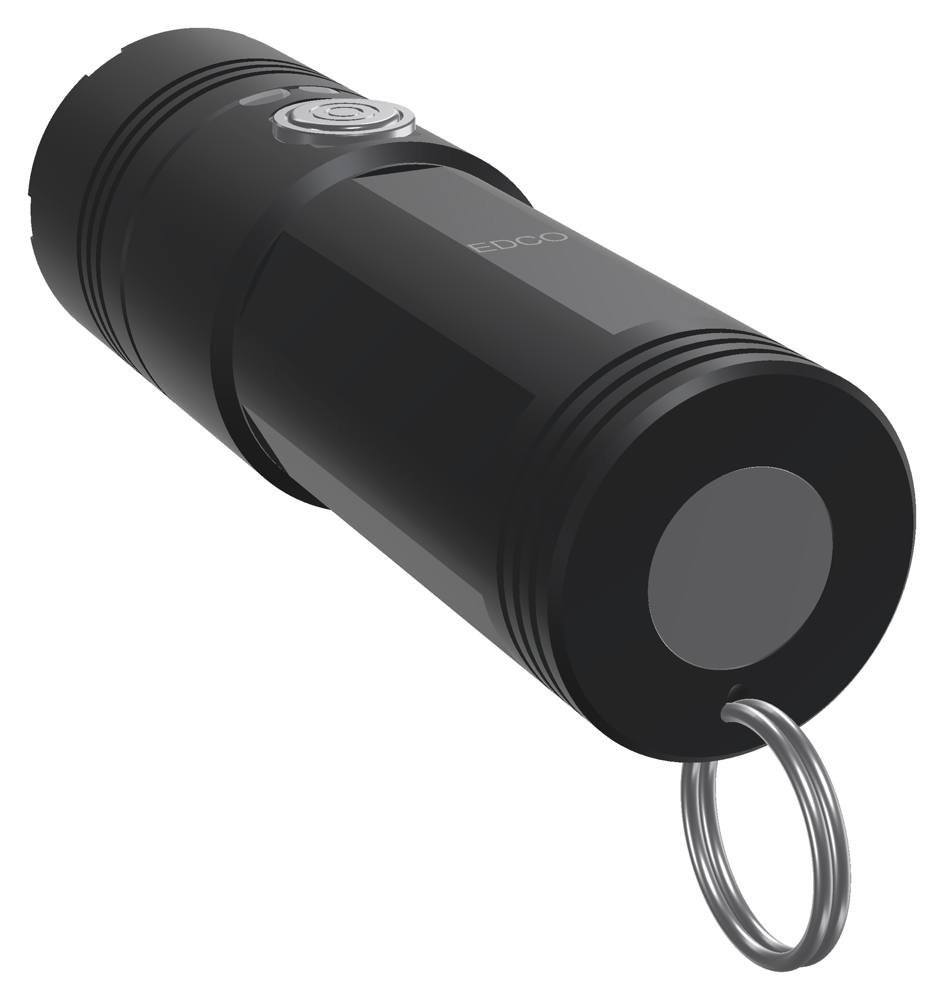
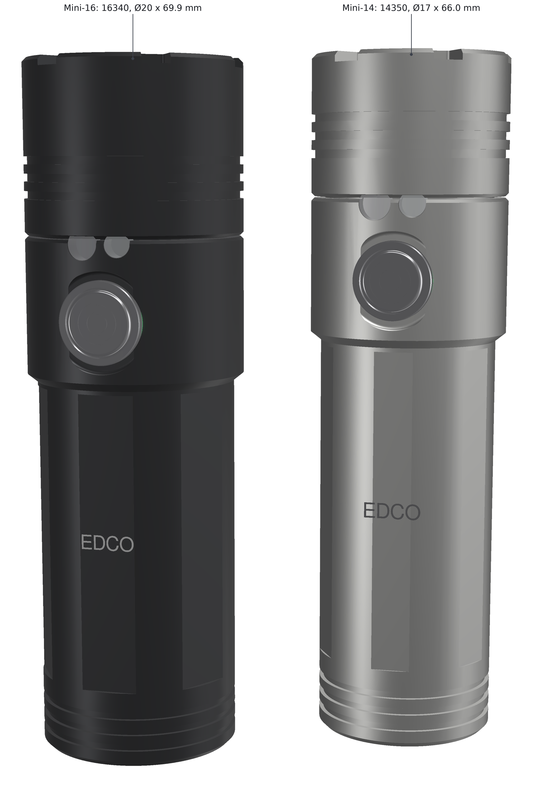
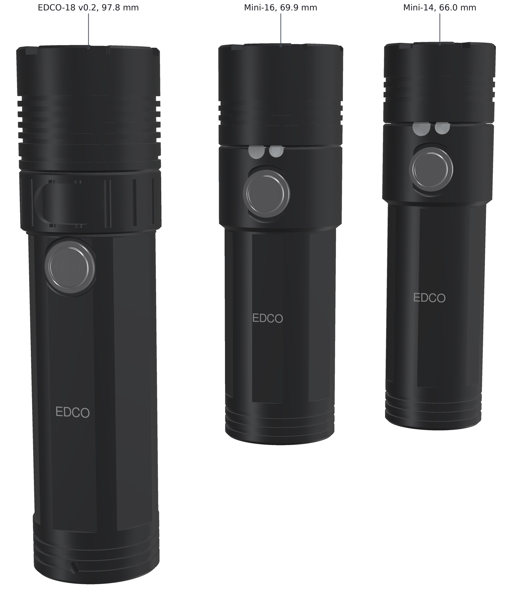
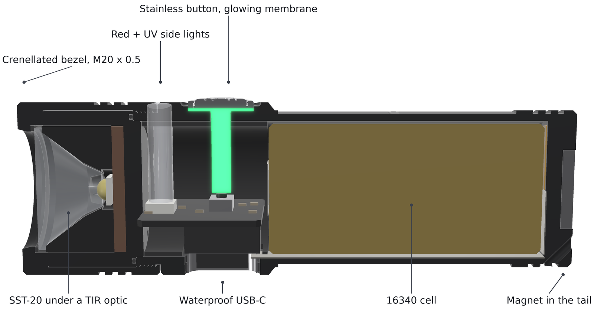
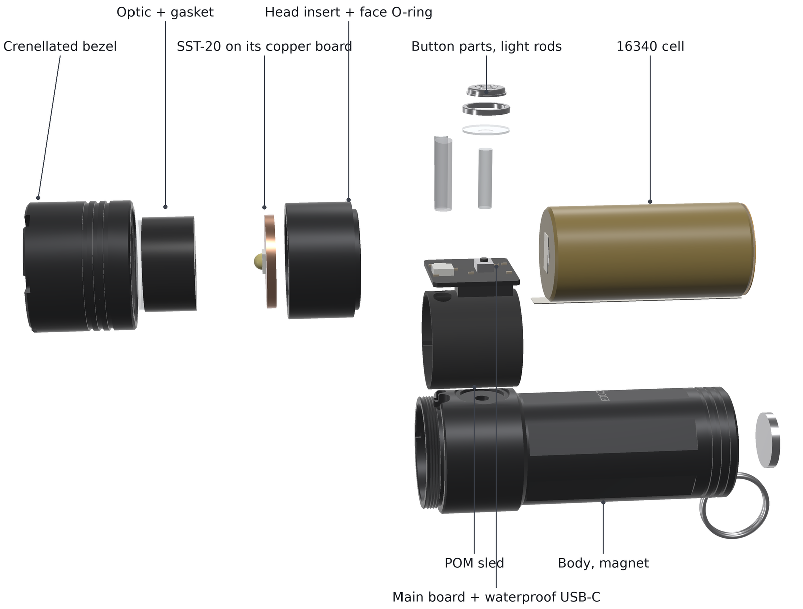

<!-- SPDX-License-Identifier: CC-BY-SA-4.0 -->
# EDCO Mini v0.1

EDCO Mini is the small sister of [EDCO v0.2](../edco-v02/README.md): a sealed keychain light of at most 70 mm,
made to beat the best 60 mm keychain lights on light, throw, battery and water. It comes in **two sizes**:

| | EDCO Mini-16 | EDCO Mini-14 |
|---|---|---|
| Cell | one 16340 (Vapcell INR16340 T6, 650 mAh) | a made-to-order Ø14 × 35 mm high-rate LiPo cell (about 400 mAh) |
| Body / head | Ø20 / Ø22 mm | Ø17 / Ø19 mm |
| Length | 69.9 mm | 66.0 mm |

Both run a Luminus **SST-20** LED behind a TIR optic, with **red and UV side lights**, a **magnet in the tail** and
a **waterproof USB-C socket** on the side of the head. There is no laser and no radio.



*Render made from the design files.*

> **Status: concept (v0.1).** The housing of both sizes is modelled in CadQuery and checked for fits, walls and
> interference. The firmware has the side lights and a board header for each size, and the light output is
> simulated with the LuxLibre simulator. The circuit boards are **not drawn yet**, and nothing has been built or
> measured. Every light figure on this page is simulated or estimated.
>
> **The Mini-16 is the main design.** No high-drain cell of the Mini-14's size (Ø14 × at most 37 mm) is sold
> today: the Mini-14 needs a cell made to order (see [open points](#open-points-before-the-first-order)).

## Against the best 60 mm keychain lights

The benchmark is RovyVon's small keychain lights of the current (G4) generation: the A4 Pro (titanium), A9 Pro
(copper), A3 Pro (aluminium) and A8 (polycarbonate, with side lights). They share one light engine: an SST-20
behind a small optic and a sealed 330 mAh LiPo cell. Measured figures come from independent reviews; where none
exist, the maker's claims are used.

| | 60 mm benchmark | EDCO Mini-16 | EDCO Mini-14 | Mini-16 |
|---|---|---|---|---|
| Light at switch-on, out of the front | 608 lm measured (A3 Pro), 650 lm claimed | **944 lm** | **978 lm** | better |
| Light at 30 s | 416 lm measured (A3 Pro), 381 lm (A9 Pro) | **944 lm** | **978 lm** | better |
| Light at 10 min | 119 lm measured (A3 Pro) | **about 220 lm** | **about 195 lm** | better |
| Peak intensity / throw | 3,241 cd, 114 m measured (A9 Pro) | **about 11,000 cd, 210 m** (estimate) | **about 5,600 cd, 150 m** (estimate) | better |
| Battery | 330 mAh, sealed | **650 mAh** (950 mAh with the Vapcell T9) | about 400 mAh (made to order) | better |
| Runtime at about 115 lm (medium) | 1 h 44 min (measured, falling from 118 to 67 lm) | **2 h 38 min** (113 lm all the way) | 1 h 37 min (117 lm) | better |
| Runtime at about 20 lm (low) | 6 h 22 min measured | **13 h 15 min** | **8 h 8 min** | better |
| Runtime from the brightest mode | 1 h 13 min (High, measured; about 100-120 lm after the first minutes) | 1 h 10 min (about 220 lm after the first minutes) | 53 min (about 195 lm) | about the same time, twice the light |
| Moon | 0.25-0.5 lm, 72 h claimed | 1.4 lm, 47 h | 1.4 lm, 29 h | **worse** (see [open points](#open-points-before-the-first-order)) |
| Charging | USB-C, 45-58 min measured | USB-C at 1 A, about 55-60 min (estimate) | USB-C at 0.5 A, about 55-60 min (estimate) | about the same |
| Water | IPX6 claimed (IP65-IP66 on some pages) | **IPX8 target**, not tested | IPX8 target, not tested | better (if the test passes) |
| Side lights | A8 only: UV 365 nm, red, warm white; UV for 100 min (claimed) | **UV 365 nm and red**; UV for about 2 h 10 min | UV 365 nm and red; UV for about 1 h 20 min | same colours, no white; longer UV |
| Magnet, lanyard | magnetic tail, magnetic clip, split ring | magnet in the tail face, split ring | the same | no clip |
| Size | 60.5 × 15.6 mm (63.8 mm with the tail magnet) | 69.9 × 22 mm | 66.0 × 19 mm | **worse** |
| Weight | 17.6 g (A8), 24 g (A4 Pro, titanium), about 40 g (A9 Pro, copper) | about 53 g (estimate) | about 32 g (estimate) | **worse** |

The Mini-16 is better on everything except size, weight and moon runtime. The size and weight are the price of
twice the battery and a body that can hold about 220 lm for a long time. The moon runtime can be fixed in the
firmware.

The Mini-14 wins on light, throw, low runtime and water, but its made-to-order cell is only a little larger than
the benchmark's. It runs about as long at medium and less long from its brightest mode.

Sources for the benchmark:
[1lumen A3 Pro G4](https://1lumen.com/review/rovyvon-a3-pro-g4/) (608 / 416 / 119 lm, 3,025 cd, runtimes, 58 min
charge), the zeroair.org review of the A9 Pro, June 2023 (571 / 381 lm, 3,241 cd),
[Battery Junction A4 Pro G4](https://www.batteryjunction.com/products/rovyvon-a4-pro-g4-keylight) (650 lm, 2,500 cd,
330 mAh, 60 mm, 24 g, IPX6, high to 80 lm within a minute),
the budgetlightforum.com thread on the titanium A4 Pro (63.8 mm with the magnet, Ø15.5).

|  |  |
|---|---|
| **Front.** Crenellated bezel, three fins, the TIR optic. | **Port.** The waterproof USB-C socket sits in the head's wall; the plug rests on the head. |
|  |  |
| **UV side light.** 365 nm, out of a clear rod in front of the button. | **Red side light.** Out of the second rod; the button's membrane glows as the indicator. |
|  |  |
| **Tail.** A magnet in the tail face, three grooves, a lanyard hole through the corner. | **Two sizes.** Mini-16 (black) and Mini-14 (clear anodised). |



## Specifications

| Item | EDCO Mini-16 | EDCO Mini-14 |
|---|---|---|
| Size | Ø20 body, Ø22 head × 69.9 mm | Ø17 body, Ø19 head × 66.0 mm |
| Aluminium parts (body, bezel, head insert; from the CAD) | 22.7 g | 15.7 g |
| Whole light (estimate) | about 53 g, of which the cell about 20 g | about 32 g, of which the cell about 10 g |
| LED | Luminus SST-20-W Gen 2, 6500 K, on a 16 mm copper DTP board | the same on a 12 mm board |
| Optic | LEDiL FA10887 TINA-RS for XP-E, Ø16.1 × 9.7 mm, 13° with an XP-E (fit over the SST-20 dome to be checked) | Carclo 12079 10 mm IP66 spot, flange Ø12.5 mm, about 6 mm tall; 89 % and 23° with an XP-G |
| Turbo (simulated) | 2,850 mA: about 1,110 lm at the LED and 944 lm out of the front with the LED at 85 °C; about 10 % more in the first seconds with a cool LED | 2,850 mA: about 1,110 lm at the LED, 978 lm out of the front |
| Throw (estimate) | about 11,000 cd, 210 m: 10 cd per LED lumen assumed, from Carclo's 10 mm figure scaled by the larger aperture | about 5,600 cd, 150 m: Carclo's 5.0 cd/lm with an XP-G |
| Cell | Vapcell INR16340 T6: 650 mAh typical (580 minimum), 6 A, Ø16.5 × 34.0 mm flat top (claimed). For longer runtimes: Vapcell T9, 950 mAh, 3 A (set `BAT_MAX_MA` to 2100: turbo then about 800 lm) | made to order: high-rate LiPo, Ø14 × 35 mm, about 400 mAh and 4 A (estimate) |
| Driver | the EDCO v0.1 / FlashKa v0.7 power stage: TI TPS62095 4 A buck in the LuxLibre current loop (TLV333, 20 mΩ sense), DW01A + SE8830A protection | the same |
| USB-C | waterproof vertical SHOU HAN TYPE-C 16PFS LTH7.45 (LCSC C3020055, IPX8 by its name), axial, in the side of the head; its own seal ring seals in the hole | the same |
| Charging | 1 A: TI BQ24050 (2 × 2 mm, LCSC C2859551) instead of the TP4057; about 55-60 min (estimate) | 0.5 A, about 55-60 min (estimate) |
| Side lights | UV: Nichia NVSU233B-U365 (365 nm, 3.5 × 3.5 mm), about 250 mA from the cell (roughly 0.35-0.4 W of UV at the LED; it falls as the cell runs down). Red: a 2.0 × 1.6 mm power LED, about 150 mA. Each shines through a clear rod: fused quartz for the UV, PMMA for the red | the same |
| Button | Ø6.5 mm stainless cap on a sealed, glowing membrane (halo indicator), Alps SKRKAEE020 | Ø5.8 mm cap |
| Magnet | supermagnete S-10-1.5-N52N, Ø10 × 1.5 mm, N52, about 1.2 kg pull on thick steel, in the tail face | S-08-02-N, Ø8 × 2 mm, about 1.1 kg |
| Water | IPX8 is the target, not tested. Seals: the optic gasket, the face O-ring of the head insert, the button membrane, the USB-C socket's seal ring, the two bonded light rods | the same |
| Firmware | LuxLibre, board [`edco-mini-16`](../../firmware/boards/edco-mini-16/board.h) | board [`edco-mini-14`](../../firmware/boards/edco-mini-14/board.h) |

## Light and runtime (simulated)

LuxLibre simulator runs with each size's board header: 25 °C still air, a full cell, the default profile, and
10 mA for the electronics while the light is on. Lumens are out of the front, with the LED at 85 °C.

| | EDCO Mini-16 | EDCO Mini-14 |
|---|---|---|
| Turbo | 944 lm, full for 45 s (the turbo timer); 56 s with the timer off | 978 lm, full for 33 s (the temperature regulator) |
| High (1.5 A) | 578 lm for 146 s | 599 lm for 91 s |
| Sustained (temperature regulator, `THM_LIMIT` 48 °C) | about 200-230 lm, body at most 47.3 °C | about 160-195 lm, body at most 47.0 °C |
| Turbo from a half-full cell, at 30 s | 837 lm | 839 lm |
| On a 35 °C day | full turbo for 26 s, then about 90-130 lm; body at most 48.0 °C | 15 s, then about 80-110 lm; 47.9 °C |
| Runtime from turbo to the ANSI end point | 70 min | 53 min |
| Medium (244 mA, 113-117 lm) | 2 h 38 min | 1 h 37 min |
| Low (40 mA, 18-19 lm) | 13 h 15 min | 8 h 8 min |
| Moon (3 mA, 1.4 lm) | 47 h | 29 h |
| UV side light (1 W from the cell, kept constant in the simulator) | about 2 h 10 min | about 1 h 20 min |

* **Small bodies heat fast.** The SST-20 at 2.85 A turns about 8 W into heat in 14-23 g of aluminium. Turbo
  therefore lasts well under a minute, and the light then holds about 200 lm. The temperature regulator looks
  10 s ahead (`THM_LEAD` 10). With the default 4 s, it swung between 70 and 330 lm in these bodies.
* **Why moon is short.** At moon the LED takes 3 mA, but the awake ESP32-C3 takes about 10 mA. Automatic light
  sleep between the 10 ms ticks would cut that to about 1-2 mA and give a moon of several days. It is the first
  firmware open point.

```sh
cd firmware
make sim BOARD=edco-mini-16
build/luxsim-edco-mini-16 --preset board "2C W8000000"                          # turbo, then until empty
build/luxsim-edco-mini-16 --preset board --set MEMORY=0 --set MODE_1=104 "1C W30000000"   # medium
```

## Using the light

Modes layout (as EDCO):
* **On and off:** 1 click.
* **Modes:** hold to step low → medium → high.
* **Turbo:** 2 clicks.
* **Momentary turbo:** click, then click and hold.
* **Battery check:** 3 clicks.
* **Lockout:** 4 clicks.
* **Side light:** **5 clicks from off**. In it, 2 clicks switch red ↔ UV and 1 click switches off. The colour
  used last comes back next time.

Over USB (the LuxLibre console):
* `SIDE_RED` and `SIDE_UV` set the brightness of each side light. `SIDE_UV` 0 turns the UV off for good.
* `BLINKY` adds beacon, SOS or strobe after the battery check.

**UV safety:** 365 nm is invisible but not harmless. Do not look into the UV window, and do not shine it into
anyone's eyes.

## How it is built



From the front to the tail:

1. **Bezel.** Crenellated, with three cooling fins. It screws onto the band's external thread (M20 × 0.5 on the
   Mini-16, M17 × 0.5 on the Mini-14, 2.3 mm of engagement) and is locked with thread-locker. Its lip presses
   the optic onto a silicone gasket, and its inner shoulder clamps the head insert, metal on metal, against the
   band's front face.
2. **Head insert.** The LED holder: a cup for the optic, the SST-20 on its copper board on a 1.2 mm floor, a face
   O-ring on its rear face and a key in a band notch. The key stops it turning while the bezel is tightened, so
   the LED wires never twist.
3. **Head section.** The front of the body, as large as the bezel.
   * **USB-C:** the waterproof socket's shell goes through an axial hole in the bottom of the head. Its seal ring
     seals in the 2 mm wall, and the plug's overmould rests on the round head.
   * **Top:** two clear rods carry the UV and red light out of the top, side by side in front of the button.
   * **Button:** above the socket, so the board is backed by the socket when the button is pressed.
4. **Main board in a POM sled.** The board lies across the bore.
   * Underneath: the socket, the MCU and the driver.
   * On top: the switch, the halo LED and the two side LEDs.
5. **Cell.** Its + strip goes to the rear of the main board. The − strip runs forward along the bottom of the
   cell.
6. **Tail.** Closed, with three grooves and a magnet bonded into a pocket in the tail face. A lanyard hole runs at
   45° from the tail face out to the side, clear of the cell bay.



### Assembly (once, for good)

1. **Bench-test the cartridge.**
   * Weld the strips to the cell. Solder the cell and the LED wires to the main board.
   * Test the cartridge on the bench and flash the firmware over USB-C.
2. **Insert the cartridge.** Slide it into the tube with the socket facing its hole. Press the socket's seal ring
   into the hole from inside, and check from outside that the shell sits centred.
3. **Fit the button and the windows.**
   * Bond the two light rods into their holes with a UV-resistant epoxy.
   * Fit the clear pin, the membrane, the cap and the button collar (press-fit with retaining compound).
4. **Fit the head.** Fit the head insert with its face O-ring, the LED board on paste, the optic and its gasket.
   Screw on the bezel with medium-strength thread-locker.
5. **Fit the magnet.** Bond it into the tail pocket.

## Electronics: what changes from EDCO v0.1

| EDCO v0.1 | EDCO Mini |
|---|---|
| SST-20 Gen 2 on a 10 mm board, LEDiL LISA3-RS-PIN | the same LED on a 16 mm (Mini-16) or 12 mm (Mini-14) board, LEDiL TINA-RS / Carclo 12079 |
| TPS62095 driver, 2,850 mA, DW01A + SE8830A | unchanged |
| TP4057 at 500 mA | 1 A charger, TI BQ24050 in WSON-10 2 × 2 mm (LCSC C2859551; low stock); its CHG and PG pins go to the HAL's two status inputs, and its enable pin to `CHG_SET` (to be confirmed when the board is drawn). A linear charger at 1 A makes about 1.3 W of heat in the first half of the charge |
| waterproof USB-C on a tail board, 4-wire flex | the same kind of socket on the main board, in the side of the head; no tail board, no flex |
| RGB indicator under a light pipe | RGB LED under the button's membrane (halo) |
| (none) | side lights: UV through a P-MOSFET on GPIO9 (on when low; the strap pin's pull-up keeps it off at reset), red through an N-MOSFET on GPIO10 |
| ESP32-C3FH4, RT9080, NTC | unchanged |

The firmware gains side lights for every board that sets `LX_HAS_SIDE`:
* the core: the gestures, the `SIDE_RED` and `SIDE_UV` parameters, pocket protection and switch-off on an empty
  cell or overheating;
* `hal::set_side()` in every port, with two LEDC channels on the ESP32-C3;
* a power model in the simulator, and tests.

## Cost (rough estimate)

There is no workbook yet. The Mini has the same parts count as EDCO v0.1 less the tail board and flex, plus two
side LEDs, two rods and a magnet; its metal parts are smaller. Roughly 650-750 USD for one light, about 220-250 USD
each for five, all fees, shipping and VAT included (estimate).

## What has been checked

* **CAD interference:** no part overlaps a neighbour in either size (33 pairs). They include:
  * body / head insert, bezel / insert, body / sled, sled / board, body / cell;
  * body / USB-C shell, seal ring and socket body;
  * body / light rods, sled / light rods, LEDs / rods;
  * body / button pin and collar, body / magnet, body / face O-ring.
* **Walls, Mini-16:**
  * 1.3 mm over the cell, 0.9 mm under the flats;
  * 2.3 mm in the head section;
  * 0.99 mm at the thread root, 0.94 mm at the run-out;
  * 1.2 mm under the button counterbore;
  * 0.95 mm in the bezel over the insert, 0.6 mm at its fins;
  * 2.0 mm of tail floor under the magnet.
* **Walls, Mini-14:**
  * 1.0 mm over the cell, 0.8 mm under the flats;
  * 2.0 mm in the head section;
  * 0.69 mm at the thread root, 0.64 mm at the run-out;
  * 0.9 mm under the button counterbore;
  * 0.95 / 0.6 mm in the bezel;
  * 1.5 mm under the magnet.
* **Below JLCCNC's recommended 0.8 mm (above their 0.5 mm minimum):**
  * the bezel at its fins (0.6 mm, both sizes);
  * the metal between the lanyard hole and the cell bay (0.55 mm, both);
  * the Mini-14's thread root and run-out (0.69 / 0.64 mm) and its lanyard hole to the magnet pocket (0.63 mm).
* **Fits:**
  * Main board: 15.4 × 14.9 mm (Mini-16) and 13.9 × 14.5 mm (Mini-14), 0.32-0.34 mm from the bore.
  * Socket: mouth 0.25 mm below the head's crest, through a 2.3 / 2.1 mm wall.
  * Button pin: 10.2 / 7.2 mm. UV rod: 12.2 / 9.2 mm.
  * Cell radial room: 0.4 / 0.5 mm.
* **Firmware:** 2 new behaviour tests (side-light gestures; refused in lockout, by pocket protection and on an
  empty cell). All 519 unit and 197 behaviour checks pass.
* **Light and heat:** simulated, as above.

All numbers are in [cad/edco_mini_interface.json](cad/edco_mini_interface.json), written by
[tools/housing/edco_mini.py](tools/housing/edco_mini.py).

## Open points before the first order

* **The Mini-14's cell.**
  * No high-drain cell of Ø14 × at most 37 mm is sold: no 14350 or 14300 at nkon, Vapcell, Keeppower or
    lygte-info. The nearest real cells are 14430s (42.6 mm long, too long, 2-3 A) and 14280s (about 1 A).
  * A LiPo maker (for example Grepow) would have to make it. Their smallest standard 15C cell is
    7.5 × 20 × 31 mm, too wide for this bore.
  * Until such a cell is quoted, the Mini-16 is the one to build.
* **The Mini-16's cell.**
  * The bay takes a flat-top cell of at most 16.6 × 34.5 mm. The T6 is listed at 16.5 × 34.0 mm, but one shop
    lists its button-top version at 36.5 mm: buy the flat top.
  * The T6's 6 A and 30 mΩ are claims with no independent test yet.
  * The older Vapcell 800 mAh 7 A cell measured 660-780 mAh at 5 A ([BLF](https://budgetlightforum.com/t/-/57137/38)),
    if it can still be found.
* **The optics.**
  * The TINA-RS version for the XP-E has to be checked over the SST-20's dome (about Ø2.6 × 2.0 mm).
  * The Carclo 12079's height (about 6 mm) is read from its drawing.
  * The throw figures are estimates from other LEDs' data.
* **The USB-C socket.** The C3020055's outline, hole size and seal are not published as text. Buy samples,
  measure them, then set the hole (drawn 9.6 × 3.9 mm) and test the seal under water.
* **Firmware: light sleep while on.** The awake ESP32-C3 draws about 10 mA, which limits the moon to 1-2 days.
  The LEDC outputs can keep running in light sleep from the RC clock. Making the port sleep between ticks is the
  next firmware task.
* **The side lights.**
  * The UV LED runs straight from the cell, so its output falls as the cell empties. A small current regulator
    would fix that, if there is room on the board.
  * The UV rod must be UV-grade fused quartz (ordinary PMMA blocks most of 365 nm).
  * Bonded rods are a seal of their own and need the water test too.
* **The board.** Both boards are smaller than EDCO v0.1's (about 200-230 mm² a side). Fitting everything needs
  4 layers and 0201 parts, to be proven when the board is drawn.
* **Replacing the cell** ([BAT-2](../../docs/design-rules.md#bat-2)), as for EDCO: fine for your own light. From
  18 February 2027, though, a light sold in the EU must let its user replace the cell.
* **The boards, drawings, order files and a parts and cost workbook**, as for EDCO v0.1 and v0.2.

## Files

| Path | What |
|---|---|
| [cad/](cad/) | for each size (`EDCO_Mini-16_*`, `EDCO_Mini-14_*`): body, bezel and head insert as STEP (plain thread diameters), and the assembly STEP |
| [cad/edco_mini_interface.json](cad/edco_mini_interface.json) | sizes, walls, fits, masses, the thermal split and the interference check of both sizes |
| [tools/housing/edco_mini.py](tools/housing/edco_mini.py) | the CadQuery model (sizes in `SIZES`, common dimensions in class `P`): `python3 edco_mini.py ../../cad --size both` |
| [tools/housing/edco_mini_render.py](tools/housing/edco_mini_render.py) | the renders: `xvfb-run -a python3 edco_mini_render.py ../../assets` (uses the FlashKa v0.7 renderer) |
| [../../firmware/boards/edco-mini-16/](../../firmware/boards/edco-mini-16/board.h), [edco-mini-14/](../../firmware/boards/edco-mini-14/board.h) | the firmware board headers, each with the thermal model for the simulator |

Licences as for the rest of LuxLibre: hardware CERN-OHL-W-2.0, firmware and tools GPL-3.0-or-later, this page
CC-BY-SA-4.0 ([LICENSING.md](../../LICENSING.md)).
