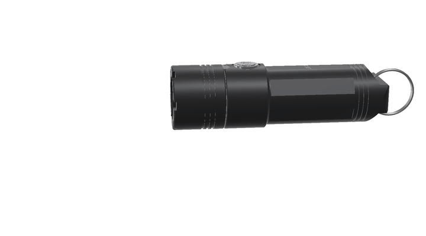
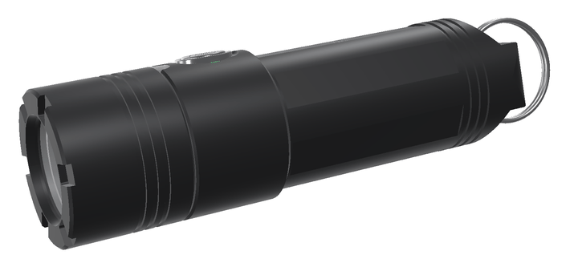
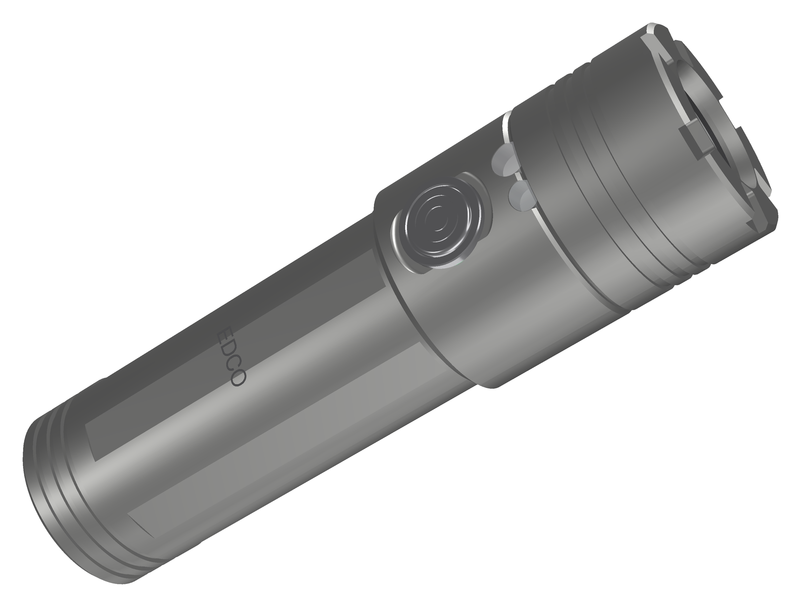
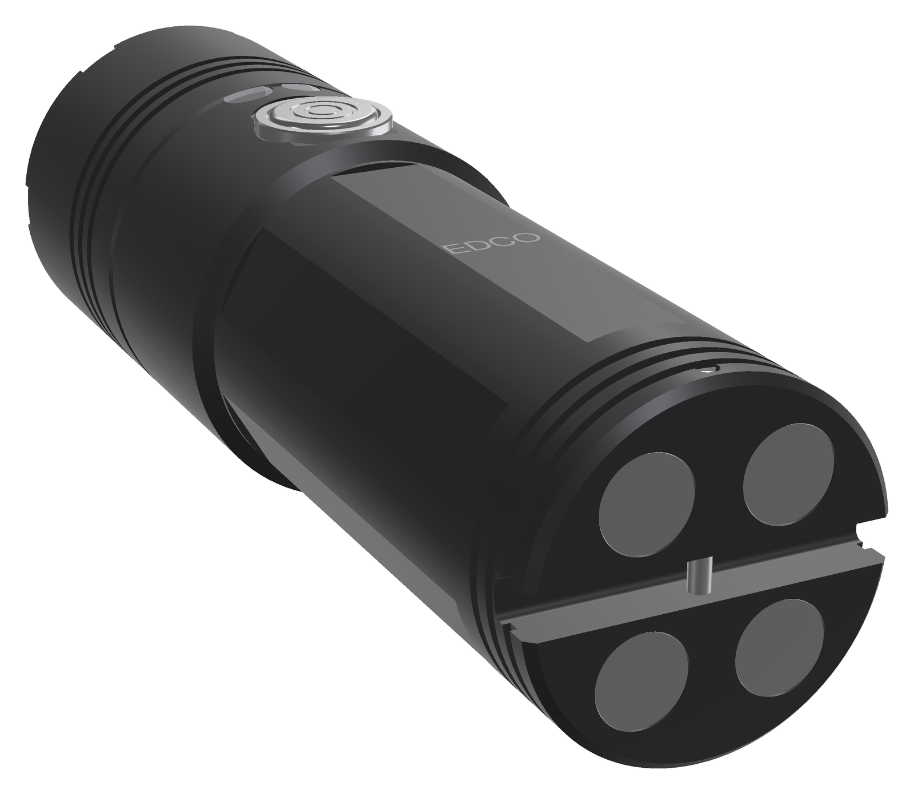

<!-- SPDX-License-Identifier: CC-BY-SA-4.0 -->
[LuxLibre](../../../README.md) › [Lights](../../../hardware/README.md) › [EDCO Mini](../README.md) › Pictures

# EDCO Mini: pictures

Renders and animations made from the design files. Nothing here is a photo: the light has not been built yet. The renders are made by [edco_mini_render.py](../tools/housing/edco_mini_render.py), the animations by [hardware/tools/edco_anim.py](../../tools/edco_anim.py).

## Animations

|  |  |
|---|---|
| EDCO Mini-16M coming apart into its parts and back `mini16_exploded.gif` | EDCO Mini-16M turning about its axis `mini16_turntable.gif` |

## Renders

|  |  |
|---|---|
| Mini14 hero natural `mini14_hero_natural.png` | Exploded view of EDCO Mini-16 `mini16_exploded.png` |
|  |  |
| Front: crenellated bezel and the TIR optic `mini16_front.png` | EDCO Mini-16M, black anodised: crenellated bezel, two side-light windows, the stainless button, a split ring through the tail tab `mini16_hero.png` |
|  |  |
| Underneath: the waterproof USB-C socket in the head `mini16_port.png` | Half section of EDCO Mini-16 `mini16_section.png` |
|  |  |
| The red side light on `mini16_side_red.png` | The UV side light on `mini16_side_uv.png` |
|  |  |
| Tail: the keyring tab with its obround hole and a split ring `mini16_tail.png` | Tail of the M version: the tab with two magnets in its end `mini16m_tail.png` |
|  |  |
| EDCO-18 v0.2, Mini-16 and Mini-14 `mini_family.png` | Mini-16M and Mini-14 side by side `mini_sizes.png` |
