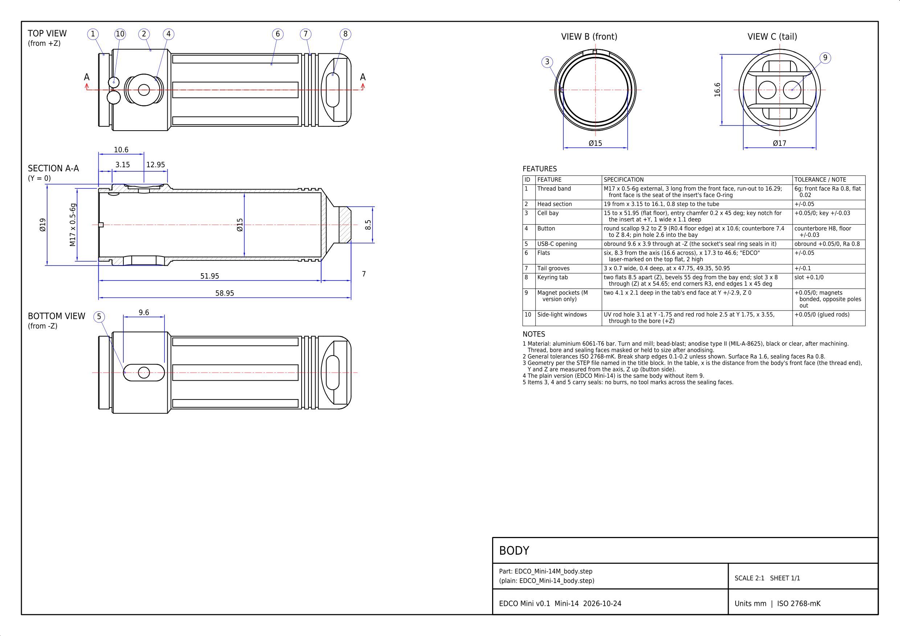
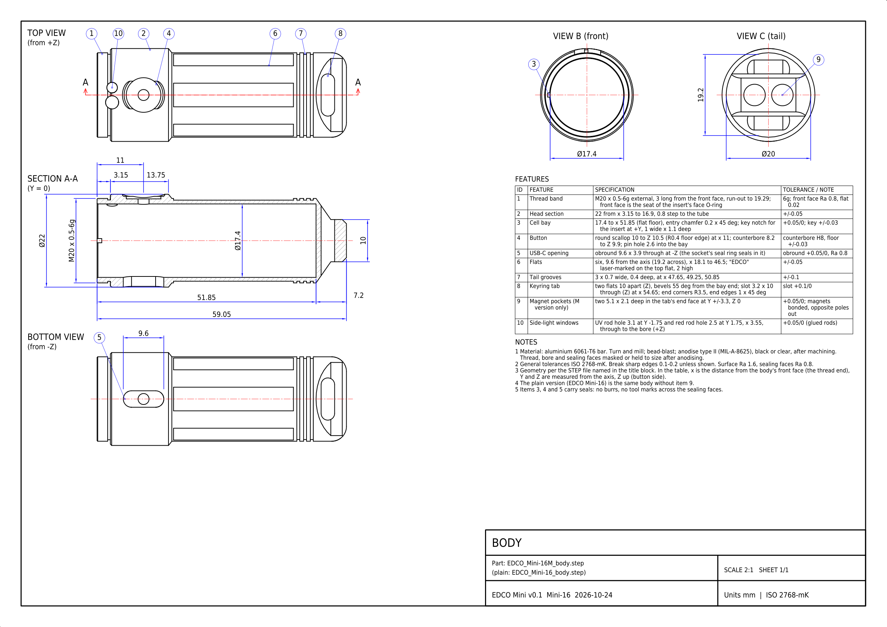

<!-- SPDX-License-Identifier: CC-BY-SA-4.0 -->
[LuxLibre](../../../README.md) › [Lights](../../../hardware/README.md) › [EDCO Mini](../README.md) › Drawings and CAD

# EDCO Mini: drawings and CAD

The files of the EDCO Mini housing, made from the design scripts in [../tools/](../tools/) (nothing is drawn by hand). STEP files open in FreeCAD, Fusion, Onshape or any CAD program; DXF in LibreCAD, QCAD or any CAD program; PDF and PNG are for reading. The design page explains every part: [EDCO Mini](../README.md).

## Drawings

The M body is drawn: the plain body is the same without the two magnet pockets (item 9 on the sheet).

**EDCO Mini 14 body drawing, A3 at 2:1** ([PDF](EDCO_Mini-14_body_drawing.pdf), [DXF](EDCO_Mini-14_body_drawing.dxf), [PNG](EDCO_Mini-14_body_drawing.png))

**EDCO Mini 16 body drawing, A3 at 2:1** ([PDF](EDCO_Mini-16_body_drawing.pdf), [DXF](EDCO_Mini-16_body_drawing.dxf), [PNG](EDCO_Mini-16_body_drawing.png))

## 3D models

| File | What it is |
|---|---|
| `EDCO_Mini-14M_body` ([STEP](EDCO_Mini-14M_body.step)) | Mini-14: body; M version (with the magnet pockets) |
| `EDCO_Mini-14M_v0.1_assembly` ([STEP](EDCO_Mini-14M_v0.1_assembly.step)) | Mini-14: every part in place, with stand-ins for the boards and the socket; M version (with the magnet pockets) |
| `EDCO_Mini-14_bezel` ([STEP](EDCO_Mini-14_bezel.step)) | Mini-14: bezel (screws onto the body's thread) |
| `EDCO_Mini-14_body` ([STEP](EDCO_Mini-14_body.step)) | Mini-14: body |
| `EDCO_Mini-14_insert` ([STEP](EDCO_Mini-14_insert.step)) | Mini-14: head insert (holds the LED board and the optic) |
| `EDCO_Mini-14_v0.1_assembly` ([STEP](EDCO_Mini-14_v0.1_assembly.step)) | Mini-14: every part in place, with stand-ins for the boards and the socket |
| `EDCO_Mini-16M_body` ([STEP](EDCO_Mini-16M_body.step)) | Mini-16: body; M version (with the magnet pockets) |
| `EDCO_Mini-16M_v0.1_assembly` ([STEP](EDCO_Mini-16M_v0.1_assembly.step)) | Mini-16: every part in place, with stand-ins for the boards and the socket; M version (with the magnet pockets) |
| `EDCO_Mini-16_bezel` ([STEP](EDCO_Mini-16_bezel.step)) | Mini-16: bezel (screws onto the body's thread) |
| `EDCO_Mini-16_body` ([STEP](EDCO_Mini-16_body.step)) | Mini-16: body |
| `EDCO_Mini-16_insert` ([STEP](EDCO_Mini-16_insert.step)) | Mini-16: head insert (holds the LED board and the optic) |
| `EDCO_Mini-16_v0.1_assembly` ([STEP](EDCO_Mini-16_v0.1_assembly.step)) | Mini-16: every part in place, with stand-ins for the boards and the socket |

## Data

| File | What it is |
|---|---|
| [`edco_mini_interface.json`](edco_mini_interface.json) | sizes, walls, fits, masses and the interference check (written by the CAD script, read by the checks) |

The drawings are made by [hardware/tools/edco_drawings.py](../../tools/edco_drawings.py) and checked against the solids ([report](../../tools/edco_drawings_check.txt)).
