<!-- SPDX-License-Identifier: CC-BY-SA-4.0 -->
# EDCO Prism v0.1

EDCO Prism is the EDCO light whose beam can be **white or any colour**. It is a sealed 18350 light of 83 mm
with a bigger battery than [EDCO Mini](../edco-mini/README.md), a white turbo, and red, green and blue LEDs
in the same optic. You pick the colours with the button or on the **settings page over USB-C**.

| | EDCO Prism |
|---|---|
| Cell | one 18350, Keeppower UH1835P: 1,200 mAh claimed, 10 A |
| Body / head | Ø22 / Ø28 mm |
| Length | 83.0 mm with the keyring tab |
| Versions | EDCO Prism (no magnet) and EDCO PrismM (two magnets in the end of the tail tab) |

Four LEDs sit in the four cavities of one 24 mm quad TIR optic. One is a white Luminus **SST-20**, and the others
are **red**, **green** and **blue**. Turbo runs all four at once. The **button glows** in RGB: it shows the charge
level and, when you change it, the beam's colour. A **waterproof USB-C socket** in the side of the head charges the
light and connects it to the settings page. The tail ends in the EDCO Mini's **keyring tab**; the **M version**
adds two magnets in its end. There is no laser and no radio.

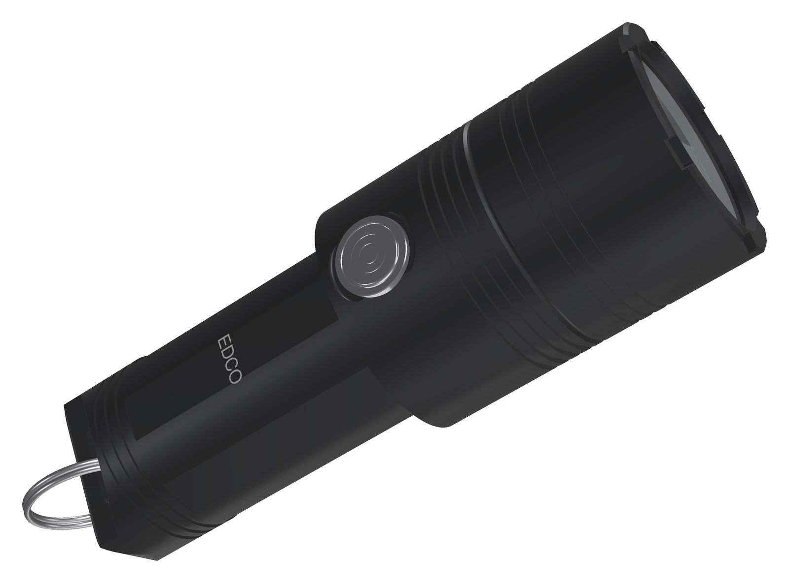

*Render made from the design files.*

> **Status: concept (v0.1).** The housing is modelled in CadQuery and checked for fits, walls and interference.
> The firmware has the colour beam and a board header, and the light output is simulated with the LuxLibre
> simulator. The circuit boards are **not drawn yet**, and nothing has been built or measured. Every light figure
> on this page is simulated or estimated.

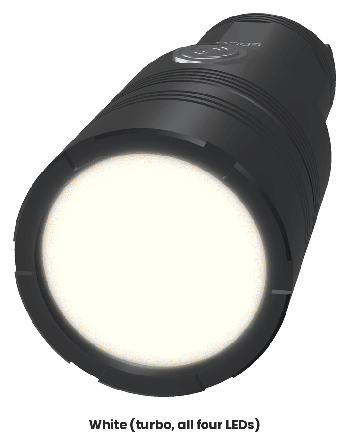

## Against the best multi-colour light of its size

The benchmark is the **Skilhunt MiX-7 Gen 2**: 79 mm long with an 18350 cell, a Nichia 519A white LED and
separate red, green, blue and UV LEDs that can be mixed. No other light of this size with a colour main beam and
a USB-C port was found. The MiX-7's figures are measured by independent reviewers unless marked as claimed.

| | Skilhunt MiX-7 Gen 2 | EDCO Prism | EDCO Prism is |
|---|---|---|---|
| White at switch-on, out of the front | 1,477 lm measured | 1,248 lm in turbo (all four LEDs), 944 lm from the white LED alone | **worse** |
| White at 30 s | 1,380 lm measured | 1,248 lm | worse |
| White at 10 min | 366 lm measured (body temperature not reported) | about 280-350 lm, with the body held below 48 °C | about the same or a little worse |
| Peak intensity / throw | 2,695 cd, 104 m measured | about 3,000 cd, 110 m from the white LED (estimate) | about the same |
| Colours | red 229, green 401, blue 12 lm measured (55 lm claimed), UV 365 nm | red 127, green 272, blue 34 lm; any mix at any brightness; no UV | **worse** on red and green |
| A colour at its brightest | red 1 h 38 min, green 1 h 20 min, blue 1 h 14 min measured | green 1 h 36 min | about the same |
| Battery | 18350, 1,100 mAh, protected | 18350, 1,200 mAh claimed (Keeppower UH1835P, 10 A) | a little better |
| Runtime from turbo | 1 h 02 min measured (to 10 %) | **1 h 29 min** | better |
| Charging | magnetic cable (Skilhunt MC-10), 1 A, 1 h 37 min measured | **USB-C**, any cable, 1 A, about 1 h 15 min (estimate) | better |
| Settings | button only | **settings page over USB-C**: every parameter, any colour | better |
| Button | blue and red indicator | **RGB**: the charge, charging and the beam's colour | better |
| Water | IPX8 claimed | IPX8 target, not tested | the same (if the test passes) |
| Magnet, keyring | magnetic tail, clip and lanyard | keyring tab; M version: two magnets; no clip | about the same |
| Size | 79 mm, head Ø32.5, body Ø23 | 83.0 mm, head Ø28, body Ø22 | about the same |
| Weight with the cell | 96 g measured | about 80 g (estimate) | better |

The Prism gives up about 15 % of the white peak and a third of the red and green for a standard USB-C port, a
settings page, an RGB button that shows the colour, longer runtime from turbo and a lighter body. The colours
mix in one optic at any brightness. More white would need a brighter white LED; see the
[open points](#open-points-before-the-first-order).

Sources for the benchmark:
[1lumen MiX-7 Gen 2](https://1lumen.com/review/skilhunt-mix-7-v2) (1,477 / 1,380 / 366 lm, 2,695 cd, the colours,
the runtimes, 1 h 37 min charge, 96 g, 79 mm, 21 Oct 2024),
[zeroair.org MiX-7 Gen 2](https://zeroair.org/?p=105838) (25 Sep 2024),
[BLF review by SammysHP](https://budgetlightforum.com/t/review-skilhunt-mix-7-gen-2-nichia-519a-red-green-blue-and-uv-now-with-color-mixing/225590)
(colour mixing, 23 Sep 2024).

| 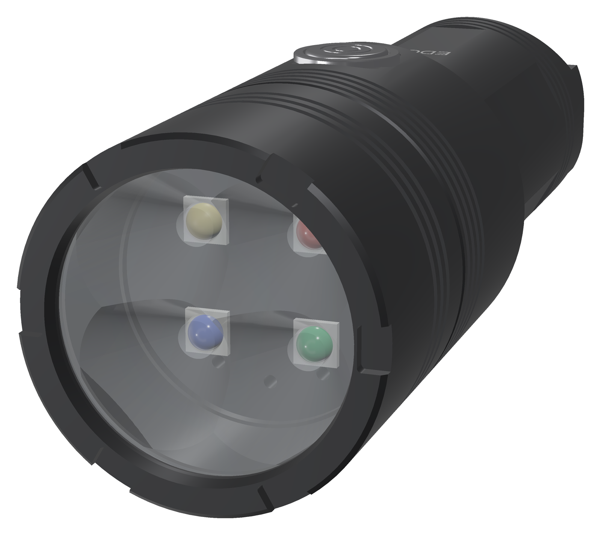 | 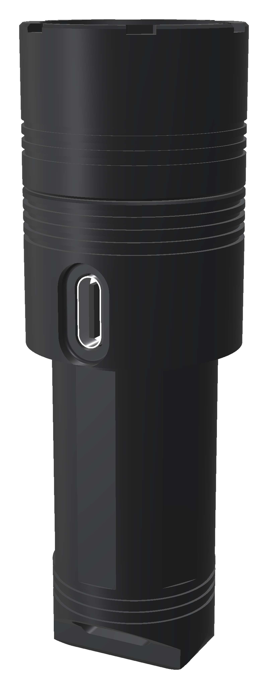 |
|---|---|
| **Front.** Crenellated bezel, the 24 mm quad optic over four LEDs. | **Port.** The waterproof USB-C socket in the side of the head; the plug sits in a pocket. |
| 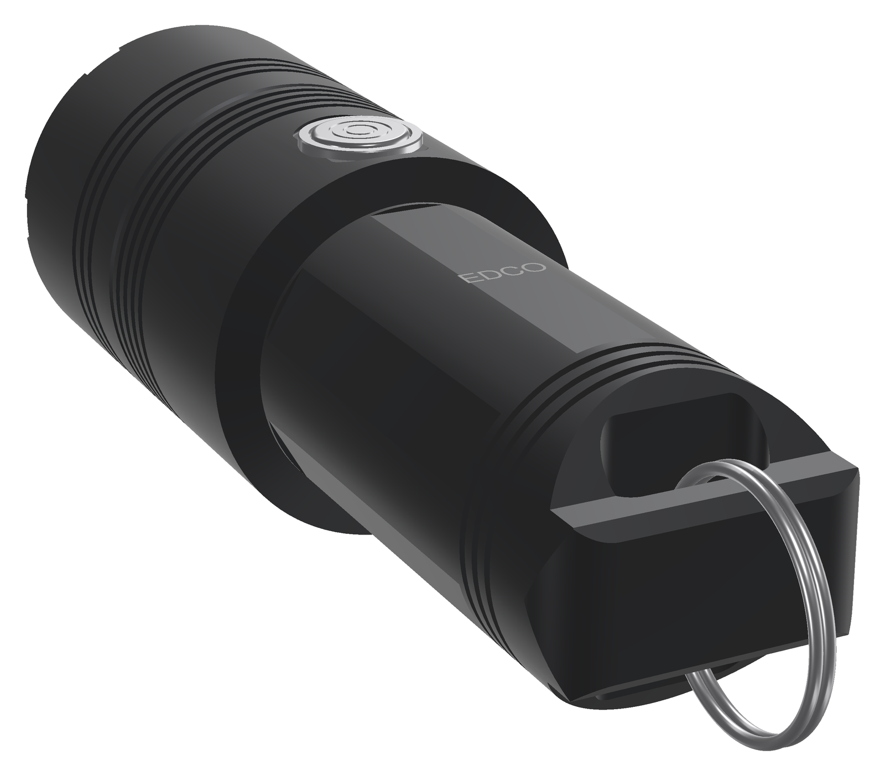 | 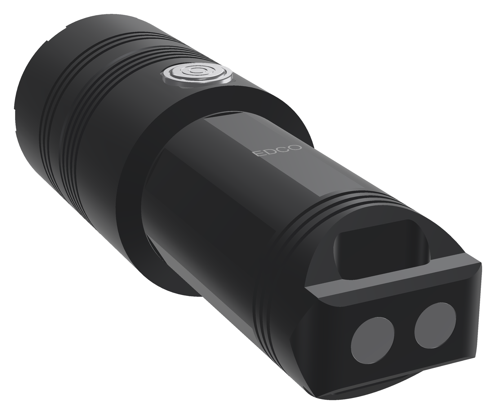 |
| **Tail.** The EDCO Mini's tab, with an obround hole for a split ring or a lanyard. | **M version.** Two magnets flush in the tab's end: the light stands on steel. |

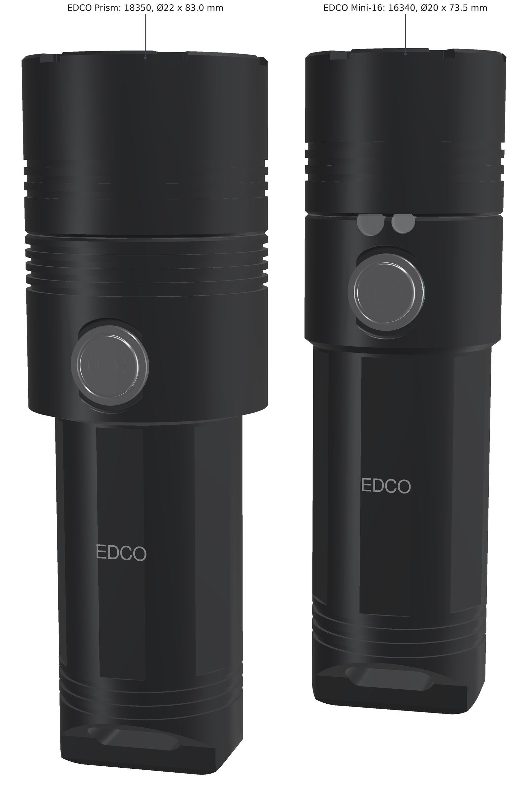

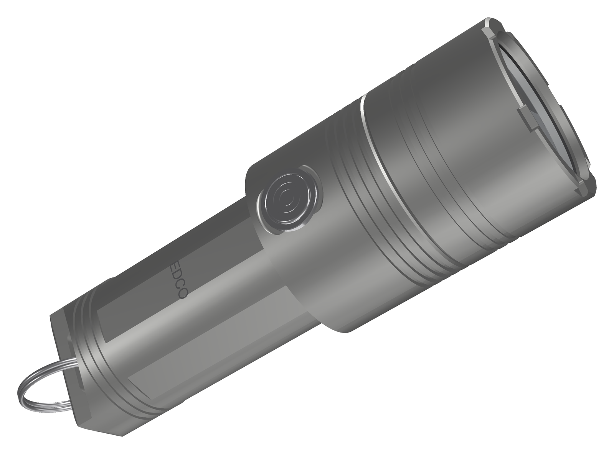

## Specifications

| Item | EDCO Prism |
|---|---|
| Size | Ø22 body, Ø28 head × 83.0 mm (with the keyring tab) |
| Aluminium parts (body, bezel, head insert; from the CAD) | 40.6 g (M: 40.3 g) |
| Whole light (estimate) | about 80 g, of which the cell about 24 g |
| LEDs | white: Luminus SST-20-W Gen 2, 6500 K, G1 bin, 3.0 A maximum. Red: Luminus SST-10-R, 621 nm typical, 1.5 A maximum (LCSC C17403621). Green: ams OSRAM OSCONIQ P 3030 GT QSSPA1.13, 528 nm, 1.3 A maximum. Blue: Luminus SST-20-B, 450 nm, 3 A maximum. All four on a 24 mm four-channel copper DTP board |
| Optic | Carclo 10623 frosted medium quad, Ø24 mm: 84.6 % / 84.7 % efficient and 25.7° / 30° wide with an XP-E / XP-G (Carclo's figures). The frosted face blends the colours. Carclo 10621 clear (87 %, 16.6° / 24°) throws further but shows coloured fringes close up. The height is not published; 11.5 mm is assumed |
| Turbo (simulated) | white LED at 2,850 mA plus red, green and blue at 667 mA each: about 1,470 lm at the LEDs and 1,248 lm out of the front, with the LEDs at 85 °C. The white LED alone (`TURBO_ALL` 0): 944 lm |
| Colours (simulated, estimates) | up to 1,000 mA per colour LED and 2,000 mA for the three together. At high: red 127 lm, green 272 lm, blue 34 lm (about 1.3 W of 450 nm light), amber 232 lm, white made of the three 303 lm, all out of the front |
| Throw (estimate) | about 3,000 cd, 110 m from the white LED with the frosted optic (from its 30° beam); about 4,700 cd, 137 m with the clear 10621 |
| Cell | Keeppower UH1835P: 1,200 mAh claimed (1,100 minimum), 10 A continuous (confirmed in an independent test), 35.0 × 18.3 mm flat top. The bay takes 18.6 × 35.3 mm. For more capacity: Keeppower UH1835P2, 1,600 mAh, 5 A (untested; set `BAT_MAX_MA` to 3500) |
| White driver | the EDCO Mini / EDCO v0.1 power stage: TI TPS62095 4 A buck in the LuxLibre current loop (TLV333, 20 mΩ sense), DW01A + a dual N-MOSFET in the cell minus |
| Colour driver | a TI TPS63020 buck-boost (LCSC C15483) makes a 3.45 V rail. Three linear current sinks (TLV9064 quad op-amp, an N-MOSFET and a 100 mΩ resistor each) sit on it, set by an MCP4728 4-channel I²C DAC. The colours stay the same down to an empty cell |
| USB-C | waterproof vertical SHOU HAN TYPE-C 16PFS LTH7.45 (LCSC C3020055), axial, in the side of the head. Its seal ring seals in a 2.7 mm wall, and the plug's overmould sits in a 12.8 × 7.0 mm pocket |
| Charging | 1 A: TI BQ24050 (LCSC C2859551), about 1 h 15 min (estimate) |
| Button | Ø7.0 mm stainless cap on a sealed, translucent membrane (Alps SKRKAEE020), lit from below by an RGB LED |
| Keyring, lanyard | a flat tab at the tail, 11 mm thick, with an obround hole 3.4 × 11 mm through it. A split ring of at least about 15 mm across (checked in the CAD with a 16.8 mm ring of 0.8 mm wire) or a lanyard cord goes through it |
| Magnets (M version only) | two supermagnete S-05-02-N52N, Ø5 × 2 mm, N52, about 680 g pull each on thick steel (rated), flush in the tab's end face with opposite poles out |
| Water | IPX8 is the target, not tested. Seals: the optic gasket, the face O-ring of the head insert, the button membrane, the USB-C socket's seal ring |
| Firmware | LuxLibre, board [`edco-prism`](../../firmware/boards/edco-prism/board.h) |

## Light and runtime (simulated)

LuxLibre simulator runs with the board header: 25 °C still air, a full cell, the default profile, and 10 mA for
the electronics while the light is on. Lumens are out of the front, with the LEDs at 85 °C.

| | EDCO Prism |
|---|---|
| Turbo (all four LEDs) | 1,248 lm for about 1 min (the 60 s turbo timer and the temperature regulator end it at about the same time) |
| Turbo from the white LED alone (`TURBO_ALL` 0) | 944 lm for 60 s |
| High (white, 1.5 A) | 578 lm for 5 min |
| Sustained (temperature regulator, `THM_LIMIT` 48 °C) | about 280-370 lm after 5 min, body at most 46.9 °C |
| Turbo from a half-full cell, at 30 s | 1,033 lm |
| On a 35 °C day | full turbo for 26 s, then about 160-240 lm; body at most 47.8 °C |
| Runtime from turbo to the ANSI end point | 1 h 29 min |
| Medium (244 mA, 113 lm) | 4 h 40 min |
| Low (40 mA, 18 lm) | 22 h 13 min |
| Moon (3 mA, 1.0 lm) | 83 h |
| Colour beam at high (1 A per colour LED) | red 127 lm, green 272 lm, blue 34 lm: full for 7-8 min, then regulated. White from the three colours: 303 lm (2 A in all), full for nearly 3 min |
| Green at high, to the ANSI end point | 1 h 36 min |
| Red at medium (163 mA, 23 lm) | 5 h 33 min |
| Charging an empty cell at 1 A | about 1 h 15 min |

* **A big head.** The finned head section, the bezel and the LED holder hold 28 g of aluminium. That keeps turbo
  for a full minute and high for five.
* **Turbo with all four LEDs** adds red, green and blue to the white LED (`TURBO_ALL` 1, the default): about
  30 % more light and a slightly warmer beam. They fade in only above "high", so the regulated output after turbo
  comes from the white LED alone, which makes the most light per watt.
* **Why moon is short-lived for its brightness**, as on EDCO Mini: the awake ESP32-C3 takes about 10 mA. Light
  sleep while on is the first firmware open point.

```sh
cd firmware
make sim BOARD=edco-prism
build/luxsim-edco-prism --preset board "2C W6000000"                          # turbo, then until empty
build/luxsim-edco-prism --preset board --set COLOR_SET=2 "5C W2000 H700 W900000"   # green at high
```

## Using the light

The modes layout, as on EDCO and EDCO Mini, plus the colour beam:

* **On and off:** 1 click. The white beam comes on at the brightness used last.
* **Brightness:** hold to step low → medium → high.
* **Turbo:** 2 clicks.
* **Momentary turbo:** click, then click and hold.
* **Battery check:** 3 clicks.
* **Lockout:** 4 clicks from off.
* **Colour beam:** **5 clicks from off**. It comes on in the colour and brightness used last.
  * **2 clicks:** the next colour. The button shows the new colour for a second.
  * **Hold:** brightness, as for white. "High" is the most the colour LEDs take.
  * **4 clicks:** switch between the white beam and the colour beam at the same brightness. This works both
    ways.
  * **1 click:** off.

At first, two clicks step through red, green, blue and a custom colour, which starts as amber. `COLOR_SET`
chooses the colours in the list: red, green, blue, yellow, cyan, magenta, white made of the three colour LEDs,
and the custom colour (`COL_R`, `COL_G`, `COL_B`). The light remembers the colour through a power cut.

**The button glows.** An RGB LED lights the button's membrane from below:
* the charge level for 2 s after switching on (green, amber or red);
* a slow red blink while charging, steady green when full;
* the beam's colour for a second when you change it;
* blinks that confirm lockout and other actions.

## The settings page (USB-C)

The [LuxLibre settings page](../../site/luxlibre/index.html) talks to the light over the USB-C cable. It runs in
Chrome or Edge on a computer; phones and tablets cannot do this. Nothing is installed or uploaded. **Try the
demo** shows the page with a simulated light.

* **Status:** state, beam and colour, level, charge, cell voltage and temperature.
* **Colours:** pick any colour with the colour picker or a swatch and see it on the light straight away. Choose
  which colours two clicks step through.
* **Every setting:** each parameter with its range and meaning, for example the modes, the turbo time, the
  temperature limit or the cell current limit. **Save to the light** stores them.

The page uses the firmware's text console, so a serial terminal works too (`help` lists the commands):

```
set COL_R 100
set COL_G 20
set COL_B 60
color 120 custom
save
```

## How it is built

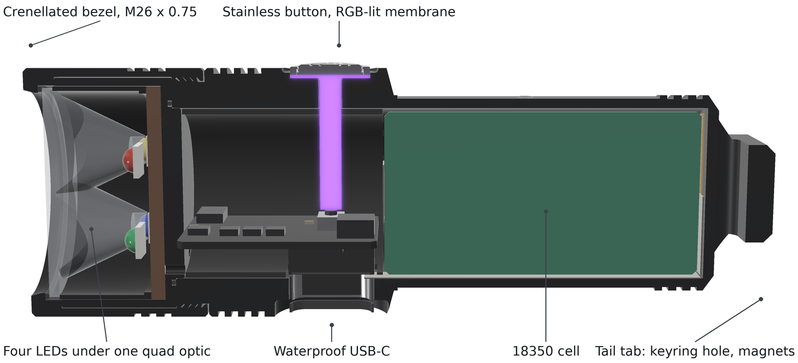

From the front to the tail:

1. **Bezel.** Crenellated, with three cooling fins. It screws onto the band's external M26 × 0.75 thread (2.7 mm
   of engagement) and is locked with thread-locker. Its lip presses the optic onto a silicone gasket, and its
   inner shoulder clamps the head insert, metal on metal, against the band's front face.
2. **Head insert.** The LED holder: a cup for the 24 mm optic, the four LEDs on their 24 mm copper board on a
   1.2 mm floor, a face O-ring on its rear face and a key in a band notch. The key stops it turning while the bezel
   is tightened, so the five LED wires (white + and −, and the three colour channels) never twist.
3. **Head section.** The front of the body, Ø28 like the bezel, with four cooling fins.
   * **USB-C:** the waterproof socket's shell goes through an axial hole in the bottom of the head. Its seal ring
     seals in the 2.7 mm of wall under a pocket that takes the plug's overmould.
   * **Button:** above the socket, so the board is backed by the socket when the button is pressed.
4. **Main board in a POM sled.** The board, 16.1 × 21.4 mm, lies across the bore.
   * Underneath: the socket, the MCU, the white channel's buck and the cell protection.
   * On top: the switch, the halo LED, the colour DAC, the op-amp, the three sink FETs and the buck's inductor.
5. **Cell.** Its + strip goes to the rear of the main board. The − strip runs forward along the bottom of the
   cell.
6. **Tail.** Closed, with three grooves over the end of the cell, then the **keyring tab** of EDCO Mini, scaled to
   the Ø22 body.
   * **Tab:** the round tube bevels down at 55° on two sides to a flat tab 11 mm thick, as wide as the body,
     with R4 end corners and 1 mm end chamfers.
   * **Keyring hole:** 3.4 × 11 mm, with 1.2 mm of metal to the cell bay and 3.0 mm to the end.
   * **M version:** two magnets bonded into pockets in the tab's flat end face, opposite poles out. Both versions
     are the same length.

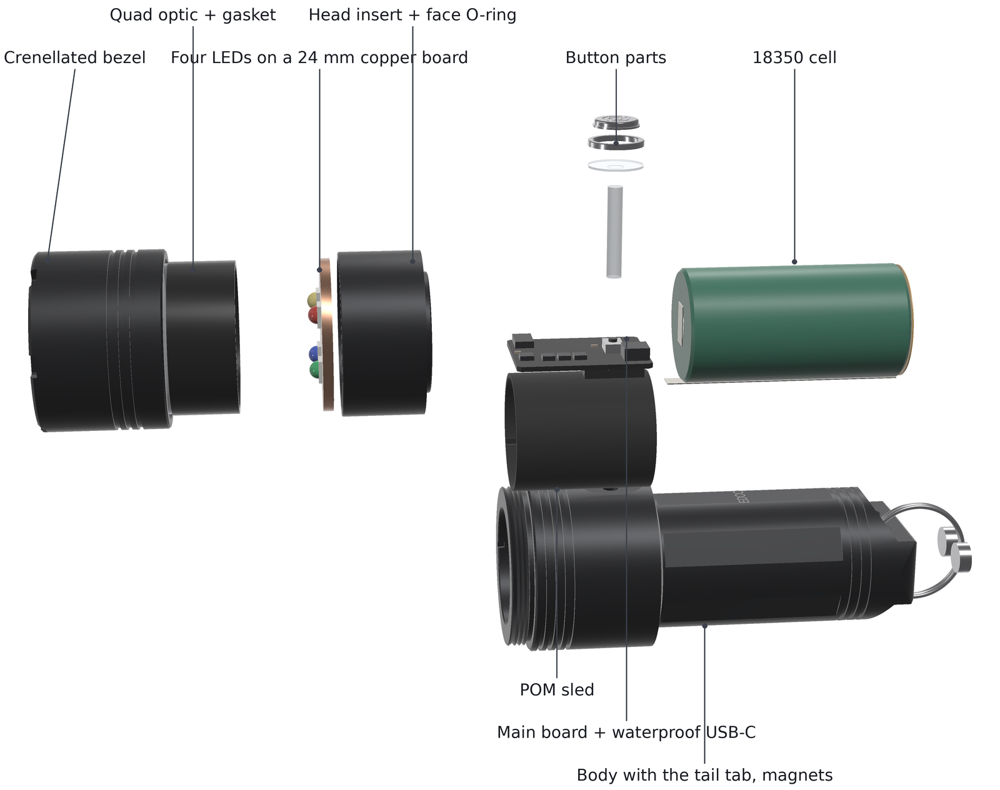

### Assembly (once, for good)

1. **Bench-test the cartridge.**
   * Weld the strips to the cell. Solder the cell and the five LED wires to the main board.
   * Test the cartridge on the bench and flash the firmware over USB-C.
2. **Insert the cartridge.** Slide it into the tube with the socket facing its hole. Press the socket's seal ring
   into the hole from inside, and check from outside that the shell sits centred.
3. **Fit the button.** Fit the clear pin, the membrane, the cap and the button collar (press-fit with retaining
   compound).
4. **Fit the head.** Fit the head insert with its face O-ring, the LED board on paste, the optic and its gasket.
   Screw on the bezel with medium-strength thread-locker.
5. **Finish the tail.** In the M version, bond the two magnets into their pockets, opposite poles out. Thread the
   split ring or the lanyard through the tab's hole.

## Electronics: what changes from EDCO Mini

| EDCO Mini-16 | EDCO Prism |
|---|---|
| one SST-20 Gen 2 on a 16 mm board, LEDiL TINA-RS | white SST-20 Gen 2 plus red, green and blue LEDs on a 24 mm four-channel board, Carclo 24 mm quad optic |
| TPS62095 white driver, 2,850 mA | unchanged |
| red and UV side lights straight from the cell | the colour beam: a TPS63020 3.45 V rail and three linear sinks, set by an MCP4728 DAC on I²C (GPIO9 and GPIO10, the side lights' pins). The DAC's fourth channel switches the TPS63020 on while a colour LED is lit; with every colour off, the DAC's channels are powered down |
| Vapcell INR16340 T6, 650 mAh | Keeppower UH1835P 18350, 1,200 mAh claimed |
| BQ24050 at 1 A, ESP32-C3FH4, RT9080, NTC, RGB halo | unchanged |

The colour beam is new in the LuxLibre firmware, for every board that sets `LX_HAS_COLOR`:
* the core: the gestures, the colour list and the custom colour (`COLOR_SET`, `COL_R`, `COL_G`, `COL_B`),
  turbo with all LEDs (`TURBO_ALL`), the halo showing the colour, and memory of the colour through a power
  cut;
* the same protection as the white beam: the temperature regulator, the cell current limit (`BAT_MAX_MA`), the
  low-voltage cut-off, lockout and pocket protection;
* `hal::set_color()` in every port (on the ESP32-C3 through the MCP4728), a console command `color N [NAME]`, a
  colour-LED model in the simulator, a test board and tests.

## Cost (rough estimate)

There is no workbook yet. The Prism has EDCO Mini's parts plus three colour LEDs, the colour driver (buck-boost,
DAC, op-amp, three FETs) and a larger optic and head, less the side lights and rods. Roughly 700-800 USD for one
light, about 240-280 USD each for five, all fees, shipping and VAT included (estimate).

## Drawings and animations

| 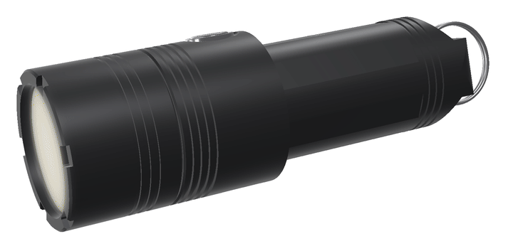 | 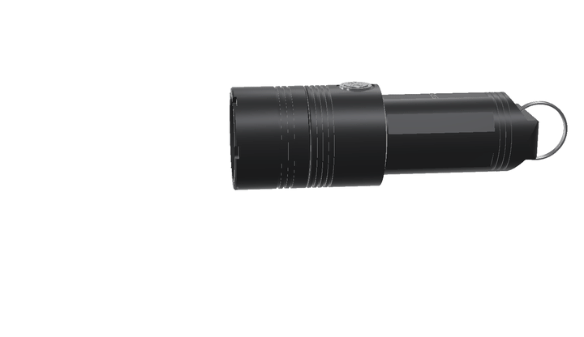 |
|---|---|
| **Turning.** The beam steps through its colours; the finned head, the RGB button, the USB-C socket in its pocket, the tail tab. | **Coming apart.** Bezel, quad optic, the four LEDs on their copper board, head insert, button parts, main board, cell, body with magnets. |

[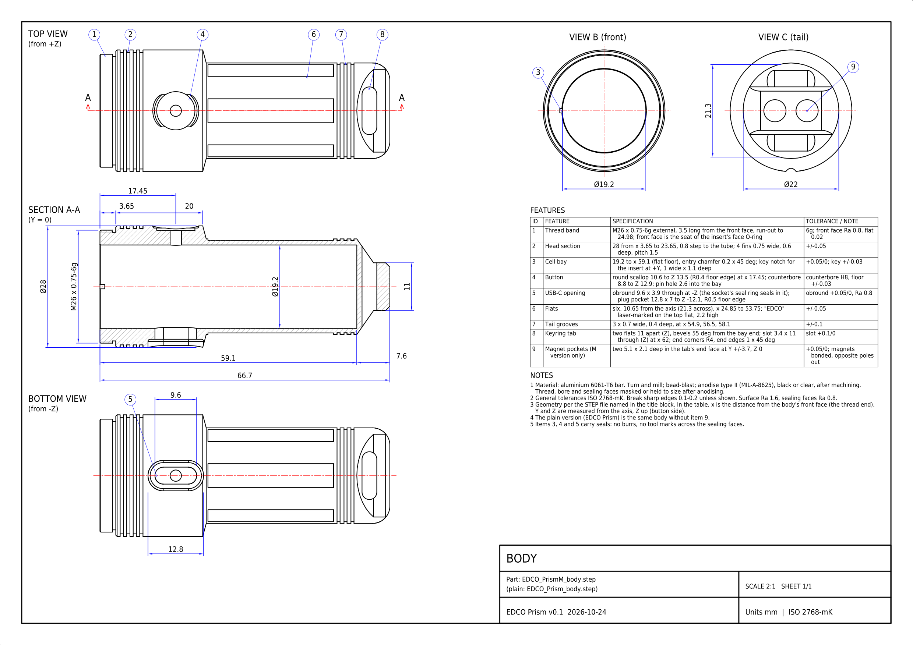](cad/EDCO_Prism_body_drawing.pdf)

**Body drawing:** [PDF](cad/EDCO_Prism_body_drawing.pdf), [DXF](cad/EDCO_Prism_body_drawing.dxf). The M body is drawn; the
plain body is the same without the two magnet pockets (item 9). The drawings are A3 sheets at 2:1, made from the same parameters as the STEP files by [hardware/tools/edco_drawings.py](../tools/edco_drawings.py). Each has the outline, a section, the end views and a feature table with tolerances, and every dimension on it is checked against the solid ([check report](../tools/edco_drawings_check.txt)). The animations are made by [hardware/tools/edco_anim.py](../tools/edco_anim.py). All of them are renders and drawings of the design: nothing has been built yet.

## What has been checked

* **CAD interference:** no part overlaps a neighbour in either version (45 pairs, 47 with the magnets). They
  include:
  * body / head insert, bezel / insert, body / sled, sled / board, body / cell;
  * the optic and the LEDs, the insert and the LED board, the bezel and the optic;
  * body / USB-C shell, seal ring and socket body; the board's parts and the sled;
  * body / button pin and collar, body / magnet, body / face O-ring;
  * body / split ring, magnets / split ring.
* **Walls:**
  * 1.4 mm over the cell, 1.05 mm under the flats;
  * 4.4 mm in the head section (3.8 mm under its fins), 3.3 mm under the button counterbore;
  * 2.94 mm at the thread root, 2.89 mm at the run-out;
  * 0.95 mm in the bezel over the insert, 0.6 mm at its fins; 0.9 mm of insert round the optic;
  * tail: 1.0 mm under the tail grooves; 1.2 mm from the cell bay to the keyring hole, 3.0 mm from the hole to the
    end, 4.03 mm beside it;
  * M version: 0.9 mm from the magnet pockets to the keyring hole, 1.95 mm to the end chamfers, 0.75 mm to the
    rounded corners.
* **Below JLCCNC's recommended 0.8 mm (above their 0.5 mm minimum):** the bezel at its fins (0.6 mm) and the
  magnet pockets to the rounded corners (0.75 mm, M version).
* **Fits:**
  * Main board: 16.1 × 21.4 mm, 0.3 mm from the bore.
  * Socket: mouth 1.9 mm below the head's crest, in the plug pocket; 2.7 mm of wall for the seal ring.
  * Button pin: 14.5 mm.
  * Cell radial room: 0.45 mm with an 18.3 mm cell.
* **Firmware:** the colour beam's behaviour tests (gestures, the colour list, memory through a power cut, the
  custom colour, lockout and an empty cell, the cell current limit, the temperature regulator, turbo with all
  LEDs, the console) on a simulated colour board. All 529 unit and 263 behaviour checks pass, and the ESP32-C3,
  ATtiny1616 and CH32V003 builds pass.
* **Light and heat:** simulated, as above.

All numbers are in [cad/edco_prism_interface.json](cad/edco_prism_interface.json), written by
[tools/housing/edco_prism.py](tools/housing/edco_prism.py).

## Open points before the first order

* **More white.** The white peak is about 15 % below the benchmark's. A Cree XHP35.2 HD (12 V, the same 3.45 mm
  size) is claimed at 1,700-1,950 lm, but its datasheet was not checked. It would need a buck-boost such as TI's
  TPS55288 instead of the TPS62095.
* **The optic.**
  * Carclo publishes neither the 24 mm quads' height (11.5 mm is assumed) nor their LED positions as text
    (4.4 mm from the axis is assumed). Buy samples and measure them.
  * Different colours come from different cavities, so mixed colours show fringes close up. The frosted 10623
    blends them; check it on a wall.
  * The throw figures are estimates from the beam angle.
* **The colour LEDs.**
  * Their flux at 1 A is estimated from the datasheets' 350 mA values. Red loses much more light than the others
    when hot.
  * Pick the SST-10-R in the 620 nm bin (615 nm looks orange, 630 nm deep red).
  * The OSCONIQ green comes in reels of 900 at Farnell: buy cut tape elsewhere for a prototype.
* **The cell.** The UH1835P's 10 A is confirmed; its capacity is about 1.1 Ah in forum tests and may drop in later
  batches. The 1,600 mAh UH1835P2 is untested.
* **The colour sinks' heat.** At 1 A the red LED's sink takes about 1 W. The board needs copper and a contact to
  the sled and the head, to be checked when the board is drawn.
* **The USB-C socket**, as on EDCO Mini: the C3020055's outline, hole size and seal are not published as text.
  Buy samples, measure them, set the hole and the pocket, and test the seal under water.
* **Firmware and the settings page.**
  * Light sleep while on: the awake ESP32-C3 draws about 10 mA (see moon).
  * The MCP4728 code in the ESP32-C3 port is compiled but untested on hardware.
  * The settings page is tested against a simulated light and a fake serial port, not a real light yet. Check
    that opening the port does not restart the ESP32-C3 (its USB serial port can reset the chip through the
    DTR and RTS lines).
* **The board.** It is larger than EDCO Mini's but holds more parts (two converters, the DAC and the sinks):
  4 layers and 0201 parts, to be proven when the board is drawn.
* **The tail tab and the magnets**, as on EDCO Mini: the tab is milled after turning; the rated pulls are for thick
  steel.
* **Replacing the cell** ([BAT-2](../../docs/design-rules.md#bat-2)), as for EDCO: fine for your own light. From
  18 February 2027, though, a light sold in the EU must let its user replace the cell.
* **The boards, drawings, order files and a parts and cost workbook**, as for the other EDCO designs.

## Files

| Path | What |
|---|---|
| [cad/](cad/) | for each version (`EDCO_Prism_*`, `EDCO_PrismM_*`): the body and the assembly as STEP; the bezel and head insert once (plain thread diameters) |
| [cad/edco_prism_interface.json](cad/edco_prism_interface.json) | sizes, walls, fits, masses, the LED positions, the thermal split and the interference check |
| [cad/EDCO_Prism_body_drawing.pdf](cad/EDCO_Prism_body_drawing.pdf), [.dxf](cad/EDCO_Prism_body_drawing.dxf), [.png](cad/EDCO_Prism_body_drawing.png) | the body drawing (A3, 2:1; the M body, with the magnet pockets marked) |
| [tools/housing/edco_prism.py](tools/housing/edco_prism.py) | the CadQuery model (all dimensions in class `P`, the LED layout in `LEDS`): `python3 edco_prism.py ../../cad` |
| [tools/housing/edco_prism_render.py](tools/housing/edco_prism_render.py) | the renders: `xvfb-run -a python3 edco_prism_render.py ../../assets` (uses the FlashKa v0.7 and EDCO Mini renderers) |
| [../tools/edco_drawings.py](../tools/edco_drawings.py), [../tools/edco_anim.py](../tools/edco_anim.py) | the drawings and the animations of all EDCO designs: `python3 hardware/tools/edco_drawings.py`, `xvfb-run -a python3 hardware/tools/edco_anim.py` (from the repository root) |
| [../../firmware/boards/edco-prism/](../../firmware/boards/edco-prism/board.h) | the firmware board header, with the LED, colour and thermal models for the simulator |
| [../../site/luxlibre/](../../site/luxlibre/index.html) | the settings page (Web Serial) |

Licences as for the rest of LuxLibre: hardware CERN-OHL-W-2.0, firmware and tools GPL-3.0-or-later, this page
CC-BY-SA-4.0 ([LICENSING.md](../../LICENSING.md)).
