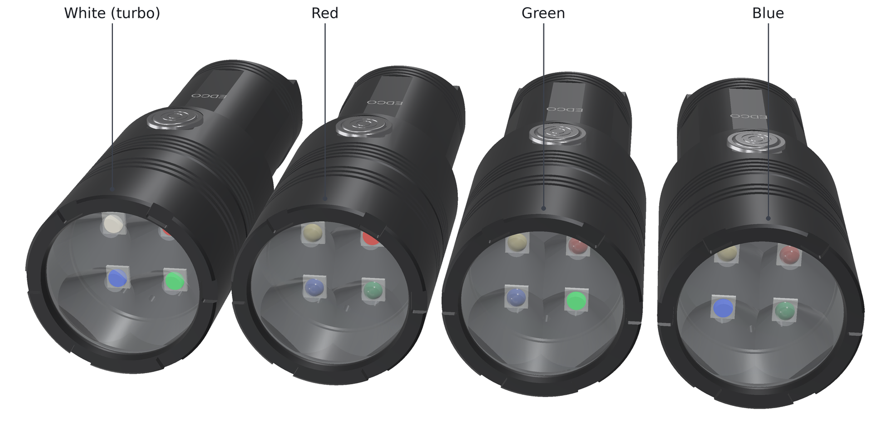

<!-- SPDX-License-Identifier: CC-BY-SA-4.0 -->
[LuxLibre](../../../README.md) › [Lights](../../../hardware/README.md) › [EDCO Prism](../README.md) › Pictures

# EDCO Prism: pictures

Renders and animations made from the design files. Nothing here is a photo: the light has not been built yet. The renders are made by [edco_prism_render.py](../tools/housing/edco_prism_render.py), the animations by [hardware/tools/edco_anim.py](../../tools/edco_anim.py).

## Animations

|  |  |
|---|---|
| The beam stepping through the colours of the firmware's list: white turbo, red, green, blue, yellow, cyan, magenta, white from the three colours, amber `prism_colours.gif` | EDCO PrismM coming apart into its parts and back `prism_exploded.gif` |
|  | |
| EDCO PrismM turning about its axis while the beam steps through its colours `prism_turntable.gif` | |

## Renders

|  |  |
|---|---|
| Prism colours `prism_colours.png` | Exploded view of EDCO PrismM `prism_exploded.png` |
|  |  |
| EDCO Prism and EDCO Mini-16 `prism_family.png` | Front: the quad optic over the white, red, green and blue LEDs `prism_front.png` |
|  |  |
| EDCO PrismM, black anodised: crenellated bezel, finned head, the RGB-lit stainless button, a split ring through the tail tab `prism_hero.png` | EDCO Prism without magnets, natural anodising `prism_hero_natural.png` |
|  |  |
| Tail of the M version: two magnets in the tab's end `prism_m_tail.png` | Underneath: the waterproof USB-C socket in its pocket `prism_port.png` |
|  |  |
| Half section of EDCO PrismM `prism_section.png` | Tail: the keyring tab with a split ring `prism_tail.png` |
