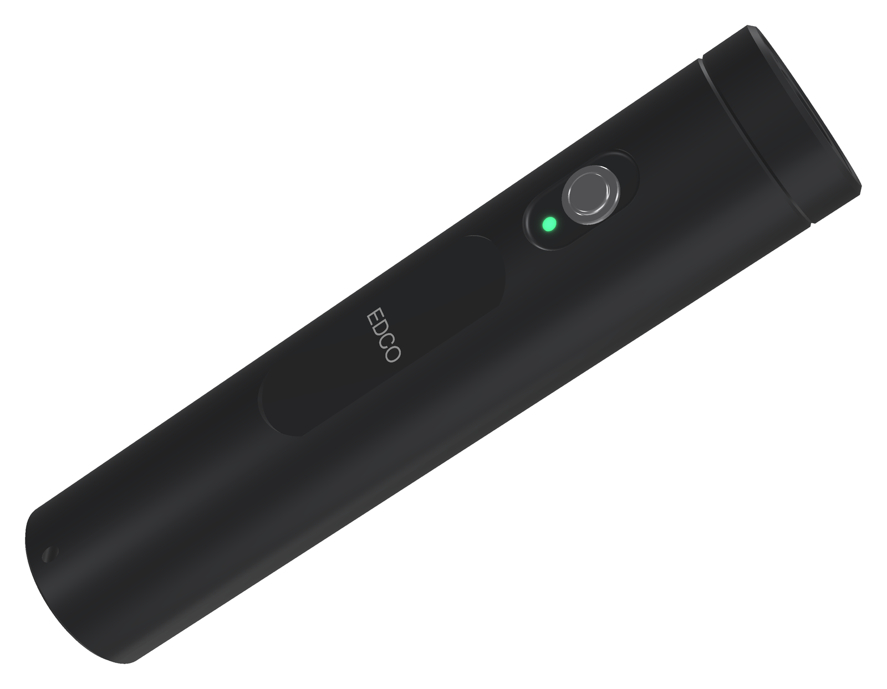
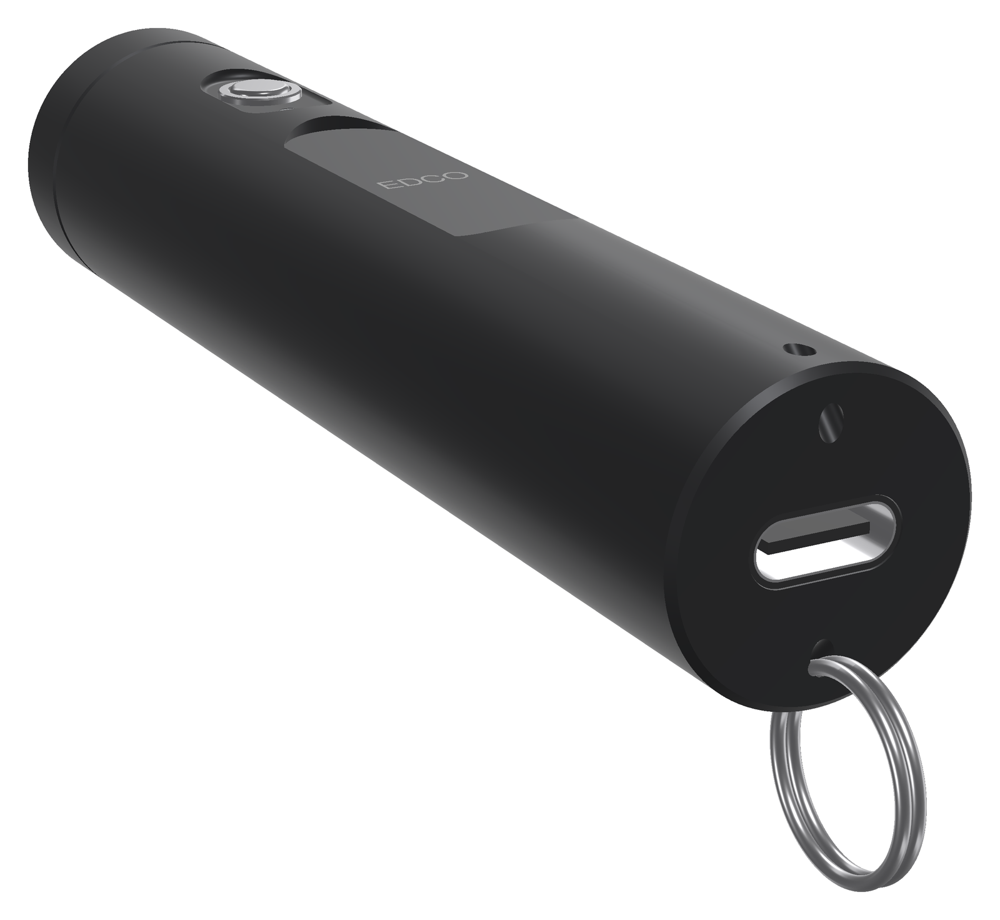
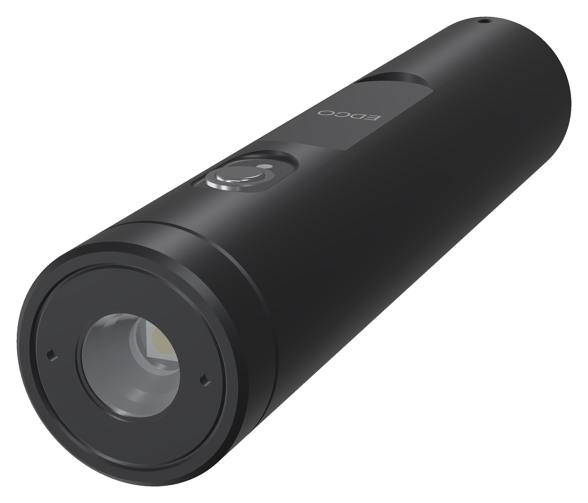
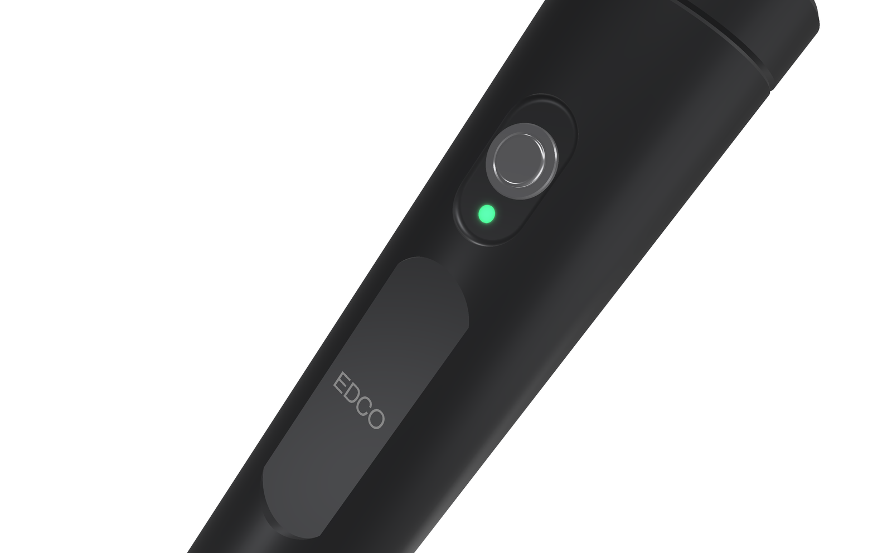
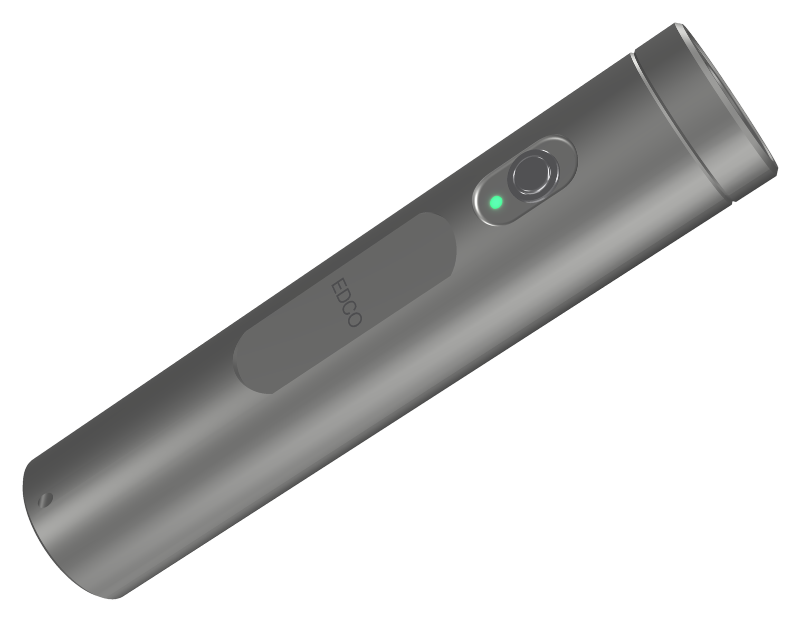
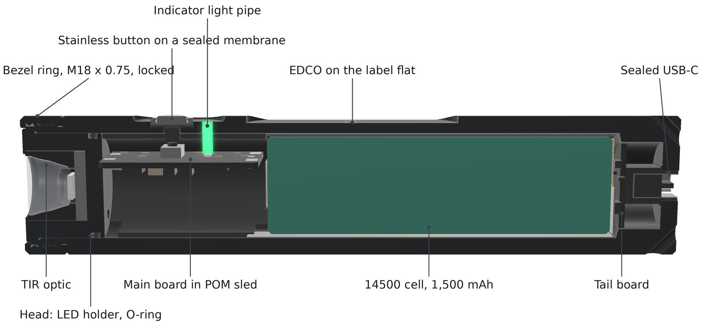
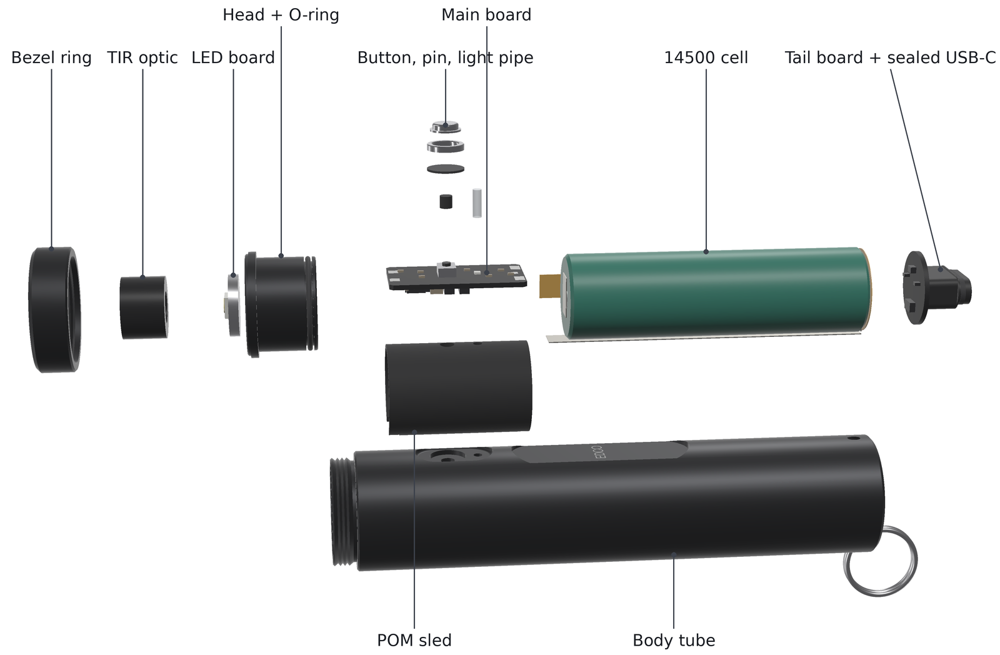
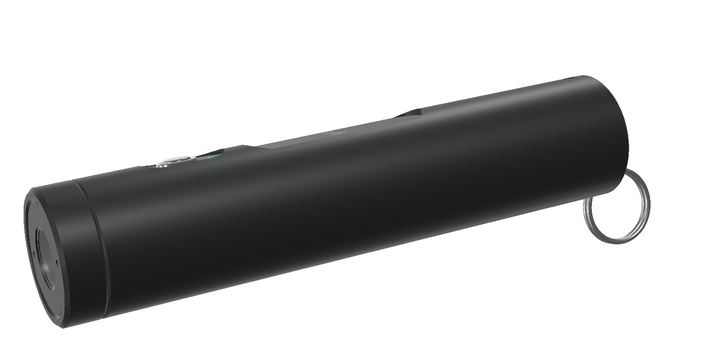
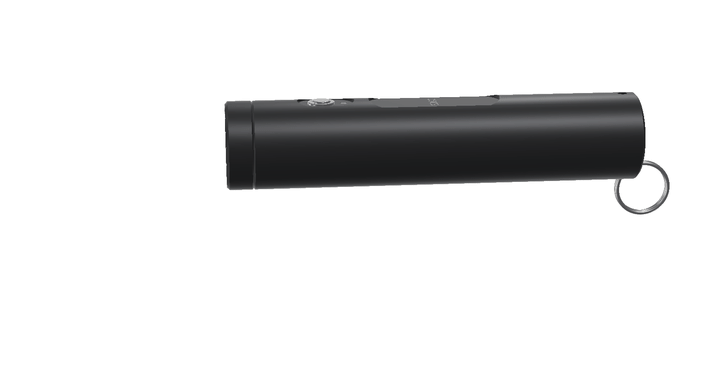
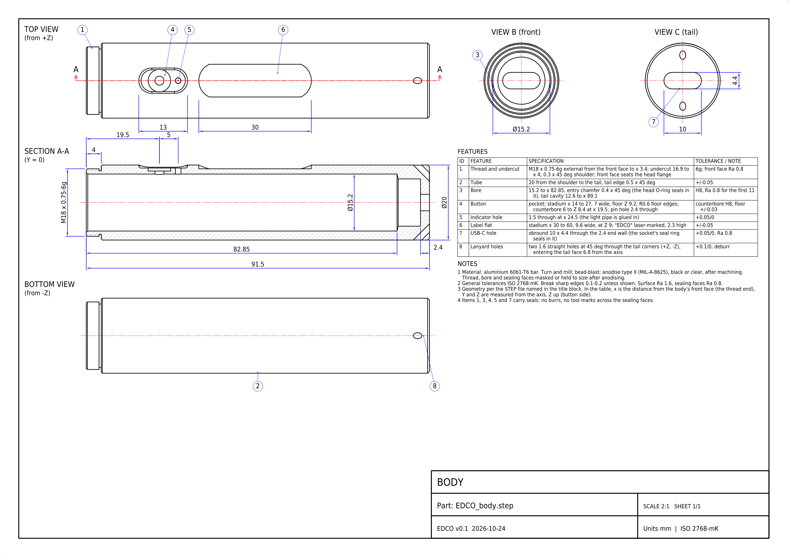

<!-- SPDX-License-Identifier: CC-BY-SA-4.0 -->
[LuxLibre](../../README.md) › [Lights](../README.md) › EDCO v0.1

# EDCO v0.1

**On this page:** [What EDCO is for](#what-edco-is-for) · [Specifications](#specifications) · [How it is built](#how-it-is-built) · [Light and runtime](#light-and-runtime-simulated) · [Using the light](#using-the-light) · [Electronics](#electronics-what-changes-from-the-v07-board) · [Cost](#cost-rough-estimate) · [Drawings and animations](#drawings-and-animations) · [What has been checked](#what-has-been-checked) · [Open points before the first order](#open-points-before-the-first-order) · [Files](#files)

EDCO is LuxLibre reference design #2: a round, sealed everyday-carry light. The body is a
Ø20 × 93.5 mm aluminium tube with a closed tail, and it runs on one 14500 Li-ion cell. There is no
laser and no radio. Charging, firmware updates and settings all go through one sealed USB-C socket
in the tail. The light inside is the 1000 lm power stage of
[FlashKa Keychain v0.7](../flashka-keychain-v07/README.md): an SST-20 Gen 2 LED behind a LEDiL TIR
optic and a 4 A driver.



*Render made from the design files.*

> **Status: concept (v0.1).** The housing is modelled in CadQuery and checked for fits and
> walls. The firmware board header exists, and the light output is simulated with the LuxLibre
> simulator. The circuit boards are **not drawn yet**, and nothing has been built or measured.
> Every light figure on this page is simulated. The light holds a lithium cell: read
> [SAFETY.md](../../SAFETY.md) first.

## What EDCO is for

These are the owner's requirements for this design:

* **No laser and no Bluetooth.** Charging, firmware updates and settings go through USB-C only.
* **A round body**, so it can be sealed with O-rings.
* **Slide-in internals with a screwed-on front.** The battery and the electronics slide in from
  the front, and the front screws on and stays on for good.
* **The look:** a slim round light with one stainless side button in a milled pocket near the
  head and a flat label panel below it.
* **At most 100 mm long.** EDCO is 93.5 mm.
* **Carried over from FlashKa:** at least 1000 lm and about 100 m of throw.

## Specifications

| Item | Value |
|---|---|
| Size and mass | Ø20.0 × 93.5 mm. Aluminium parts weigh 37.9 g (tube 33.1, head 3.6, bezel ring 1.2; calculated from the CAD solids). About 65 g complete with the cell (estimate, not weighed) |
| Body | 6061-T6 tube with a closed tail, turned and milled, bead-blasted and anodised black or clear (clear gives a titanium look). It has a Ø15.2 mm bore for the cell and the electronics, a scalloped button pocket, a label flat with a laser-marked "EDCO", and two lanyard holes through the tail corners |
| Front | The bezel ring screws onto the tube's external M18 × 0.75 thread and is locked with thread-locker. It clamps the head (the LED holder) onto the tube's front face. The head seals in the bore with a 13 × 1 O-ring, and the TIR optic is glued into the head |
| LED and optic | Same as FlashKa v0.7: Luminus SST-20 Gen 2, 6500 K, G1 bin, on a 10 mm copper DTP board, under a LEDiL LISA3-RS-PIN TIR optic (20° beam). The head and the tube are the heat sink |
| Light output | **Simulated** with the LuxLibre simulator and the LED at 85 °C. Turbo gives 966 lm out of the front (about 1,045 lm in the first seconds with a cool LED, as for v0.7). It holds full turbo for 74 s if the 60 s turbo timer is off. High gives 592 lm for about 4 minutes (237 s). After that it settles at about 290 lm with the body at 47.4 °C. Runtime from turbo to the ANSI end point is about 141 minutes. Throw is 6,605 cd / 162.5 m at switch-on, the same LED and optic as v0.7. More in [Light and runtime](#light-and-runtime-simulated) |
| Battery | One Vapcell INR14500 F15 (1,500 mAh typical, 3 A, 14.0 × 49.0 mm), as on v0.7. Nickel strips are spot-welded to both ends. The cell is protected on the main board by a DW01A IC and an SE8830A dual MOSFET |
| Charging and USB | One USB-C socket in the centre of the tail face. It is a waterproof vertical socket whose seal ring seals inside the obround hole of the tail wall. TP4057 linear charger at about 500 mA (about 3.5 h). USB 2.0 data goes to the chip's built-in USB serial/JTAG port: firmware updates and settings |
| Button | One stainless cap on a clamped silicone membrane (a static seal), held by a stainless collar in a counterbore of the pocket. A POM pin carries the press through the wall to an Alps SKRK tactile switch on the main board |
| Indicator | One RGB LED on the main board shines up a Ø1.45 mm PMMA light pipe that is glued into the pocket below the button. It shows charging and battery state |
| Electronics | ESP32-C3FH4 chip (QFN-32, 4 MB flash, rated to 105 °C) with a 40 MHz crystal and **no antenna**: the radio is never started. TPS62095 4 A buck in the TLV333 current loop (as v0.7), TP4057, DW01A + SE8830A, RT9080 LDO, NTC. One main board (12 × 22 mm, 4 layers, 0.8 mm) in a black POM sled, a round tail board (Ø12.2 mm) with the socket, and a 4-wire flex between them |
| Water | IPX8 is the target (not tested). There are five seals: head O-ring, glued optic, button membrane, the socket's own seal ring, glued light pipe |
| Firmware | The LuxLibre firmware on its ESP32-C3 port, board [`firmware/boards/edco-v01`](../../firmware/boards/edco-v01/board.h): one-button user interface, thermal regulator, low-voltage protection, a text console over USB for settings |
| Cost | About 710 USD for one light and about 235 USD per light when five are made, all fees, shipping and VAT included. This is a rough estimate scaled from the v0.7 workbook ([Cost](#cost-rough-estimate)) |

|  |  |
|---|---|
| **Tail.** The USB-C socket in the centre, a lanyard hole through each corner. | **Front.** The bezel ring, the head with two spanner holes, the TIR optic. |
|  |  |
| **Button.** Stainless cap and collar, indicator light pipe, laser-marked label. | **Clear anodised.** The same light in bead-blasted natural aluminium. |

## How it is built



From the front to the tail:

1. **Bezel ring** (x = 0–6 mm). It screws onto the tube and clamps the head flange.
2. **Head** (the LED holder). This is a solid aluminium part. The optic is glued into its front
   bore and the LED board sits on its floor. The 2.4 mm floor behind the LED carries the heat into
   the spigot. The spigot sits in the tube bore on thermal paste and carries the O-ring. Two wire
   holes take the LED wires to the main board.
3. **Main board in a POM sled** (x = 12–34 mm). The sled passes the axial load from the cell to
   the head, holds the board in two slots and guides the button pin and the light pipe.
4. **The cell** (x = 35–84 mm). The + strip goes to the rear end of the main board. The − strip
   runs back along the bottom of the cell. A 4-wire polyimide flex (VBUS, D+, D−, GND) runs along
   the +Y side of the cell to the tail board.
5. **Tail board and USB-C socket** (x = 85–93.5 mm). The socket's seal ring sits in the obround
   hole of the 2.4 mm tail wall. Its mouth sits 0.1 mm behind the tail face, which a USB-C plug
   needs to seat fully.



### Assembly (once, for good)

1. Weld the nickel strips to the cell, solder the cell, the flex and the LED wires to the boards,
   and test the cartridge on the bench (the [bring-up](../../docs/testing.md#bring-up-of-a-new-board)).
   Flash the firmware over USB. This is the last time the electronics are open.
2. Slide the cartridge (tail board first) into the tube. The obround socket finds its hole and
   sets the rotation of the whole cartridge, which brings the switch under the button hole.
3. From outside, drop in the POM pin and the light pipe (glue it), then the membrane, the cap and
   the collar (press-fit with retaining compound).
4. Glue the optic into the head, seat the LED board on paste, fit the O-ring, and push the head
   into the bore.
5. Screw on the bezel ring with medium-strength thread-locker, holding the head still with a pin
   spanner in its two face holes so that the LED wires do not twist.

### Why it is built this way

* **USB-C in the tail, not on the side.** A waterproof vertical socket with its own seal ring
  seals in a straight hole. The tail wall is flat and square to the axis, and the cartridge
  presses the socket into it. On the side of a round tube the socket would face a curved wall and
  could only be sealed with a rubber cover. With the port in the tail, the lanyard holes go through
  the two tail corners, one on each side of the port.
* **A clamping ring instead of a screwed head.** If the head itself were screwed on, the LED wires
  would twist by every turn of the thread. Instead, the head slides in without turning and only
  the ring turns. The O-ring sits on the solid head, so no thin wall has to carry a seal groove.
  Turning the ring is the only screwing the light needs.
* **The head is the heat sink, and the tube is right behind it.** The LED heat crosses about
  390 mm² of pasted contact into a tube with 133 mm² of metal in its cross-section (FlashKa v0.7
  had about 80 mm²). In the simulator this gives a longer turbo and a longer High than v0.7 from
  the same LED and cell.
* **One button.** Without Bluetooth there is no presenter mode, so the v0.7 next and previous keys
  are gone. The LuxLibre one-button interface does the rest.
* **The ESP32-C3 stays, without its radio.** The same chip family keeps the existing firmware port,
  its USB serial/JTAG console and the web installer, and the ROM can always be reached over USB.
  So the light can always be updated, even after a bad image, and it needs no programmer and no
  boot button. The bare chip is much smaller than the v0.7 module. Espressif allows the RF pin to
  be left unconnected when the radio is not initialised
  ([hardware checklist](https://docs.espressif.com/projects/esp-hardware-design-guidelines/en/latest/esp32c3/schematic-checklist.html)).
* **Same cell, same light engine.** The F15 stays, as chosen for v0.7. A Ø20 mm tube takes it with
  a 2.4 mm wall and 0.6 mm of radial room for the strip and the flex.

## Light and runtime (simulated)

The LuxLibre simulator was run on both board headers: `firmware/boards/edco-v01` and
`firmware/boards/flashka-keychain-v07`. The settings were 25 °C still air, a full cell and the
default profile. Lumens are out of the front with the LED at 85 °C, the datasheet's reference. In
the first seconds a cool LED gives about 8 % more.

| | EDCO v0.1 | FlashKa v0.7 (same simulator) |
|---|---|---|
| Turbo | 966 lm | 966 lm |
| Full turbo with the 60 s timer off | 74 s | 56 s |
| High (1.5 A) at full output | 592 lm for 237 s | 592 lm for 184 s |
| Sustained (temperature regulator) | about 290 lm, body 47.4 °C | about 290-300 lm, body 46.8 °C |
| Temperature limit (`THM_LIMIT`) | 49 °C | 50 °C |
| Turbo from a half-full cell, at 30 s | 774 lm | 774 lm |
| Runtime from turbo to the ANSI end point | 141 min | 138 min |
| Throw at switch-on | 6,605 cd, 162.5 m (same LED and optic) | 6,605 cd, 162.5 m |

The round tube couples the head to the body more tightly than the octagon. That spreads the heat
better, but it also lets the body get closer to the sensor temperature. EDCO therefore uses
`THM_LIMIT` 49 (v0.7: 50), which keeps the held surface below the 48 °C of
[THM-1](../../docs/design-rules.md#thm-1). On a 35 °C day the body reaches 48.3 °C in the
simulation, at about 180 lm. Reproduce the runs with:

```sh
cd firmware
make sim BOARD=edco-v01
build/luxsim-edco-v01 --preset board --csv turbo.csv "2C W900000"
build/luxsim-edco-v01 --preset board --set TURBO_S=0 "2C W900000"
build/luxsim-edco-v01 --preset board --set UI_STYLE=0 --set MEMORY=0 --set MEM_LEVEL=138 "1C W900000"
build/luxsim-edco-v01 --preset board --csv run.csv "2C W16000000"
```

## Using the light

The default is the LuxLibre "modes" layout ([full table](../../docs/firmware/user-interface.md)).

| Light is | Do | Result |
|---|---|---|
| off | click | on at the last mode |
| off | hold | moonlight (3 mA) |
| off | 2 clicks | turbo (60 s, then High) |
| off | 3 clicks | battery check (blinks) |
| off | 4 clicks | lockout on or off |
| on | click | off |
| on | hold | next mode: Low 19 lm, Medium 119 lm, High 592 lm |
| on | 2 clicks | turbo, and back |

**Settings and updates over USB-C.** Plug the light into a computer. The LuxLibre console answers
on the USB serial port: `status`, `list`, `set NAME VALUE`, `save`, and so on
([console](../../docs/firmware/README.md#the-console)). Firmware is written with `idf.py flash` or
a Web Serial installer page like the FlashKa one. A single EDCO page that does both (settings and
installer) is on the to-do list.

## Electronics: what changes from the v0.7 board

| v0.7 part | EDCO |
|---|---|
| ESP32-C3-MINI-1 module (U4) | ESP32-C3FH4 chip, LCSC C2858491, plus a 40 MHz ±10 ppm crystal (Murata XRCGB40M000F1S1DR0, C1870453), its load capacitors and the decoupling from Espressif's checklist. No antenna and no matching network, and the RF pin is left open. Pads for 22 Ω series resistors on D+ and D− |
| Laser: Q1 AO3401A, S2 slide switch, R19, J5, the laser module | removed |
| Key board: three switches, two ring LEDs, six pogo pins | one SKRKAEE020 switch (C115357) and one RGB LED (NH-B1010RGBT, C2874113) on the top side of the main board; the button ladder becomes one digital input |
| USB-C TYPE-C-31-M-12 on the main board | a tail board with a waterproof vertical socket, SHOU HAN TYPE-C 16PFS LTH7.45 IPX8 (C3020055, JLCPCB can assemble it), the two 5.1 kΩ CC resistors and ESD protection. Alternative: Same Sky UJ20-C-V-SMT-TR-68 (IP68, silicone O-ring) |
| — | a 4-wire flex (VBUS, D+, D−, GND, about 62 mm) between the tail board and the main board |
| power stage, protection, charger, LDO, NTC | unchanged |

Planned pin map (the v0.7 map with a digital button): GPIO0 cell voltage, GPIO1 NTC, GPIO2 / 8 / 21
indicator blue / green / red, **GPIO3 button** (a deep-sleep wake-up pin), GPIO4 / 5 charger
status, GPIO6 LED current set point, GPIO7 driver enable, GPIO18 / 19 USB D− / D+, GPIO20 charge
current, GPIO9 boot strap (test pad only).

## Cost (rough estimate)

There is no EDCO workbook yet. These numbers are scaled from the v0.7 workbook
([FlashKa_Parts_List_v0.7.xlsx](../flashka-keychain-v07/FlashKa_Parts_List_v0.7.xlsx)), with the
same scenarios, Lithuania, all fees, shipping and VAT.

| | One light (USD) | Five lights, per light (USD) |
|---|---|---|
| FlashKa v0.7 (workbook) | 859 | 299 |
| no rubber-key casting supplies and mould | −89 | −18 |
| no laser module | −24 | −24 |
| no pogo pins | −25 | −11 |
| three turned parts instead of the milled octagon tray and lid (estimate) | −20 | −15 |
| stainless cap and collar, POM sled and pin instead of the PMMA and POM-C kits (estimate) | 0 | 0 |
| flex PCB and the tail board in the panel (estimate) | +25 | +6 |
| waterproof socket, O-ring, membrane, light pipe | +6 | +5 |
| less VAT on smaller orders | −22 | −8 |
| **EDCO v0.1, about** | **710** | **235** |

## Drawings and animations

|  |  |
|---|---|
| **Turning.** The button, the label flat and the sealed USB-C socket in the tail. | **Coming apart.** Bezel ring, optic, LED board, head, button parts, main board, cell, tail board, body. |

[](cad/EDCO_body_drawing.pdf)

**Body drawing:** [PDF](cad/EDCO_body_drawing.pdf), [DXF](cad/EDCO_body_drawing.dxf). The drawings are A3 sheets at 2:1, made from the same parameters as the STEP files by [hardware/tools/edco_drawings.py](../tools/edco_drawings.py). Each has the outline, a section, the end views and a feature table with tolerances, and every dimension on it is checked against the solid ([check report](../tools/edco_drawings_check.txt)). The animations are made by [hardware/tools/edco_anim.py](../tools/edco_anim.py). All of them are renders and drawings of the design: nothing has been built yet.

## What has been checked

* **CAD interference:** every pair of neighbouring parts was checked, and none overlap. Checked
  pairs include tube/head, ring/head, tube/sled, sled/board, tube/cell, tube/socket and
  pin/sled. Outside the thread, tube and ring do not overlap either. The cosmetic thread is
  drawn as rings, so the checker ignores it.
* **Walls:** 2.4 mm over the cell, 1.4 mm under the label flat, 0.8 mm under the button
  counterbore and 0.94 mm from the thread root to the bore. The thread run-out leaves 0.85 mm, the
  bezel ring is 1.0 mm at its thread, and the tail wall is 2.4 mm. The lanyard holes have
  1.25 mm to the tail cavity and a 1.1 mm bridge to the outer corner. Every wall is at least
  JLCCNC's recommended 0.8 mm (its absolute minimum is 0.5 mm).
* **Fits:** the cell has 0.6 mm of radial room for the strip and the flex, and the main-board
  corners clear the bore by 0.28 mm. The O-ring has 20 % squeeze and 4.6 % stretch. The head
  flange clears the ring's thread by 0.045 mm, and the socket body diagonal is 11.6 mm in the
  12.6 mm tail cavity.
* **Light and heat:** simulated, as above.

All numbers are in [cad/edco_interface.json](cad/edco_interface.json), written by
[tools/housing/edco_housing.py](tools/housing/edco_housing.py).

## Open points before the first order

* **Replacing the cell (design rule [BAT-2](../../docs/design-rules.md#bat-2)).** EDCO is closed
  for good, as asked. That is fine for your own light. From 18 February 2027, though, the EU
  Batteries Regulation requires that a light *sold* in the EU lets its user replace the cell
  with common tools, without heat or solvents. Before EDCO is sold, the ring would need
  low-strength thread-locker (it comes off with a pin spanner) and the cell would need contacts
  or a connector instead of welded strips. This is a recorded deviation from BAT-2.
* **Thread engagement ([MEC-4](../../docs/design-rules.md#mec-4)).** The ring engages about 2.8 mm
  (3.7 turns of 0.75 mm). That is enough for a ring that only clamps and is locked, but
  lengthening it costs only body length.

* **The USB-C socket.** No datasheet states the seal-ring size, panel hole or maximum wall as text.
  Buy samples of C3020055 and the Same Sky part (about 1–3 USD each), measure them, then fix the
  tail hole (now 10.0 × 4.4 mm, a placeholder) and the tail-board height. The socket mouth must sit
  flush with the tail face, within about 0.3 mm.
* **The deep bore.** The Ø15.2 mm bore is about 83 mm deep (5.5 × D), then Ø12.6 mm to 89 mm. It
  is drilled and bored on a lathe, not milled. Ask JLCCNC for a design review before ordering.
* **The thread.** M18 × 0.75 needs a 2D drawing at JLCCNC. Anodising changes a 60° thread's pitch
  diameter by about twice the coating thickness, so mask the thread or cut it oversize.
* **Standby current.** The LuxLibre ESP32-C3 port uses light sleep (about 130 µA), which empties
  the cell in about 15 months. Deep sleep with wake-up on GPIO3 (about 5 µA) is the target for
  EDCO's sealed cell.
* **The boards.** Draw the main board, the tail board and the flex. Then check that the planned
  12 × 22 mm main board holds everything: by estimate, about 270 mm² of parts and clearances on
  528 mm² of two-sided board.
* **The parts files for the shops:** drawings for the tube, ring and head, the order files, and a
  parts and cost workbook.

## Files

| Path | What |
|---|---|
| [cad/EDCO_body.step](cad/EDCO_body.step), [EDCO_bezel_ring.step](cad/EDCO_bezel_ring.step), [EDCO_head.step](cad/EDCO_head.step) | the three aluminium parts, plain thread diameters (threads and marking go on the drawings) |
| [cad/EDCO_v0.1_assembly.step](cad/EDCO_v0.1_assembly.step) | every part in place (with stand-ins for the boards and the socket) |
| [cad/edco_interface.json](cad/edco_interface.json) | sizes, walls, fits, masses and the interference check |
| [cad/EDCO_body_drawing.pdf](cad/EDCO_body_drawing.pdf), [.dxf](cad/EDCO_body_drawing.dxf), [.png](cad/EDCO_body_drawing.png) | the body drawing (A3, 2:1) |
| [tools/housing/edco_housing.py](tools/housing/edco_housing.py) | the CadQuery model (all dimensions in class `P`): `python3 edco_housing.py ../../cad` |
| [tools/housing/edco_render.py](tools/housing/edco_render.py) | the renders: `xvfb-run -a python3 edco_render.py ../../assets` (uses the v0.7 renderer) |
| [../tools/edco_drawings.py](../tools/edco_drawings.py), [../tools/edco_anim.py](../tools/edco_anim.py) | the drawings and the animations of all EDCO designs: `python3 hardware/tools/edco_drawings.py`, `xvfb-run -a python3 hardware/tools/edco_anim.py` (from the repository root) |
| [../../firmware/boards/edco-v01/board.h](../../firmware/boards/edco-v01/board.h) | firmware board header, with the thermal model for the simulator |

Licences as for the rest of LuxLibre: hardware CERN-OHL-W-2.0, firmware and tools
GPL-3.0-or-later, this page CC-BY-SA-4.0 ([LICENSING.md](../../LICENSING.md)).

---

[← EDCO v0.2](../edco-v02/README.md) · [All lights](../README.md) · [LuxLibre home](../../README.md) · [FlashKa v0.6 →](../flashka-keychain-v06/README.md)
