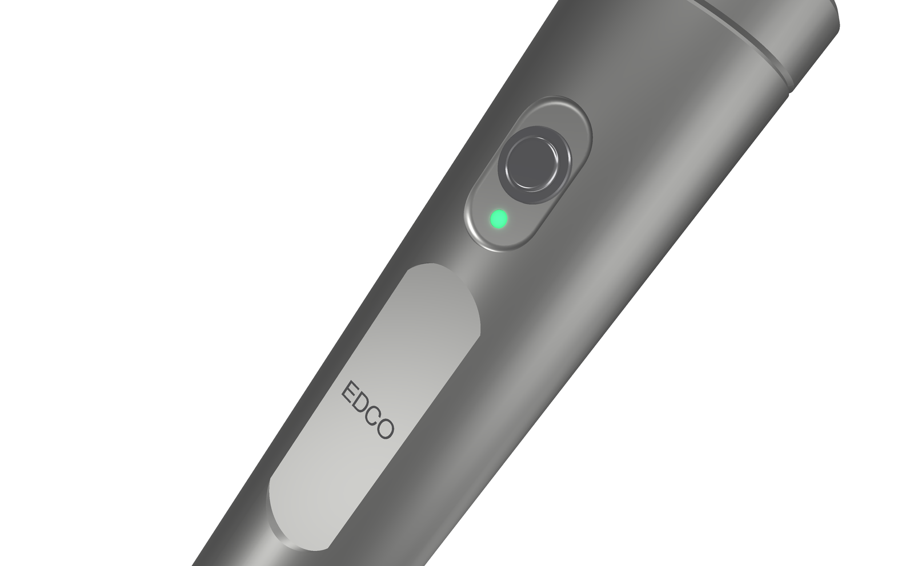
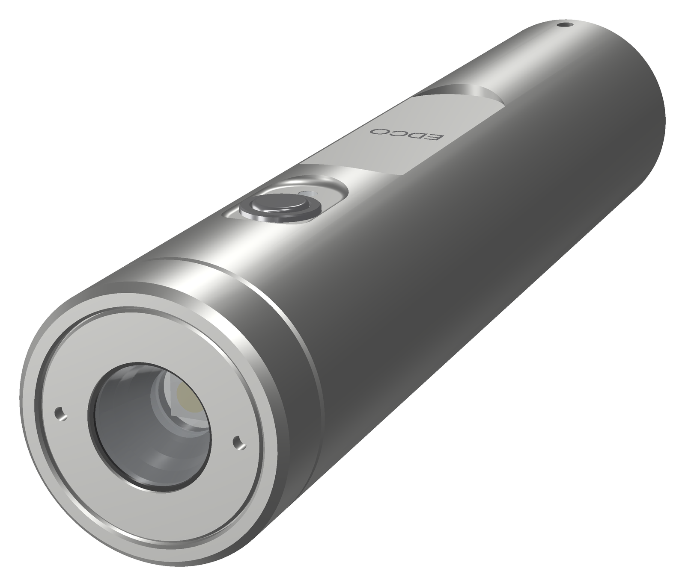
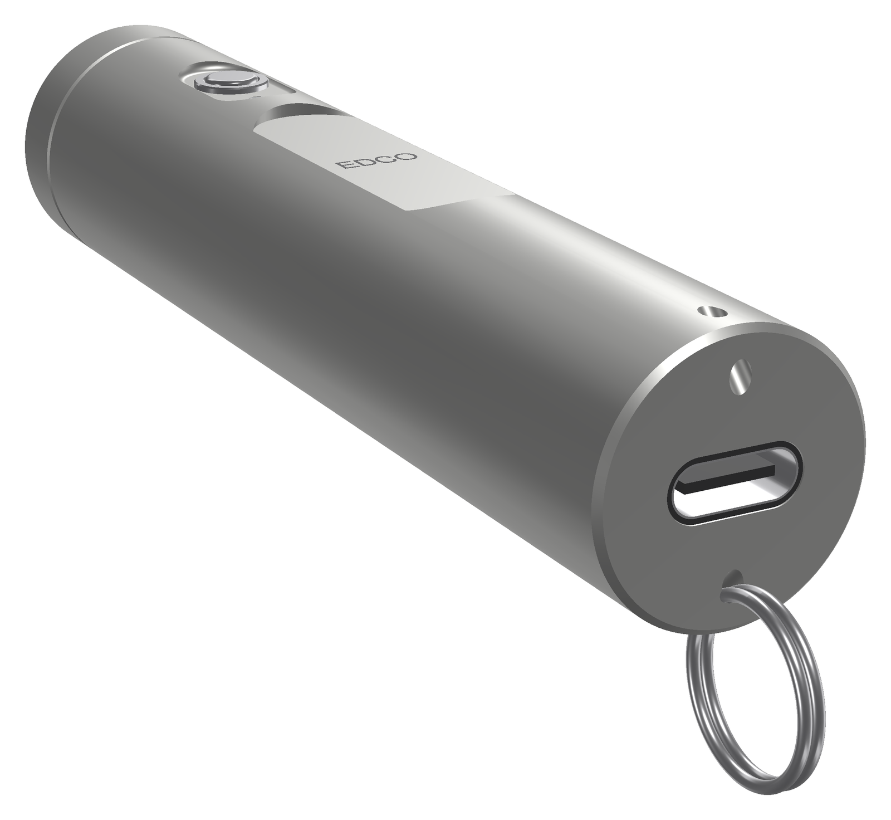

<!-- SPDX-License-Identifier: CC-BY-SA-4.0 -->
[LuxLibre](../../../README.md) › [Lights](../../../hardware/README.md) › [EDCO v0.1](../README.md) › Pictures

# EDCO v0.1: pictures

Renders and animations made from the design files. Nothing here is a photo: the light has not been built yet. The renders are made by [edco_render.py](../tools/housing/edco_render.py), the animations by [hardware/tools/edco_anim.py](../../tools/edco_anim.py).

## Animations

|  |  |
|---|---|
| EDCO v0.1 coming apart into its parts and back `edco_exploded.gif` | EDCO v0.1 turning about its axis `edco_turntable.gif` |

## Renders

|  |  |
|---|---|
| Close-up of the button, the indicator and the label flat `edco_button_macro.png` | Edco button macro natural `edco_button_macro_natural.png` |
|  |  |
| Exploded view: bezel ring, optic, LED board, head, main board, button parts, cell, tail board and socket, POM sled, body tube `edco_exploded.png` | Front: bezel ring, head and TIR optic with the LED behind it `edco_front.png` |
|  |  |
| Edco front natural `edco_front_natural.png` | EDCO v0.1, black anodised: the stainless button in its scalloped pocket, the charge indicator and the EDCO label flat `edco_hero.png` |
|  |  |
| Clear anodised version `edco_hero_natural.png` | Half section: bezel ring, head with O-ring, optic, main board in the POM sled with the button stack and light pipe, the 14500 cell, the tail board and the sealed USB-C socket `edco_section.png` |
|  |  |
| Tail: the sealed USB-C socket and the two lanyard holes `edco_tail_usb.png` | Edco tail usb natural `edco_tail_usb_natural.png` |
