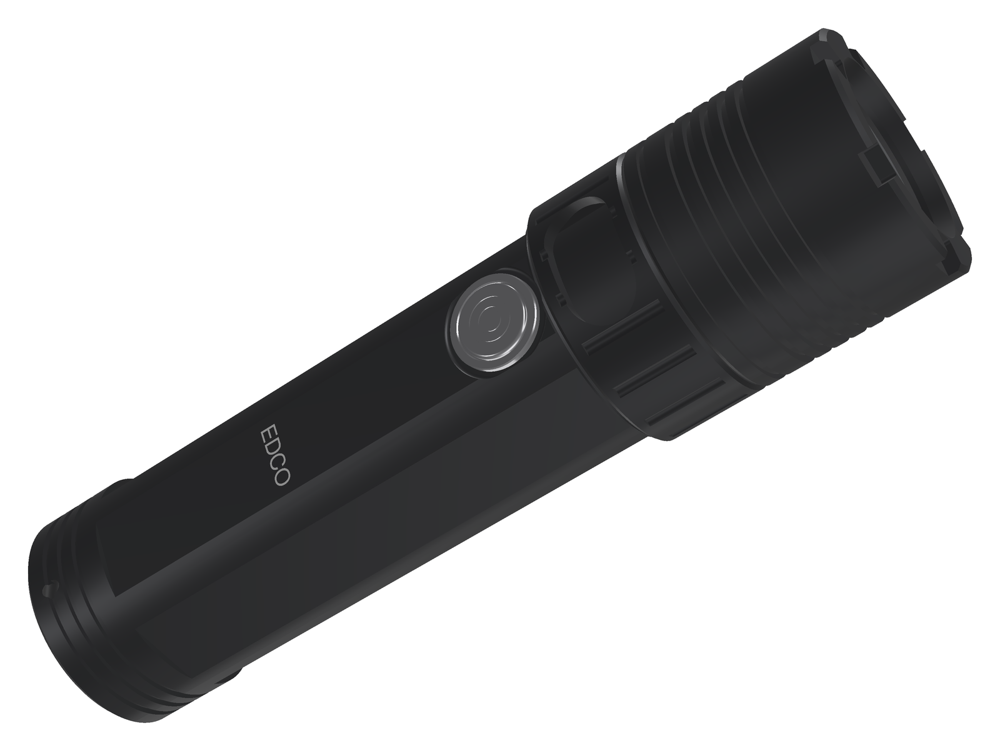
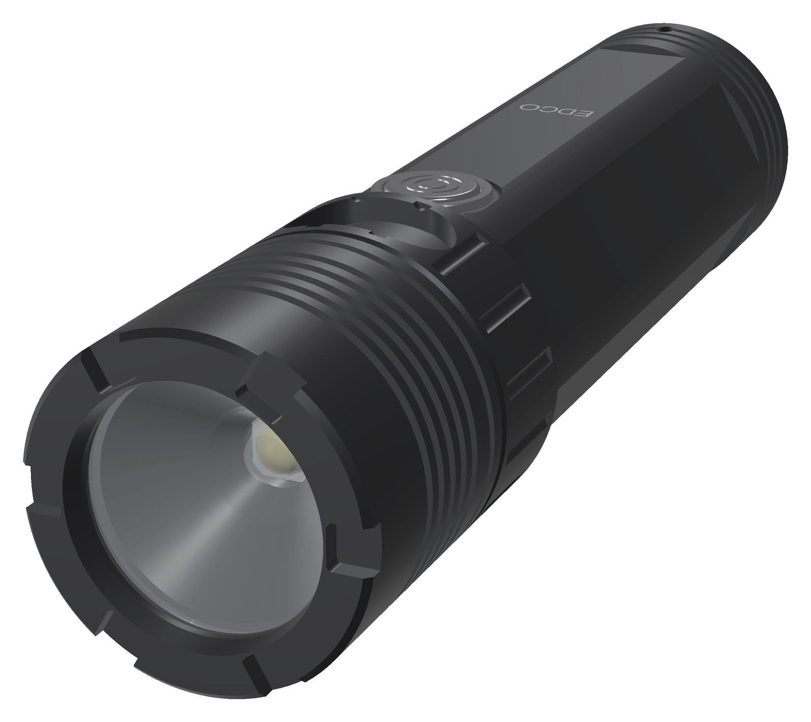
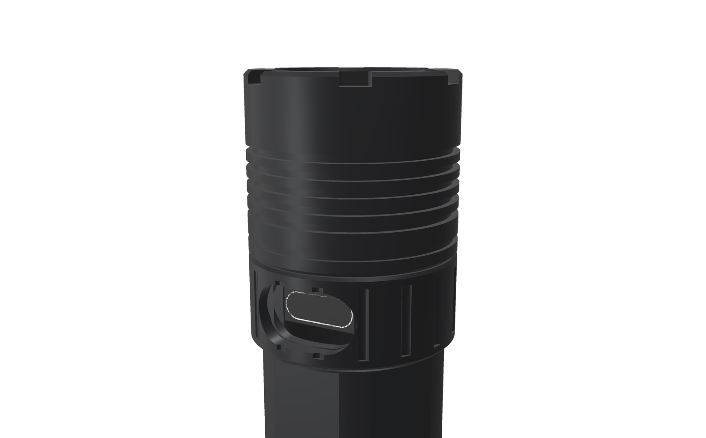
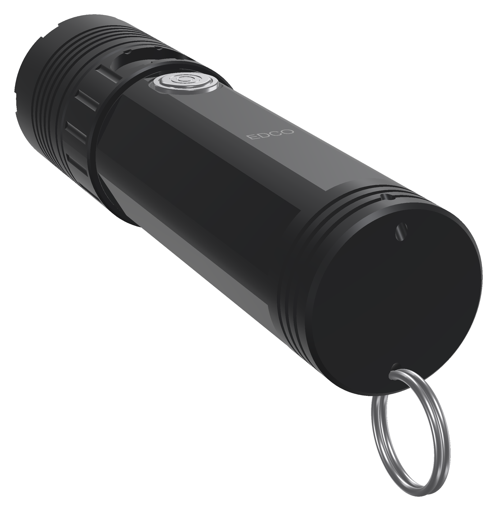
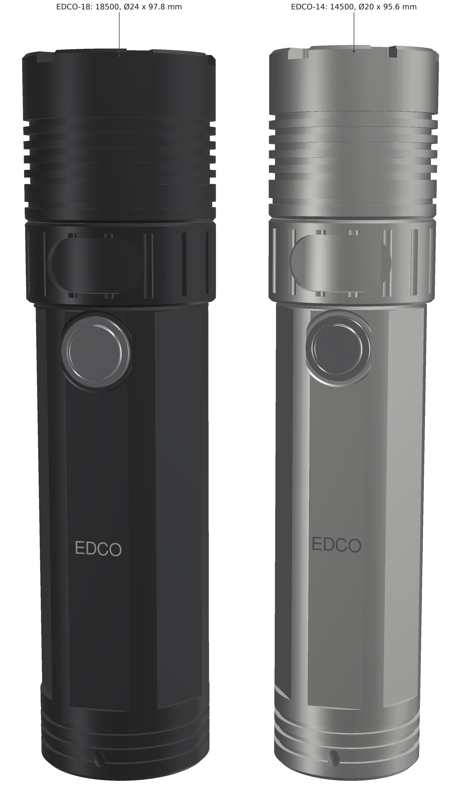
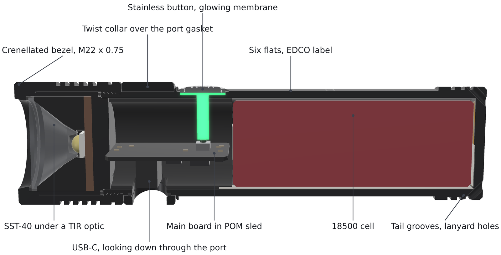
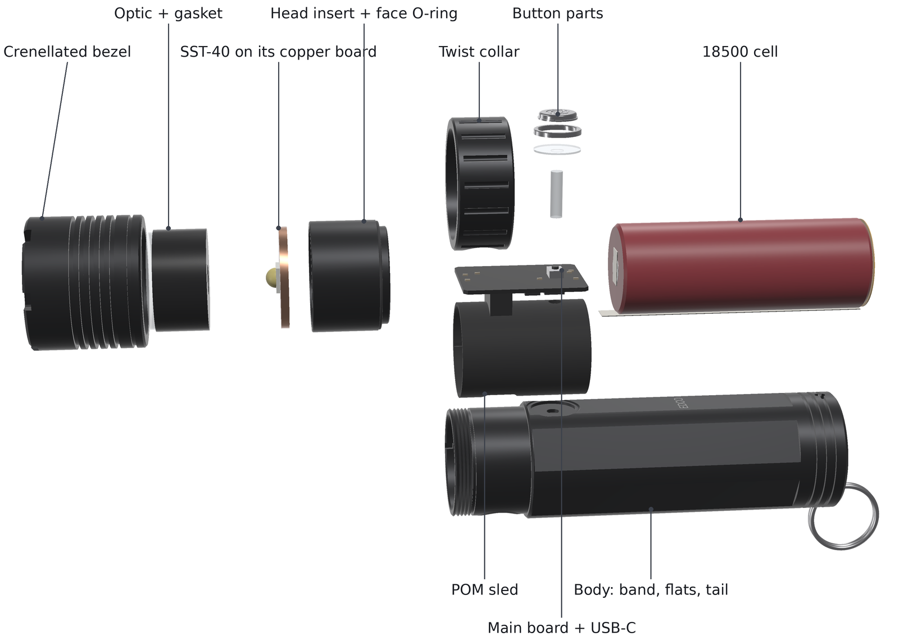

<!-- SPDX-License-Identifier: CC-BY-SA-4.0 -->
# EDCO v0.2

EDCO v0.2 makes the EDCO light brighter and gives it a more rugged look, in **two sizes**:

| | EDCO-18 | EDCO-14 |
|---|---|---|
| Cell | one 18500 | one 14500 |
| Body / head | Ø24 / Ø26 mm | Ø20 / Ø22 mm |
| Length | 97.8 mm | 95.6 mm |

Both run a Luminus **SST-40** LED behind a TIR optic. Charging, firmware updates and settings all go through a
**USB-C port on the side of the head**, under a fluted **twist collar**. There is still no laser and no radio.



*Render made from the design files.*

> **Status: concept (v0.2).** The housing of both sizes is modelled in CadQuery and checked for fits, walls
> and interference. The firmware board headers exist, and the light output is simulated with the LuxLibre
> simulator. The circuit boards are **not drawn yet**, and nothing has been built or measured. Every light
> figure on this page is simulated.

## What changed from v0.1

The owner asked for these changes:

* **About 2000 lm.** The SST-40 replaces the SST-20. Driving it near 6 A needs a cell that can deliver the
  current, so EDCO now comes in two sizes: the 18500 version gives full output, and the 14500 version keeps the
  slim body.
* **USB-C on the side.** The socket now sits on the main board and looks down through a window in the side of
  the head. The collar turns over that window: with the collar's window over the port, the port is open;
  turned away, the port is covered and sealed.
* **A more tactile look:**
  * a crenellated bezel with five cooling fins;
  * a fluted collar;
  * six milled flats along the body;
  * three grooves at the tail.
* **A bigger button.** The stainless cap grows from Ø4.2 to Ø7.5 mm (EDCO-18) or Ø6.5 mm (EDCO-14). Its
  translucent membrane glows when lit, so the separate indicator dot is gone.

|  |  |
|---|---|
| **Front.** Crenellated bezel, fins, the TIR optic. | **Port open.** The collar's window over the USB-C socket. |
|  |  |
| **Tail.** Grooves, flats and the two lanyard holes. | **Two sizes.** EDCO-18 (black) and EDCO-14 (clear anodised). |

## Specifications

| Item | EDCO-18 | EDCO-14 |
|---|---|---|
| Size | Ø24 body, Ø26 head × 97.8 mm | Ø20 body, Ø22 head × 95.6 mm |
| Aluminium parts (body, bezel, head insert, collar; from the CAD) | 45.1 g | 36.2 g |
| LED | Luminus SST-40-W Gen 2, 6500 K, on a 20 mm copper DTP board | the same on a 16 mm board |
| Optic | Carclo 10003 narrow spot TIR, Ø20 mm (87 %, about 17° with a 5 × 5 mm LED) | LEDiL FA10888 TINA-RS, Ø16.1 × 10.9 mm (14–17°; fit over the SST-40 dome to be checked) |
| Turbo (simulated) | 5,700 mA: 2,022 lm at the LED and 1,759 lm out of the front with the LED at 85 °C. About 8 % more in the first seconds with a cool LED (about 1,900 lm out of the front) | 5,000 mA: 1,836 lm at the LED, 1,561 lm out of the front |
| Throw (estimate) | about 18 kcd, 270 m (Carclo's 9.1 cd/lm with an XM-L2) | about 11 kcd, 210 m (scaled by aperture; no data published) |
| Cell | Vapcell INR18500 K15: 1,500 mAh typical, 15 A, 18.2 × 50.0 mm | Vapcell INR14500 H10: 1,000 mAh typical, 10 A, 14.3 × 49.4 mm |
| Runtime from turbo to the ANSI end point (simulated) | 99 min | 78 min |
| Driver | MPS MP2145GD 6 A synchronous buck with 100 % duty mode, in the LuxLibre current loop (TLV333, 10 mΩ sense) | the same |
| Cell protection | DW01A with a common-drain MOSFET path of about 15 mΩ: trips at about 9.3–12 A | the same |
| USB-C | SHOU HAN TYPE-C 16PLT-H6.5 (LCSC C3151748), vertical, 6.5 mm, on the underside of the main board | the same |
| Charging | TP4057 at about 500 mA (about 3 h) | about 2 h |
| Button | Ø7.5 mm stainless cap, glowing membrane, Alps SKRKAEE020 | Ø6.5 mm cap |
| Water | IPX8 is the target, not tested. Seals: the optic gasket, the face O-ring of the head insert, the button membrane, and the cord gasket round the port (sealed whenever the collar is turned away) | the same |
| Firmware | LuxLibre, board [`edco-v02-18`](../../firmware/boards/edco-v02-18/board.h) | board [`edco-v02-14`](../../firmware/boards/edco-v02-14/board.h) |

## Light and runtime (simulated)

These are LuxLibre simulator runs with each size's board header: 25 °C still air, a full cell and the default
profile. Lumens are out of the front, with the LED at 85 °C.

| | EDCO-18 | EDCO-14 |
|---|---|---|
| Turbo | 1,759 lm, full for 45 s (the turbo timer); 48 s with the timer off | 1,561 lm, full for 44 s |
| High (1.8 A) | 686 lm for 281 s | 662 lm for 212 s |
| Sustained (temperature regulator, `THM_LIMIT` 49 °C) | about 330–390 lm, body at most 47.5 °C | about 260–320 lm, body at most 47.7 °C |
| Turbo from a half-full cell, at 30 s | 1,543 lm | 1,463 lm |
| On a 35 °C day | full turbo for 23 s, about 200 lm sustained, body 48.4 °C | 21 s, about 150–200 lm, body 48.6 °C |
| Runtime from turbo to the ANSI end point | 99 min | 78 min |
| Modes (out of the front) | moon 3 mA (1 lm), low 27 lm, medium 155 lm, high 686 lm | moon 3 mA (1 lm), low 26 lm, medium 149 lm, high 662 lm |

* **Burst length.** The SST-40 at 5.7 A turns about 14 W into heat. Even the 18500 body therefore holds full
  turbo for under a minute, as with any light of this size.
* **What the bigger cell buys.** The 18500 brings mainly current and a bigger heat sink, not much more charge.
  The K15 holds 1,500 mAh, like the v0.1 14500. A 2,000 mAh 10 A 18500 (Vapcell N20) may exist but was not
  verified.

```sh
cd firmware
make sim BOARD=edco-v02-18
build/luxsim-edco-v02-18 --preset board --set TURBO_S=0 "2C W900000"
make sim BOARD=edco-v02-14
build/luxsim-edco-v02-14 --preset board "2C W14000000"
```

## How it is built



From the front to the tail:

1. **Bezel.** It is crenellated and has five cooling fins. It screws onto the band's external thread
   (M22 × 0.75 on EDCO-18, M18 × 0.75 on EDCO-14) and is locked with thread-locker. Its lip presses the optic
   onto a silicone gasket, and its inner shoulder clamps the head insert, metal on metal, against the band's
   front face.
2. **Head insert.** The LED holder. It has a cup for the optic and carries the SST-40 on its copper board, on a
   2 mm floor that leads the heat into the body. A face O-ring on its rear face seals against the band. A key
   in a notch stops it turning while the bezel is tightened, so the LED wires never twist.
3. **Twist collar.** It turns freely between the bezel and the body shoulder.
   * **The seal:** a loop of Ø0.8 mm silicone cord, bonded into a 0.75 mm groove round the port window in the
     band. The collar's bore presses and wipes it, so the port is sealed whenever the collar's window is
     turned away.
   * **Why it is built this way:** the space between the collar and the band may get wet. Only the port window
     leads into the light, so one gasket round it is enough, with no O-rings needed on either side.
4. **Main board in a POM sled.** The board lies across the bore.
   * The vertical USB-C socket on its underside looks down through the port window. The sled backs the board,
     so it takes the force of a plug.
   * The tactile switch on its top side sits under the button's clear pin.
   * An RGB LED next to the switch lights the pin and the translucent membrane: the halo indicator.
5. **Cell.** Its + strip goes to the rear of the main board. The − strip runs forward along the bottom of the
   cell.
6. **Tail.** A closed end with three grooves and a lanyard hole through each corner. v0.2 has no tail board and
   no flex.



### Assembly (once, for good)

1. **Bench-test the cartridge.**
   * Weld the strips to the cell. Solder the cell and the LED wires to the main board.
   * Test the cartridge on the bench and flash the firmware over USB-C.
2. **Insert the cartridge.**
   * Slide the cartridge into the tube with the socket facing the port window. The window shows when it is
     lined up.
   * Drop in the clear pin, the membrane, the cap and the button collar (press-fit with retaining compound).
3. **Fit the head.**
   * Bond the cord gasket into the band groove and grease it lightly with silicone grease.
   * Slide the collar on from the front.
   * Fit the head insert with its face O-ring, the LED board on paste, the optic and its gasket.
   * Screw on the bezel with medium-strength thread-locker.

## Electronics: what changes from v0.1

| v0.1 | v0.2 |
|---|---|
| TPS62095 4 A buck, 20 mΩ sense, VSET 2.2 k / 100 k | **MP2145GD** 6 A buck (QFN-12 2 × 3 mm, high-side limit 7.5–8.1 A, FB 0.6 V) with an inductor of about 0.47–1 µH (Isat ≥ 9 A, 4 × 4 mm) and a **10 mΩ** sense resistor. VSET 1.0 k / 53.6 k: 6,044 mA at full duty; the firmware never asks for more than 5,700 mA. Backup: TI TPS62480 (2 × 3 A phases). TI's TPS62866/9 do not fit: their output is set over I²C and stops at 3.35 V |
| DW01A + SE8830A (trip about 5.4 A) | DW01A with a common-drain path of about 15 mΩ, for example AOS AOC4810, or two TI CSD17575Q3 (LCSC C529277) plus a 10 mΩ resistor. Trip about 9.3–12 A; about 0.5 W in the path at 6 A |
| Waterproof socket on a tail board, 4-wire flex | vertical SHOU HAN TYPE-C 16PLT-H6.5 (C3151748) on the main board; CC resistors and ESD on the main board; no tail board, no flex |
| Indicator LED and light pipe | RGB LED beside the switch, lighting the clear pin and membrane |
| SST-20 Gen 2 on 10 mm, LISA3 optic | SST-40 Gen 2 on 20 mm / 16 mm copper DTP, Carclo 10003 / LEDiL TINA-RS |
| ESP32-C3FH4, TP4057, RT9080, NTC | unchanged |

## Cost (rough estimate)

There is no EDCO workbook yet. This is a rough estimate, all fees, shipping and VAT included:

* **About the same as v0.1:** roughly 700–750 USD for one light and 230–250 USD each when five are made.
* **Lower:** the tail board and the flex are gone.
* **Higher:** a fourth turned part (the collar), larger parts with fins and flats, and the stronger driver
  and protection parts. The cord gasket costs a few euros.

## What has been checked

* **CAD interference:** no part overlaps a neighbour in either size. The checked pairs include body / head
  insert, bezel / insert, body / collar, bezel / collar, collar / port gasket, body / sled, sled / board,
  body / socket, sled / socket, body / button pin, sled / cell and bezel / optic.
* **Walls, EDCO-18:**
  * 2.3 mm over the cell, 1.5 mm under the flats;
  * 0.84 mm at the thread root;
  * 1.3 mm in the band, 0.7 mm under the port gasket groove;
  * 0.65 mm under the button counterbore;
  * 1.2 mm in the bezel at its fins, 1.55 mm in the collar at its flutes.
* **Walls, EDCO-14:**
  * 2.4 mm over the cell, 1.7 mm under the flats;
  * 0.94 mm at the thread root;
  * 1.4 mm in the band, 0.8 mm under the port gasket groove;
  * 0.85 mm under the button counterbore;
  * 0.8 mm in the bezel at its fins, 1.55 mm in the collar at its flutes.
* **Below JLCCNC's recommended 0.8 mm (above their 0.5 mm minimum):** EDCO-18's button counterbore wall
  (0.65 mm), port gasket groove (0.7 mm) and thread run-out (0.79 mm).
* **Fits:**
  * Main board: 18.3 mm wide (EDCO-18) / 14.3 mm (EDCO-14), with 0.34 mm to the bore.
  * Socket mouth: 4.6 / 5.1 mm below the collar surface, so the plug's overmould goes through the windows.
  * Thread engagement: 3.3 mm.
  * Cell radial room: 0.6 / 0.45 mm.
* **Light and heat:** simulated, as above.

All numbers are in [cad/edco_v02_interface.json](cad/edco_v02_interface.json), written by
[tools/housing/edco_v02.py](tools/housing/edco_v02.py).

## Open points before the first order

* **The collar seal is a new design.** No production light documents how its rotating port cover seals.
  Build one collar and band first and test them under water: closed, after many turns, and with grit.
* **The optic heights.** The Carclo 20 mm optic's height depends on its holder (10–13.8 mm; 11.5 mm is drawn).
  Check the TINA-RS cavity over the SST-40's 3 mm dome.
* **Throw.** The figures above are estimates from other LEDs' data. A smooth 20 mm reflector may throw further
  but needs more depth.
* **Parts to confirm:**
  * MP2145GD availability (no LCSC number found yet);
  * the exact protection MOSFET and its resistance at a 3–4 V gate;
  * the socket's footprint.
* **The 18500 cell.** The K15 (1,500 mAh, 15 A) is verified; a 2,000 mAh option is not. No EU shop seen with
  high-drain 18500 stock.
* **Replacing the cell** ([BAT-2](../../docs/design-rules.md#bat-2)), as in v0.1: fine for your own light.
  From 18 February 2027, though, a light sold in the EU must let its user replace the cell.
* **The boards, drawings, order files and a parts and cost workbook**, as for v0.1.

## Files

| Path | What |
|---|---|
| [cad/](cad/) | for each size (`EDCO-18_*`, `EDCO-14_*`): body, bezel, head insert and collar as STEP (plain thread diameters), and the assembly STEP |
| [cad/edco_v02_interface.json](cad/edco_v02_interface.json) | sizes, walls, fits, masses and the interference check of both sizes |
| [tools/housing/edco_v02.py](tools/housing/edco_v02.py) | the CadQuery model (sizes in `SIZES`, common dimensions in class `P`): `python3 edco_v02.py ../../cad --size both` |
| [tools/housing/edco_v02_render.py](tools/housing/edco_v02_render.py) | the renders: `xvfb-run -a python3 edco_v02_render.py ../../assets` (uses the FlashKa v0.7 renderer) |
| [../../firmware/boards/edco-v02-18/](../../firmware/boards/edco-v02-18/board.h), [edco-v02-14/](../../firmware/boards/edco-v02-14/board.h) | the firmware board headers, each with the thermal model for the simulator |

Licences as for the rest of LuxLibre: hardware CERN-OHL-W-2.0, firmware and tools GPL-3.0-or-later, this page
CC-BY-SA-4.0 ([LICENSING.md](../../LICENSING.md)).
