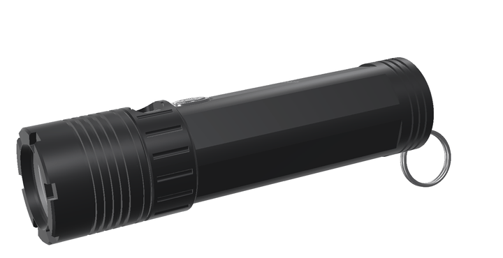
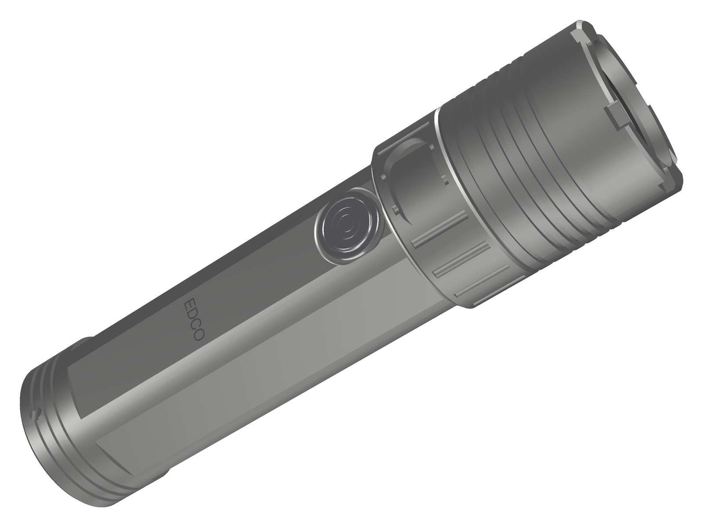

<!-- SPDX-License-Identifier: CC-BY-SA-4.0 -->
[LuxLibre](../../../README.md) › [Lights](../../../hardware/README.md) › [EDCO v0.2](../README.md) › Pictures

# EDCO v0.2: pictures

Renders and animations made from the design files. Nothing here is a photo: the light has not been built yet. The renders are made by [edco_v02_render.py](../tools/housing/edco_v02_render.py), the animations by [hardware/tools/edco_anim.py](../../tools/edco_anim.py).

## Animations

|  |  |
|---|---|
| EDCO-18 coming apart into its parts and back `edco18_exploded.gif` | EDCO-18 turning about its axis, collar closed `edco18_turntable.gif` |

## Renders

|  |  |
|---|---|
| Exploded view of EDCO-18 `edco18_exploded.png` | Front: crenellated bezel, fins, TIR optic with the SST-40 behind it `edco18_front.png` |
|  |  |
| EDCO-18, black anodised: crenellated and finned bezel, the fluted twist collar, the stainless button, six flats `edco18_hero.png` | Edco18 hero natural `edco18_hero_natural.png` |
|  |  |
| The collar turned to open: the USB-C socket under the window `edco18_port_open.png` | Half section of EDCO-18 `edco18_section.png` |
|  |  |
| Tail: grooves, flats and the lanyard holes `edco18_tail.png` | EDCO-18 and EDCO-14 side by side `edco_v02_sizes.png` |
