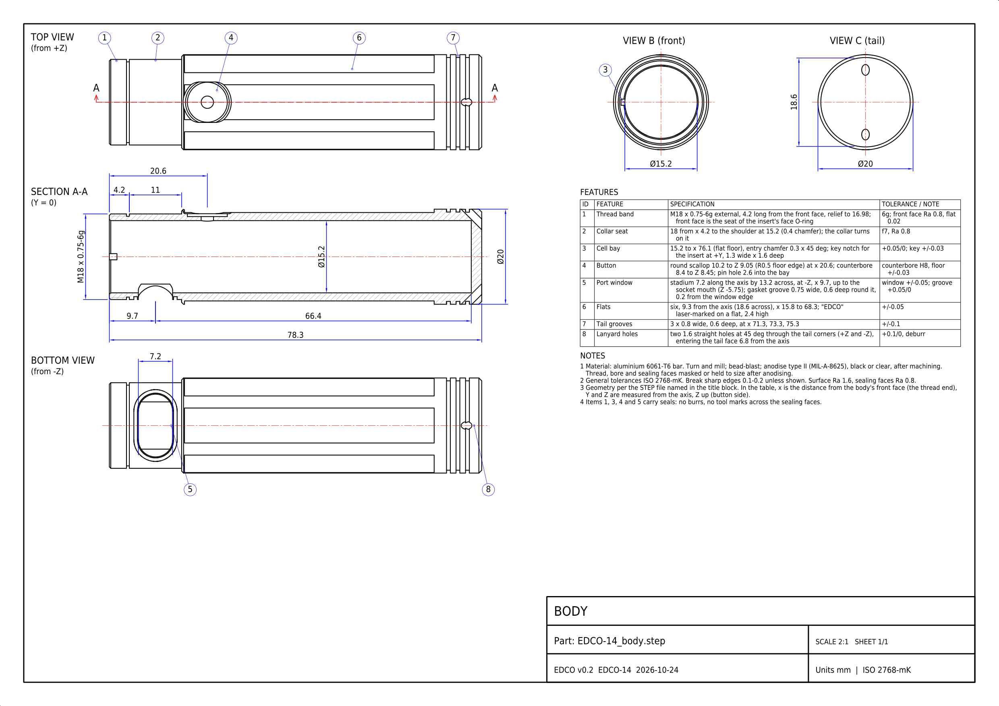
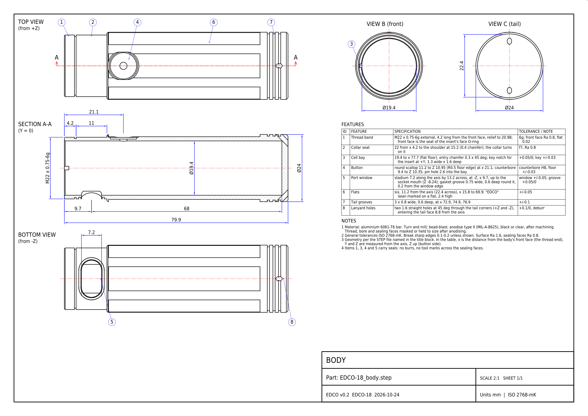

<!-- SPDX-License-Identifier: CC-BY-SA-4.0 -->
[LuxLibre](../../../README.md) › [Lights](../../../hardware/README.md) › [EDCO v0.2](../README.md) › Drawings and CAD

# EDCO v0.2: drawings and CAD

The files of the EDCO v0.2 housing, made from the design scripts in [../tools/](../tools/) (nothing is drawn by hand). STEP files open in FreeCAD, Fusion, Onshape or any CAD program; DXF in LibreCAD, QCAD or any CAD program; PDF and PNG are for reading. The design page explains every part: [EDCO v0.2](../README.md).

## Drawings

**EDCO 14 body drawing, A3 at 2:1** ([PDF](EDCO-14_body_drawing.pdf), [DXF](EDCO-14_body_drawing.dxf), [PNG](EDCO-14_body_drawing.png))

**EDCO 18 body drawing, A3 at 2:1** ([PDF](EDCO-18_body_drawing.pdf), [DXF](EDCO-18_body_drawing.dxf), [PNG](EDCO-18_body_drawing.png))

## 3D models

| File | What it is |
|---|---|
| `EDCO-14_bezel` ([STEP](EDCO-14_bezel.step)) | EDCO-14: bezel (screws onto the body's thread) |
| `EDCO-14_body` ([STEP](EDCO-14_body.step)) | EDCO-14: body |
| `EDCO-14_collar` ([STEP](EDCO-14_collar.step)) | EDCO-14: twist collar over the USB-C port |
| `EDCO-14_insert` ([STEP](EDCO-14_insert.step)) | EDCO-14: head insert (holds the LED board and the optic) |
| `EDCO-14_v0.2_assembly` ([STEP](EDCO-14_v0.2_assembly.step)) | EDCO-14: every part in place, with stand-ins for the boards and the socket |
| `EDCO-18_bezel` ([STEP](EDCO-18_bezel.step)) | EDCO-18: bezel (screws onto the body's thread) |
| `EDCO-18_body` ([STEP](EDCO-18_body.step)) | EDCO-18: body |
| `EDCO-18_collar` ([STEP](EDCO-18_collar.step)) | EDCO-18: twist collar over the USB-C port |
| `EDCO-18_insert` ([STEP](EDCO-18_insert.step)) | EDCO-18: head insert (holds the LED board and the optic) |
| `EDCO-18_v0.2_assembly` ([STEP](EDCO-18_v0.2_assembly.step)) | EDCO-18: every part in place, with stand-ins for the boards and the socket |

## Data

| File | What it is |
|---|---|
| [`edco_v02_interface.json`](edco_v02_interface.json) | sizes, walls, fits, masses and the interference check (written by the CAD script, read by the checks) |

The drawings are made by [hardware/tools/edco_drawings.py](../../tools/edco_drawings.py) and checked against the solids ([report](../../tools/edco_drawings_check.txt)).
