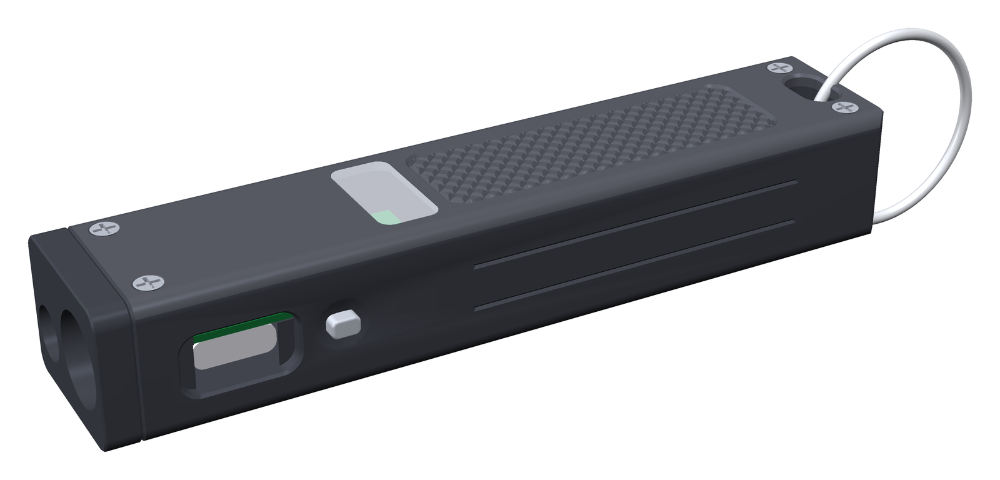
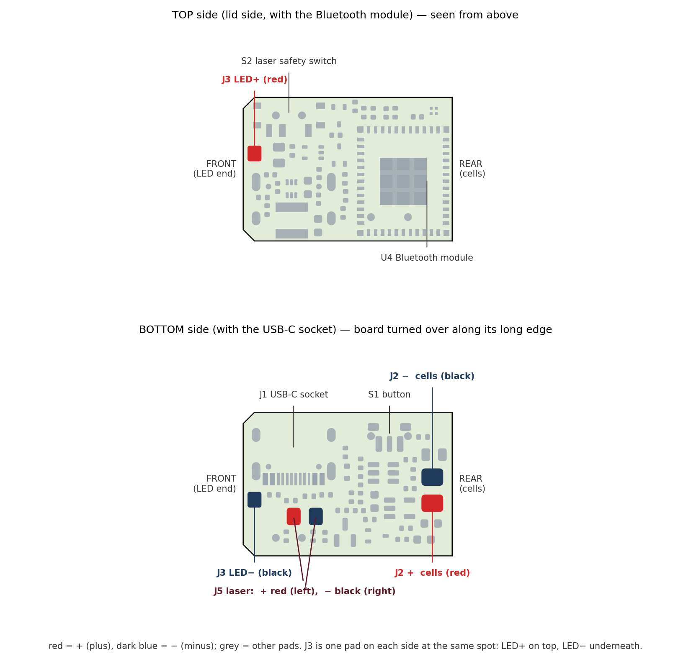
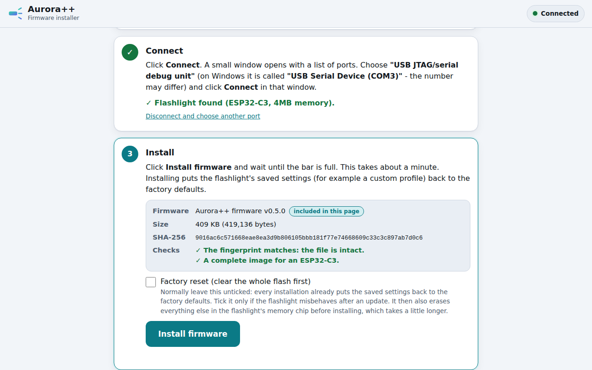
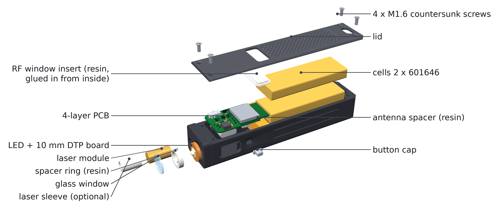
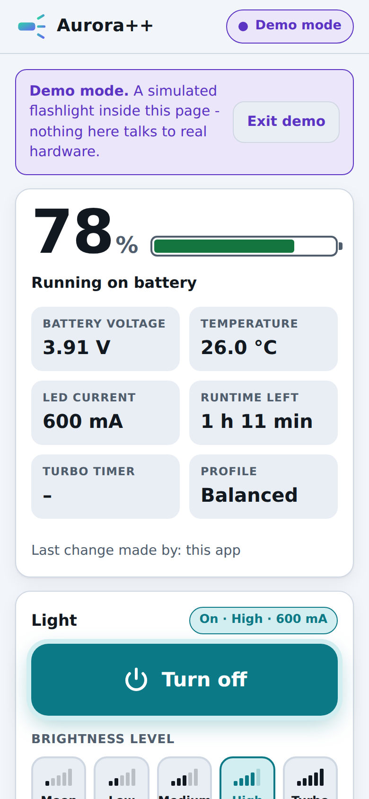

# Aurora++ v0.5 — Build guide from zero

This guide takes you from "I have never ordered a circuit board" to a working flashlight in
your hand. You do not need to know electronics or programming. You need patience, a
soldering iron and a computer with the Chrome or Edge browser. Read the whole guide once
before you order anything.

*The finished light: 94.4 × 20 × 16 mm, black anodised aluminium, USB-C charging, a white
LED in front, a small green laser below it, and Bluetooth for the phone app.*

---

## 0. What you are building

| | |
|---|---|
| Size | 94.4 × 20 × 16 mm, about 50 g with cells |
| Main light | Luminus SST-20 LED, 3 mA (moonlight) to 2.2 A (turbo, short bursts) |
| Laser | green 520 nm module, Class 2 (≤ 1 mW), with a hardware safety switch |
| Battery | two LP601646 lithium-polymer cells in parallel, about 800 mAh |
| Charging | USB-C, about 300 mA, status shown by a small RGB LED through the lid |
| Brain | ESP32-C3 module with Bluetooth Low Energy |
| Phone app | a web page — no app store, works in Chrome/Edge (Android, Windows, Mac, Linux) |
| Firmware updates | from a web page over the same USB-C cable — no programmer needed |

How it is made:

* **The circuit board** (24 × 16.5 mm, 4 copper layers) is made *and fitted with all its
  small parts* by JLCPCB. You only solder a few wires by hand.
* **The aluminium body** (two parts: tray and lid) is machined and anodised by JLCCNC.
* **Four small plastic parts** are 3D-printed by JLC3DP as one "print kit".
* **The LED board, the laser, the cells, the window and the screws** are bought ready-made
  (for example on AliExpress).

## 1. Before you spend money

**Cost.** The workbook `Aurora_Parts_List_v0.5.xlsx` lists every part and every fee. The short version
(prices checked 2026-10-14, delivery to Lithuania):

| | one light | per light when you build five |
|---|---|---|
| Everything, including shipping, VAT and set-up fees | about **530 USD** (473 EUR) | about **196 USD** (175 EUR) |
| Tools you may not have yet (one-time) | about 128 USD | |

One light is expensive because the fixed costs (assembly set-up, stencils, three parcels from
JLC, several AliExpress parcels) are paid once whatever the quantity. JLCPCB makes at least 5
boards and assembles at least 2. Building with friends brings the price down a lot.

**Time and the order of the orders.** Building takes one afternoon; the waiting takes longer.
Order in this sequence (the workbook's sheet *Ordering checklist* has the same steps):

1. **Day 1:** order the bought parts (section 6) and the circuit boards (section 3).
2. **When the cells, the LED board and the laser have arrived** (2–5 weeks from AliExpress):
   measure them (section 8). They must match the specification — the body is made for them.
3. **Then** order the aluminium body (section 4) and the print kit (section 5); about 10 days.

At every checkout choose shipping with **taxes and duties paid (DDP / "tax included")** — the
cost figures above assume it.

**Skills.** Soldering wires to pads (practise on scrap first), using a small screwdriver,
following instructions exactly. Nothing else.

**Safety — read this.**

* **Lithium cells** can burn if they are short-circuited, punctured, bent or charged wrongly.
  Never let the red and black wires of a cell touch each other. Never solder on the cell
  itself — only on the wires. Keep a metal box or a sand-filled pot nearby while you work.
* **The laser** is a real laser. Class 2 is safe for an accidental glance, but never look into
  it or point it at people, animals, cars or aircraft. Wear 520 nm laser safety glasses while
  testing. Buy only a module whose seller states **Class 2 / ≤ 1 mW**.
* **The LED gets hot** in turbo. The firmware limits the temperature, but do not cover the
  light with your hand for minutes in turbo.

## 2. The files

Everything you upload is ready in the folder `order_files/` of the package, one subfolder per
shop — you never have to look for a file anywhere else:

| File | What it is | Who gets it |
|---|---|---|
| `order_files/1_JLCPCB/Aurora_main_gerbers.zip` | the circuit board drawings | JLCPCB (PCB) |
| `order_files/1_JLCPCB/BOM_JLCPCB.csv` | list of parts to mount | JLCPCB (assembly) |
| `order_files/1_JLCPCB/CPL_JLCPCB.csv` | where each part goes | JLCPCB (assembly) |
| `order_files/2_JLCCNC/Aurora_tray.step` + `Aurora_tray.pdf` | aluminium body + its drawing | JLCCNC |
| `order_files/2_JLCCNC/Aurora_lid.step` + `Aurora_lid.pdf` | aluminium lid + its drawing | JLCCNC |
| `order_files/2_JLCCNC/Aurora_marking_class2.dxf` | optional laser marking | JLCCNC |
| `order_files/3_JLC3DP/Aurora_print_kit.stl` | the four plastic parts on one sprue | JLC3DP |
| `app/aurora-flasher.html` | the firmware installer (open in Chrome/Edge) | you |
| `app/aurora-app.html` | the phone/computer app (open in Chrome/Edge) | you |
| `Aurora_Parts_List_v0.5.xlsx` | every part, price, link and fee | you |

(The same files, with all the source data behind them, are also in `production/` and `cad/`.)

<!-- pagebreak -->
## 3. Order 1 — circuit boards with parts mounted (JLCPCB)

1. Make an account at **jlcpcb.com** and log in.
2. Click **Order now** (or "Instant quote") and **Add gerber file**. Choose
   `order_files/1_JLCPCB/Aurora_main_gerbers.zip`. Wait until the picture of the board appears
   (24.0 × 16.5 mm should be detected automatically).
3. Set these options (leave everything not listed at its default):

   | Option | Choose |
   |---|---|
   | Base material | FR-4 |
   | Layers | **4** |
   | PCB qty | 5 (the minimum) |
   | PCB thickness | **0.8 mm** |
   | PCB color | green (cheapest; others are fine) |
   | Surface finish | **ENIG** (flat gold pads — needed for the Bluetooth module) |
   | Outer / inner copper | 1 oz / 0.5 oz |
   | Via covering | Tented |
   | Min via hole size/diameter | the value JLCPCB detects (0.2 mm hole, 0.45 mm via: no surcharge) |
   | Remove order number | No (the default) — JLCPCB prints a small number on a free spot; it is hidden in the body |

4. Scroll down and switch **PCB Assembly** on:

   | Option | Choose |
   |---|---|
   | PCBA type | **Standard** (parts on both sides need Standard) |
   | Assembly side | **Both sides** |
   | PCBA qty | 2 (the minimum) — or as many lights as you build, if more |
   | Tooling holes | Added by JLCPCB |
   | Confirm parts placement | **Yes** (an engineer checks the orientation of every part — recommended) |

5. Click **Next**, then upload **BOM** = `order_files/1_JLCPCB/BOM_JLCPCB.csv` and
   **CPL** = `order_files/1_JLCPCB/CPL_JLCPCB.csv`. Click **Process BOM & CPL**.
6. The parts list appears. Every line should show a matched part with stock. If a part is
   out of stock, the workbook (sheet *Main PCB BOM*) names the alternative — the only one you
   are likely to need is the Bluetooth module: **C2838502** (ESP32-C3-MINI-1-N4) can be
   replaced by **C41349510** (ESP32-C3-MINI-1-H4X), same footprint, same firmware. (A few small
   parts had low *retail* stock on 2026-10-14 — C15850, C15195, C1525, C11702, C485117; JLCPCB's
   assembly stock is separate and usually fine. The workbook's stock notes list a substitute.)
7. **Placement preview.** JLCPCB shows the board with every part drawn on it. For each chip,
   the small dot or line that marks pin 1 must sit on the pin-1 mark of the board. If one is
   turned, select it and use *Rotate*. Look closest at the parts whose drawing in JLCPCB's
   library is often turned against KiCad's: the Bluetooth module **U4**, the small chips **U1, U2,
   U3, U5**, the transistors **Q1, Q2, Q4, Q5**, the USB-C socket **J1** and the tiny RGB LED
   **LED3**. Do not worry if you are unsure: with "Confirm parts placement" an engineer checks it
   and sends you a picture before production.
8. Save to cart, pay. The board order (5 boards, 2 of them assembled, all parts included) costs
   about 170 USD before shipping and VAT (the workbook, sheet *JLCPCB order*, shows every line).
   Choose a shipping method with taxes paid (DDP).

> **Why the gold surface (ENIG)?** The Bluetooth module sits on a big flat ground pad under
> its belly. Tin (HASL) surfaces are bumpy and the module can end up crooked. ENIG costs a
> few dollars more and avoids that.

## 4. Order 2 — the aluminium body (JLCCNC)

1. Go to **jlccnc.com**, log in with the same account, *Instant quote → CNC machining*.
2. Upload `order_files/2_JLCCNC/Aurora_tray.step` **and** `Aurora_tray.pdf` from the same
   folder — JLCCNC matches the drawing to the 3D file by its name, which is why both are called
   `Aurora_tray` (the drawing carries the threads and tolerances JLCCNC needs).
   Do the same for the lid: `Aurora_lid.step` + `Aurora_lid.pdf`.
3. For both parts choose:

   | Option | Choose |
   |---|---|
   | Material | Aluminum **6061-T6** |
   | Surface finish | **Bead blasting + anodizing, black** |
   | Tolerance | ISO 2768-m (standard) |
   | Threads | yes — write in the remark: "4 × M1.6×0.35 in the tray, 1 × M2×0.4, see drawing; tapped before anodising, screws must fit after finishing (drawing note 3)" |
   | Quantity | one of each per light (+1 spare tray if you want a safety margin) |

4. Optional: **laser marking** with `order_files/2_JLCCNC/Aurora_marking_class2.dxf` on the
   bottom face (the laser warning text). Only if your laser module really is Class 2.
5. JLCCNC answers with a price within a day. If they say M1.6 threads are not possible,
   accept plain holes: the drawing gives the tap-drill size, and you cut the thread yourself
   with an M1.6 hand tap (about 5 USD).

## 5. Order 3 — the plastic parts (JLC3DP)

1. **jlc3dp.com → Instant quote**, upload `order_files/3_JLC3DP/Aurora_print_kit.stl`. (Only if
   your laser module is 4.5 mm instead of 6 mm thick, also upload `Aurora_laser_sleeve.stl`.)
2. Material: **SLA resin, 8001 (translucent)**. The kit contains the RF window (lets the
   Bluetooth signal and the status LED through the aluminium lid), the button cap, the LED
   spacer ring and the antenna spacer, joined by thin rods. You cut them apart with side
   cutters at home.
3. Quantity: one kit per light (they are cheap — order one spare kit).

## 6. Order 4 — parts you buy ready-made

Search these on AliExpress (or any electronics shop). The workbook has a link example and the
typical price for each. Order them first (section 1) and **measure what you receive** before
you order the aluminium body.

| Part | Exact specification | Quantity per light |
|---|---|---|
| LiPo cells | **LP601646** (6.0 × 16 × 46 mm), 3.7 V, about 400 mAh, **with protection board and wire leads**, rated for at least **2 C** continuous (0.8 A per cell; 3 C if you want the Extreme profile); the whole cell including its protection board must fit 6.0 × 16 × 47 mm | 2 (+1 spare) |
| LED board | **Luminus SST-20** (white, 5000–6500 K) on a **10 mm** round copper DTP board, **1.6 mm** thick | 1 |
| Laser module | 520 nm green, **6 × 12 mm** body, **with a built-in constant-power (APC) driver for a 3.0–4.2 V supply** (the board gives it the cell voltage), **Class 2 (≤ 1 mW)**, with wires | 1 |
| Window | glass or PMMA disc **10 mm × 1.0 mm** (AR-coated "flashlight lens" is best) | 1 |
| Lid screws | **M1.6 × 4 mm countersunk**, stainless (A2) | 4 (+4 spare) |
| Laser set screw | **M2 × 2 mm set screw, cup point** (M2 × 2.5 also fits; longer ones stick out of the bottom) | 1 |
| Wire | **28 AWG PTFE**, red and black (usually sold as 5 m rolls; one light needs about 0.3 m) | — |
| Thermal paste or 0.15 mm thermal tape | for the LED board | a little |
| Kapton tape, thin double-sided foam tape | insulation, cells | a little |
| Clear 5-minute epoxy or UV resin | RF window and front window | a little |
| Split ring or lanyard | through the tail slot | 1 |

## 7. Tools

| Tool | Why |
|---|---|
| Soldering iron with a fine tip (a temperature-controlled one, e.g. Pinecil or TS101) | the wires |
| Desoldering braid (wick) | to remove solder if a joint goes wrong |
| Digital caliper | measure the cells, the LED board and the laser before you order the body |
| Solder 0.5 mm with flux core, plus a flux pen | clean joints on small pads |
| Fine tweezers, side cutters, wire stripper (or a sharp knife) | wires, print kit |
| Small screwdriver for M1.6 countersunk screws (check the head type you bought) | lid |
| 0.9 mm hex key (for the M2 set screw) | laser |
| Multimeter | check cell voltage and polarity |
| **Laser safety glasses for 520 nm** | laser test |
| **USB-C cable that carries data** | firmware — many cheap cables only charge |
| Computer with **Chrome or Edge** (Windows, macOS, Linux or ChromeOS) | firmware installer |
| Isopropyl alcohol, cotton swabs | cleaning flux |

## 8. When the parcels arrive — check

* **Boards:** look at both sides under good light (a phone camera zoom works). No part
  missing, no part crooked, no solder bridges between pins of the Bluetooth module.
* **Body:** the PCB must drop into the tray (section 12.8 shows how) and the lid must close flat.
  The four lid threads must accept a screw by hand.
* **Cells:** measure each with the multimeter: 3.6–4.2 V is normal for new cells. Size with
  the protection board: at most 6.0 × 16 × 47 mm.
  **The two cells should be within 0.1 V of each other** (0.05 V is ideal) before you connect them.
* **LED board:** 10.0 mm diameter, 1.6 mm thick, the "+" and "−" marks are readable.
* **Laser:** 6.0 mm diameter, ≤ 12 mm long. Red wire = +, black wire = −.

<!-- pagebreak -->
**The pads you will solder.** Front end = the end with the LED pad J3 (the head of the light);
rear end = the end with the cell pads J2. Keep this picture next to you:

*The two sides of the board. Red pads are +, dark blue pads are −. The small "+" and "−" printed
on the board are tiny and partly covered by solder mask — trust the picture.*

<!-- pagebreak -->
## 9. Step 1 — Prepare the cells

The flashlight takes its power from the cells — also while you install the firmware. So the
cells come first.

1. **Check polarity.** Red = +, black = −. Confirm with the multimeter (red probe on the red
   wire: the reading must be positive).
2. **Match the voltages.** Both cells within 0.1 V. If they differ more: solder only the fuller
   cell (steps 3–6), install the firmware (section 10) and charge it until the LED is steady
   green; unsolder it, do the same with the other cell; then both are full and equal.
3. **Check the board for a short.** Set the multimeter to the beep (continuity) setting and
   touch the two J2 pads (see the picture above): it must **not** beep. If it beeps, stop and
   look at the board under a magnifier — do not connect the cells.
4. Shorten the wires to about **40 mm** (cut **one wire at a time** — cutting both at once
   with the same cutter short-circuits the cell!). Strip 2 mm, twist, tin with solder.
5. Twist the two red wires together and the two black wires together (still one at a time).
6. **Solder to the board** — the cell pads J2 are the two big pads near the rear end on the
   **bottom side** (the side with the USB-C socket). **J2 + (red wires)** is the pad nearer the
   edge with the slide switch S2; **J2 − (black wires)** is the pad nearer the middle of the
   board (see the picture). Put a little flux on the pad, hold the tinned wire on it, touch
   with the iron for 2–3 seconds. Red first, then black.
7. The board is now powered. Nothing lights up yet — the firmware is not installed. Lay the
   board and cells on a non-metal surface.

> **If anything gets hot, smells or smokes:** pull the cells away with pliers by the wire,
> put them in the metal box. A reversed cell destroys the board — that is why step 1 matters.

## 10. Step 2 — Install the firmware (no experience needed)

The firmware is the program that runs in the flashlight. You install it from a web page,
through the flashlight's own USB-C socket. Nothing to download, nothing to install on your
computer.

**You need:** the board with the cells soldered on (step 1), a USB-C cable **that carries
data**, and a computer with **Google Chrome** or **Microsoft Edge**. (Firefox and Safari
cannot do this, and phones cannot flash.)

**1. Open the installer.** Open `app/aurora-flasher.html` from the package in Chrome or Edge
(double-click the file; if it opens in another browser, right-click → *Open with* → Chrome).
If someone has put the package on a website (see `docs/web_apps.md`), you can open the same
page from there instead.

**2. Plug in.** Connect the flashlight's USB-C socket to the computer. The status LED starts
breathing red slowly (charging) — if the firmware was not installed yet, it may stay dark;
that is normal.

**3. Connect.** Click **Connect**. A small browser window lists the serial ports. Choose:

* on Windows: **"USB Serial Device (COM3)"** (the number can differ),
* on macOS: **"USB JTAG/serial debug unit"** (`cu.usbmodem…`),
* on Linux/ChromeOS: **"USB JTAG/serial debug unit"** (`ttyACM0`).

and click **Connect** in that window. The page says **"Flashlight found (ESP32-C3, 4MB
memory)"**.

**4. Install.** Click **Install firmware**. A progress bar runs for about one minute. Do not
unplug while it runs.

**5. Done.** The page says the installation is complete. Unplug the cable and plug it in
again. The status LED breathes red (charging) or shows steady green (full).

That's it. To update the firmware later, do exactly the same with a newer installer page.
Installing resets the saved settings (your custom profile) to the factory defaults.

### If "Connect" shows no port

* **The cable.** Most failures are charge-only cables. Try another cable — one that can move
  files to a phone is a data cable.
* **Another USB port**, directly on the computer (not through a hub).
* **Windows 7/8** have no built-in driver for this USB serial port; use Windows 10/11.
* **Linux:** your user must be allowed to use serial ports:
  `sudo usermod -a -G dialout $USER`, then log out and in again.

### If the port appears but connecting or installing fails

Force the chip into its built-in installation mode (it cannot be broken this way):

1. Unplug the USB cable.
2. **Press and hold the flashlight button** (the side button S1 — on the bare board it is the
   small black switch on the bottom side, at the edge next to the USB-C socket).
3. While holding it, **plug the USB cable in**. Keep holding for about a second, then release.
4. Click **Connect** again and choose the port. Then **Install firmware**.
5. When it is done, unplug and replug (or press the button once).

Why this works: plugging in USB restarts the chip (a small circuit on the board does that),
and a chip that starts with the button pressed waits for new firmware instead of running the
old one.

### What happens inside (for the curious)

The ESP32-C3 has a USB port built in. The installer page uses your browser's *Web Serial*
feature and the open-source **esptool-js** to write one file (`aurora-fw-v0.5.0-merged.bin`,
419,136 bytes — bootloader, partition table and program) to address 0 of the module's 4 MB
flash memory. The page checks the file's fingerprint (SHA-256) before writing.

## 11. Step 3 — Test on the bench (lid open, nothing in the body yet)

1. **Bluetooth.** On a computer with Bluetooth, open `app/aurora-app.html` in Chrome or Edge
   (a phone needs the app from a web address — see section 14).
   Press the flashlight button three times quickly: the RGB LED blinks blue twice — Bluetooth
   is on for 2 minutes. In the app, click **Connect**, choose **Aurora-XXXX**. You see the
   battery percentage, the voltage and the temperature.
2. **LED (optional, quick).** Solder the LED board temporarily with two wires (LED+ to the
   **top** pad J3, LED− to the **bottom** pad J3, same spot on both sides of the board). Click
   the button once: low light. **Do not run high levels on the bench** — without the
   aluminium body the LED board has nothing to shed heat into. Unsolder again.
3. **Charging.** Plug USB in: the RGB LED breathes red, later steady green.

<!-- pagebreak -->
## 12. Step 4 — Assemble

Work on a clean towel. The order matters, because some joints cannot be reached later.

**12.0 Make it safe first.** The cells are connected, so the board is live. Push the knob of
the slide switch **S2 towards the front (LED) end — SAFE** — and lock the light with **four
quick clicks** (red ×3). It stays locked until section 13.

*Exploded view: window, spacer ring and LED board go into the head from the front; the laser
below them; the PCB with the cells drops into the tray; the antenna spacer sits behind the
PCB; the lid with its translucent RF window closes everything with four screws.*

**12.1 Cut the print kit.** Cut the four parts off their rods with side cutters, close to the
part, and trim the stubs with a knife: RF window (the flat stepped plate), button cap (the
tiny plunger), spacer ring (the ring) and antenna spacer (the U-shaped block).

**12.2 LED board.** Solder a red wire (60 mm) to the **+** pad and a black wire (60 mm) to the
**−** pad of the LED board, on the LED side, with the wires pointing away from the board's
centre. Hold the board so that **+ is at 12 o'clock** (top, lid side) and − at 6 o'clock.

**12.3 Into the head.** From the front of the body, push the red wire into the **upper**
groove of the big bore and on through the upper hole into the inside of the body; the black
wire through the **lower** groove and hole. Put a thin layer of thermal paste (or the thermal
tape) on the back of the LED board and push the board to the bottom of the bore, wires
pulled gently from inside.

**12.4 Spacer ring and window.** Insert the spacer ring (its notches go over the two solder
joints), then the glass window. Fix the window with three tiny dots of clear epoxy or UV
resin at its edge. Keep the glass clean.

**12.5 Laser.** Push the module into the small bore below the LED from the front, wires
first, until its front sits 0.2–0.3 mm behind the front face (no thermal paste needed — a
Class 2 module makes almost no heat).
Tighten the **M2 × 2 set screw** from the bottom of the body with the 0.9 mm hex key —
gently, the module body is soft brass.

**12.6 Button cap.** From inside, push the button cap into the small rectangular hole in the
control-side wall (flange inside).

**12.7 Wires to the board (bottom side first).**

* **Laser:** J5 is the pair of pads side by side on the bottom side (see the picture in
  section 8): **red to the pad nearer the front (LED) end (+)**, black to the other one (−).
  Shorten the wires so that about 15 mm of slack remains.
* **LED black (−):** to the **bottom** pad of **J3** (front end of the board).
* **LED red (+):** to the **top** pad of **J3** (same position, other side) — you can also do
  this one after the board is in, the top side stays reachable.

**12.8 Board in.** The slide switch S2 sticks out of the board edge on the side opposite the
USB-C socket.

1. Tilt the board a little (about 5°) with the **S2 side low**, front end towards the head.
2. Push the front edge under the head step, guide the S2 knob into its slot in the side wall.
3. Lower the USB-C side: the USB-C socket, the button switch (behind the cap) and the edge of
   the board drop into their openings and onto the ledges.
4. Press the button from outside: it must click (the RGB LED gives a short red flash — the
   light is still locked, as it should be).

**12.9 Antenna spacer and cells.** Push the U-shaped antenna spacer in behind the board: the
module's antenna (it sticks out of the board's rear edge) sits in the U, the cell wires pass
through the notch. Put a strip of Kapton over each cell's protection board. Lay both cells
into the bay behind the spacer, **flat, one on top of the other** (the bay is two cells high),
the end with the protection board and the wires towards the PCB, and put a strip of foam tape
on top so that the lid holds them without rattling.

**12.10 Lid.** Glue the RF window into the lid from inside (epoxy on the flange, not on the
top face) and let it cure. Put the lid on and fasten the four **M1.6 × 4** screws —
**snug only**, the threads are in aluminium and strip easily.

**12.11** Thread a split ring or a lanyard through the slot in the tail.

## 13. Step 5 — First use

* **One click:** on (Low the first time). **One click** again: off.
* **Hold** while on: steps Low → Medium → High.
* **Double click:** turbo for 45–60 s, then it steps down by itself.
* **Laser:** with the light off, **click, then click-and-hold**: the laser is on while you hold.
  The small slide switch S2 in the side wall must be **armed** — knob pushed **towards the
  tail** (away from the LED). With the knob towards the LED the laser cannot come on, whatever
  the software does: the switch cuts the laser's control line in hardware.
  **Check it once, with the safety glasses on and the light pointed at a wall** (unlock first:
  four clicks, green ×3): knob towards the LED → the gesture must do nothing; knob towards the
  tail → the laser comes on. If the laser comes on with the knob towards the LED, your switch
  works the other way round: then *towards the tail* is SAFE — mark the safe side on the body
  with a dot of paint and remember it.
* **Triple click** (off): Bluetooth for 2 minutes. **Four clicks:** lockout (red ×3); four
  clicks again unlocks (green ×3).

The complete button table, the RGB LED colours and the protection behaviour are in
`docs/firmware.md`, chapter 2 (the user manual).

## 14. The app

**On a computer** (Windows, Mac, Linux, ChromeOS with Bluetooth): open `app/aurora-app.html`
in Chrome or Edge. **On a phone** the page must come from a web address (https): put the `app`
folder on GitHub Pages once — free, about 10 minutes, step by step in `docs/web_apps.md`,
section 4 — and open that address in Chrome on Android or in the free **Bluefy** browser on an
iPhone. Bluetooth is only on while the light is on, 2 minutes after it was switched off, after
a triple click, or while USB is connected — so switch it on (or triple-click) before you tap
**Connect**.

* **Battery, voltage, temperature, runtime left** at the top.
* **On/Off and the levels** — the button on the light always wins: for 3 s after you press
  it, the app cannot switch or dim the light ("the button has priority").
* **Profiles:** *Extreme* (maximum light for short bursts — 2.2 A turbo for 45 s),
  *Balanced* (default), *Endurance* (longest battery life, the LED never runs above 300 mA),
  *Custom* (your own: every level, the turbo current and time, the temperature limit, the
  battery limits — then **Save to flashlight**).
* **Demo mode** shows the app without a flashlight.

<!-- pagebreak -->
## 15. Troubleshooting

| What you see | What to do |
|---|---|
| Nothing at all when you click | Charge it (USB). |
| A short red flash when you click | Locked: four clicks unlock it (green ×3). |
| Five fast red blinks | Battery empty: charge it. |
| One red blink when you ask for turbo | Too hot — turbo is refused near the temperature limit. Wait. |
| Light gets dimmer by itself | Normal: turbo time over, or temperature / battery protection. |
| App: "the button has priority" | Wait 3 seconds after pressing the button, then try again. |
| App finds no flashlight | Bluetooth is off to save power: triple-click the light, then *Connect*. |
| Installer: no port | Data cable, other USB port (section 10). |
| Installer: connection fails | Hold the button while plugging in (section 10). |
| Red LED flickers briefly when it starts | Normal (the boot message runs over that pin). |
| Laser does not come on | S2 must be armed (knob towards the tail); the gesture is click + click-and-hold from off; it stops above 60 °C, below 3.2 V and after 60 s. |
| USB does not charge | The charger pauses above 45 °C and below 0 °C, and while the LED runs above 500 mA. |

## 16. Where to read more

* `docs/firmware.md` — how the firmware works, the user manual, the bench test plan.
* `docs/ble_protocol.md` — the Bluetooth protocol (for anyone who wants to write their own app).
* `docs/web_apps.md` — the app and the installer, and how to put them on GitHub Pages.
* `docs/bom_notes.md` — where every price in the workbook comes from.
* `docs/ch12_v0.5_bluetooth_redesign.md` — the design story of v0.5 (why every decision was made).
