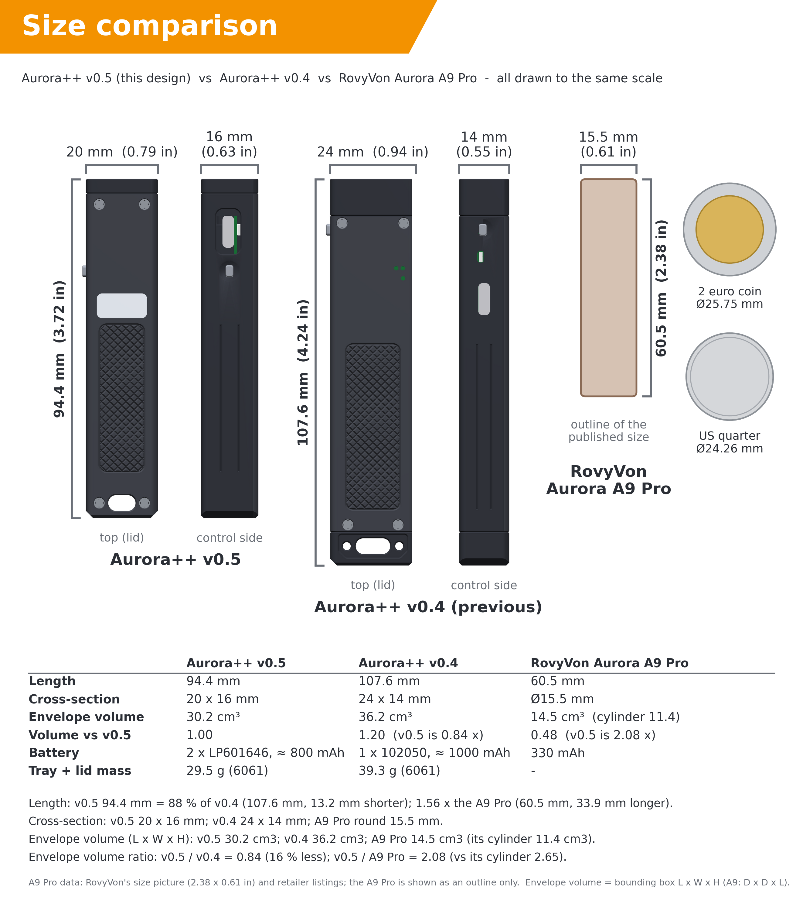
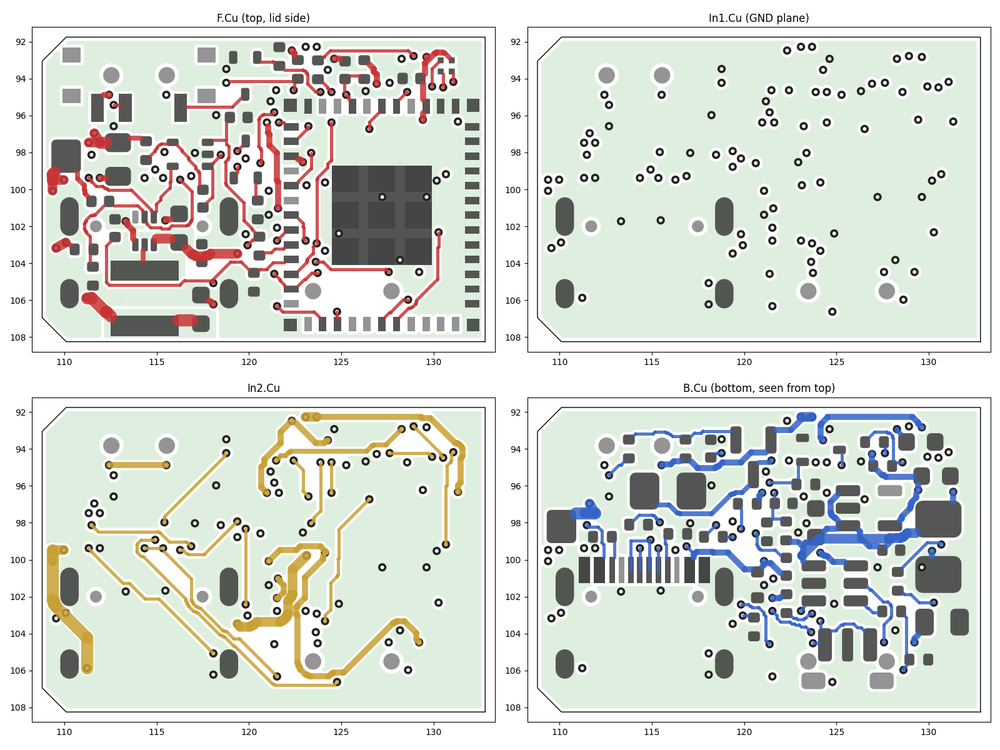

## 12. Version 0.5 — Bluetooth, a Smaller Body and a Build Anyone Can Follow

Version 0.4 worked on paper, but it was a 107.6 × 24 × 14 mm block with a microcontroller you
could only program with a UPDI adapter. Version 0.5 has three goals, all from the same
request: make it **smaller**, give it **Bluetooth** (battery level, light control and
user-defined profiles from a phone, with the button always in charge), and make it possible
for **someone with no electronics background** to order the parts, install the firmware and
assemble a working light. This chapter explains what changed and why; the step-by-step
instructions for builders are in the separate *Build guide* (`docs/build_guide_v0.5.md`).

### 12.1 What changed

| | v0.4 | v0.5 | Why |
|---|---|---|---|
| Body | 107.6 × 24 × 14 mm, 39 g | **94.4 × 20 × 16 mm**, 29 g | smaller cross-section as requested; length set by the parts (12.2) |
| Microcontroller | ATtiny1616 (UPDI programmer needed) | **ESP32-C3-MINI-1** (BLE 5, native USB) | Bluetooth; firmware installed through the light's own USB-C port from a web page |
| Cells | one 102050 LiPo, ≈ 1000 mAh | **two LP601646 in parallel, ≈ 800 mAh** | 20 × 16 mm section; 6 mm cells stacked two-high |
| Main LED | SST-40 on a custom copper MCPCB | **SST-20 on a ready-made 10 mm DTP board** | fits the 20 mm body; nothing to make |
| LED driver | buck + current loop, DAC sets the current | same loop, **filtered 13-bit PWM** sets the current | the ESP32-C3 has no DAC |
| Charger | TP4056 (ESOP-8), 1 A, charge LEDs | **TP4057** (SOT-23-6), ≈ 300 mA, charge control by the MCU, RGB status LED | size; 300 mA ≈ 0.4 C for the small cells |
| PCB | 2 layers, placed, routed by hand in EasyEDA | **4 layers, 24 × 16.5 mm, placed and routed automatically**, parts on both sides | density; JLCPCB-ready files without manual work |
| Antenna | — | module antenna **beyond the PCB edge under a translucent window** in the aluminium lid | a PCB antenna in an aluminium box needs an opening |
| Status | two charge LEDs | one 1 × 1 mm **RGB LED** shining through the same window | |
| Firmware | C for the ATtiny | **Rust** (esp-hal, embassy, trouble-host BLE) | memory safety, reproducible build from crates.io |
| Interface | button only | button + **Web Bluetooth app** + **Web Serial installer** | no app store, no drivers |
| Costs | estimate | **workbook with every fee** (assembly set-up, stencils, shipping, VAT) | |

### 12.2 Why 94.4 mm and not 80 mm

The target was "about 80 mm". The length is the sum of five blocks, and each block is set by
a part that cannot shrink without giving something up:

| Block | X range (mm) | Length | Set by |
|---|---|---|---|
| Head | 0 – 8.5 | 8.5 | 10 mm window + DTP board + LED wire holes; laser bore below |
| PCB | 8.5 – 32.8 | 24.3 | USB-C socket, button and slide switch at the side walls, buck stage, module footprint |
| Antenna overhang + gap | 32.8 – 39.0 | 6.2 | the module's PCB antenna must stick out of the PCB (5.4 mm) |
| Cell bay | 39.0 – 87.0 | 48.0 | LP601646 cells, 46 mm + protection board |
| Tail | 87.0 – 94.4 | 7.4 | lanyard slot through tray and lid, rear lid screws |
| **Total** | | **94.4** | |

Reaching 80 mm would mean 14 mm less: shorter cells (2 × 402030-class ≈ 2 × 200 mAh, half the
runtime), no laser (−4 mm), or a bare ESP32-C3 chip with a chip antenna instead of the
certified module (−5 mm, but a radio design and its own certification). These were offered as
options; the laser and the capacity were kept. The result is 12 % shorter and 16 % smaller in
volume than v0.4, and 1.56 times the length of a RovyVon Aurora A9 Pro (figure 12.1).



*Figure 12.1 — Aurora++ v0.5 next to v0.4 and the RovyVon Aurora A9 Pro (outline), same scale.*

### 12.3 Electronics

The schematic has five blocks (`production/Aurora_main_schematic.pdf`; generated from
`tools/kicad/aurora_parts.py`, the single source of truth for parts, values and connections).

**Blocks 1–2 — USB-C and charger.** USB-C with 5.1 kΩ Rd on CC1 and CC2 (5 V sink), D+/D−
straight to the ESP32-C3's native USB (D− GPIO18, D+ GPIO19), a TVS on VBUS. The TP4057 sets its charge
current through the resistance at PROG: `I = 1000 V / R_PROG`. R3 (3.3 kΩ) returns PROG to
GPIO20 instead of ground, so the firmware has three states without a transistor: GPIO low →
1000 V / 3.3 kΩ ≈ 300 mA (≈ 0.4 C for 800 mAh; the firmware's charge estimate assumes a
conservative 280 mA); GPIO floating → 10 mA trickle through R29 (100 kΩ), which is
what a flat cell gets before any firmware runs; GPIO high → PROG pulled up, charger off (used
above 45 °C, below 0 °C and while the LED runs above 500 mA). CHRG and STDBY are read on
GPIO4/GPIO5.

**Block 3 — cells, 3.3 V, reset.** J2 takes the two cells in parallel. An RT9080 LDO (2 µA
quiescent) makes 3.3 V for the module. Q5, C17 and R7 pull EN low for ≈ 0.1 s whenever USB is
plugged in: the module restarts, and if the button (GPIO9, the boot strap pin) is held at that
moment, the ROM waits for new firmware. This is the recovery path that needs no tools.

**Block 4 — LED driver.** The TLV62585 buck and the cascaded current loop from v0.3/v0.4 stay:
U3 compares the voltage across RS1 (20 mΩ) with VSET and steers the buck's feedback through Q2.
The ATtiny's DAC is replaced by a 13-bit PWM on GPIO6 filtered by R15/R16/C12:

```
VSET  = duty × 3.3 V × R16 / (R15 + R16) = duty × 3.3 V × 2 k / 102 k
I_LED = VSET / 20 mΩ  →  100 % duty = 3.235 A,  1 count (1/8192) = 0.39 mA
```

The divider also makes the PWM ripple negligible (time constant R15‖R16 × C12 ≈ 2 ms). The
op-amp is powered from LED_EN, so the whole driver draws nothing when the light is off.

**Block 5 — laser.** Unchanged in principle: the P-MOSFET Q1 switches the module, Q4 pulls its
gate path low from GPIO10, and the slide switch S2 sits in that gate path: in SAFE it ties the
gate to VBAT, so no software can switch the laser on. S2 never carries laser current.

**Block 6 — module and status.** ESP32-C3-MINI-1-N4 (C2838502; the newer -H4X, C41349510, is
pin-compatible). GPIO0 reads VBAT through 1 MΩ/1 MΩ, GPIO1 an NTC next to the LED wires, the
RGB LED (common anode) hangs on GPIO2/8/21, the button on GPIO3 *and* GPIO9 — GPIO9 is the boot
strap, GPIO3 can wake the chip from deep sleep (the C3 can only wake on GPIO0–5).

**Battery current.** The two cells together are rated about 1–2 C continuous. The firmware
estimates the cell current from the LED current, `I_BAT = V_LED(I) · I / (0.9 · V_BAT)` with
`V_LED ≈ 2.75 V + 0.15 V/A · I`, and limits it per profile (2.6 A in Extreme for bursts,
0.8 A in Endurance).

### 12.4 The 4-layer board



*Figure 12.2 — The routed board, 24 × 16.5 mm: F.Cu (top, lid side), In1 (solid ground plane),
In2 (signals and ground pour), B.Cu (bottom). Grey: pads; green: ground pours.*

**Stack-up and rules.** 0.8 mm, 4 layers, ENIG. In1 is a solid ground plane under everything
(the module's RF ground, the LED current return); F.Cu, In2 and B.Cu carry signals and are
filled with ground wherever there is room. The design rules follow JLCPCB's 2026 capabilities
(table) with margin; KiCad's DRC checks them (`production/DRC_report.txt`: **0 errors**, only
silkscreen warnings), including the JLCPCB-specific rules in `Aurora_main.kicad_dru` (plated-hole
clearances, via-to-pad-hole spacing, and one documented exception: the switch S1's own land
pattern puts its positioning holes 0.1 mm from its terminals). The finished board has 790 track
segments (375 mm), 94 vias and 39 nets.

| Rule | JLCPCB minimum | This board |
|---|---|---|
| Track / space | 0.09 / 0.09 mm | 0.13 mm signal tracks, ≥ 0.10 mm space (router target 0.115) |
| Via | 0.15 mm hole / 0.25 mm pad | 0.2 / 0.45 mm (no surcharge) |
| Via to via (hole to hole) | 0.2 mm | ≥ 0.2 mm |
| Via / NPTH to copper | 0.2 mm | ≥ 0.2 mm |
| Plated hole to copper | 0.28 mm | ≥ 0.28 mm |
| Pad hole to hole | 0.45 mm | ≥ 0.45 mm (vias to the USB-C and switch pegs) |
| Copper to board edge | 0.2 mm | ≥ 0.25 mm |

**Placement.** Ten of the 63 parts are placed by rule. The housing fixes five: the USB-C
socket and the button switch on the control-side edge, the slide switch on the other edge, the
LED wire pads behind the head and the module with its antenna over the rear edge. The buck
stage (U2, L1, C5, C7, C8) is placed by hand — the switching loop is the one place where layout
decides whether the driver works. The other 53 parts were placed by simulated annealing
(`tools/kicad/placer.py`): wire length, decoupling-capacitor affinity and Kelvin connections as
the cost, the housing's keep-outs (ledges, laser tail, trough under the board) and the USB-C
escape as hard rules. 29 parts sit on the top side, 34 on the bottom.

**Routing.** No autorouter in the toolchain could route this board under these rules, so the
project has its own (`tools/kicad/route.py`, about 1700 lines of Python):

* a 0.05 mm grid, A* search per connection on three layers (F, In2, B), vias anywhere legal;
* **exact** distance fields to every pad (not rasterised), so the 0.10 mm minimum holds by
  construction; routed copper is checked against a raster with a 0.04 mm allowance;
* negotiated congestion (PathFinder-style history costs, rip-up and re-route), a progressive
  freeze, and power nets routed wide only between the parts that carry current
  (VBAT 0.4 mm cell → buck, VOUT/ISNS/SW 0.5 mm, plus local copper pours);
* ground: In1 is the plane; every ground pad must reach it. Pads are tied by the real KiCad
  pour fill where it reaches them, else by a via placed inside the pad's own copper island,
  else by a short stub to a new via. Every filled pour island counts on its own, exactly as
  KiCad sees it — two islands that only touch are not connected (an early version missed one
  such pad, U4 pin 14, and KiCad's DRC caught it). The module's exposed pad gets four tented
  thermal vias in the solder-mask webs between its nine paste windows;
* a **monotonic repair phase**: every change in the end game is a transaction — rip, re-route,
  re-fill the pours, and keep it only if no net and no ground pad ends up worse;
* KiCad's own DRC as the judge.

The USB D+/D− pins of the reversible socket alternate (D+ D− D+ D−). D+ joins its two pins with
a short U-shaped track on the bottom layer, D− drops to two vias and joins on In2; the placer
keeps those via spots free on both sides of the board.

### 12.5 Firmware

The firmware (`firmware/`, Rust, `no_std`) has two parts:

* **aurora-core** — all decisions, no hardware: the button gesture parser, the light's state
  machine, profiles and their clamping, the protection rules, battery percentage and runtime,
  charger control, RGB patterns, the Bluetooth packet formats and the settings record. 93 unit
  tests run on a PC (`cargo test`).
* **aurora-fw** — hardware and timing only: GPIO, LEDC PWM, ADC with calibration, the BLE GATT
  server (trouble-host on esp-radio), flash storage, watchdog, deep sleep.

**Profiles.** The phone chooses how the light behaves; the button still works the same way in
every profile:

| | Extreme | Balanced (default) | Endurance | Custom |
|---|---|---|---|---|
| Moon / Low / Medium / High | 3 / 40 / 250 / 900 mA | 3 / 30 / 200 / 600 mA | 2 / 15 / 100 / 300 mA | your values |
| Turbo | 2200 mA for 45 s | 1200 mA for 60 s | none | your values |
| Temperature limit | 55 °C | 50 °C | 45 °C | 40–70 °C |
| Low-voltage step-down | 3.30 V | 3.35 V | 3.40 V | 3.10–3.60 V |
| Cell current limit | 2.6 A | 1.6 A | 0.8 A | 0.2–3.0 A |

"Extreme power for a short time" is Extreme's turbo; "longer battery time, no overdrive" is
Endurance, where the LED never runs above 300 mA and the cells stay below 1 C.

**The button always wins.** Every button action locks the app out of on/off/level/profile
changes for 3 s (the app shows why), and a button press cancels any brightness the app set.
The app is refused with a clear error code, never silently ignored.

**Bluetooth only when useful.** The Rust BLE stack keeps the radio fully on (about 13 mA) — it
has no modem sleep yet. Advertising all day would empty the cells in about 2½ days, so the
radio runs in windows: while the light is on, for 2 minutes after it goes off, for 2 minutes
after a triple click, while USB is connected, and while a phone is connected. The rest of the
time the chip is in deep sleep (≈ 30 µA for the whole light, months of standby).

**Safety in software.** LED_EN and LASER_ON are the first pins set low at start-up, both have
pull-downs for the time before that, and the panic handler drives them low. A watchdog resets
a hung firmware. The laser can only be switched by the button gesture (never from Bluetooth),
for at most 60 s, never when locked, hot (> 60 °C) or flat (< 3.2 V) — and only if S2 is armed.

**Installation.** `firmware/build.sh` builds the release image and merges bootloader,
partition table and program into one file for address 0 (`firmware/dist/aurora-fw-v0.5.0-merged.bin`,
419,136 bytes; rebuilding gives the identical file in any folder). The flasher page embeds it.

### 12.6 Phone app and installer

Both are single HTML files in `app/` — no app store, no installation, they work offline and
from any web host (GitHub Pages instructions in `docs/web_apps.md`):

* **`aurora-app.html`** uses Web Bluetooth (Chrome/Edge on Android, Windows, macOS, Linux; Bluefy
  on iPhone): battery, voltage, temperature, runtime estimate, on/off, levels, brightness,
  profiles, the Custom profile editor, lockout. A demo mode simulates a light.
* **`aurora-flasher.html`** uses Web Serial and esptool-js: Connect → choose the port → Install.
  It checks the embedded image's SHA-256 before writing.

The protocol both sides implement is `docs/ble_protocol.md`: a standard Battery Service plus an
"Aurora Control" service with an 18-byte status, a command characteristic with explicit error
codes, and a 20-byte profile.

### 12.7 Housing


*Figure 12.3 — v0.5 exploded: window, spacer ring and DTP LED board in the head, laser below;
the 4-layer PCB on its ledges with the module's antenna under the translucent RF window of the
lid; the U-shaped antenna spacer; two cells; four M1.6 screws.*

New in the housing (`tools/housing/aurora_housing.py`):

* **RF window.** The antenna would be deaf inside aluminium, so the lid has a 6.9 × 14 mm
  opening above the antenna and the RGB LED, closed by a translucent resin insert glued in
  from inside (stepped flange, 0.8 mm — JLC3DP's minimum wall).
* **Antenna spacer.** A printed U-block between the PCB and the cells: the antenna overhang
  sits in the U, the cells rest against it, the cell wires pass through a notch.
* **Compact tail.** A 4.4 × 7.6 mm lanyard slot through tray and lid, after the RovyVon A9
  tail, with a recessed window in the bottom face.
* **Print kit.** The four resin parts are joined by 1 mm sprues into one part, because two of
  them are below JLC3DP's minimum build size of 5 × 5 × 5 mm.
* **Checks** run on every build: all solids valid; thinnest metal 0.8 mm — JLCCNC's minimum —
  where the upper LED wire groove passes under the lid seat (a 1.2 mm long web, covered by the
  lid), everything else ≥ 0.825 mm; PCB insertion path (tilted in, S2 knob first) collision-free;
  button-cap travel reaches the switch from every PCB position; the real PCB STEP inside the
  housing (`tools/housing/fit_pcb.py`).

### 12.8 Cost

`Aurora_Parts_List_v0.5.xlsx` (generated by `tools/parts_list.py`, every price with its source
and date in `docs/bom_notes.md`):

| | 1 light | 5 lights (per light) |
|---|---|---|
| PCB + assembly (JLCPCB; 5 boards, 2 assembled minimum) | 169 USD | 39 USD |
| Housing (JLCCNC) + print kit (JLC3DP) | 66 USD | 45 USD |
| Bought parts (cells, LED board, laser, window, screws) | 57 USD | 42 USD |
| Consumables (wire, tapes, epoxy) | 18 USD | 4 USD |
| Shipping, VAT 21 %, duty, carrier and card fees | 219 USD | 66 USD |
| **Total** | **530 USD (473 EUR)** | **196 USD (175 EUR)** |
| Tools (one-time, not included) | 128 USD | |

Fixed costs dominate a single light; five lights cost less than twice one.

### 12.9 What is verified, and what is not yet

Verified by software on every build: schematic netlist = intended netlist (39 nets); PCB pad
nets = intended netlist; KiCad DRC of the routed board; courtyards, keep-outs and the housing
interface (`check_pcb.py`); housing walls, insertion path, button travel and the PCB fit;
firmware logic (93 tests), app and installer against simulated hardware (123 tests and
headless browser runs).

Not verified — this needs the first real board, in this order (`docs/firmware.md` §7.1):
start-up behaviour of LED_EN/LASER_ON on a scope; ADC readings (VBAT, NTC); LED current at
3 / 30 / 600 / 2200 mA; every button gesture; charger current and pause; deep-sleep current;
Bluetooth range through the RF window; laser cut-offs. The firmware constants that a
measurement may need to correct are listed in `docs/firmware.md` §6.

### 12.10 Rebuilding after a change

```
python3 tools/housing/aurora_housing.py cad          # housing STEP/STL + housing_interface.json (~15 min)
python3 tools/kicad/build_all.py                     # schematic, placement, routing, DRC, JLC files (~10 min)
python3 tools/housing/drawings.py cad cad            # JLCCNC drawings
cd firmware && ./build.sh                            # firmware + merged image
cd tools/web && npm install && node build_flasher.mjs   # installer page with the new image
python3 tools/parts_list.py                          # cost workbook (checks itself)
python3 docs/build_pdf.py                            # build guide + this chapter as PDFs
```
