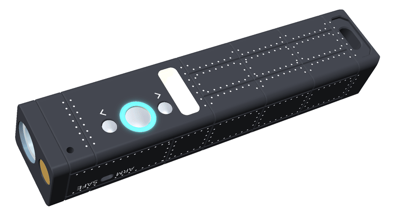
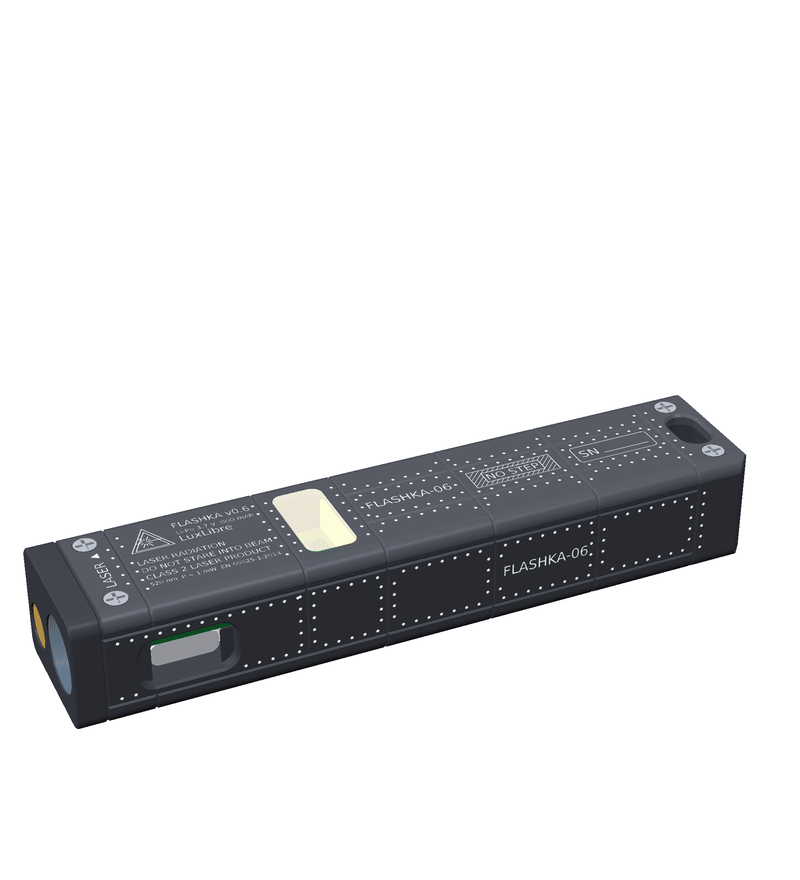
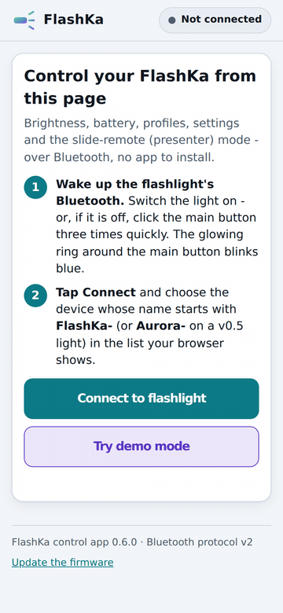

<!-- SPDX-License-Identifier: CC-BY-SA-4.0 -->
[LuxLibre](../../README.md) › [Lights](../README.md) › FlashKa Keychain v0.6

# FlashKa Keychain v0.6

**On this page:** [What's new in v0.6](#whats-new-in-v06) · [Specifications](#specifications) · [Gallery](#gallery) · [Web app and firmware installer](#web-app-and-firmware-installer) · [Presenter mode](#presenter-mode) · [Building one](#building-one) · [Cost](#cost) · [What has been checked](#what-has-been-checked) · [Known limitations](#known-limitations) · [Firmware](#firmware-two-options) · [What is in this folder](#what-is-in-this-folder) · [Licences](#licences)

> **Superseded by [FlashKa Keychain v0.7](../flashka-keychain-v07/README.md).** This folder stays as
> published apart from the shared firmware, the web pages and their documents, which now also
> serve v0.7. Its firmware sources also build firmware 0.7.0 for the v0.7 board
> (`BOARD=v07 firmware/build.sh`, [firmware.md, section 9](docs/firmware.md#9-flashka-keychain-v07-firmware-070)),
> and its web pages serve both versions.

FlashKa is LuxLibre reference design #1: a 94.4 × 20 × 16 mm aluminium keychain light. It has a
white LED from 2 mA moonlight to a 2.2 A turbo burst, a Class 2 green laser behind a hardware
safety switch, USB-C charging, two small LiPo cells (about 800 mAh) and Bluetooth. Version 0.6
adds three stainless-steel buttons on the bottom face with a glowing ring around the main one,
and a **presenter mode**: the light becomes a Bluetooth keyboard that turns your slides, and the
laser stays the pointer. A web page on a phone or computer shows the battery and switches the
light. Firmware is installed from a web page through the light's own USB-C port.



*Render — FlashKa has not been built yet.*

> **Status: designed, not yet built.** Everything here has been checked by software (see
> [What has been checked](#what-has-been-checked)), but nobody has assembled a FlashKa yet, and
> every picture of the light is a render. The first build must follow the bring-up in the
> LuxLibre testing guide, [docs/testing.md](../../docs/testing.md#bring-up-of-a-new-board), and
> the plan in [docs/firmware.md](docs/firmware.md#7-verification-status) section 7, before more
> are made. The light holds lithium cells and a laser: read [SAFETY.md](../../SAFETY.md) first.

## What's new in v0.6

* **Three stainless-steel buttons** on the bottom face: › next, ● main, ‹ previous. Two RGB LEDs
  shine through a resin ring around ● and show what the light is doing.
* **Presenter mode.** Hold ‹ + › for 2 s and the light is a Bluetooth keyboard: Page Down, Page
  Up, F5, Esc and B (black screen). It pairs with up to 4 computers and needs no dongle and no
  app on the computer. The laser is still the pointer.
* **Bluetooth protocol version 2:** a 20-byte status, a Presenter setting and a command that
  forgets the paired computers. The web app still controls v0.5 lights.
* **A new skin.** Panel seams in the shape of a V, laser-marked rivets and stencils replace the
  diamond knurl. The side button is gone. The laser label moved to the lid.
* **Hold-down pads.** Two small silicone pads under the lid press the board down, so that a
  button press lifts it as little as possible. A second radio window in the floor lets the antenna radiate
  when the bottom face points up.
* **Cost.** One light costs about 90 USD more than v0.5: 620.21 USD against 529.63 USD (see
  [Cost](#cost)).

## Specifications

| Item | Value |
|---|---|
| Size and mass | 94.4 × 20 × 16 mm. Aluminium tray + lid 29.8 g, all housing parts together 32.9 g (both calculated from the CAD solids). About 50 g with cells (not weighed) |
| Buttons | Three Alps SKRKAEE020 switches (click at 1.6 N) under three stainless-steel caps (SUS304): › next, ● main, ‹ previous. The caps are loose parts held by their flange, with 0.30 mm free play. The domes stand 0.1 mm above the bottom face |
| Ring | Two RGB LEDs (NH-B1010RGBT-HF) around ●, lit through a resin light-pipe tube. Patterns: [docs/firmware.md](docs/firmware.md#25-ring-colours) |
| LED | Luminus SST-20 (5000-6500 K) on a 10 mm copper DTP board |
| LED driver | TLV62585 buck with a current loop (TLV333 op-amp, 20 mΩ sense resistor), 3 mA to 2.2 A |
| Laser | 520 nm module, Class 2 (≤ 1 mW), slide-switch interlock S2 in its supply, marked SAFE and ARM |
| Cells | 2 × LP601646 LiPo pouch cells in parallel (6.0 × 16 × 46 mm, about 400 mAh each), with protection boards, rated at least 2C continuous (0.8 A each) |
| Charging | USB-C (two 5.1 kΩ CC resistors), TP4057 linear charger, about 300 mA, status on the ring |
| Brain | ESP32-C3-MINI-1 module (Bluetooth LE, USB serial/JTAG) |
| Bluetooth | One connection at a time. The name is `FlashKa-XXXX`. Protocol version 2 ([docs/ble_protocol.md](docs/ble_protocol.md)) |
| Presenter mode | Bluetooth LE keyboard (HID over GATT). Pairing with LE Secure Connections "Just Works", no PIN. Up to 4 computers. About 20 mA while it is on (estimate) |
| Temperature | NTC 100 kΩ, B 4250, next to the LED driver |
| Circuit board | 24 × 16.5 mm, 4 copper layers, 0.8 mm, ENIG. JLCPCB assembles 68 parts of 34 kinds, on both sides |
| Housing | CNC-machined 6061-T6 tray and lid, bead-blasted, black anodised and laser-marked, and three turned stainless caps (JLCCNC). Seven small translucent resin parts as one print kit (JLC3DP) |
| Output | Not measured yet. Simulated with the LuxLibre FlashKa board header (`make sim BOARD=flashka-keychain-v06` in the LuxLibre `firmware/` folder): default turbo about 445 lm (1.2 A), at most about 510 lm at the cell-current limit, about 250 lm sustained at the thermal limit in 25 °C still air ([simulator](../../docs/firmware/simulator.md)) |

## Gallery

All pictures are renders made from the design files.

|  |  |
|---|---|
| **Bottom face.** › next, ● main inside its ring (lit cyan), ‹ previous, and the cream plug of the radio window. The head is at the upper right. | **Control side.** The USB-C opening, the panel seams, the rivet rows and the FLASHKA-06 stencil. |
|  |  |
| **Rear (laser side).** SAFE and ARM mark the two positions of the slide switch. The laser works only when the switch is on ARM. | **Lid.** Class 2 laser label, resin radio-window insert, FLASHKA-06 stencil, NO STEP hatch over the cells, serial-number field and lanyard slot. |
|  |  |
| **Without the lid.** The real routed board, the hold-down pads, the S2 slide switch, the two cells and the lanyard slot. | **Print kit.** Light tube, three caps, radio-window insert, spacer ring and antenna spacer, joined by thin rods. |
|  |  |
| **Exploded view.** Lid, screws, cells, board, caps, tube and the parts of the head. | **Size.** 94.4 mm long: 88 % of v0.4 and 1.56 times the length of an A9 Pro. |

## Web app and firmware installer


Two small web pages belong to the light. Each is one HTML file. It works offline and runs
entirely in the browser: nothing is uploaded, there is no account and no external request.

| Page | Address on GitHub Pages | File in this folder |
|---|---|---|
| Start page | <https://dompka.github.io/LuxLibre/flashka/> | [app/index.html](app/index.html) |
| **Control app** | <https://dompka.github.io/LuxLibre/flashka/flashka-app.html> | [app/flashka-app.html](app/flashka-app.html) |
| **Firmware installer** | <https://dompka.github.io/LuxLibre/flashka/flashka-flasher.html> | [app/flashka-flasher.html](app/flashka-flasher.html) |

If an address does not open yet, the site has not been published: use the files in `app/`.

**The control app** talks to the light over Bluetooth (Web Bluetooth):

* It shows the battery (percentage and voltage), charging, board temperature, LED current and the
  estimated runtime.
* It switches the light and sets the level (Moon, Low, Medium, High, Turbo) or an exact current.
* It holds the profiles Extreme, Balanced, Endurance and Custom, with an editor for every limit,
  and saves the choice in the light.
* Its Presenter card chooses the keys (Page Down and Page Up, or the arrow keys), the idle time and
  swapped buttons. It shows how many computers are paired, forgets them, and starts presenter
  mode.
* Its demo mode is a simulated light inside the page, so you can try everything without a FlashKa.
* It needs Chrome or Edge on Android, Windows, macOS or ChromeOS (on Linux, Chrome may need the
  Web Bluetooth flag in chrome://flags). On an iPhone or iPad use
  the free Bluefy browser. Firefox and Safari have no Web Bluetooth.

**The firmware installer** writes the firmware through the USB-C port (Web Serial). The image is
inside the page. It accepts only an ESP32-C3, checks the image before it writes, and checks what
it wrote. It needs Chrome or Edge on a computer, not a phone. An installation erases the saved
settings and the paired computers.



*Recording of the control app in demo mode. The light is simulated.*

The same files work from this folder: serve `app/` over https or from `http://localhost`, or
download a file and open it in Chrome or Edge on a computer. (Web Bluetooth and Web Serial work
only on a secure page. For the installer, opening a local file was tested only with a simulated
serial port.) Details, and how to host the pages yourself: [docs/web_apps.md](docs/web_apps.md#5-why-https-and-opening-the-files-directly).

## Presenter mode

Hold ‹ + › for 2 s. The ring blinks magenta twice, then breathes cyan while the light waits for
the computer. With the bottom face up and the head pointing away from you, the row reads ›, ●, ‹,
and › (next) is towards the screen.

| Input | What it does | Key sent |
|---|---|---|
| › click | next slide | Page Down (Right Arrow in the "arrows" key set) |
| ‹ click | previous slide | Page Up (Left Arrow in the "arrows" key set) |
| › hold 0.8 s | start the show | F5, once |
| ‹ hold 0.8 s | end the show | Esc, once |
| ● click | black screen on or off | B |
| ● hold | laser on while held (S2 must be on ARM) | none |
| ● 4 clicks | lock the light; this also leaves presenter mode | none |
| ‹ + › hold 2 s | enter or leave presenter mode | none |
| ‹ + › hold 10 s | forget all paired computers (ring white × 3) | none |

* The light pairs like a Bluetooth keyboard: no PIN, no app. Up to 4 computers are remembered, and
  a fifth replaces the one paired longest ago. Steps for Windows, macOS, Android, iPhone and iPad,
  and Linux: [docs/firmware.md](docs/firmware.md#24-first-pairing-untested-on-all-systems).
* PowerPoint, LibreOffice Impress and PDF viewers should take Page Down and Page Up; for Keynote
  and Google Slides the app recommends the arrow keys (not yet tried with a real light: try both
  key sets). F5 starts a PowerPoint or Impress show on Windows and Linux; in a browser it reloads
  the page.
* Presenter mode ends by itself after 30 min without a button press (5 to 120 min in the app),
  and when the battery stays below 3.20 V for 2 s.
* The light has one Bluetooth connection, so the app cannot connect during presenter mode.
* Pairing has not been tried on any real system yet.

## Building one

1. Read [FlashKa_v0.6_Build_Guide.pdf](FlashKa_v0.6_Build_Guide.pdf) from start to end once. It is
   written for people without electronics experience; the source is
   [docs/build_guide_v0.6.md](docs/build_guide_v0.6.md).
2. Upload the files in [order_files/](order_files/), one folder per shop. The `README.txt` there
   lists the order options.

   | Shop | What it makes | Folder |
   |---|---|---|
   | JLCPCB | the circuit board with all small parts mounted, on both sides | `1_JLCPCB` |
   | JLCCNC | the aluminium tray and lid (black anodised, laser-marked) and three stainless caps | `2_JLCCNC` |
   | JLC3DP | the seven resin parts, as one print kit | `3_JLC3DP` |

3. Buy the remaining parts from the workbook [FlashKa_Parts_List_v0.6.xlsx](FlashKa_Parts_List_v0.6.xlsx):
   cells, LED board, laser module, glass, screws, two silicone hold-down pads, wire, tapes and
   adhesives. Every part has a price, a link and its fees; the notes are in
   [docs/bom_notes.md](docs/bom_notes.md). Buy only a Class 2 laser module (1 mW or less):
   [LAS-1](../../docs/design-rules.md#las-1).
4. Install the firmware with the [installer](app/flashka-flasher.html) (Chrome or Edge on a
   computer).
5. Assemble the light, test it and use it as the guide says.

The stainless caps are tiny, and the JLCCNC quote may refuse them by size. Try them in the
instant quote before you order anything else. If it refuses, send the same files to another CNC
shop, or use the resin caps from the print kit.

## Cost

Prices as of 2026-10-18 (readings of parts that did not change since v0.5: 2026-10-14), delivered
to Lithuania (EU, 21 % VAT), from [docs/bom_notes.md](docs/bom_notes.md):

| USD (EUR) | 1 light | 2 lights (total) | 5 lights (total) |
|---|---|---|---|
| PCB + assembly (JLCPCB), before shipping | 174.33 (155.82) | 174.33 (155.82) | 194.69 (174.01) |
| Housing (aluminium, stainless caps, resin print kit) | 122.56 (109.54) | 187.52 (167.60) | 382.39 (341.78) |
| Bought parts (cells, LED board, laser, glass, screws, ring) | 56.75 (50.72) | 94.65 (84.60) | 211.30 (188.86) |
| Consumables (wire, tapes, silicone pads, adhesives) | 27.79 (24.84) | 27.79 (24.84) | 27.79 (24.84) |
| Shipping, VAT, customs duty, carrier and card fees | 238.78 (213.43) | 290.99 (260.09) | 378.82 (338.60) |
| **Total** | **620.21 (554.35)** | **775.28 (692.95)** | **1,194.99 (1,068.10)** |
| **Per light** | **620.21 (554.35)** | **387.64 (346.48)** | **239.00 (213.62)** |
| Tools, once | about 135 (121) | | |

One light is expensive because the fixed costs are paid once, whatever the quantity: shipping,
VAT, duty and fees are 39 % of the total (three JLC parcels and eight marketplace parcels, each
with its own shipping and customs fee), and JLCPCB's assembly fees are 132.01 USD (set-up for two
board sides 51.12, feeder loading for 34 kinds of parts 52.02, stencils 16.42, X-ray inspection
9.84, the rest 2.61). The electronic parts of the two boards that JLCPCB assembles at the
minimum cost only 17.32 USD. Building several lights at once is the biggest saving.

Version 0.5 cost 529.63 USD for one light. The 90.58 USD difference is the housing (+56.60: three
stainless caps, laser marking of four faces, more machining set-ups), shipping, VAT and customs
(+19.46), silicone pads and adhesive (+9.50) and the extra parts on the board (+5.02).

**Many prices are estimates.** The housing (above all the stainless caps, about 28 USD for one
light, and the laser marking), the bare boards, the shipping prices and the marketplace prices
are estimates until the shops quote. Two new parts on the board (the switches and a resistor)
could not be priced from the shop pages. The workbook marks every estimate in blue on amber.

## What has been checked

From the v0.6 build scripts, the tests and the checks of chapter 13
([section 13.7](docs/ch13_v0.6_presenter.md#137-checks)):

| Area | Result |
|---|---|
| Board | The netlist has the 44 expected nets. The routed 4-layer board has 0 KiCad DRC errors and 0 unconnected pads (65 silkscreen warnings). BOM and CPL match the board: 34 lines, 68 parts. Two rebuilds give the same files (the Gerbers differ only in date lines) |
| Housing | 11 of 11 solids are valid. No two parts overlap. The board goes in along its insertion path without a hit. 347 numbers on the drawings match the parameter table, 0 mismatches. Hold-down preload 34.0 N (calculated; target 3 N or more) |
| Board in the housing | The real routed board model has 0 collisions with the housing, centred or pushed 0.24 mm to either wall |
| Firmware | 149 host tests pass (93 from v0.5, 56 new), 0 lint warnings. The release image builds byte for byte the same in any folder: 534,736 bytes, SHA-256 `e21058791bab990439835fbd977eecfed385af5837405e36ae923cb6083a8fdd` |
| Web pages | Type check clean. 143 unit tests, 67 browser tests of the app and 29 of the installer pass. The app makes no external request. The firmware inside the installer is the image in `firmware/dist/`, byte for byte |
| Cost workbook | 8 sheets, 913 formulas, 0 error cells. 523 cells equal an independent Python model |

None of this replaces a built and measured light. One housing target is not met: see
"Hold-down" below.

## Known limitations

The open points that the first build has to settle are
[section 13.9](docs/ch13_v0.6_presenter.md#139-open-points-for-the-first-prototype) of chapter 13.
The deviations from the working specification, with reasons, are
[section 13.8](docs/ch13_v0.6_presenter.md#138-deviations-from-the-specification-and-why).

| Topic | Limitation | Rule | Plan |
|---|---|---|---|
| Verification | not built and measured yet | [FW-8](../../docs/design-rules.md#fw-8), [THM-6](../../docs/design-rules.md#thm-6) | first build with the full test plan |
| Hold-down | When ‹ is pressed hard (10 N) the board lifts 0.121 mm, against a target of 0.05 mm (calculated, with pad hardness taken from the Shore value). At 3 N the board moves at most 0.017 mm, but at ‹ it already leaves its ledge at 2 N; the switch clicks at 1.6 N | | accepted for v0.6. If ‹ feels soft: a harder can pad, or a third pad in a later version |
| Caps | The caps stand 0.1 mm above the bottom face instead of sitting in a recess. A hard press on ● in a pocket can switch the light on | [MEC-6](../../docs/design-rules.md#mec-6) | lockout (● 4 clicks, [BAT-7](../../docs/design-rules.md#bat-7)); › and ‹ do nothing while the light is off and awake (from deep sleep a very short press switches it on: see Wake-up); carry the first light for a week and log every accidental switch-on |
| Cells | The pouch cells are soldered in. The EU requires user-replaceable portable batteries from 18 February 2027. Not changed since v0.5 | [BAT-2](../../docs/design-rules.md#bat-2) | open |
| Power use | Deep sleep is as in v0.5: about 29 µA expected (an estimate, not measured). Presenter mode draws about 20 mA (estimate, about 30 to 40 h from 800 mAh), because the firmware has no light sleep and the radio library has no Bluetooth modem sleep | [BAT-6](../../docs/design-rules.md#bat-6) | measure both at the first build |
| Cell current | The 2.2 A "Extreme" profile draws about 2 A from two 2C cells (1.6 A rating). Not changed since v0.5 | [BAT-1](../../docs/design-rules.md#bat-1) | use 3C cells for the Extreme profile |
| Capacitor derating | C5, the 22 µF 6.3 V X5R 0603 input capacitor of the buck on VBAT (up to 4.2 V), is rated below twice its working voltage. Not changed since v0.5 | [DRV-4](../../docs/design-rules.md#drv-4) | a part rated 10 V or more, checked against the DC-bias curve |
| USB detection | The board has no VBUS sense pin. Plugging in USB resets the chip, so presenter mode ends. Not changed since v0.5 | [CHG-3](../../docs/design-rules.md#chg-3) | a VBUS divider to a GPIO in a later version |
| Ring | The datasheet drawing of the ring LED could not be read, so its pad map comes from the text. The colour balance is not tuned. The red LED shares the UART TX pin and flickers during the boot messages | | light each colour at the first build and tune the balance |
| Wake-up | A very short press on › or ‹ that wakes the light from deep sleep counts as ● and switches the light on | | hold › or ‹ a little longer when waking |
| Pairing | Untested on every system. Windows 10 before 1803 and Android before 6 cannot pair, because the light supports only LE Secure Connections. The Bluetooth product ID 0x1209:0x0001 is a test number | | pair with each system at the first build; apply for a free product ID at pid.codes before the firmware goes to other people |
| Assembly cost | Parts on both sides, 34 kinds of parts, leadless parts that need X-ray inspection (the module and the two ring LEDs) | [DFM-1](../../docs/design-rules.md#dfm-1) to [DFM-3](../../docs/design-rules.md#dfm-3) | not changed in v0.6 |
| Orders | JLCCNC may refuse the small stainless caps by size. The shop pages of two new parts (the switches and a 330 Ω resistor) could not be read, so their stock and price are estimates | | try the caps in the instant quote first; check both lines in the JLCPCB BOM upload |
| Bluetooth in LuxLibre | Only in the FlashKa Rust firmware, not in the LuxLibre port | | open |

## Firmware: two options

1. **The FlashKa firmware** in [firmware/](firmware/) (Rust) is the reference. It has the flashlight
   mode with profiles (Extreme, Balanced, Endurance, Custom), the Bluetooth app, presenter mode and
   deep sleep, and the main button always has priority over the app.
   `firmware/dist/flashka-fw-v0.6.0-merged.bin` (534,736 bytes) is the image that the installer
   [app/flashka-flasher.html](app/flashka-flasher.html) writes; the app is
   [app/flashka-app.html](app/flashka-app.html). Details: [docs/firmware.md](docs/firmware.md),
   [docs/ble_protocol.md](docs/ble_protocol.md), [docs/web_apps.md](docs/web_apps.md).
2. **LuxLibre** with the board header
   [firmware/boards/flashka-keychain-v06/board.h](../../firmware/boards/flashka-keychain-v06/board.h)
   and the [ESP32-C3 port](../../firmware/ports/esp32c3/README.md) gives the common LuxLibre user
   interface, console and parameters on the same board. It is experimental. It uses the main
   button and the ring only: › and ‹ are ignored, and there is no Bluetooth and no presenter
   mode. It sleeps in light sleep instead of deep sleep.

## What is in this folder

Version 0.5 files used the working name "Aurora++". All v0.6 files are named FlashKa.

| Folder / file | Contents |
|---|---|
| [FlashKa_v0.6_Build_Guide.pdf](FlashKa_v0.6_Build_Guide.pdf) | ordering, firmware, assembly, first use, troubleshooting; appendix: user manual |
| [FlashKa_v0.6_Hardware_Package.pdf](FlashKa_v0.6_Hardware_Package.pdf) | why and how v0.6 was designed: chapter 13 of the design documents (source [docs/ch13_v0.6_presenter.md](docs/ch13_v0.6_presenter.md)) |
| [FlashKa_Parts_List_v0.6.xlsx](FlashKa_Parts_List_v0.6.xlsx) | cost workbook: every part with price, link and fee (notes in [docs/bom_notes.md](docs/bom_notes.md)) |
| [order_files/](order_files/) | exactly the files to upload at JLCPCB, JLCCNC and JLC3DP, with a README |
| [production/](production/) | Gerbers and drill (zip), BOM and CPL for JLCPCB assembly, schematic PDF, DRC report, assembly drawings, layer pictures, netlist |
| [kicad/](kicad/) | KiCad project (schematic and routed 4-layer board, design rules) and the project footprints; [flashka.net](flashka.net) is the netlist |
| [cad/](cad/) | housing STEP and STL files, drawings (DXF, PDF, PNG), laser-marking DXF files, print kit, the board's STEP model, `housing_interface.json` (the contract between housing and board). The Class 3R lid label is kept for reference only: LuxLibre's [LAS-1](../../docs/design-rules.md#las-1) allows Class 1 and 2 lasers only |
| [firmware/](firmware/) | the FlashKa Rust firmware (`flashka-core`, `flashka-fw`) and the built image in `dist/` |
| [app/](app/) | the start page, the control app and the firmware installer (single HTML files that work offline), and screenshots |
| [renders/](renders/), [assets/](assets/) | pictures of the light, the exploded view, the print kit, a size comparison, and the pictures and animations of this page |
| [tools/](tools/) | the generators: `kicad/` (schematic, placement, router, production files), `housing/` (CAD, drawings, renders, fit checks), `web/` (installer build and tests), `parts_list.py` (cost workbook) |
| [docs/](docs/) | Markdown sources: [chapter 13](docs/ch13_v0.6_presenter.md) (the design), the [build guide](docs/build_guide_v0.6.md), [firmware.md](docs/firmware.md) (with the user manual), [ble_protocol.md](docs/ble_protocol.md), [web_apps.md](docs/web_apps.md), [bom_notes.md](docs/bom_notes.md), [housing_v06_notes.md](docs/housing_v06_notes.md) and [checks/](docs/checks/) (logs of the checks) |

### Rebuilding after a change

Run each line from this folder (`hardware/flashka-keychain-v06/`):

```sh
python3 tools/kicad/build_all.py --no-route          # board outputs from the routed board (about 3 min)
python3 tools/kicad/build_all.py                     # or a full rebuild (about 40 min)
(cd tools/housing && python3 flashka_housing.py ../../cad)   # housing solids and checks (about 75 s)
(cd firmware && ./build.sh)                            # firmware: tests, release build, merged image
(cd tools/web && npm install && npm run build:release) # installer page with the new image
python3 tools/parts_list.py                          # cost workbook (checks itself)
python3 docs/build_pdf.py                            # the two PDFs
```

The rest of the housing chain (marking files, drawings, renders, fit check) is in
[docs/housing_v06_notes.md](docs/housing_v06_notes.md). The generators need Python 3 with CadQuery
(OCP), ezdxf and KiCad 7 or newer (for `kicad-cli`); the firmware needs the Rust ESP toolchain
([docs/firmware.md](docs/firmware.md#5-building)); the PDF script needs python-markdown and
Playwright with Chromium.

## Licences

Hardware design files (KiCad, CAD, drawings and their PDFs, production files): CERN-OHL-W-2.0. The
FlashKa Rust firmware, the web app and the web tools: MIT OR Apache-2.0. The Python generator
scripts: GPL-3.0-or-later. The build guide, design chapter and other documents: CC-BY-SA-4.0.
Details and what they mean for building and selling FlashKa lights:
[LICENSING.md](../../LICENSING.md).

**Previous design:** [FlashKa Keychain v0.5](../flashka-keychain-v05/README.md) (one side button,
no presenter mode).

---

[← EDCO v0.1](../edco-v01/README.md) · [All lights](../README.md) · [LuxLibre home](../../README.md) · [FlashKa v0.5 →](../flashka-keychain-v05/README.md)
