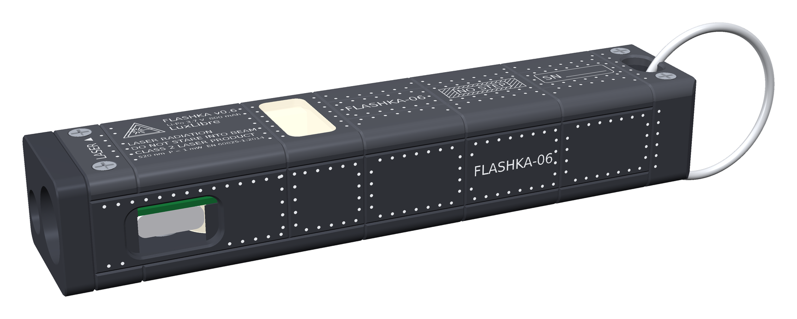
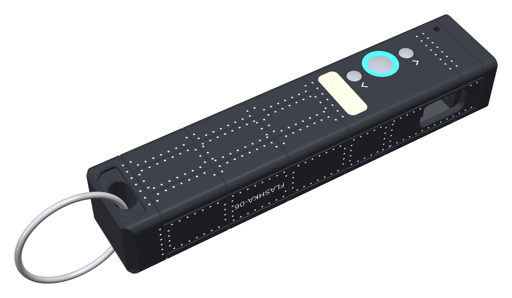

<!-- SPDX-License-Identifier: CC-BY-SA-4.0 -->
# FlashKa Keychain v0.6 — Build guide from zero

This guide takes you from "I have never ordered a circuit board" to a working flashlight and
slide remote in your hand. You do not need to know electronics or programming. You need
patience, a soldering iron and a computer with the Chrome or Edge browser. Read the whole guide
once before you order anything.

> **Status: designed, not yet built.** Nobody has assembled a FlashKa yet. Everything in this
> guide is checked by software only (chapter 13, section 13.7), so you may be the first to build
> one. Where a step or a behaviour is untested, the guide says so. Please tell the project what
> you find (section 16).

*Render, not a photo: FlashKa has not been built yet. Every picture of the light in this guide is a computer render made from the design files. The finished light seen from the USB-C side (the buttons are on the face underneath): 94.4 × 20 × 16 mm, black anodised aluminium, a white LED and a small green laser in the head, USB-C charging, and Bluetooth for the phone app and for presenting.*

---

## 0. What you are building

FlashKa is a keychain flashlight with a green laser pointer. Version 0.6 adds a second job: it
turns slides. In *presenter mode* the light is a Bluetooth keyboard, and the laser stays the
pointer.

| | |
|---|---|
| Size | 94.4 × 20 × 16 mm, about 50 g with cells |
| Buttons | three stainless-steel buttons on the bottom face: › next, ● main, ‹ previous |
| Ring | two RGB LEDs shine through a ring around the main button and show what the light is doing |
| Main light | Luminus SST-20 LED, 3 mA (moonlight) to 2.2 A (turbo, short bursts) |
| Laser | green 520 nm module, Class 2 (≤ 1 mW), with a hardware safety switch |
| Presenter mode | the light is a Bluetooth keyboard: › next slide, ‹ previous slide, ● black screen; the laser is the pointer |
| Battery | two LP601646 lithium-polymer cells in parallel, about 800 mAh |
| Charging | USB-C, about 300 mA, status shown on the ring |
| Brain | ESP32-C3 module with Bluetooth Low Energy |
| Phone and computer app | a web page: no app store, works in Chrome or Edge (Android, Windows, Mac, Linux) |
| Firmware updates | from a web page over the same USB-C cable: no programmer needed |

How it is made:

* **The circuit board** (24 × 16.5 mm, 4 copper layers) is made *and fitted with all its small
  parts, on both sides,* by JLCPCB. That includes the three push switches and the two ring
  LEDs. You only solder a few wires by hand.
* **The aluminium body** (two parts: tray and lid) is machined, anodised black and
  laser-marked by JLCCNC. The same shop, or another CNC shop, turns the **three small stainless
  caps** that you press.
* **Seven small plastic parts** are 3D-printed by JLC3DP as one "print kit": the light tube of
  the ring, the radio window insert, the LED spacer ring, the antenna spacer and three resin
  caps (a back-up for the stainless ones).
* **The LED board, the laser, the cells, the window, the screws, two silicone pads and the
  glue** are bought ready-made (for example on AliExpress).

Hold the light with the bottom face up and the head pointing away from you (at the screen, when
you present). The row of buttons then reads, from the head to the tail:
**› next · ● main · ‹ previous**. Next is towards the screen. Previous is towards you. The
seams, rivets and stencils on the body are styling. The marks that matter are SAFE and ARM at
the slide switch, LASER near the head, the chevrons at the buttons and the laser warning label.

*Render. The bottom face with its three buttons, head (LED and laser) at the upper right. From the head to the tail: › next, ● main inside its light ring (shown cyan), ‹ previous, and the cream plug that closes the radio window in the floor. The chevron beside › points towards the head, the one beside ‹ towards the tail.*

If you know the v0.5 guide: chapter 13, section 13.1 lists what changed and why.

## 1. Before you spend money

**Cost.** The workbook `FlashKa_Parts_List_v0.6.xlsx` lists every part and every fee. The short
version (delivery to Lithuania, EU, 21 % VAT; prices of unchanged parts read on 2026-10-14, new
lines on 2026-10-18):

| | one light | two lights | five lights |
|---|---|---|---|
| Everything, including shipping, VAT and set-up fees | 620.21 USD (554.35 EUR) | 775.28 USD (692.95 EUR) | 1,194.99 USD (1,068.10 EUR) |
| Per light | 620.21 USD | 387.64 USD (346.48 EUR) | 239.00 USD (213.62 EUR) |
| Tools you may not have yet (one-time) | about 135 USD | | |

Version 0.5 cost about 530 USD for one light. v0.6 costs about 90 USD more:

* about 57 USD for the housing (the three stainless caps, laser marking of four faces, more
  machining set-ups);
* about 19 USD for shipping, VAT and customs on the dearer parts;
* about 10 USD for the silicone pads and their adhesive;
* about 5 USD for the extra parts on the board (three switches, a second ring LED and five
  more resistors).

One light is expensive because the fixed costs (assembly set-up, stencils, three parcels from
JLC, several marketplace parcels) are paid once, whatever the quantity. JLCPCB makes at least 5
boards and assembles at least 2. Building with friends brings the price down a lot.

> **Many prices are estimates.** The shops show their price only after you upload the files,
> and some pages could not be read. The stainless caps (about 28 USD for the caps of one light
> with a spare of each), the laser marking, the bare boards, the aluminium parts and the
> marketplace parts are estimates. The workbook marks them (blue on amber). Replace them with
> the real quotes before you pay.

**Time and the order of the orders.** Building takes one or two evenings (the glue needs time
to harden); the waiting takes longer. Order in this sequence (the workbook's sheet *Ordering
checklist* has the same steps):

1. **Day 1:** order the bought parts (section 6) and the circuit boards (section 3), about 2
   weeks. Also try the two cap files in the JLCCNC instant quote (section 4, step 2); it costs
   nothing.
2. **When the cells, the LED board and the laser have arrived** (2–5 weeks from
   AliExpress): measure them (section 8). They must match the specification, because the body
   is made for them.
3. **Then** order the body and caps (section 4; 10–12 days) and the print kit (section 5; a week).

At every checkout choose shipping with **taxes and duties paid (DDP / "tax included")**. The
cost figures above assume it.

**Skills.** Soldering wires to pads (practise on scrap first), using a small screwdriver, cutting
two tiny pieces of rubber with a sharp knife, gluing with a very small amount of epoxy, and
following instructions exactly. Nothing else.

**Safety — read this.** The project's safety notes are in [SAFETY.md](../../../SAFETY.md) at the
root of the LuxLibre repository. The design rules named in this guide (for example LAS-1) are in
`docs/design-rules.md` at the same root.

* **Lithium cells** can burn if they are short-circuited, punctured, bent or charged wrongly.
  Never let the red and black wires of a cell touch each other. Never solder on the cell
  itself, only on the wires. Keep a metal box or a sand-filled pot nearby while you work. Stay
  near the light during its first charges.
* **The laser** is a real laser. Class 2 is safe for an accidental glance, but never look into
  it or point it at people, animals, cars or aircraft. Wear 520 nm laser safety glasses while
  testing. Buy only a module whose seller states **Class 2 / ≤ 1 mW**, and measure it if you
  can ([LAS-1](../../../docs/design-rules.md#las-1), [LAS-3](../../../docs/design-rules.md#las-3)).
* **The LED gets hot** in turbo. The firmware limits the temperature, but do not cover the
  light with your hand for minutes in turbo.
* **The metal buttons stand a little out of the body** (0.1 mm). In a pocket a hard press on
  ● can still switch the light on. Lock the light before you carry it: 4 clicks on ● (section
  13). The design rule is [MEC-6](../../../docs/design-rules.md#mec-6); the lockout is
  [BAT-7](../../../docs/design-rules.md#bat-7).
* **Glue and silicone** need fresh air. Use clear two-part epoxy on the clear resin parts. Do
  not use cyanoacrylate ("super glue"): its vapour leaves a white bloom on clear parts and on
  glass.

## 2. The files

Everything you upload is ready in the folder `order_files/` of the package, one subfolder per
shop. The paths below start in that folder.

| Shop | File | What it is |
|---|---|---|
| JLCPCB | `1_JLCPCB/FlashKa_main_gerbers.zip` | the circuit board drawings (Gerber files) |
| JLCPCB | `1_JLCPCB/BOM_JLCPCB.csv` | list of the parts to mount (34 lines, 68 parts per board) |
| JLCPCB | `1_JLCPCB/CPL_JLCPCB.csv` | where each part goes and how it is turned |
| JLCCNC | `2_JLCCNC/FlashKa_tray.step` + `FlashKa_tray.pdf` | aluminium tray: 3D model + drawing (2 sheets) |
| JLCCNC | `2_JLCCNC/FlashKa_lid.step` + `FlashKa_lid.pdf` | aluminium lid: 3D model + drawing |
| JLCCNC | `2_JLCCNC/FlashKa_cap_main.step` + `.pdf` | stainless main cap (the ● button): 3D model + drawing |
| JLCCNC | `2_JLCCNC/FlashKa_cap_slide.step` + `.pdf` | stainless slide cap (the › and ‹ buttons): 3D model + drawing |
| JLCCNC | `2_JLCCNC/FlashKa_marking_lid_class2.dxf` | laser marking of the lid: warning label, stencils, rivets |
| JLCCNC | `2_JLCCNC/FlashKa_marking_bottom.dxf` | laser marking of the bottom face: chevrons, rivets |
| JLCCNC | `2_JLCCNC/FlashKa_marking_minus_y.dxf` | laser marking of the USB-C side |
| JLCCNC | `2_JLCCNC/FlashKa_marking_plus_y.dxf` | laser marking of the laser side: SAFE and ARM |
| nobody | `2_JLCCNC/FlashKa_marking_lid_class3R.dxf` | a Class 3R label; do not use (see section 4) |
| JLC3DP | `3_JLC3DP/FlashKa_print_kit.stl` | the seven resin parts on thin rods, as one part |
| JLC3DP | `3_JLC3DP/FlashKa_laser_sleeve.stl` | only if your laser module is 4.5 mm instead of 6 mm |

Files you keep:

| File | What it is |
|---|---|
| `app/flashka-flasher.html` | the firmware installer (open it in Chrome or Edge) |
| `app/flashka-app.html` | the phone and computer app (open it in Chrome or Edge) |
| `FlashKa_Parts_List_v0.6.xlsx` | every part, price, link and fee |

(The same files, with all the source data behind them, are also in `production/` and `cad/`.
Each folder in `order_files/` has a short `README.txt`.)

## 3. Order 1 — circuit boards with parts mounted (JLCPCB)

1. Make an account at **jlcpcb.com** and log in.
2. Click **Order now** (or "Instant quote") and **Add gerber file**. Choose
   `order_files/1_JLCPCB/FlashKa_main_gerbers.zip`. Wait until the picture of the board appears
   (24.0 × 16.5 mm should be detected automatically).
3. Set these options (leave everything not listed at its default):

    | Option | Choose |
    |---|---|
    | Base material | FR-4 |
    | Layers | **4** |
    | PCB qty | 5 (the minimum) |
    | PCB thickness | **0.8 mm** |
    | PCB color | green (cheapest; others are fine) |
    | Surface finish | **ENIG** (flat gold pads, needed for the Bluetooth module) |
    | Outer / inner copper | 1 oz / 0.5 oz |
    | Via covering | Tented |
    | Min via hole size/diameter | the value JLCPCB detects (0.2 mm hole, 0.45 mm via: no surcharge) |
    | Remove order number | No (the default). JLCPCB prints a small number on a free spot of the board; it stays inside the closed body |

4. Scroll down and switch **PCB Assembly** on:

    | Option | Choose |
    |---|---|
    | PCBA type | **Standard** (parts on both sides need Standard) |
    | Assembly side | **Both sides** (the three switches and the two ring LEDs are on the bottom side) |
    | PCBA qty | 2 (the minimum), or as many lights as you build if more |
    | Tooling holes | Added by JLCPCB |
    | Confirm parts placement | **Yes** (an engineer checks the orientation of every part; recommended) |

5. Click **Next**, then upload **BOM** = `order_files/1_JLCPCB/BOM_JLCPCB.csv` and
   **CPL** = `order_files/1_JLCPCB/CPL_JLCPCB.csv`. Click **Process BOM & CPL**.
6. The parts list appears: 34 lines. Every line should show a matched part with stock.

    Two lines need a closer look, because the shop pages for them could not be read when the
    workbook was made:

    * **C115357**: the three push switches SW1–SW3 (Alps SKRKAEE020). There is no simple
      substitute. Ask in the project before you pick another switch, because the footprint must
      match.
    * **C25104**: the two 330 Ω resistors. Any 330 Ω, 1 %, 0402 resistor can replace it.

    If another part is out of stock, the workbook (sheet *Main PCB BOM*) names an alternative.
    For example, the Bluetooth module **C2838502** (ESP32-C3-MINI-1-N4) can be replaced by
    **C41349510** (ESP32-C3-MINI-1-H4X), a drop-in alternative. Five small parts had low or zero
    *retail* stock at LCSC on 2026-10-14 (C15850, C15195, C1525, C11702, C485117). JLCPCB has its
    own warehouse, and the upload page shows its real stock.

7. **Check the placement preview.** JLCPCB draws every part on the board. For each chip, the
   small dot or line that marks pin 1 must sit on the pin-1 mark of the board. The pads of every
   part must fall on the pads of the board. If a part is turned, select it and use *Rotate*.

    Look closest at the parts whose drawing in JLCPCB's library is often turned against
    KiCad's ([DFM-7](../../../docs/design-rules.md#dfm-7)): the Bluetooth module **U4**, the small
    chips **U1, U2, U3, U5**, the transistors **Q1, Q2, Q4, Q5**, the USB-C socket **J1**, the
    three switches **SW1, SW2, SW3** and the two ring LEDs **LED3, LED4**.

    If you are unsure, do not worry. With "Confirm parts placement" an engineer checks it and
    sends you a picture before production.

8. Save to cart, pay. The board order (5 boards, 2 of them assembled, all parts included) costs
   about 174 USD before shipping and VAT (the workbook, sheet *JLCPCB order*, shows every line;
   the bare-board price is an estimate). Choose a shipping method with taxes paid (DDP).

> **Why the gold surface (ENIG)?** The Bluetooth module sits on a big flat ground pad under its
> belly. Tin (HASL) surfaces are bumpy and the module can end up crooked. ENIG costs a few
> dollars more and avoids that.

## 4. Order 2 — the aluminium body and the stainless caps (JLCCNC)

The tray and the lid are aluminium parts. The three caps are tiny stainless-steel parts that
you press with your thumb. All of them come from `order_files/2_JLCCNC/`.

1. Go to **jlccnc.com**, log in with the same account, *Instant quote → CNC machining*.
2. **Try the caps first.** They are very small: 7.0 mm long, with a head 5.8 mm (main cap) or
   3.4 mm (slide cap) across. JLCCNC's own pages disagree on whether it turns parts that small.
   One page gives a minimum part size of 5 × 5 × 1 mm. Another says turned metal parts must be
   longer than 20 mm. Upload `FlashKa_cap_main.step` **and** `FlashKa_cap_main.pdf`, then
   `FlashKa_cap_slide.step` **and** `FlashKa_cap_slide.pdf`, and read the answer. JLCCNC matches a
   drawing to a 3D file by its name, which is why both are called the same.

    | Option | Choose |
    |---|---|
    | Process | CNC turning |
    | Material | stainless steel **SUS304** |
    | Surface finish | **bead blasting**; no coating (JLCCNC offers no polishing or passivation for stainless) |
    | Quantity | main cap: 1 per light + 1 spare; slide cap: **2** per light + 1 spare |

    **If the quote refuses the caps by size**, you have two ways out. Send the same STEP files
    and PDF drawings to another CNC shop (PCBWay, Xometry or a local workshop can make them), or
    use the **resin caps** from the print kit (section 5). The resin caps have the same shape.
    They are not stainless and not tested.

3. Upload the tray and the lid the same way: `FlashKa_tray.step` + `FlashKa_tray.pdf` and
   `FlashKa_lid.step` + `FlashKa_lid.pdf`. The drawings carry the threads and the tolerances
   that JLCCNC needs.
4. For both parts choose:

    | Option | Choose |
    |---|---|
    | Process | CNC milling |
    | Material | Aluminum **6061-T6** |
    | Surface finish | **Bead blasting + anodizing, black** (the drawings ask for type II, 8–12 µm) |
    | Tolerance | ISO 2768-m (standard) |
    | Threads | yes. Write in the remark: "4 × M1.6×0.35 in the tray, 1 × M2×0.4, see drawing; tapped before anodising, screws must fit after finishing (drawing note 3)" |
    | Quantity | one of each per light. Order **one set first**, test-fit it with your real parts, then order the rest |

    *Bead blasting* shoots tiny glass beads at the part for a matt surface. *Anodising* grows a
    hard, black oxide layer on the aluminium.

5. **Laser marking** after anodising, from the four DXF files (a DXF file is a 2D drawing):

    | Face | File |
    |---|---|
    | lid | `FlashKa_marking_lid_class2.dxf` |
    | bottom face of the tray | `FlashKa_marking_bottom.dxf` |
    | USB-C side (−Y) | `FlashKa_marking_minus_y.dxf` |
    | laser side (+Y) | `FlashKa_marking_plus_y.dxf` |

    The marking removes the black layer, so bare aluminium shows. It carries the laser warning
    label, the rivet dots and stencils, and the marks that matter: **SAFE** and **ARM** at the
    slide switch, **LASER** near the head and the chevrons at the two small buttons.

    If JLCCNC does not offer laser marking for your order, print an adhesive label with the
    label text (LASER RADIATION, DO NOT STARE INTO BEAM, CLASS 2 LASER PRODUCT, 520 nm P < 1 mW
    EN 60825-1:2014) and mark SAFE, ARM and the chevrons by hand.

6. JLCCNC answers with a price within a day. Two things can come up:

    * If they warn that a wall is thin: the thinnest metal wall in the design is 0.8 mm and is
      intended. Confirm it in the quote chat.
    * If they say M1.6 threads are not possible, accept plain holes. The drawing gives the
      tap-drill size, and you cut the thread yourself with an M1.6 hand tap (about 10 USD for a
      tap set).

> **Laser class.** LuxLibre rule [LAS-1](../../../docs/design-rules.md#las-1) allows Class 1 or
> Class 2 lasers only (visible, at most 1 mW). The label on the lid says Class 2, and it is only
> true if your module really emits at most 1 mW (rule
> [LAS-3](../../../docs/design-rules.md#las-3): measure it). The folder also holds a Class 3R
> label file. It exists only so that a builder who measures more than 1 mW has a correct label.
> A module that strong should not be used: send it back and buy another one. Do not order the
> Class 3R file.

## 5. Order 3 — the plastic parts (JLC3DP)

1. **jlc3dp.com → Instant quote**, upload `order_files/3_JLC3DP/FlashKa_print_kit.stl`. It is
   one file and one part: seven resin parts joined by thin rods (sprues). (Only if your laser
   module is 4.5 mm instead of 6 mm thick, also upload `FlashKa_laser_sleeve.stl`.)
2. Material: **SLA resin, 8001 (translucent)**, as printed. Do not choose the "transparent"
   8001: it is sanded and oil-sprayed, and costs more. The quote may warn about thin flanges (the
   resin caps have 0.6 mm flanges). Accept it, or ask the shop.
3. Quantity: one kit per light, plus **one spare kit** (they are cheap). You cut the parts apart
   at home with side cutters.

What is in one kit:

| Part | What it does |
|---|---|
| Light tube (ring) | carries the light of the two ring LEDs down to the bottom face, where it shows as a ring around the main button |
| Radio window insert | closes the window in the lid; lets the Bluetooth signal out |
| LED spacer ring | sits between the LED board and the glass window |
| Antenna spacer, with a plug | keeps the cells away from the antenna; its plug closes the radio window in the floor |
| Main cap, resin | same shape as the stainless main cap: a back-up, and a fit check |
| Slide caps, resin (2) | same shape as the stainless slide caps |

## 6. Order 4 — parts you buy ready-made

Search these on AliExpress (or any electronics shop). The workbook (sheet *Bought parts*) has a
search term, a link example and the typical price for each. Order them first (section 1) and
**measure what you receive** before you order the aluminium body.

| Part | Exact specification | Quantity per light |
|---|---|---|
| LiPo cells | **LP601646** (6.0 × 16 × 46 mm), 3.7 V, about 400 mAh, **with protection board and wire leads**, rated for at least **2 C** continuous (0.8 A per cell; 3 C if you want the Extreme profile); the whole cell including its protection board must fit 6.0 × 16 × 47 mm | 2 (+1 spare) |
| LED board | **Luminus SST-20** (white, 5000–6500 K) on a **10 mm** round copper DTP board (direct thermal path), **1.6 mm** thick | 1 (+1 spare) |
| Laser module | 520 nm green, **6 × 12 mm** body, **with a built-in constant-power (APC) driver for a 3.0–4.2 V supply**, **Class 2 (≤ 1 mW)**, with wires. Ask the seller for a measured output power | 1 |
| Window | flat glass disc **10.0 mm × 1.0 mm** (AR-coated "flashlight lens" is best); no curved lens | 1 |
| Lid screws | **M1.6 × 4 mm countersunk**, stainless (A2) | 4 (+4 spare) |
| Laser set screw | **M2 × 2 mm set screw, cup point**, hex socket (M2 × 2.5 also fits; longer ones stick out of the bottom) | 1 |
| Wire | **28 AWG PTFE**, red and black (usually sold as 5 m rolls; one light needs about 0.3 m) | – |
| Thermal tape | 0.15 mm, double-sided, thermally conductive, at least 10 mm wide (or a little thermal paste), for the LED board | a little |
| Kapton tape, thin double-sided foam tape | insulation; holds the cells (foam: 1 mm × 10 mm) | a little |
| Clear epoxy | **two-part, 5 minute**, small syringe (or a clear UV-curing adhesive): glues the tube, the radio window insert and the glass window. **Not cyanoacrylate** (white bloom) | a little |
| Silicone gap pad | **1.0 mm** thick, **Shore 00 70–80** (soft; the thermal rating does not matter), a sheet of at least 20 × 20 mm. You cut **8.8 × 12.4 mm** from it for the module-can boss | 1 piece |
| Silicone rubber sheet | **1.0 mm** thick, **Shore A 70** (firmer), at least 20 × 20 mm. You cut **3.7 × 3.2 mm** from it for the front boss | 1 piece |
| Silicone adhesive | small tube, **neutral cure** (no vinegar smell: the acid kind can attack the copper of the board). Sticks the two pads | a drop per pad |
| Split ring or lanyard | stainless split ring, 20–25 mm, wire at most 3 mm thick, through the tail slot | 1 |

The two pads hold the circuit board down against the lid (section 12.8). The firmer pad goes
on the small boss, the softer one on the big boss.

## 7. Tools

| Tool | Why | About (USD) |
|---|---|---|
| Soldering iron with a fine tip (temperature-controlled, e.g. Pinecil or TS101) | the wires | 35 |
| Solder 0.5 mm with flux core | clean joints on small pads | 8 |
| Flux (gel syringe or pen) | makes the solder flow on small pads | 6 |
| Desoldering braid (wick) | to remove solder if a joint goes wrong, and the temporary wires of the bench test | 3 |
| Fine tweezers | hold small parts and wires | 5 |
| Flush side cutters | wires, and the print kit | 5 |
| Wire stripper (fine), for 28 AWG | strip the wires without cutting the strands | 7 |
| Hobby knife or scalpel and a small cutting mat | cut the two silicone pads to size | 7 |
| Precision screwdriver and hex key set | M1.6 countersunk lid screws (check the head type you bought); 0.9 mm hex key for the M2 set screw | 8 |
| Digital caliper | measure the cells, the LED board, the laser and the pads | 12 |
| Multimeter | check cell voltage, polarity and shorts | 15 |
| **Laser safety glasses for 520 nm** (OD 4 or better, CE / EN 207 marked) | laser tests | 14 |
| Isopropyl alcohol 99 %, cotton swabs | cleaning flux and wiping off glue | 6 |
| **USB-C cable that carries data** | firmware; many cheap cables only charge | 4 |
| Computer with **Chrome or Edge** (Windows, macOS, Linux or ChromeOS) | firmware installer | – |

These tools add up to about 135 USD. Optional and not counted: a magnifier or USB microscope
(about 15 USD; good for checking the small parts), a bench power supply with a current limit
(about 30 USD, for a careful first power-up), a laser power meter for 520 nm (about 45 USD,
to check that the module is really Class 2), and M1.6 and M2 hand taps (about 10 USD, only if
JLCCNC cannot cut the threads).

## 8. When the parcels arrive — check

* **Boards:** look at both sides under good light (a phone camera zoom works). The **bottom
  side** now carries three small push switches and two small ring LEDs in a row. No part missing,
  no part crooked, no solder bridges between pins of the Bluetooth module or the USB-C socket.
  The slide switch S2 must move with a click.
* **Body:** the board must drop into the tray (section 12.10 shows how) and the lid must close
  flat. The four lid threads must accept a screw by hand. The floor has three round holes in a
  row (a wide one with a step on the inside, and two small ones). Behind them, towards the tail,
  is a rectangular window, 5.1 × 14 mm. The edges must be clean, with no burr.
* **Print kit:** seven parts on thin rods, no cracks. Keep the spare kit sealed.
* **Caps:** each cap is a small turned part: a domed head (the part you press), a flange (a thin
  disc that stops it from falling out) and a thin stem. Test each one **on its own**: the main
  cap must fall by its own weight through the bore of a resin tube, and each slide cap through
  a small floor hole of the tray, until the flange stops. If a cap catches, it is not usable
  ([MEC-8](../../../docs/design-rules.md#mec-8): blasting must not make caps stick). Send it back
  or use the resin cap.
* **Pads:** the gap pad and the rubber sheet are 1.0 mm thick (check with the caliper).
* **Cells:** measure each with the multimeter: 3.6–4.2 V is normal for new cells. Size with the
  protection board: at most 6.0 × 16 × 47 mm. **The two cells should be within 0.1 V of each
  other** (0.05 V is ideal) before you connect them.
* **LED board:** 10.0 mm diameter, 1.6 mm thick, the "+" and "−" marks are readable.
* **Laser:** 6.0 mm diameter, at most 12 mm long. Red wire = +, black wire = −. If you have a
  power meter, measure the output now; it must be 1 mW or less.
* **Glass:** 10.0 mm × 1.0 mm.

## 9. Step 1 — Prepare the cells

The flashlight takes its power from the cells, also while you install the firmware. So the
cells come first.

**The pads you will solder.** The front end of the board is the end with the LED pad J3 (the
head of the light). The rear end is the end with the cell pads J2. Keep this picture next to
you. Sections 11 and 12 use it again.

*A drawing of the two sides of the board, not a photo. Red pads are +, dark blue pads are −. J2: cells, J3: the LED (one pad on each side, at the same spot), J5: the laser. The small "+" and "−" printed on the board are tiny and partly covered by solder mask: trust the picture.*

1. **Check polarity.** Red = +, black = −. Confirm with the multimeter (red probe on the red
   wire: the reading must be positive).
2. **Match the voltages.** Both cells within 0.1 V. If they differ more: solder only the
   fuller cell (steps 3–6), install the firmware (section 10) and charge it until the ring is
   steady green; unsolder it, do the same with the other cell; then both are full and equal.
3. **Check the board for a short.** Set the multimeter to the beep (continuity) setting and
   touch the two J2 pads (see the picture above). It must **not** give a steady beep. (On the
   resistance setting, a reading near 0 Ω is a short. A reading that climbs slowly is normal:
   the capacitors on the board are charging from the meter.) If it beeps, stop and look at the
   board under a magnifier. Do not connect the cells.
4. Shorten the wires to about **40 mm** (cut **one wire at a time**: cutting both at once with
   the same cutter short-circuits the cell!). Strip 2 mm, twist, tin with solder.
5. Twist the two red wires together and the two black wires together (still one at a time).
6. **Solder to the board.** The cell pads J2 are the two big pads at the rear end, in the corner
   on the **bottom side** (the side with the USB-C socket and the switches). **J2 + (red wires)**
   is the pad nearer the long edge with the USB-C socket; **J2 − (black wires)** is the pad
   nearer the middle of the board (see the picture). Put a little flux on the pad, hold the
   tinned wire on it, touch with the iron for 2–3 seconds. Red first, then black.
7. The board is now powered. Nothing lights up yet, because the firmware is not installed. Lay
   the board and cells on a non-metal surface.

> **If anything gets hot, smells or smokes:** pull the cells away with pliers by the wire, put
> them in the metal box. A reversed cell destroys the board. That is why step 1 matters.

*Optional, for the first power-up.* Nobody has powered a FlashKa yet. If you own a bench power
supply with a current limit, you can follow the bring-up of the LuxLibre testing guide
([bring-up of a new board](../../../docs/testing.md#bring-up-of-a-new-board)) before you solder
the cells: set about 3.7 V and a current limit of 100 mA on the J2 pads. This guide goes on
directly with the cells.

## 10. Step 2 — Install the firmware (no experience needed)

The firmware is the program that runs in the flashlight. You install it from a web page,
through the flashlight's own USB-C socket. Nothing to download, nothing to install on your
computer.

**You need:** the board with the cells soldered on (step 1), a USB-C cable **that carries
data**, and a computer with **Google Chrome** or **Microsoft Edge**. (Firefox and Safari cannot
do this, and phones cannot flash.)

**1. Open the installer.** Open `app/flashka-flasher.html` from the package in Chrome or Edge
(double-click the file; if it opens in another browser, right-click → *Open with* → Chrome).
The project also publishes the same page at
`https://dompka.github.io/LuxLibre/flashka/flashka-flasher.html`, and you can put the `app`
folder on any website with https (see `docs/web_apps.md`).

**2. Plug in.** Connect the flashlight's USB-C socket to the computer. The ring starts breathing
red slowly (charging). If the firmware was not installed yet, it may stay dark; that is normal.

**3. Connect.** Click **Connect**. A small browser window lists the serial ports. Choose:

* on Windows: **"USB Serial Device (COM3)"** (the number can differ),
* on macOS: **"USB JTAG/serial debug unit"** (`cu.usbmodem…`),
* on Linux and ChromeOS: **"USB JTAG/serial debug unit"** (`ttyACM0`),

and click **Connect** in that window. The page says **"Flashlight found (ESP32-C3, 4MB
memory)"**.

*The installer after Connect (a screenshot of the page): it names the firmware inside the page (FlashKa firmware v0.6.0, 534,736 bytes) and shows two green checks.*

**4. Install.** Leave the box "Factory reset" **unticked** (every installation already puts the
settings back to the factory defaults). Click **Install firmware**. A progress bar runs for
about one minute. Do not unplug while it runs.

**5. Done.** The page says "Installed and checked". Unplug the cable and plug it in again. The
ring breathes red (charging) or shows steady green (full).

That's it. To update the firmware later, do exactly the same with a newer installer page.

> **Every installation resets the saved settings** (your custom profile) to the factory
> defaults **and makes the light forget the paired computers.** After an installation, remove
> "FlashKa" from the Bluetooth list of each computer and pair it again (section 13).

### If "Connect" shows no port

* **The cable.** Most failures are charge-only cables. Try another cable. One that can move
  files to a phone is a data cable.
* **Another USB port**, directly on the computer (not through a hub).
* **Windows 7/8** have no built-in driver for this USB serial port; use Windows 10/11.
* **Linux:** your user must be allowed to use serial ports:
  `sudo usermod -a -G dialout $USER`, then log out and in again.

### If the port appears but connecting or installing fails

Force the chip into its built-in installation mode (it cannot be broken this way):

1. Unplug the USB cable.
2. **Press and hold one of the three push switches** on the bottom side of the board. Any of
   the three works; the middle one is the main button ● (the picture in section 9 shows the
   row). On the bare board press the switch with a plastic toothpick. In a closed light, hold
   the round metal button ●.
3. While holding it, **plug the USB cable in**. Keep holding for about a second, then release.
4. Click **Connect** again and choose the port. Then **Install firmware**.
5. When it is done, unplug and replug the cable.

Why this works: plugging in USB restarts the chip (a small circuit on the board does that), and
a chip that starts with a button pressed waits for new firmware instead of running the old
one. Every press of any of the three buttons pulls the same pin low.

### What happens inside (for the curious)

The ESP32-C3 has a USB port built in. The installer page uses your browser's *Web Serial*
feature and the open-source **esptool-js** to write one file (`flashka-fw-v0.6.0-merged.bin`,
534,736 bytes: bootloader, partition table and program) to address 0 of the module's 4 MB
flash memory. The file sits inside the page. The page checks its fingerprint (SHA-256,
`e21058791bab990439835fbd977eecfed385af5837405e36ae923cb6083a8fdd`) before writing.

## 11. Step 3 — Test on the bench (lid open, nothing in the body yet)

Find a fault now, while the board is still lying on the table. Work on a non-metal surface.
Keep the USB cable unplugged unless a step says so.

**How to click a bare switch.** The three switches are on the bottom side of the board, in a
row: › next, ● main (the middle one) and ‹ previous. Press a switch with the tip of a plastic
toothpick. A **click** is a press shorter than 0.4 s; the pause between the clicks of one
gesture is at most 0.4 s. A hold is longer. If a gesture does not work, you were too slow: click
faster, like a double-click.

### 11.1 Charging and the ring

1. Plug in the USB cable. **You should see:** the ring (the two small LEDs next to the main
   switch) breathes red slowly, about once in 3 seconds. That means charging. Steady green
   means the cells are full.
2. Unplug the cable.

### 11.2 Ring colours and gestures (no wires needed)

With the light off, do each gesture and look at the ring:

| You do | You should see |
|---|---|
| ● 4 clicks | red × 3 (lockout on) |
| ● 4 clicks again | green × 3 (lockout off) |
| ● 3 clicks | blue × 2 (a Bluetooth window opens for 2 minutes), then a blue double blink every 3 s |
| › or ‹ click | nothing: › and ‹ do nothing while the light is off |

Red, green and blue must look like red, green and blue. **If a colour is wrong** (for example
the lockout shows green first), the pad map of the ring LED differs from the plan. That is a
known open point of the design (chapter 13, section 13.9, item 5). Do not assemble. Write down
what you see and report it (section 16). The mixed colours (white, yellow) may look tinted:
the colour balance is not tuned yet.

**To check Bluetooth with the app (optional):** open `app/flashka-app.html` in Chrome or Edge on a
computer, click ● three times (ring blue × 2), click **Connect** in the app and choose
**FlashKa-XXXX**. **You should see:** the battery percentage, the voltage and the temperature.
(A phone needs the app from a web address: section 14.)

*Do not click ● once for now.* A single click switches the main LED on, and no LED is connected
yet. Nobody has tried that on a real board, so leave it for the LED test below.

### 11.3 LED and brightness levels (recommended)

1. Solder a red wire (60 mm) to the **+** pad and a black wire (60 mm) to the **−** pad of the
   LED board, on the LED side, with the wires pointing away from the board's centre. You will
   use the same wires in the body later.
2. Solder the black wire (LED −) to the **bottom** pad of **J3** and the red wire (LED +) to the
   **top** pad of J3 (the same spot on both sides of the board, at the front end; see the
   picture in section 9).
3. Click ● once. **You should see:** the LED lights at Low (30 mA), and the ring shows green
   for 2 seconds (battery above 50 %; yellow means 20–50 %, red below 20 %).
4. Click › **once**: one step brighter (Medium, 200 mA). Click ‹ twice: Low, then Moon (3 mA,
   very dim). A third ‹ does nothing: the levels do not wrap.
5. Click ● again: the LED goes off. Now click › and ‹: **nothing happens** (no light, no ring).

**Do not run High or Turbo on the bench**, and keep Medium to a few seconds. Without the
aluminium body the LED board has nothing to shed heat into. Do not look into the LED from
close range.

### 11.4 Laser with the safety switch (recommended)

> **Warning — laser.** Put on the 520 nm safety glasses first. Point the module at a matt dark
> card at the end of the table. Nothing shiny in the beam, nobody in line with it. Never look
> into the beam. The laser is on only while you hold the gesture.

1. Solder the module's wires to **J5**, the pair of narrow pads on the bottom side: **red to the
   pad nearer the front end (+)**, black to the other one (−). Let the module lie on the table,
   pointing at the card.
2. Push the knob of the slide switch **S2** towards the **rear (cell) end**: ARM.
3. With the light off and not locked: click ●, then press ● again and **hold** it. **You should
   see:** a green dot on the card and the ring steady red, for as long as you hold. Let go: both
   go off.
4. Push S2 to the **front end**: SAFE. Repeat the gesture. **You should see no green dot.** (The
   ring may still turn red: the firmware cannot see S2.)
5. If the dot comes on with S2 at the front end, your switch works the other way round: then the
   SAFE and ARM marks on the body would be wrong. Do not use that light as it is. Report it
   (section 16).

### 11.5 Presenter mode (pairing and keys)

Unplug the USB cable first: plugging in USB restarts the chip and ends presenter mode. The
cells must be above 3.20 V (presenter mode is refused below that: one red blink).

1. Press ‹ and › **together** for 2 seconds (two toothpicks, or two fingertips). **You should
   see:** the ring blinks magenta twice, then breathes cyan, slowly. The light waits for a
   computer.
2. On the computer open the Bluetooth settings and pair **FlashKa-XXXX** (XXXX is the end of the
   light's Bluetooth address). On Windows 10 or 11: *Settings → Bluetooth & devices → Add device →
   Bluetooth*. There is no PIN; the computer may ask you to confirm. The steps for other systems
   are in section 13.4. **You should see:** the ring blinks cyan twice and goes off.
3. Open a text editor with a long text. Click › (quick press): the page moves down by one
   screen (Page Down). Click ‹: it moves up (Page Up). Click ●: a letter **b** is typed. Each
   key press makes a short white blip on the ring. Each click must give **exactly one** key.
4. Hold › for about a second: **one** F5 is sent. Hold ‹ for about a second: **one** Esc.
5. Press ‹ and › together for 2 seconds: the ring blinks magenta twice. The light is a
   flashlight again.

Nobody has tried the pairing with a real FlashKa yet; if it does not work, see section 15.

### 11.6 Clean up

Unsolder the LED wires from **J3** and the laser wires from **J5** with the desoldering braid:
you need them with free ends in section 12. Check that nothing bridges the pads. Lock the light
(section 12.0).

<!-- pagebreak -->
## 12. Step 4 — Assemble

Work on a clean towel. The order matters, because some joints cannot be reached later and the
loose caps fall out if the tray is turned over. Four steps use glue (the tube, the glass window,
the radio window insert, the two pads): give each the time on its pack to harden, and do the
other work meanwhile. Close the lid last.

### 12.0 Make it safe first

The cells are connected, so the board is live. Push the knob of the slide switch **S2 towards
the front (LED) end: SAFE**, and lock the light with **4 quick clicks on ●** (red × 3). It
stays locked until section 13.

*Render, exploded view. The window, spacer ring, LED board and laser go into the head from the front. The light tube and the three stainless caps sit in the floor. The board drops into the tray. The antenna spacer, the two cells and the lid follow.*

### 12.1 Cut the print kit

Cut the seven parts off their rods with side cutters, close to the part. Trim the stubs flat with
a knife. The picture shows which part is which. On the light tube, the **end face** (the end
without the rim) is the glowing ring. Leave no stub on it or on the rim.

*Render, the print kit as ordered. From the left: radio window insert, LED spacer ring, antenna spacer with its floor plug, light tube, resin main cap, two resin slide caps.*

### 12.2 Glue the tube into the floor

The tube is the first new step. The caps and the board go on top of it, so it comes first.

1. Try the tube in the large floor hole **without glue**. Put it in from the inside of the tray,
   with the end that has no rim going first. The rim ends up in a step (the counterbore) around
   the hole. The tube must go in by its own weight, with a little play. The ledge it rests on is
   only 0.2 mm wide. **If it does not go in, do not press it.** Take the tube of the spare kit.
   If that is tight too, rub the body of the tube (not the rim, not the end face) with fine
   sandpaper on a flat surface for a second and try again.
2. Take the tube out. Put the tray open side up on a sheet of paper on a flat table, so that the
   bottom face lies flat.
3. Mix a **very small** amount of clear epoxy. With a toothpick put a thin ring of it on the
   ledge around the hole (the rim of the tube will sit on it). **Do not get any glue in the
   bore of the tube or on its end face.**
4. Put the tube in again in the same way and let it settle by its own weight. **Do not press.**
   The underside of its rim sits on the ledge, and its end face must be flush with the bottom
   face. Wipe any glue that shows with a cotton swab and isopropyl alcohol at once.
5. Leave it to harden. Do not turn the tray over until the epoxy is hard (an hour or more,
   see the pack).

**You should see:** from below, a clean ring of translucent resin around a round hole, level
with the floor. From above, the rim sits flat in its step.

### 12.3 LED board

If you did not do this in section 11.3: solder a red wire (60 mm) to the **+** pad and a black
wire (60 mm) to the **−** pad of the LED board, on the LED side, with the wires pointing away
from the board's centre. Hold the board so that **+ is at 12 o'clock** (top, lid side) and − at
6 o'clock.

### 12.4 Into the head

From the front of the body, push the red wire into the **upper** groove of the big bore and on
through the upper hole into the inside of the body; the black wire through the **lower**
groove and hole. Put a thin layer of thermal paste (or the thermal tape) on the back of the LED
board and push the board to the bottom of the bore, wires pulled gently from inside.

### 12.5 Spacer ring and window

Insert the spacer ring (its notches go over the two solder joints), then the glass window. Fix
the window with three tiny dots of clear epoxy or UV resin at its edge. Keep the glass clean.

### 12.6 Laser

Push the module into the small bore beside the LED bore, on the S2 side, from the front, wires
first, until its front sits 0.2–0.3 mm behind the front face (no thermal paste needed: a
Class 2 module makes almost no heat). Tighten the **M2 × 2 set screw** from the **bottom face**
of the body, near the head, with the 0.9 mm hex key. Be gentle: the module body is soft brass.
The epoxy of the tube must be hard before you turn the tray for this.

### 12.7 Caps

Now the stainless caps, **from inside**, with the tray open side up on the table.

1. **Main cap:** drop it, head down and stem up, into the light tube. It falls until its flange
   rests on the step inside the tube.
2. **Slide caps:** drop one into each of the two small floor holes in the same way, head down.
   The two are identical. The flange rests on the inner face of the floor.
3. **Check every cap.** Tilt the tray gently: each cap must slide by itself, without catching.
   Seen from the side, each domed head should stand about **0.1 mm** out of the floor, roughly
   the thickness of a sheet of paper. A cap has a free play of 0.30 mm by design: it moves that
   far before it reaches its switch.

*The caps are loose parts.* Only the flange holds a cap. Do not turn the tray over before the
board is in, or the caps fall out. If one falls out, drop it in again.

### 12.8 Lid: radio window insert and pads

**Radio window insert.** Glue the radio window insert into the window of the lid, from the inside
(epoxy on the flange, not on the top face). Let it harden.

*Render, the open tray seen from the lid side, head on the left. The two hold-down pads are drawn on the board: the big grey one on the metal can of the Bluetooth module and the small salmon one next to the › switch. In the finished light they sit on the lid bosses and press the board down.*

**Pads.** Under the lid there are two raised blocks, the **bosses**. A boss is a small block that
presses on the board through its pad. The big one is 8.8 × 12.4 mm and goes over the metal can of
the Bluetooth module; the small one is 3.7 × 3.2 mm and goes next to the › switch.

1. Cut the pads on the cutting mat with the knife and a ruler, in one firm stroke per edge (do not
   saw). Measure with the caliper:
    * from the **1.0 mm silicone gap pad** (soft): **8.8 × 12.4 mm**, for the big boss;
    * from the **1.0 mm silicone rubber sheet** (firmer): **3.7 × 3.2 mm**, for the small boss.
2. Put a small drop of **neutral-cure silicone adhesive** on each boss, spread it thin, and press
   the matching pad on. Keep the adhesive off the board and off the rim of the lid.
3. Leave the lid face up until the adhesive has skinned over (see the pack; this is a good
   moment to do the other steps). The pads must stay on the lid when you open it later.

When the lid closes, each pad is compressed from 1.0 to 0.8 mm. The two pads then press on the
board with about 34 N together (calculated). That keeps the board on its ledges when you press a
button.

### 12.9 Wires to the board (bottom side first)

* **Laser:** J5 is the pair of narrow pads side by side on the bottom side (see the picture in
  section 9): **red to the pad nearer the front (LED) end (+)**, black to the other one (−).
  Shorten the wires so that about 15 mm of slack remains.
* **LED black (−):** to the **bottom** pad of **J3** (front end of the board).
* **LED red (+):** to the **top** pad of **J3** (same position, other side). You can also do
  this one after the board is in; the top side stays reachable.

### 12.10 Board in

The slide switch S2 sticks out of the board edge on the laser side (the side opposite the USB-C
socket).

1. Tilt the board a little (about 5°) with the **S2 side low**, front end towards the head.
2. Push the front edge under the head step and guide the **S2 knob into its slot** in the side
   wall first.
3. Swing the USB-C side down. The USB-C socket goes into its opening in the wall, the three
   switches come to rest above the three caps, and the long edges lie on the ledges. Do not
   force it. If it does not go in, look for a wire in the way.
4. The board must lie flat and must not rock. Without the lid it is not held down, so a press on
   a cap may only lift it. The real test of the buttons is in section 12.13.

### 12.11 Antenna spacer and cells

1. Push the antenna spacer in behind the board. The module's antenna (it sticks out of the
   board's rear edge) sits in the U. The plug on the underside of the spacer goes into the
   window in the floor and must end level with the floor. The cell wires pass through the notch
   at the lower corner on the USB-C side.
2. Put a strip of Kapton over each cell's protection board.
3. Lay both cells into the bay behind the spacer, **flat, one on top of the other** (the bay is
   two cells high), the end with the protection board and the wires towards the board. Put a
   strip of foam tape on top, so that the lid holds the cells without rattling.

The way of the cell wires has not been tried on a real light. If it does not fit, report it
(section 16).

### 12.12 Close the lid

1. Put the lid on: the end with the slot for the split ring is the tail. It sits in a small
   step around the tray.
2. The pads push back. **Press the lid down firmly** with one hand and start the four **M1.6 × 4**
   screws with the other, two at the head and two at the tail. Start all four, then tighten them
   in turn. **Snug only:** the threads are in aluminium and strip easily.

**You should see:** the lid flat on the tray, no gap, no wire pinched in the joint.

### 12.13 Test every button through its cap

1. Unlock the light: **4 clicks on ●**, ring green × 3.
2. Click ●. **You should see:** the LED lights at Low. Click ›: brighter (Medium). Click ‹ twice:
   Low, then Moon. Click ●: off.
3. Every cap should move a hair (the free play) and then click. No cap may stay down, and the
   light must not switch on by itself when you put it on the table or turn it over.
4. Push S2 to SAFE and lock the light again (4 clicks, red × 3).

If a button does not work or feels wrong, see section 15 (caps).

### 12.14 Split ring

Thread a split ring or a lanyard through the slot in the tail.

## 13. Step 5 — First use

Plug in the USB cable and charge the light until the ring is **steady green**. Then:

### 13.1 Flashlight mode

* **● one click:** on (Low the first time). **One click** again: off.
* **● hold** while off: on in Moon. **Hold** while on: steps Low → Medium → High → Low, every
  0.6 s.
* **› and ‹** while the light is on: one level up or down (Moon, Low, Medium, High). They do not
  wrap and never go into Turbo. While the light is off or locked they do nothing.
* **● double click:** turbo (1.2 A for 60 s in the default profile), then it steps down by
  itself. Another double click goes back.
* **● triple click** (off): Bluetooth for 2 minutes (ring blue × 2). While the light is on, a
  triple click shows the battery on the ring: 1 to 5 blinks, green, yellow or red.
* **● four clicks:** lockout (red × 3); four clicks again unlock (green × 3). A locked light
  ignores everything else. **Lock it before you carry it in a pocket.**

### 13.2 Laser check

*Render, the laser side (+Y), head on the right. At the slide switch S2: SAFE towards the head, ARM towards the tail.*

With the light off, **click ●, then click and hold ●**: the laser is on while you hold. The ring
is steady red. The slide switch S2 in the side wall must be **armed**: knob pushed **towards the
tail** (ARM). With the knob towards the head (SAFE) the laser cannot come on, whatever the
software does: the switch cuts the laser's supply in hardware
([LAS-2](../../../docs/design-rules.md#las-2)). The laser stops after 60 s, above 60 °C, below
3.2 V and in lockout.

**Check it once with the safety glasses on and the light pointed at a wall** (unlock first: 4
clicks, green × 3): knob towards the head → no green dot; knob towards the tail → the dot
appears. If the laser comes on with the knob towards the head, your switch works the other way
round, and SAFE and ARM on the body are wrong. Do not use the light as it is, and report it
(section 16).

### 13.3 Presenter mode

In presenter mode FlashKa is a Bluetooth keyboard that turns slides. The laser stays the pointer.

**Enter it:** hold **‹ and › together for 2 seconds**. The ring blinks magenta twice and then
breathes cyan, slowly: the light waits for a computer. The main LED cannot be switched on in
presenter mode.

**What the buttons do** (the key set "Page keys", the default):

| You press | Key sent |
|---|---|
| › click | next slide: **Page Down** (key set "arrows": Right arrow) |
| ‹ click | previous slide: **Page Up** (key set "arrows": Left arrow) |
| › hold 0.8 s | start the show: **F5** (sent once) |
| ‹ hold 0.8 s | end the show: **Esc** (sent once) |
| ● click | black screen on or off: **B** |
| ● hold | **laser** while you hold (S2 on ARM) |

Every key goes out once, as a quick press and release, so holding a button never makes the
computer repeat it. Keys are sent only while a computer is connected (ring off). While the ring
breathes cyan, presses are dropped.

### 13.4 First pairing (untested on real systems)

Pairing works only in presenter mode. The light uses a pairing method without a PIN ("Just
Works"): the computer asks you to confirm. When the computer is connected, the ring blinks cyan
twice and goes off. The steps below come from the documentation of each system. **Nobody has
tried them with a real FlashKa.** If your screen differs, trust your system and tell the project.

| System | Steps | Note |
|---|---|---|
| Windows 11, Windows 10 (1803 or newer) | Settings → Bluetooth & devices → Add device → Bluetooth → "FlashKa-XXXX" (keyboard icon) | older Windows 10 cannot pair |
| macOS | System Settings → Bluetooth → "FlashKa-XXXX" → Connect | close the Keyboard Setup Assistant if it opens |
| Android 6 or newer | Settings → Connected devices → Pair new device → "FlashKa-XXXX" → Pair | |
| iPhone, iPad (iOS 9 or newer) | Settings → Bluetooth → "FlashKa-XXXX" (Other devices) → Pair | the on-screen keyboard hides while the light is connected |
| Linux (BlueZ, kernel 3.19 or newer) | `bluetoothctl`: `scan on`, `pair <addr>`, `trust <addr>`, `connect <addr>` | |

The light remembers up to **4 computers**; a fifth replaces the one paired longest ago. After
the first pairing, entering presenter mode is enough: the computer reconnects by itself and the
ring blinks cyan twice.

### 13.5 Keys for your program

Which keys suit which program has **not been tested**. Choose the key set in the app (section
14).

| Program | Key set | Note |
|---|---|---|
| PowerPoint (Windows, Mac), LibreOffice Impress | Page keys (default) | B is the black screen, Esc ends the show |
| PDF viewers | Page keys (default) | |
| Keynote, Google Slides | arrows (Right / Left) | on a Mac, F5 does not start a show: start it on the computer |
| A program that ignores Page Up and Page Down | arrows | |

F5 starts a show in Windows and Linux programs only. If the slides do not move, try the other
key set.

### 13.6 Leaving presenter mode, and forgetting computers

Presenter mode ends when:

* you hold **‹ and › together for 2 seconds** (ring magenta × 2);
* you press nothing for the idle time (30 minutes by default, 5–120 minutes in the app);
* the battery stays below 3.20 V for 2 seconds (five fast red blinks);
* you click ● four times: that locks the light, so it also leaves presenter mode;
* you plug in USB (the chip restarts). Enter presenter mode again; the computer reconnects.

Presenter mode keeps the radio on, about 20 mA (an estimate, not measured), which is about 30 to
40 hours from a full battery.

**Forget all paired computers:** hold ‹ and › together for **10 seconds**. The ring blinks white
× 3. On the way the light changes mode at 2 seconds (ring magenta × 2), as for any 2-second hold:
from flashlight mode it enters presenter mode and stays there, ready to pair a new computer; from
presenter mode it leaves. Also remove "FlashKa" from the Bluetooth list of each computer,
otherwise that computer keeps trying the old key.

## 14. The app

**On a computer** (Windows, Mac, Linux, ChromeOS with Bluetooth): open `app/flashka-app.html`
in Chrome or Edge. **On a phone** the page must come from a web address (https). The project
publishes it at `https://dompka.github.io/LuxLibre/flashka/flashka-app.html`. Open that
address in Chrome on Android, or in the free **Bluefy** browser on an iPhone or iPad. You can
also put the `app` folder on a web site of your own (free on GitHub Pages, about 10 minutes, step
by step in `docs/web_apps.md`, section 4).

The light listens for the app only in short Bluetooth windows: while it is on, for 2 minutes
after it was switched off, after a triple click, or while USB is connected. So switch it on (or
triple-click it) before you tap **Connect**. The app cannot connect while presenter mode is on:
a light has one Bluetooth connection at a time.

What the app shows and does (the picture below shows the pages):

* **Battery, voltage, temperature, runtime left** at the top.
* **On/Off and the levels.** The button on the light always wins: for 3 s after you press it,
  the app cannot switch or dim the light ("the button has priority").
* **Profiles:** *Extreme* (maximum light for short bursts: 2.2 A turbo for 45 s), *Balanced*
  (default), *Endurance* (longest battery life, the LED never runs above 300 mA), *Custom* (your
  own: every level, the turbo current and time, the temperature limit, the battery limits; then
  **Save to flashlight**).
* **Presenter card:** **Start presenter mode** (the app disconnects, because the light is now a
  keyboard; to come back hold ‹ and › for 2 seconds, then tap **Reconnect**), the keys for next
  and previous (Page keys or arrows), the idle time, **Swap › and ‹**, how many computers are
  paired (N of 4), **Forget paired computers**, and a short help for pairing. **Save to
  flashlight** stores your choices.
* **Demo mode** shows the app without a flashlight.

*Screenshots of the web pages in demo mode, not of a real light. Left: the light controls and the profiles. Middle: the Presenter card (dark theme). Right: the firmware installer.*

## 15. Troubleshooting

### Power, charging and the ring

| What you see | What to do |
|---|---|
| Nothing at all when you click | Charge it (USB). The ring breathes red while charging. |
| USB does not charge | The charger pauses above 45 °C and below 0 °C, and while the LED runs above 500 mA. Check the cable. |
| A short red flash when you click ● | Locked: four clicks unlock it (green × 3). |
| Five fast red blinks | Battery empty: charge it. (It also means that presenter mode ended because the battery fell below 3.20 V.) |
| One red blink | The light refused a request: turbo when too hot, the laser when not allowed, switch-on with an empty battery, presenter mode in lockout or below 3.20 V. |
| › or ‹ do nothing | Normal while the light is off or locked. They step the levels while the light is on, and turn slides in presenter mode. |
| The ring flickers red for a moment when the light starts | Normal: the boot message runs over that pin. |
| A very short press on › or ‹ switches the light on | Known: from deep sleep a very short press counts as ●. Hold a little longer when you wake the light. |
| Light gets dimmer by itself | Normal: turbo time over, or temperature or battery protection. |

What the ring shows (the complete table is in Appendix A, section A.5):

| Ring | Meaning |
|---|---|
| red, slow breathing / green, steady | USB connected: charging / charge complete |
| red × 3 / green × 3 | lockout on / off |
| green, yellow or red for 2 s after switch-on | battery above 50 % / 20–50 % / below 20 % |
| red blink every 4 s while the light is on | battery below 10 % |
| blue × 2 | Bluetooth window opened (● 3 clicks while off) |
| blue double blink every 3 s | flashlight mode: Bluetooth window open, nobody connected |
| cyan (dim), steady | flashlight mode: the app is connected |
| cyan × 3 | "Identify" from the app |
| magenta × 2 | presenter mode entered or left |
| cyan, breathing | presenter mode: waiting for the computer |
| cyan twice, then off | presenter mode: computer connected |
| short white blip | a presenter key was sent |
| white × 3 | paired computers forgotten |
| red, steady | laser on |
| one red blink | request refused |
| five fast red blinks | battery empty |

<!-- pagebreak -->
### Presenter mode and pairing

| What you see | What to do |
|---|---|
| The computer does not list FlashKa | The ring must breathe cyan (waiting). If not, enter presenter mode (‹ and › together, 2 s). One red blink means the light refused: it is locked, or the battery is below 3.20 V. Bluetooth must be on in the computer. |
| Pairing fails, or the computer says it cannot connect | **Remove FlashKa from the computer's Bluetooth list and pair again.** Do this after every firmware installation too: the installation makes the light forget its computers, but the computer still holds the old key. |
| A computer cannot pair at all | A computer that only supports old ("legacy") pairing cannot pair: Windows 10 before 1803 and Android before 6. The light uses only LE Secure Connections. |
| Paired, but the keys do nothing | The ring must be off (connected). Cyan breathing means no computer is connected, and keys are dropped. Click into the slide window first so that it has the keyboard focus. Try the other key set in the app. |
| F5 does not start the show | F5 starts a show in Windows and Linux programs only. On a Mac start the show on the computer. |
| The app cannot connect | One connection at a time: the app cannot connect while presenter mode is on. Leave presenter mode first (‹ and › together, 2 s). A paired computer in range may also hold the link for up to 10 s; wait, or switch off its Bluetooth. |
| Presenter mode ended by itself | The idle time ran out (30 minutes by default), the battery fell below 3.20 V, or USB was plugged in. |
| A computer should forget the light | Hold ‹ and › together for 10 s (ring white × 3) and remove FlashKa in the computer's list. |

### Laser, installer and app

| What you see | What to do |
|---|---|
| Laser does not come on | S2 must be armed (knob towards the tail). The gesture is click, then click-and-hold from off (● hold in presenter mode). It stops above 60 °C, below 3.2 V and after 60 s, and never works in lockout. |
| Installer: no port | Data cable, other USB port (section 10). |
| Installer: connection fails | Hold a button while plugging in (section 10). |
| Installer: "The firmware inside this page is damaged" | Get the page again (a changed file fails the check). |
| App: "the button has priority" | Wait 3 seconds after pressing a button, then try again. |
| App finds no flashlight | Bluetooth is off to save power: switch the light on, or click ● three times (ring blue × 2), then *Connect*. It also finds nothing in presenter mode. |

### Buttons and caps (the new mechanics)

| What you see | What to do |
|---|---|
| A cap sticks or does not come back up | Take it out and test it on its own: it must fall through its bore by its own weight (section 8). Look for epoxy in the tube bore or on the cap, a burr, or a printed bore that is too tight. Use a tube from the spare kit, or the resin cap. |
| A button feels soft or loose | Every cap has 0.30 mm of free play by design; it moves that far before the switch clicks. If the button feels spongy: are both pads stuck on the bosses and the lid screws snug? The ‹ button is the known weak spot of the hold-down (chapter 13, section 13.4.5). Report how it feels. |
| A cap presses its switch by itself (the light switches on, the ring lights) | The free play is gone. Open the lid. Look for glue on a cap, a tube that sits too high, a cap that is stuck, or a pad that is thicker than 1.0 mm. |
| The ring is dim or uneven | Not known yet: nobody has seen a real ring. The light passes through 8.2 mm of printed resin. Report what you see (chapter 13, section 13.9, item 9). |
| The lid does not close flat | The board is not flat on its ledges, a wire is under it, the antenna spacer is not down, or a pad is too thick. |
| The caps fell out | The tray was turned over. Drop them in again from inside (section 12.7). |

<!-- pagebreak -->
## 16. Where to read more

* `docs/firmware.md`: how the firmware works, the user manual (section 2), the bench test plan
  (section 7). The manual is also **Appendix A** at the end of the PDF of this guide.
* `docs/ble_protocol.md`: the Bluetooth protocol (version 2), for anyone who wants to write their
  own app.
* `docs/web_apps.md`: the app and the installer, and how to put them on GitHub Pages.
* `docs/bom_notes.md`: where every price in the workbook comes from, and what to re-check.
* `docs/housing_v06_notes.md`: the housing files and how to rebuild them.
* `docs/ch13_v0.6_presenter.md`: the design story of v0.6 (why every decision was made), the checks
  that were run and the open points of the first prototype (section 13.9). It is also printed as
  `FlashKa_v0.6_Hardware_Package.pdf`.
* The LuxLibre [testing guide](../../../docs/testing.md#bring-up-of-a-new-board) (`docs/testing.md`
  at the root of the repository): the bring-up of a new board and the
  [optical safety](../../../docs/testing.md#optical-safety) checks.
* The previous design: [FlashKa v0.5](../../flashka-keychain-v05/README.md)
  (`hardware/flashka-keychain-v05/` in the repository).

**Tell the project what you find.** No FlashKa had been built when this guide was written, so
every result helps: what you ordered and what the shops said, what worked, what you measured,
what went wrong. Open a **Build report** in the issue tracker of the LuxLibre repository
(`github.com/DomPka/LuxLibre`).
