<!-- SPDX-License-Identifier: CC-BY-SA-4.0 -->
# Chapter 13: v0.6 - metal button, light ring and presenter mode

*This chapter replaces the working specification of v0.6. It is the final description of the design as built, with the reasons.*

Version 0.5 gave the FlashKa keychain light a Bluetooth link and a 94.4 × 20 × 16 mm body (chapter 12, kept in the v0.5 folder). Version 0.6 keeps all of that and changes what the hand touches. There are now three stainless-steel buttons on the bottom face and a glowing ring around the main one. There is also a **presenter mode**: the light becomes a Bluetooth keyboard that turns slides, and the laser stays the pointer. The aluminium body gets a new surface as well: engraved panel seams and laser-marked rivets instead of the diamond knurl.

The chapter was written after the PCB, housing, firmware and web-app work was finished. Numbers come from the build checks in section 13.7. A number marked *calculated* was worked out for this chapter from those sources.

> **Status.** No v0.6 board exists yet. Everything below is checked in software only: netlist, design rules, 3D fit, host tests, and simulated Bluetooth and serial links. Section 13.9 lists what the first prototype must confirm.

## 13.1 What v0.6 adds and what stays

v0.6 is v0.5 plus four additions and the changes that follow from them.

| | v0.5 | v0.6 | Why |
|---|---|---|---|
| Buttons | one side button with a printed cap and a thumb dish | three stainless-steel buttons on the bottom face: ● main, › next, ‹ previous | slides can be turned with the thumb of the hand that holds the light; ● keeps its v0.5 job |
| Indicator | one RGB LED under the lid window | two RGB LEDs around the main button, lit through a resin ring | the state is shown on the button the thumb is on |
| Bluetooth | link to the phone app only | the same, plus presenter mode: the light is a keyboard that pairs with up to 4 computers | a computer needs no dongle and no app |
| Protocol | version 1: 18-byte Status | version 2: 20-byte Status, a Presenter characteristic, commands 0x0A and 0x0B | the app sets up presenter mode and forgets computers |
| Surface | diamond knurl and two side grooves | "fighter-jet skin": 90° V seams 0.25 mm deep, laser-marked rivets and stencils | a styling choice; it also carries functional marks (SAFE / ARM at the slide switch, LASER near the head) |

These changes follow from the four additions:

| Change | Reason |
|---|---|
| S1 (the side button), its hole, thumb dish and ledge gap are removed | the buttons moved to the floor |
| LED3 moves to the bottom side; the red LED resistors change from 1 kΩ to 330 Ω | the ring needs two LEDs that face the floor, and more red |
| Two lid bosses with bought pads hold the PCB down | pressing a button pushes the board up |
| A second RF window is cut in the floor | the antenna must be able to radiate through the face that points up while presenting |
| The class 2 laser label moves from the bottom face to the lid | the bottom face is now the button face |

What stays the same:

| Item | Value |
|---|---|
| Body | 94.4 × 20 × 16 mm; tray and lid in 6061-T6 aluminium, 29.8 g (calculated from the solids) |
| Board | 24 × 16.5 mm, 4 layers, 0.8 mm; module ESP32-C3-MINI-1-N4, its antenna beyond the board edge under the lid RF window |
| Cells | two LP601646 in parallel, about 800 mAh |
| Main LED | SST-20 on a 10 mm DTP board (a ready-made copper board with a direct thermal path) |
| Laser | the same class 2 green module (520 nm, below 1 mW), switched by the hardware interlock S2 |
| Charger and driver | TP4057 charger on USB-C; the buck converter and current loop with the filtered PWM set point |
| Radio | Bluetooth LE only. There is no USB dongle |

The body is not larger: the envelope is still 30.2 cm³, which is 88 % of the length of v0.4 and 1.56 times the length of a RovyVon Aurora A9 Pro (Figure 13.2).


*Figure 13.1 — v0.6 from the control side (the USB-C side). On the lid: the class 2 laser label, the RF window insert, the FLASHKA-06 stencil, the NO STEP hatch over the cell bay, the serial plate and the lanyard slot. Panel seams and rivet rows cover all faces.*

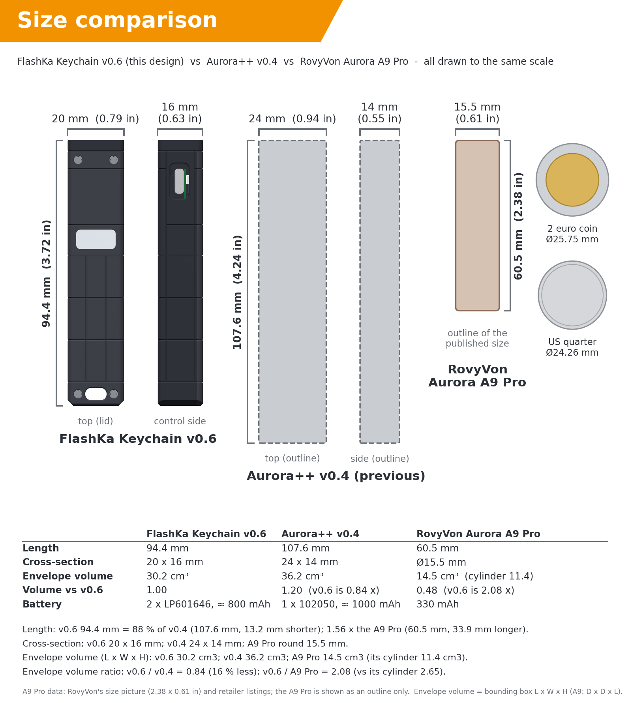

*Figure 13.2 — v0.6 next to v0.4 and the RovyVon Aurora A9 Pro (outline), same scale.*

## 13.2 User interface

### 13.2.1 The three buttons

All three buttons are on the **bottom face** (the tray floor). Hold the light with the floor up and the head, which has the LED and the laser, pointing away from you. The laser side (+Y, with the S2 slide switch) is then on your left and the USB-C side on your right, and the row reads, from the head to the tail:

**› next · ● main · ‹ previous**

Next is towards the screen. Previous is towards you. The chevrons laser-marked beside the two small buttons point along the body in the same way.

| Button | Part | X position | Cap | Switch orientation |
|---|---|---|---|---|
| › next | SW2 | 16.4 mm | stainless, head Ø3.4 mm | pads along X |
| ● main | SW1 | 23.6 mm | stainless, head Ø5.8 mm, inside the lit ring | pads along Y |
| ‹ previous | SW3 | 30.8 mm | stainless, head Ø3.4 mm | pads along Y |

All three sit 3.2 mm off the centre line, 7.2 mm apart. X is measured from the front (head) face.

A **click** is a press shorter than 0.4 s on ● and shorter than 0.8 s on › and ‹. A longer press is a **hold**. Every contact is debounced: a change must stay stable for 25 ms before it counts. The main button always wins: while ● is pressed, › and ‹ are ignored until all buttons are released. A › or ‹ click counts when you release the button, so pressing ‹ and › together never sends a click of the one that went down first.

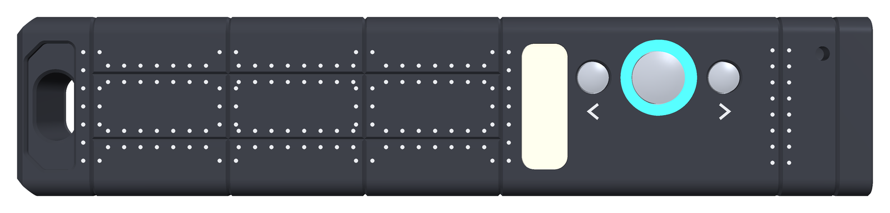

*Figure 13.3 — The floor seen from below, head on the right. From the tail to the head: the plug of the floor RF window (cream), ‹ previous, ● main inside its lit ring (shown cyan), › next. The chevron beside › points to the head, the one beside ‹ to the tail.*

### 13.2.2 Flashlight mode

Flashlight mode is the default after power-up. ● works exactly as in v0.5. › and ‹ are new: they step the brightness. The levels are Moon (the dimmest), Low, Medium and High. Turbo is a short boost above High.

| State | Input | Result |
|---|---|---|
| Off | ● 1 click | on at the remembered level |
| Off | ● hold | on in Moon |
| Off | ● 2 clicks | Turbo (High if the profile has no turbo or the board is too warm) |
| Off | ● click, then click and hold | **laser** while held (at most 60 s; the slide switch S2 must be on ARM); the main LED stays off |
| Off | ● 3 clicks | opens a 120 s Bluetooth window for the app (the ring blinks blue twice) |
| Off | ● 4 clicks | lockout on (red × 3) or off (green × 3) |
| Off | › or ‹ | ignored: no light and no ring |
| Off or on | ‹ + › held 2 s | presenter mode (the main LED goes off) |
| On | ● 1 click | off |
| On | ● hold | steps Low, Medium, High, Low ... every 0.6 s |
| On | ● 2 clicks | Turbo on, or back to the previous level |
| On | ● 3 clicks | battery check on the ring: 1 to 5 blinks in green, yellow or red |
| On | › click or hold | one level up: Moon, Low, Medium, High. No wrap. Never into Turbo. From Turbo: nothing |
| On | ‹ click or hold | one level down. No wrap. From Turbo: High |
| Lockout | ● 4 clicks | unlock (green × 3) |
| Lockout | anything else | ignored (● click: one short red flash) |

The reasons:

* › and ‹ do nothing while the light is off. A press in a pocket must not switch on the light or the laser ([BAT-7](../../../docs/design-rules.md#bat-7)).
* Stepping never enters Turbo. Turbo stays behind the ● double click, so a squeeze on › cannot start the hottest mode.
* A step counts as a button action. For 3 s it blocks app commands that switch or dim the light (the button has priority), and it cancels an exact current set by the app.
* A › or ‹ hold steps only once, at 0.8 s. It does not repeat.

Levels, profiles, Turbo, the laser rules, protection, charging and the battery estimate work as in v0.5 (`firmware.md`, section 2.6).

### 13.2.3 Presenter mode

In presenter mode the light is a Bluetooth keyboard. It uses the standard *HID over GATT* profile: HID (human interface device) is the class of keyboards and mice, and GATT is the way a Bluetooth LE device offers its data. A computer, phone or tablet treats the light like any keyboard. The laser stays the pointer.

| Input | Action (key sent) |
|---|---|
| › click | next slide: **Page Down** (key set "arrows": Right Arrow) |
| ‹ click | previous slide: **Page Up** (key set "arrows": Left Arrow) |
| › hold 0.8 s | start the show: **F5** (sent once, at 0.8 s) |
| ‹ hold 0.8 s | end the show: **Esc** (sent once) |
| ● click | black screen on or off: **B** |
| ● hold | **laser** on while held; same rules as in flashlight mode: S2 armed, at most 60 s, not hot, not flat, never in lockout. It works with or without a computer |
| ● 4 clicks | lockout on; this also leaves presenter mode |
| ‹ + › held 2 s | leave presenter mode |
| ‹ + › held 10 s | forget all paired computers (ring white × 3) |

How it behaves:

* Every key goes out as two reports: key down, then key up 10 ms later. Holding a button never holds the key down, so the computer's key repeat cannot flip several slides.
* ● 2 or 3 clicks send nothing. The main LED cannot be switched on in presenter mode.
* Keys are sent only while a paired computer is connected (ring off). While the light waits for a computer (cyan breathing) key presses are dropped, not stored.
* The app setting "swap" exchanges › and ‹, clicks and holds.
* Presenter mode ends by itself after the idle time (default 30 min without a button press, 5 to 120 min in the app) and when the battery is empty (below 3.20 V for 2 s: five red blinks). It is refused below 3.20 V (one red blink).
* The radio stays on: about 20 mA (an estimate, untested), which is about 30 to 40 h from the 800 mAh pack. The light does not sleep in presenter mode.
* The phone app cannot connect during presenter mode: the light has one Bluetooth connection, and it advertises as a keyboard, not with the app's service.
* The laser stays under the rules of [LAS-2](../../../docs/design-rules.md#las-2): the hardware interlock S2 in series, a deliberate hold, and the red ring as the emission indicator.

Which keys suit which program has not been tested. PowerPoint and LibreOffice Impress take Page Up, Page Down, B and Esc, and PDF viewers take Page Up and Page Down. F5 starts the show on Windows and Linux. It does not start a show on a Mac. For Keynote and Google Slides the firmware manual and the app both recommend the arrow key set (Apple documents the arrow keys, not Page Up and Page Down, for a Keynote show); try both key sets (13.9).

### 13.2.4 First pairing

Pairing works only in presenter mode. Enter it with ‹ + › held 2 s (the ring shows magenta × 2, then cyan breathing). The light uses *LE Secure Connections, Just Works*: there is no PIN, and the computer asks you to confirm. When the computer is connected the ring blinks cyan twice and goes off.

| System | Steps | Note |
|---|---|---|
| Windows 10 (1803 or newer), Windows 11 | Settings, Bluetooth & devices, Add device, Bluetooth, "FlashKa-XXXX" | older Windows 10 cannot pair |
| macOS | System Settings, Bluetooth, "FlashKa-XXXX", Connect | close the Keyboard Setup Assistant if it opens |
| Android 6 or newer | Settings, Connected devices, Pair new device, "FlashKa-XXXX" | |
| iOS, iPadOS 9 or newer | Settings, Bluetooth, "FlashKa-XXXX", Pair | the on-screen keyboard hides while a keyboard is connected |
| Linux (BlueZ, kernel 3.19 or newer) | `bluetoothctl`: `scan on`, `pair`, `trust`, `connect` | |

XXXX is the last two bytes of the Bluetooth address. The light remembers up to **4 computers**. A fifth pairing replaces the one paired longest ago. After that, entering presenter mode is enough: the computer reconnects by itself and the ring blinks cyan twice. The pairing steps are untested on all systems.

### 13.2.5 Ring colours

The ring is two RGB LEDs around ●, driven together by the three status-LED pins of v0.5. It shows, highest priority first:

| Pattern | Meaning |
|---|---|
| Red steady | laser on |
| White × 3 | paired computers forgotten |
| Cyan double blink, then off | presenter mode: computer connected |
| Short white blip (40 ms) | presenter key sent |
| Magenta × 2 | presenter mode entered or left |
| Red × 3 or green × 3 | lockout on or off |
| Cyan × 3 | "Identify" from the app |
| Blue × 2 | Bluetooth window opened (● 3 clicks while off) |
| 1 to 5 blinks in green, yellow or red | battery check (● 3 clicks while on) |
| One red blink | request refused (turbo too hot, laser not allowed, switch-on refused, presenter mode refused) |
| Five fast red blinks | battery empty: light switched off, switch-on refused, or presenter mode ended |
| Short red flash | ● click while locked |
| Cyan breathing (2 s) | presenter mode: waiting for the computer |
| Green, yellow or red for 2 s after switch-on | battery above 50 %, 20 to 50 %, below 20 % |
| Red slow breathing (3 s) | USB connected, charging |
| Green steady | USB connected, charge complete |
| Red blink every 4 s (light on) | battery below 10 % |
| Cyan dim, steady | flashlight mode: app connected |
| Blue double blink every 3 s | flashlight mode: Bluetooth window open, nobody connected |

One-shot patterns (the blinks) are drawn over the steady and breathing states. A presenter one-shot is not cut short by one that ranks lower in the table. Blue is the weakest colour of this LED (4.5 mcd at 2 mA, typical), so the presenter states use cyan.

## 13.3 Electronics

The schematic and the board are generated from one table of parts, values and connections (`tools/kicad/flashka_parts.py`). Only the button, LED and resistor part of the v0.5 design changed. The module, charger, LED driver, laser switch and sensors are as in v0.5 (chapter 12).

### 13.3.1 Parts that changed

| Ref | v0.6 | Note |
|---|---|---|
| S1 | removed | no side button |
| SW1 ● | Alps SKRKAEE020 (LCSC C115357): pin 1 BTN, pin 2 GND | main; shorts BTN straight to ground |
| SW2 › | SKRKAEE020: pin 1 BTN_NX, pin 2 GND | next |
| SW3 ‹ | SKRKAEE020: pin 1 BTN_PV, pin 2 GND | previous |
| R30 | 1 kΩ (C11702) between BTN and BTN_NX | ladder step for › |
| R31 | 2.2 kΩ (C25879) between BTN and BTN_PV | ladder step for ‹ |
| R9 | 10 kΩ, 1 %, between 3V3 and BTN: unchanged | pull-up of the ladder |
| LED3 | moved to the bottom side (ring); nets unchanged | |
| LED4 | NH-B1010RGBT-HF (C2874113): pin 1 3V3, pin 2 R_K2, pin 3 G_K2, pin 4 B_K2 | second ring LED |
| R23, R32 | 330 Ω (C25104): R_K and R_K2 to RGB_R | red; it was 1 kΩ in v0.5 |
| R24, R33 | 100 Ω (C25076): G_K and G_K2 to RGB_G | green |
| R25, R34 | 100 Ω: B_K and B_K2 to RGB_B | blue |

The switch is a top-push tact switch (a small switch with a click), 3.9 × 2.9 × 2.0 mm, 1.6 N operating force, 200,000 cycles. Its actuator tip is at Z 7.2 and points down. The cap stroke check uses a switch travel of 0.25 mm.

The result is **71 parts and 44 nets** (v0.5: 63 parts, 39 nets). The new nets are BTN_NX, BTN_PV, R_K2, G_K2 and B_K2.

### 13.3.2 The button ladder

All three switches hang on one net, BTN, with the pull-up R9. Each switch adds a different resistance to ground, so each button gives a different voltage:

```text
3V3 ──[ R9 10 kΩ ]──┬── BTN ── GPIO3 (ADC1_CH3) and GPIO9
                    │
                    ├── SW1 (● main) ───────────────────────── GND
                    │
                    ├── R30 1 kΩ ──── SW2 (› next) ─────────── GND
                    │
                    └── R31 2.2 kΩ ── SW3 (‹ previous) ─────── GND
```

With a resistance R to ground the voltage is 3.3 V × R / (10 kΩ + R) (calculated). The firmware reads it with the ADC (analog-to-digital converter) and sorts it into a class:

| Pressed | Resistance to GND | BTN voltage | ADC class | GPIO9 |
|---|---|---|---|---|
| none | – | 3.30 V (the ADC saturates near 1050 mV) | above 810 mV: none | high |
| ● (alone or with any other) | 0 Ω | 0 V | below 106 mV: main | low |
| ‹ + › together | R30 and R31 in parallel, 0.69 kΩ (calculated) | 0.212 V | 106 to 255 mV: both | low |
| › | R30, 1 kΩ | 0.300 V | 256 to 447 mV: next | low |
| ‹ | R31, 2.2 kΩ | 0.595 V | 448 to 810 mV: previous | low |

The thresholds 106, 256 and 448 mV are the midpoints between the nominal levels. The top threshold, 810 mV, sits 215 mV above the ‹ level (calculated). The ● button is a direct short, so it always reads 0 V and wins when pressed together with another button.

**Worst-case margins.** The table assumes 1 % resistors, an ADC error of ±10 mV (2.5 dB range, after calibration) and a 3.3 V rail within ±2 %. The margins of ›, ‹ + › and ‹ are the values of the firmware report (host test `ladder_tolerance` and a calculation). The margins of ● and "none", and the worst-case readings, are calculated for this chapter.

| Class | Nominal | Worst-case reading | Band | Smallest margin |
|---|---|---|---|---|
| ● main | 0 mV | ±10 mV | below 106 mV | 96 mV (calculated) |
| ‹ + › both | 212 mV | 194 to 231 mV (calculated) | 106 to 255 mV | 25.4 mV |
| › next | 300 mV | 279 to 322 mV (calculated) | 256 to 447 mV | **22.7 mV** |
| ‹ previous | 595 mV | 564 to 627 mV (calculated) | 448 to 810 mV | 115.7 mV |
| none | 3300 mV | saturated, near 1050 mV | above 810 mV | at least 240 mV (calculated) |

The tightest margin is › at 22.7 mV. Keep the 1 % resistors, and measure the levels on the first board (13.9).

### 13.3.3 Why one net, with the ADC and GPIO9

The ESP32-C3 module has 15 usable GPIO pins (GPIO0 to 10 and GPIO18 to 21). All 15 were already in use in v0.5, so there is no free pin for two more buttons. The ladder reads three buttons on the one pin that v0.5 used for one.

The BTN net goes to two pins:

* **GPIO3** is the ADC input. The firmware reads the voltage and learns which button is pressed. Before deep sleep the firmware makes GPIO3 a digital input again, and a low level on it wakes the chip.
* **GPIO9** is a digital input and the **boot strap** pin. If it is low while the chip starts and USB is plugged in, the chip's ROM starts download mode, where new firmware can be written. This is the recovery path that needs no tools.

Every pressed level is at or below 0.617 V in the worst case (calculated). That is under the 0.825 V low-level limit (VIL) of the digital pins. So every press is a valid digital low:

* any of the three buttons wakes the chip from deep sleep;
* any button held while USB is plugged in starts download mode;
* if the ADC fails, the firmware falls back to GPIO9 and reads a low as "main button".

The levels are computed for the external pull-up R9 (10 kΩ). The internal pull-up of GPIO9 is switched off after start-up so that it cannot shift them. GPIO9 is never driven by the firmware.

### 13.3.4 Ring LEDs and resistors

Two NH-B1010RGBT-HF LEDs (NationStar, LCSC C2874113; 1.0 × 1.0 × 0.85 mm; common anode, which means the three colours share one plus pin) sit on the bottom side. LED3 is at X 19.8 and LED4 at X 27.4, both at Y 3.2. Each is 3.8 mm from the main axis (X 23.6) and shines down into the top face of the light-pipe tube (13.4.3). Pin 1 is the common anode, connected to 3V3. Pins 2, 3 and 4 are the red, green and blue cathodes, as the datasheet text says (the drawing could not be read, see 13.9).

The two LEDs share the three pins of the v0.5 status LED: GPIO21 (red), GPIO8 (green) and GPIO2 (blue). Each cathode has its own resistor to the shared pin. A pin pulls low to light its colour.

| Colour | Resistors | Typical forward voltage | Current per LED (calculated) | Both LEDs on one pin (calculated) | Brightness, typical |
|---|---|---|---|---|---|
| Red | R23, R32: 330 Ω | 2.0 V | 3.9 mA | 7.9 mA | 18 mcd at 5 mA |
| Green | R24, R33: 100 Ω | 2.6 V | 7.0 mA | 14 mA | 25 mcd at 2 mA |
| Blue | R25, R34: 100 Ω | 2.7 V | 6.0 mA | 12 mA | 4.5 mcd at 2 mA |

The currents are (3.3 V − forward voltage) / resistance at the typical forward voltage. The values are not measured.

Red was 1 kΩ in v0.5. At 330 Ω the red current rises from about 1.3 mA to about 3.9 mA (calculated): more red comes out of the ring. The firmware's colour balance (`RGB_FULL_R`, `_G` and `_B`, 255 / 70 / 110 out of 255) still holds the v0.5 values for the 1 kΩ red. It is not tuned yet (13.9). Blue is the weakest colour, so the presenter states use cyan.

### 13.3.5 PCB placement and the keep-outs

The board is 24 × 16.5 mm, 0.8 mm thick, with four layers: F.Cu (top, lid side), In1 (ground plane), In2 and B.Cu (bottom). It uses the same JLCPCB rules as v0.5: 0.13 mm tracks, at least 0.10 mm space, vias 0.2 / 0.45 mm.

Positions use the housing coordinates. X is 0 at the front (head) face and grows to the tail. Y is 0 on the centre line: −Y is the control side (USB-C), +Y the laser side (S2). Z is 0 on the bottom face and grows towards the lid. The board sits on ledges at X 8.8 to 32.8 and Y ±8.25, with its bottom face at Z 9.2 and its top face at Z 10.0. The housing interface fixes the switches, the ring LEDs, J1, S2, U4, J3 and the buck cluster (L1). The PCB script places J2 and J5 and everything else. The numbers are footprint origins (Figure 13.4 shows the wire pads and the three switches):

| Part | X, Y (mm) | Side | Note |
|---|---|---|---|
| SW1 ● main | 23.6, 3.2 | bottom | pads along Y |
| SW2 › next | 16.4, 3.2 | bottom | pads along X |
| SW3 ‹ previous | 30.8, 3.2 | bottom | pads along Y |
| LED3 | 19.8, 3.2 | bottom | ring LED |
| LED4 | 27.4, 3.2 | bottom | ring LED |
| J1 USB-C | 14.6, −4.6 | bottom | at the −Y edge; its courtyard reaches Y +0.67 |
| J2 cell wires | 31.3, −4.8 | bottom | rear −Y corner, rotated 90° |
| J3 LED wires | 10.1, 1.8 | both | one pad on each side at the same spot: LED+ on top, LED− underneath |
| J5 laser wires | 15.55, 6.35 | bottom | narrow-pad footprint so that the S2 peg fits |
| S2 laser interlock | 14.05, 5.85 | top | slide switch at the +Y edge; its slot is in the +Y wall |
| U4 module | 27.2, −1.4 | top | antenna beyond the rear board edge |
| L1 | 14.35, −5.9 | top | buck inductor |

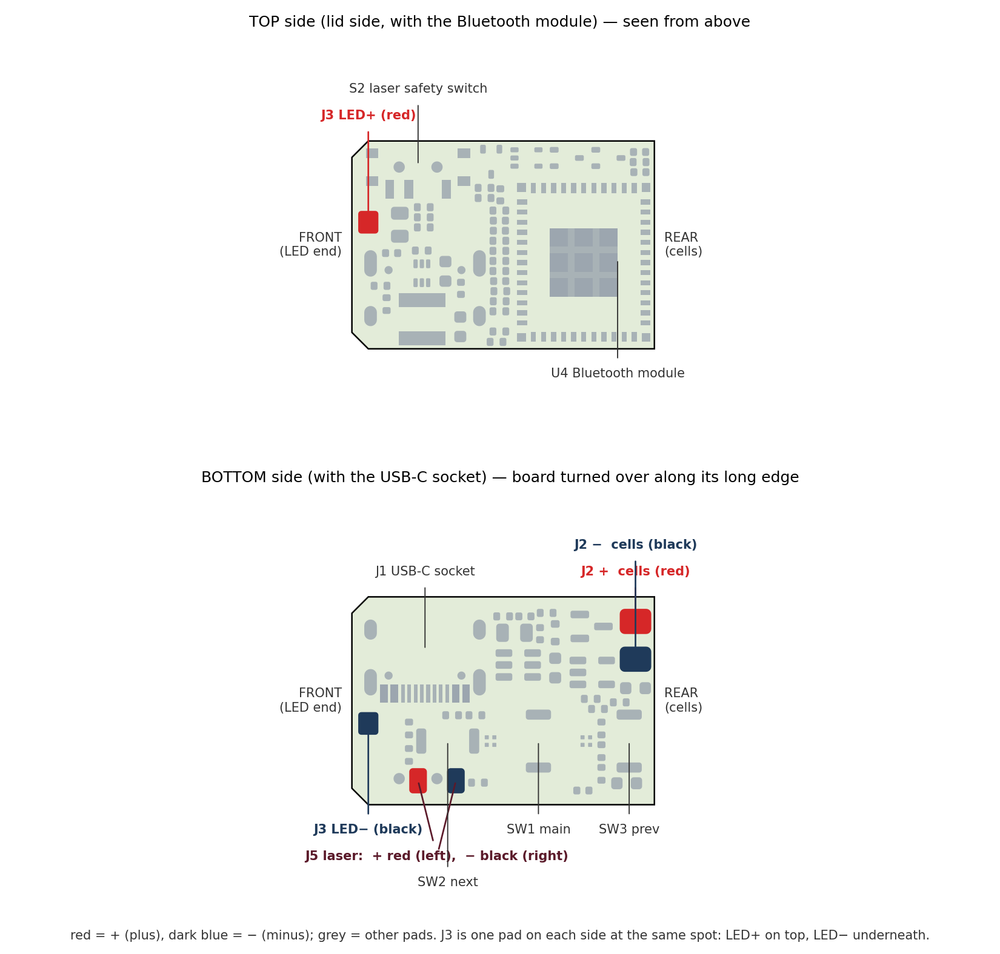

*Figure 13.4 — Wire pads and switch positions. Red is plus, dark blue is minus. J3 is one pad on each side at the same spot. The lower view is the board turned over along its long edge, so the USB-C side is at the top: J5 (laser) is on the bottom side, J2 (cells) at the rear corner next to the USB-C side. SW2, SW1 and SW3 are the three buttons.*

Two keep-outs protect the new mechanics:

* **Bottom side:** a circle of r 4.4 mm around the main axis (23.6, 3.2). Only SW1, LED3 and LED4 may stand inside it. The light-pipe tube (OD 8.4 mm, rim 8.8 mm) stands there, its top at Z 8.2. The LED resistors sit next to their LEDs but outside the circle. The one exception is R25, the blue resistor of LED3: it is on the top side (X 19.3, Y 3.7), just outside the front hold-down area. It is the part that comes closest to the lid (13.4.8).
* **Top side:** X 15.6 to 19.4, Y 0.0 to 3.3 mm. No components: the front lid boss and its pad press the board here. Copper, vias and solder mask are allowed.

The other parts are placed in hand-made groups and by annealing. The hand-placed groups are the front cluster (the current-sense loop RS1, R14 and RT1, the buck feedback R10, R11 and C9, and R1, R2, R17 and R19), the buck cluster (U2, L1, C5, C7, C8) and the large parts. The remaining 45 parts, all 0402, go into 30 fixed slots chosen by annealing: a random search that scores net length, the distance of decoupling capacitors to their pins, and the room to route out of each pad (seed 82, 250,000 iterations; stored in `cad/pcb_placement_sa.json`). A check then flips or swaps parts until no pad is walled in. The ladder resistors R30 and R31 sit at their own switches, SW2 and SW3. The module's courtyard (the keep-clear zone around a part) now shrinks by 0.10 mm like the others, so that a column of 0402 parts fits between the USB-C shell and the module pads.

### 13.3.6 Routing result

The board is fully routed with the project's own router (`tools/kicad/route.py`). Figure 13.5 shows the four layers.

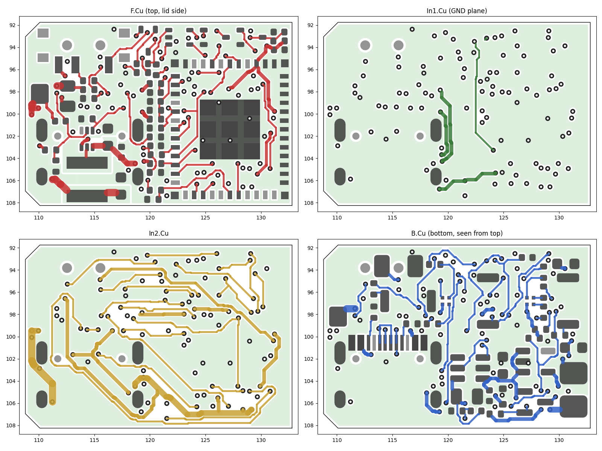

*Figure 13.5 — The routed board, 24 × 16.5 mm: F.Cu (top, lid side), In1 (ground plane; the green tracks are the signal tracks inside the one box described below), In2 and B.Cu (bottom, seen from above).*

| Check | Result |
|---|---|
| KiCad DRC (`production/DRC_report.txt`) | **0 errors, 0 unconnected pads, 0 footprint errors** |
| DRC warnings | 65, all silkscreen: 40 overlap, 10 silk to board edge, 7 silk over copper, 8 text size (v0.5 had 33) |
| Router exact checks | 0 incomplete nets, 0 ground pads off the plane, clearance audit 0 (at least 0.101 mm) |

The board in numbers, v0.5 and v0.6:

| | v0.5 | v0.6 |
|---|---|---|
| Parts (top / bottom) | 63 | 71 (39 / 32) |
| Nets | 39 | 44 |
| Track segments | 790 | 1079 |
| Track length | 375 mm | 544 mm |
| Vias | 94 | 104 |

By layer, v0.6 has F.Cu 311 segments (124.0 mm), In1 41 (27.5 mm), In2 396 (251.5 mm) and B.Cu 331 (140.8 mm). The extra length comes from the button row and the 8.8 mm keep-out circle on the bottom side. Routing from scratch takes about 35 min (stage 1 about 4 min, the finishing step about 27 min).

The routing differs from v0.5 in these points:

* **In1 carries signals in one box.** Inside X 19.0 to 24.3, Y −7.6 to 7.6 (the column of 0402 parts between the USB-C shell and the module) In1 holds 41 track segments, 27.5 mm in total: the nets 3V3, VBUS, VBAT, LASER_ON and RGB_G. The plane has slots there. Routing on In1 costs four times as much, so the router uses it only where needed. Everywhere else In1 is solid. The module and the antenna area are not affected.
* **Ground pour clearance is 0.12 mm and the minimum width 0.13 mm** (v0.5: 0.15 and 0.15 mm). This is still above the 0.10 mm design rule, and it lets the pours reach pads between the dense 0402 rows.
* **Courtyards are 0.10 mm smaller per side** (margin 0.25 to 0.15 mm), now also for the ESP32 module. Exceptions: the USB-C socket, the PCM12 switch (S2) and the inductor L1.
* **LED3 and SW2 courtyards overlap by 0.2 mm.** Both positions are fixed by the housing. The copper is 0.44 mm apart. The check script exempts this pair.
* **J5 uses a narrow-pad footprint** (`FlashKa:WirePad_SMD_2_P3.0mm_N`) so that the S2 peg fits.
* **J2 is at the rear −Y corner** (X 31.3, Y −4.8, rotated 90°). SW3 and its ladder resistor take the +Y rear corner. The housing's antenna spacer has a cell-wire notch (1.6 mm wide, 2.2 mm high) at both lower corners, so the wires can leave on either side. The wire path itself is not tested (13.9).
* **Router costs:** a via costs 5 grid steps and the congestion history is 1.5 (v0.5: 10 and 0.6). The design rules are unchanged.
* **Silkscreen.** The 65 warnings are cosmetic: designators overlap in the dense areas.

**Assembly files.** JLCPCB assembles 68 parts (38 on the top, 30 on the bottom) from 34 BOM lines. J2, J3 and J5 are wire pads, not assembled. The BOM and CPL (the position list) agree with the board: 68 designators in both, no duplicates, sides match, every line has an LCSC number. Rotations on the bottom side are 180° minus the KiCad rotation: SW1 90°, SW2 180°, SW3 90°, LED3 180°, LED4 180°. No correction is applied for the SKRKAEE020 or the NH-B1010RGBT-HF, so check pin 1 and orientation in the JLCPCB order preview (13.9). J1 and S2 use the pad centre in the CPL, as in v0.5.

**Reproducible.** Rebuilding the outputs from the released board twice gives identical BOM, CPL, netlist, DRC report, schematic and placement files. The gerber files differ only in KiCad's date lines. A full rebuild from the placement file gives the same copper. KiCad gives new tracks random IDs when it saves, so the board file itself is not byte-identical even when the copper is; use `--no-route` to rebuild the outputs from the released board.

## 13.4 Mechanics

The housing is still a tray and a lid of 6061-T6 aluminium, 94.4 × 20 × 16 mm. A comparison of the two parameter files shows that 94 housing parameters are identical to v0.5 (calculated). The LED window bore, the laser bore, the cell bay, the four M1.6 lid screws, the USB-C opening, the S2 slot and the lanyard slot did not move. The 20 parameters of the side button, its dish, the diamond knurl and the two side grooves are gone. What is new is the bottom face (three buttons and a light ring), the hold-down for the board, a second radio window and the surface.

Every number in this section comes from one parameter table: class `P` in `tools/housing/flashka_housing.py`. The same script writes the STEP files, the drawings and the checks of section 13.7. The coordinates are those of 13.3.5.

### 13.4.1 Parts

| Part | Drawing | Material and process | Per light | Made by |
|---|---|---|---|---|
| Tray | FK-H-01, 2 sheets | 6061-T6, CNC, bead blast, black anodise type II (8 to 12 µm), then laser marking | 1 | JLCCNC |
| Lid | FK-H-02 | the same | 1 | JLCCNC |
| Main cap | FK-H-03 | SUS304 stainless steel, turned, bead blast, no coating | 1, plus 1 spare | JLCCNC or another CNC shop (13.4.4) |
| Slide cap | FK-H-04 | the same | 2, plus 1 spare | the same |
| Print kit | FK-H-05 for the tube (reference only) | SLA resin 8001, translucent, on 1 mm sprues: light-pipe tube, RF window insert, LED spacer ring, antenna spacer with the floor plug, resin copies of the three caps | 1 kit, plus 1 spare | JLC3DP |
| Hold-down pads | lid drawing, item 8a | silicone thermal pad, 1.0 mm; silicone rubber sheet, 1.0 mm | 1 of each | bought and cut to size, not in the kit |
| Laser sleeve | – | resin, only if the laser module is 4.5 mm instead of 6 mm | optional | JLC3DP |

Masses, calculated from the solids: tray 22.68 g and lid 7.14 g (29.8 g together); tube 0.20 g, RF window insert 0.21 g, spacer ring 0.10 g, antenna spacer 1.07 g; main cap 0.86 g and each slide cap 0.32 g.

Figure 13.6 shows how the parts fit together, and Figure 13.7 shows the print kit.

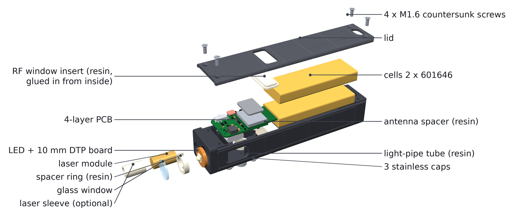

*Figure 13.6 — Exploded view. Top to bottom: four M1.6 countersunk screws, the lid with its RF window insert, the two cells, the antenna spacer, the routed 4-layer board, the tray with the light-pipe tube and the three stainless caps. At the head end: the LED on its 10 mm DTP board, the laser module, the resin spacer ring, the glass window and the optional laser sleeve.*

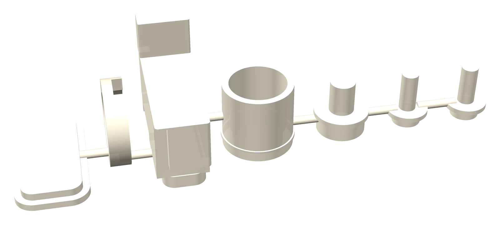

*Figure 13.7 — The print kit on its sprues (8001 resin). From the left: RF window insert, LED spacer ring, antenna spacer with the plug for the floor window, light-pipe tube, then the resin copies of the main cap and the two slide caps. Cut the sprues with side cutters.*

### 13.4.2 Buttons in the floor

The floor stays flat and 1.5 mm thick. There is no pocket. Each button is a small stainless cap in a hole of the floor. It presses the actuator (the moving part) of its switch.

* **Main button:** a floor hole Ø8.45 mm (Z 0 to 1.1) with a counterbore Ø8.85 mm from inside (Z 1.1 to 1.5) for the rim of the light-pipe tube (13.4.3). The cap runs inside the tube.
* **Slide buttons** (› and ‹): two holes Ø3.6 mm right through the floor, with a 0.2 mm × 45° chamfer on the outside. The flange of the cap sits on the inner face of the floor.

| | Main cap | Slide cap (2, identical) |
|---|---|---|
| Head, visible | Ø5.8 mm, domed, 0.4 mm sag | Ø3.4 mm, domed, 0.3 mm sag |
| Fit | in the tube bore Ø6.0 mm, 0.1 mm per side | in the floor hole Ø3.6 mm, 0.1 mm per side |
| Flange (the seat) | Ø6.6 × 0.6 mm on the tube step, Z 2.4 to 3.0 | Ø5.0 × 0.6 mm on the floor inner face, Z 1.5 to 2.1 |
| Stem | Ø3.0 mm up to Z 6.9 | Ø2.0 mm up to Z 6.9 |
| Length, apex to stem end | 7.0 mm | 7.0 mm |
| Dome apex at rest | Z −0.1 mm: 0.1 mm proud of the bottom face | the same |

The heights of the main button stack, from the lid side down:

| Z (mm) | What |
|---|---|
| 10.0 and 9.2 | top and bottom face of the board (the bottom face rests on the ledges) |
| 8.35 | faces of the two ring LEDs |
| 8.2 | top of the light-pipe tube, 0.15 mm under the LED faces |
| 7.2 | tip of the switch actuator, pointing down |
| 6.9 | stem end of every cap |
| 3.0 and 2.4 | top and underside of the main cap flange; 2.4 is the step in the tube bore (the seat) |
| 2.1 and 1.5 | top and underside of the slide cap flange; 1.5 is the inner face of the floor (the seat) |
| 1.1 | underside of the tube rim, on the counterbore ledge |
| 0 | bottom face of the tray and end face of the tube |
| −0.1 | dome apex of a cap at rest |

**Free play.** With a cap on its seat the stem end is 0.30 mm below the actuator tip. This gap is the *free play*. It keeps every switch unloaded at rest. The thumb moves the cap 0.30 mm without force and then 0.25 mm against the switch (the switch travel), so the whole cap stroke is 0.55 mm. The housing script tested all three caps with the board centred and pushed 0.24 mm to either side wall. In every case the free play is 0.30 mm, the actuator is reached after at most 0.35 mm of cap travel, the cap can be pressed to 0.55 mm, and nothing else is touched.

**Tolerance stack.** Four tolerances add up in the free play:

| Item | Tolerance |
|---|---|
| Printed step in the tube (the seat of the main cap) | ±0.10 mm |
| Switch height (actuator tip) | ±0.10 mm |
| Ledge height of the floor and of the board | ±0.05 mm |
| Cap length (turned) | ±0.05 mm |

The free play is 0.30 mm nominal. In the worst case it is 0.00 to 0.60 mm. The root-sum-square minimum (the statistical value, calculated by the housing script) is 0.142 mm. In no case does a cap press its switch at rest: at 0.00 mm the stem end only touches the actuator. The slide caps sit on the floor face, not on the printed step, so their stack is tighter than the main cap's.

The hold-down bows the board down by 0.08 mm at rest (plate model, 13.4.5; 0.03 mm in the soft case and 0.14 mm in the hard case). A bow towards the floor takes up free play. The stack above does not include it. The first prototype must therefore show that no button is pressed at rest (13.9).

**The caps are loose parts.** A cap is held only by its flange between its seat and the switch. So the direction of the light changes where the caps rest:

| Light | Cap position | Effect |
|---|---|---|
| Floor down (on a table) | on its seat, apex 0.1 mm proud | the table touches the caps. The weight goes through the seats. The switches stay unloaded |
| Floor up (presenting) | fallen onto its actuator, apex 0.2 mm below the floor face (calculated) | the cap touches the actuator but does not press it: the caps weigh 0.86 g and 0.32 g, and a switch needs 1.6 N |

The light weighs about 50 g with its cells (the figure of v0.5; the three steel caps add 1.5 g, calculated). That is about 0.49 N (calculated). Even if all of it rested on the caps, it is far below the 1.6 N of a switch. The working specification gave 0.3 N for the weight; this chapter replaces that number (13.8, item 10).

The caps stand proud, not recessed. [MEC-6](../../../docs/design-rules.md#mec-6) prefers a shrouded or recessed button. Section 13.8 says what protects the light from accidental presses instead, and 13.9 lists the pocket test.

### 13.4.3 Light-pipe tube

The two ring LEDs sit on the underside of the board, 9.2 mm above the floor face. A tube of translucent resin carries their light down to the floor and spreads it into a ring around the main button.

| Item | Value |
|---|---|
| Axis | X 23.6 mm, Y 3.2 mm |
| Height | Z 0 (flush with the bottom face) to Z 8.2 |
| Body | outside diameter 8.4 mm, in the floor hole Ø8.45 mm (0.025 mm per side) |
| Rim | Ø8.8 mm, Z 1.1 to 1.5, in the counterbore Ø8.85 mm. The seat is only 0.2 mm wide (radial): **glue the tube in, do not press it** |
| Bore | Ø6.0 mm from Z 0 to 2.4 (the cap head); Ø6.8 mm above, up to the top (the cap flange). The step at Z 2.4 is the seat of the main cap |
| Wall | at least 0.8 mm |
| Light input | the top face at Z 8.2: 0.15 mm under the LED faces and 1.0 mm below the underside of the board. The two LEDs sit at radius 3.8 mm, in the middle of the wall (radius 3.4 to 4.2 mm) |
| Lit ring | the end face of the tube at Z 0, between the Ø6.0 mm bore and the Ø8.4 mm outside diameter |
| Clearance | SW1 body to the tube bore 0.97 mm |

The lit ring is the end face of the tube. It is not the 0.1 mm gap between the cap head (Ø5.8 mm) and the bore (Ø6.0 mm), which is only a thin dark line (note 2 on the tube drawing).

How even and how bright the ring is has not been seen on a real part. The datasheet brightness of the LED is low (13.3.4), and the light has to pass 8.2 mm of printed resin (13.9).

### 13.4.4 Stainless caps and where to buy them

The caps are turned from SUS304 stainless steel bar (1.4301), bead blasted and not coated. The drawings give the tolerances: for example head Ø5.8 mm with +0 / −0.05 mm and stem Ø3.0 mm with −0.02 / −0.06 mm; the length is 7.0 ±0.05 mm and the stem end is flat and square to the axis within 0.03 mm. After the blast, check that each cap falls through its bore by its own weight with no catch (the tube bore for the main cap, the floor hole for a slide cap). Blasting must not make the caps stick.

**Size caveat.** The caps are very small. The pages of JLCCNC do not agree on what it will turn:

| Page | Statement |
|---|---|
| [Capabilities](https://jlccnc.com/capabilities/cnc-machining-service) | minimum part size 5 × 5 × 1 mm |
| [CNC turning](https://jlccnc.com/cnc-machining-service/cnc-turning) | minimum diameter 3 mm, recommended size 6 to 230 mm; the pictures of turned materials do not show stainless steel |
| [Home page](https://jlccnc.com/), FAQ on machining sizes | metal parts on the rotary axis: length above 20 mm and diameter above 4 mm |

Our caps are 7.0 mm long. They break the rule of the FAQ. Do this before ordering the housing:

1. Upload the STEP files of both caps to the instant quote of JLCCNC and read the answer. Do not rely on the pages above.
2. If the quote refuses the caps, send the same STEP files and PDF drawings to another CNC shop. PCBWay, Xometry or a local workshop can make them.
3. As a last fallback, use the resin caps from the print kit. They have the same shape. They are not stainless, and they were not tested.

Order one spare of each cap type. The machine shop's rules and a drawing with tolerances for every fit that matters are the content of [MEC-8](../../../docs/design-rules.md#mec-8).

### 13.4.5 PCB hold-down

**Why.** The board is not screwed down. It lies on two ledges, 0.8 mm wide, and the lid holds it from above. A press on a switch pushes the switch, and the switch pushes the board up. Without a hold-down the board would lift off its ledges and the button would feel soft. Two bosses on the underside of the lid therefore press the board down through bought pads. This is new in v0.6.

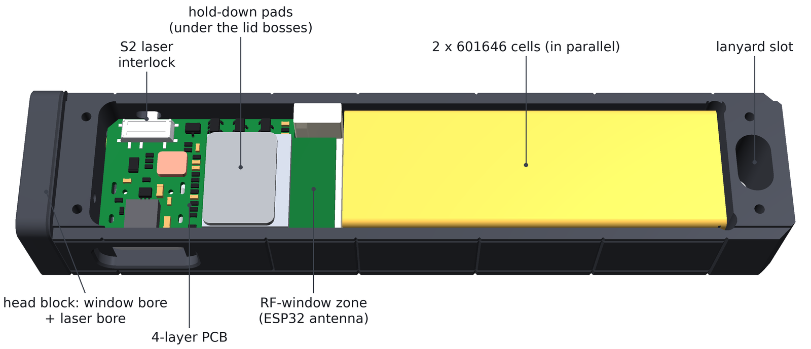

*Figure 13.8 — The routed board in the open tray, seen from above, head on the left. The two hold-down pads are drawn on the board: the grey one on the module can (X 22.1 to 30.9 mm) and the small salmon one next to SW2 (X 15.65 to 19.35 mm). The lid bosses press on them. The strip beyond the can is the RF-window zone over the antenna, and the cells fill the rear bay.*

| | Can pad | Front pad |
|---|---|---|
| Lid boss | X 22.1 to 30.9 mm, Y −7.6 to 4.8 mm (8.8 × 12.4 mm), 1.3 mm tall | X 15.65 to 19.35 mm, Y 0.05 to 3.25 mm (3.7 × 3.2 mm), 3.7 mm tall |
| It presses on | the top of the module can (Z 12.4). The boss stays off the RF window (X 31.8 mm and more) | the component-free area on the top side next to SW2 (X 15.6 to 19.4 mm, Y 0 to 3.3 mm) |
| Pad | silicone thermal gap pad, 1.0 mm, Shore 00 70 to 80 | silicone rubber sheet, 1.0 mm, Shore A 70 |
| Young's modulus (assumed) | 1.0 MPa | 5.3 MPa |
| Pad area | 108.3 mm² | 11.6 mm² |
| Compressed to | 0.8 mm (20 %) | 0.8 mm (20 %) |
| Spring rate | 108.3 N/mm | 61.6 N/mm |
| Preload | 21.7 N | 12.3 N |

The lid underside is at Z 14.5. The can boss (1.3 mm) and the compressed pad (0.8 mm) fill the 2.1 mm up to the can top at Z 12.4. The total preload is 34.0 N. The targets were a preload of at least 3 N and a pad compression of 15 to 25 %. Stick each pad on its boss with a drop of silicone adhesive. The pads are bought parts and not in the print kit.

**The plate model.** A press on a button was calculated with a plate model of the board, because the board is thin and bends. The assumptions are:

| Assumption | Value |
|---|---|
| Plate | FR-4, 0.8 mm, E = 20 GPa, ν = 0.14; a plate model that includes shear (first-order shear theory); grid 0.273 × 0.275 mm |
| Edges | free |
| Supports | the ledges, which push but never pull: +Y ledge for X ≥ 12.9 mm, −Y ledge for X ≥ 19.6 mm. There is no ledge at the USB-C opening or at the laser. J1 inside the USB-C opening is not counted as a support |
| Pads | linear springs; stiffness = E × area / free thickness. E comes from the Shore hardness with the usual relation for rubber. **These are assumptions, not datasheet values** |
| S2 knob | stops the board after it has risen 0.225 mm (the knob stands in a slot of the +Y wall) |
| Load | 3 N and 10 N at a button, spread over 2 × 2 mm |
| Ignored | the stiffness that parts and copper add. The real board is stiffer than this plate |

Two more cases bound the pad assumptions. In the *soft* case the pad modulus is multiplied by 0.7 and the gap is 0.1 mm larger (the pads are compressed only to 0.9 mm, 10 %). In the *hard* case the modulus is multiplied by 1.3 and the gap is 0.1 mm smaller (compressed to 0.7 mm, 30 %).

Movement of the board at the button point, towards the lid, in mm at a press of 3 N and 10 N:

| Case | SW2 › (3 N / 10 N) | SW1 ● (3 N / 10 N) | SW3 ‹ (3 N / 10 N) | Preload |
|---|---|---|---|---|
| Nominal | 0.011 / 0.051 | 0.009 / 0.030 | 0.017 / 0.121 | 34.0 N |
| Soft | 0.013 / 0.155 | 0.010 / 0.078 | 0.033 / 0.276 | 11.9 N |
| Hard | 0.010 / 0.034 | 0.008 / 0.028 | 0.016 / 0.070 | 66.3 N |

The board leaves the ledge at SW2, SW1 and SW3 at these presses: nominal 8, 6 and 2 N; soft 3, 3 and 3 N; hard above 12, 10 and 3 N.

**Result against the target.** The specification asked for no lift below 3 N and at most 0.05 mm of lift at 10 N.

| Target | Result | Verdict |
|---|---|---|
| Preload at least 3 N | 34.0 N (11.9 N soft, 66.3 N hard) | met |
| Movement at 3 N | at most 0.017 mm nominal, at most 0.033 mm in the soft and hard cases | met |
| At most 0.05 mm at 10 N | SW1 0.030 mm. SW2 0.051 mm, marginal. SW3 0.121 mm, 0.276 mm soft, 0.070 mm hard | **not met at SW3, marginal at SW2** |

At SW3 the board leaves its ledge at 2 N in the nominal case, that is, below the 3 N of the target, although it has moved only 0.017 mm at 3 N.

**Decision: accepted for v0.6.** The reasons:

* The switch clicks at 1.6 N. At that force the board does not move measurably.
* 10 N is a hard squeeze after the click. It costs travel, not function: the switch has already closed.
* The movement is elastic. The board returns when the thumb lets go.
* The model ignores the stiffness that the parts add. The real board is stiffer than the plate.

SW3 is the weak point because it sits at X 30.8 mm, at the end of the can pad (X 30.9 mm) and 2 mm from the free end of the board (X 32.8 mm). A harder can pad would need about 3 MPa, which is about 70 N of preload. A third boss with a rubber pad near SW3 (for example X 28.2 to 30.8 mm, Y 5.2 to 7.4 mm) was also modelled: SW3 then moves 0.061 mm at 10 N. That needs a free area on the top side of the board, so it is a v0.7 change.

**To verify on the first prototype:** press the previous button (‹, SW3) hard and judge the feel. If it feels soft, fit a harder can pad or plan the third pad.

**The S2 stop in the model.** The model stops the board at the S2 knob after 0.225 mm. In the real 3D model of the board the knob touches the tray only after 0.393 mm (13.4.8). The model was not run again with 0.393 mm. A later stop can only make the movement larger, and only if it matters at all.

### 13.4.6 Second RF window in the floor

The antenna of the module reaches 5.4 mm over the rear edge of the board. In v0.5 it radiated through a window in the lid. While presenting, the floor points up and the lid points into the hand. So the floor has a window, too.

| Item | Value |
|---|---|
| Floor opening | X 33.6 to 38.7 mm, Y ±7.0 mm (5.1 × 14.0 mm), corner radius 1.5 mm |
| Plug | a part of the resin antenna spacer. It fills the opening flush with the floor |
| Lid window (kept) | 6.9 × 14.0 mm, X 31.8 to 38.7 mm, with a resin insert glued in from inside |
| Walls | opening to the side wall 1.5 mm; SW3 hole to the opening 1.0 mm |
| LED3 | it is no longer under the lid window |

Resin does not shield the radio. How far the Bluetooth link reaches with a hand over the floor is not known (13.9).

### 13.4.7 Fighter-jet skin and laser marking

The diamond knurl and the two side grooves of v0.5 are replaced by a surface like an aircraft fuselage: panel seams, rows of rivets and stencils. It is a styling choice. It also carries marks that matter: SAFE and ARM at the slide switch and LASER at the laser end.

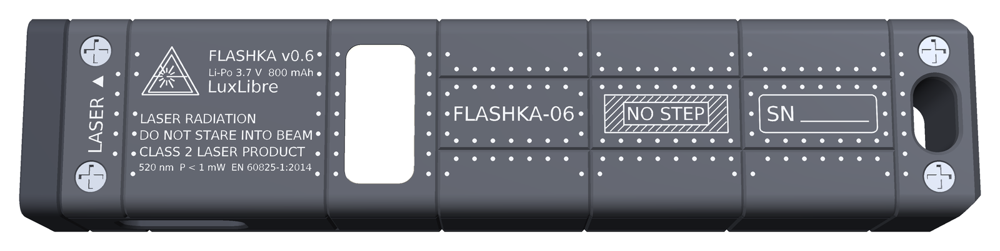

*Figure 13.9 — The lid from above, head on the left. Class 2 laser label with the warning triangle (field X 11.72 to 28.57 mm), the RF window opening over the antenna, the FLASHKA-06 stencil, NO STEP with hatching over the cell bay, the serial plate and the lanyard slot. The four screw heads are the M1.6 countersunk lid screws.*

**Seams.** The seams are 90° V grooves, 0.25 mm deep (±0.03 mm). A V cutter with a sharp tip (tip radius at most 0.03 mm) cuts them after the final milling and before the blast. The cutter is the one of the v0.5 grooves.

| Seam | Position |
|---|---|
| Joint ring | at X 3.95 mm. Lid and tray meet in a rabbet (a small step) 0.6 mm high, with 0.05 mm clearance per side, so that frame seams can cross the joint on the flat side without a knife edge |
| Frames (rings round the body) | X 10.2, 30.1, 41, 56, 71 and 86 mm. The frames at X 10.2 and 30.1 mm do not go all the way round, because the S2 slot and the laser bore block the +Y side |
| Stringers (seams along the body) | on both sides at Z 3.0 and Z 13.0 mm (X 3.95 to 86.0 mm); on the lid and on the floor at Y ±3.6 mm (X 41 to 86 mm) |

The metal under any seam is at least 1.11 mm thick (limit 1.1 mm). Every seam is at least 0.945 mm from an opening or hole (limit 0.5 mm). The thickness under each groove is listed in `cad/housing_interface.json`, key `skin_walls`. The four long corners of the cavity carry a 0.3 mm 45° gusset, so that metal stays under the corner seams (13.8, item 13).

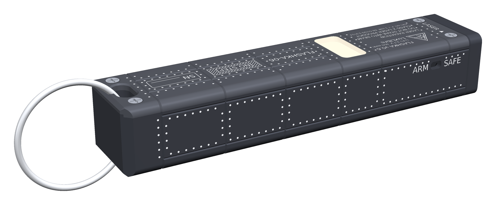

*Figure 13.10 — The laser side (+Y), lid on top, head on the right. At the S2 slot: SAFE towards the head and ARM towards the tail. Panel seams and rivet rows cover the sides.*

**Rivets and stencils.** A laser marks them after anodising. It removes the black anodise, so the bare aluminium shows. Rivet dots are Ø0.45 mm at 1.8 mm pitch and 0.9 mm from the seam centre. There are 151 on the lid, 148 on the floor, 117 on the −Y side and 124 on the +Y side. The marks keep at least 0.358 mm from a seam and 0.525 mm from an opening, with 0 violations on the four faces. The stencils are:

| Stencil | Where |
|---|---|
| FLASHKA-06 | lid and −Y side |
| NO STEP, with hatching | over the cell bay on the lid. The lid is a 1.5 mm plate there |
| LASER ▲ | on the lid near the head |
| SN, a serial plate | lid, X 72.72 to 84.28 mm, Y ±1.9 mm |
| SAFE (towards the head) and ARM (towards the tail) | beside the S2 slot on the +Y side. Armed means the knob towards the tail, as in v0.5 |
| Chevrons | on the floor beside the two small buttons: › next (X 16.4 mm) points to the head, ‹ previous (X 30.8 mm) points to the tail |

The marks in the renders are a simple bright layer. Real laser marks on anodise look less white.

**Laser label.** The class 2 label moved from the floor to the lid, because the floor is now the button face. The field is X 11.72 to 28.57 mm and Y ±6.9 mm (16.85 × 13.8 mm). The specification asked for X 9 to 30.8 mm and Y ±7.5 mm. The frames at X 10.2 and 30.1 mm and the rivet rows take the rest of that area. The capitals are 0.6 to 0.67 mm high, and the text still holds every mandatory line:

| Line | Text |
|---|---|
| 1 | LASER RADIATION |
| 2 | DO NOT STARE INTO BEAM |
| 3 | CLASS 2 LASER PRODUCT |
| 4 | 520 nm P < 1 mW EN 60825-1:2014 |

The label also shows the warning triangle, "FLASHKA v0.6", "Li-Po 3.7 V 800 mAh" and "LuxLibre". A class 3R version of the artwork exists (`cad/FlashKa_marking_lid_class3R.dxf`). The design uses class 2 only ([LAS-1](../../../docs/design-rules.md#las-1)).

### 13.4.8 Fit check with the real board

The housing script first checked the fit with simple stand-ins for the board. When the routed board existed, `fit_pcb.py` repeated the check with the KiCad 3D model of that board (`cad/FlashKa_main_pcb.step`) plus stand-ins for the parts the model does not hold: U4 (module with can and antenna overhang), J1 (USB-C socket, 8.94 × 7.35 × 3.21 mm), SW1 to SW3 with their actuators, LED3, LED4 and L1 (4.0 × 4.0 × 2.0 mm). The assembly measures X 8.80 to 38.20 mm, Y −8.25 to 8.98 mm (the S2 knob), Z 5.99 to 12.40 mm.

**Collisions.** The board was placed centred and pushed 0.24 mm against each side wall. A collision is an overlap of at least 0.001 mm³.

| Pose | Collisions | Result |
|---|---|---|
| Centred | 0 | – |
| Against the −Y wall | 1: board × tray, 0.0026 mm³, at X 10.15, Y −8.48, Z 9.60 | a contact-level sliver |
| Against the +Y wall | 1: board × tray, 0.0026 mm³, at X 10.15, Y +8.48, Z 9.60 | a contact-level sliver |

There are **0 collisions of 0.01 mm³ or more**. The two slivers are at the front corners of the board, where it touches the wall.

**Insertion.** The board goes in tilted about the S2 knob (an axis through Y 8.80 mm and Z 10.70 mm, the +Y edge low), from 9° down to 0° in 12 steps. It was checked against the tray, the tube, the three resting caps and the laser stand-in. No step has a collision above the 0.002 mm³ threshold of the script. The front corner of J1 touches the tray at 9.0, 8.25, 7.5 and 6.75°, with 0.0019, 0.0018, 0.0016 and 0.0011 mm³. From 6.0° down there is no overlap. J1 stays in contact with the tray down to 4.5° and then moves away from it (0.211 mm at 0°). The S2 knob stays at least 0.215 mm from the tray.

**Smallest clearances** over the three poses:

| Part | Clearance | Nearest part of the board |
|---|---|---|
| Tray | 0.000 mm (touching) | J1, board against the −Y wall. Centred 0.211 mm; against the +Y wall 0.085 mm (C10) |
| Lid | 0.410 mm | R25. Centred 0.467 mm; against the +Y wall 0.620 mm |
| RF window insert | 1.900 mm | U4 |
| Antenna spacer | 0.150 mm | board, at the rear stop |
| Light-pipe tube | 0.150 mm | LED3 |
| Caps (main, next, previous) | 0.300 mm each | SW1, SW2, SW3: this is the free play |
| Laser | 0.300 mm | board |
| Cell 1 | 2.640 mm | U4 |
| Cell 2 | 1.100 mm | U4 |
| LED board (MCPCB) | 3.600 mm | board |
| Spacer ring, window, LED | more than 5 mm | – |

**Free travel** of the board from the centred position, until it touches something:

| Direction | Travel | Stopped by |
|---|---|---|
| +Y and −Y | 0.229 mm | tray wall |
| +X (rear) | 0.149 mm | antenna spacer |
| −X (front) | 0.261 mm | tray |
| +Z (up) | 0.393 mm | the S2 knob against the tray |
| −Z | none | the board rests on the ledges at Z 9.2 mm by design |

The complete output is in `docs/checks/fit_pcb_report.txt`.

### 13.4.9 Drawings

Six sheets describe the CNC parts and the tube. They are A3 sheets, 2:1 with details at 10:1, printed here on A4. Every number on the sheets was compared with the parameter table: 275 distinct numbers, 0 mismatches. Thirty probes through the 3D solids against the drawing values also gave 0 mismatches. The layout check lists 8 cosmetic notes, such as a label over a line.

| Sheet | Part | Figure | Files in cad/ (each sheet also as .png, the picture printed here) |
|---|---|---|---|
| FK-H-01, sheets 1 and 2 | tray | 13.11, 13.12 | `FlashKa_tray_drawing.pdf` (both sheets), `FlashKa_tray_drawing.dxf` (sheet 1), `FlashKa_tray_drawing_sheet2.dxf` (sheet 2) |
| FK-H-02 | lid | 13.13 | `FlashKa_lid_drawing.pdf`, `.dxf` |
| FK-H-03 | main cap | 13.14 | `FlashKa_cap_main_drawing.pdf`, `.dxf` |
| FK-H-04 | slide cap | 13.15 | `FlashKa_cap_slide_drawing.pdf`, `.dxf` |
| FK-H-05 | light-pipe tube (reference) | 13.16 | `FlashKa_tube_drawing.pdf`, `.dxf` |

The copies for the order are in `order_files/2_JLCCNC/`. There each PDF has the base name of its part and sits next to the STEP file of the same name: `FlashKa_tray.pdf`, `FlashKa_lid.pdf`, `FlashKa_cap_main.pdf` and `FlashKa_cap_slide.pdf`. The tube is a resin part of the print kit, so its drawing is not part of the CNC order.

<!-- landscape -->
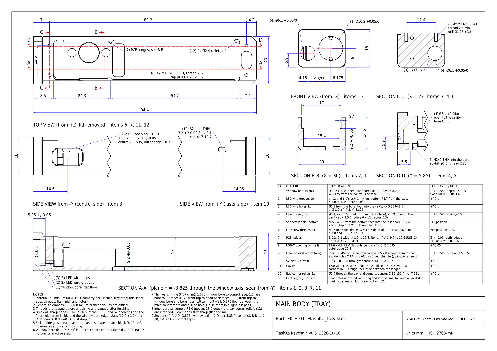

*Figure 13.11 — Tray, sheet 1 of 2 (FK-H-01): top view, front view, side views, sections A-A, B-B, C-C and D-D, the feature table and the notes (material 6061-T6, anodise type II, general tolerances ISO 2768-mK).*

<!-- landscape -->
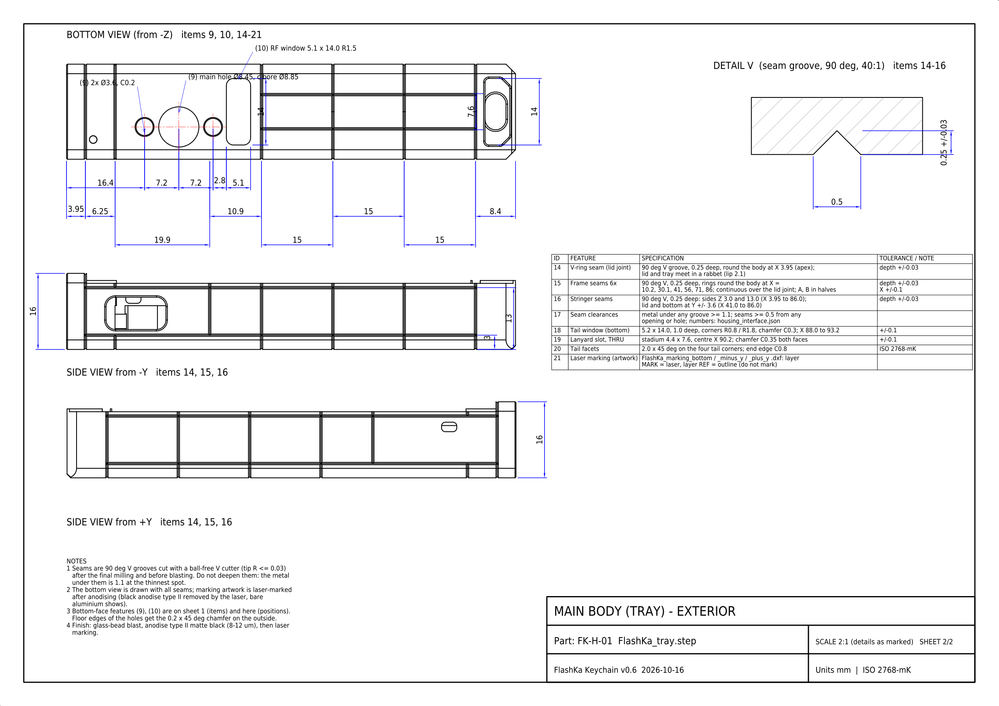

*Figure 13.12 — Tray, sheet 2 of 2 (FK-H-01): the bottom view with the three button holes and the floor RF window, the side views with the seam layout, the V-groove detail and the notes for the laser marking.*

<!-- landscape -->
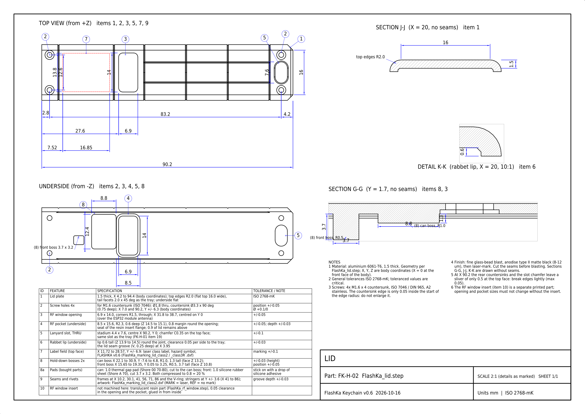

*Figure 13.13 — Lid (FK-H-02): top view, underside with the two hold-down bosses, sections J-J, K-K (rabbet lip) and G-G, and the feature table. The pads and the RF window insert are separate parts.*

<!-- landscape -->
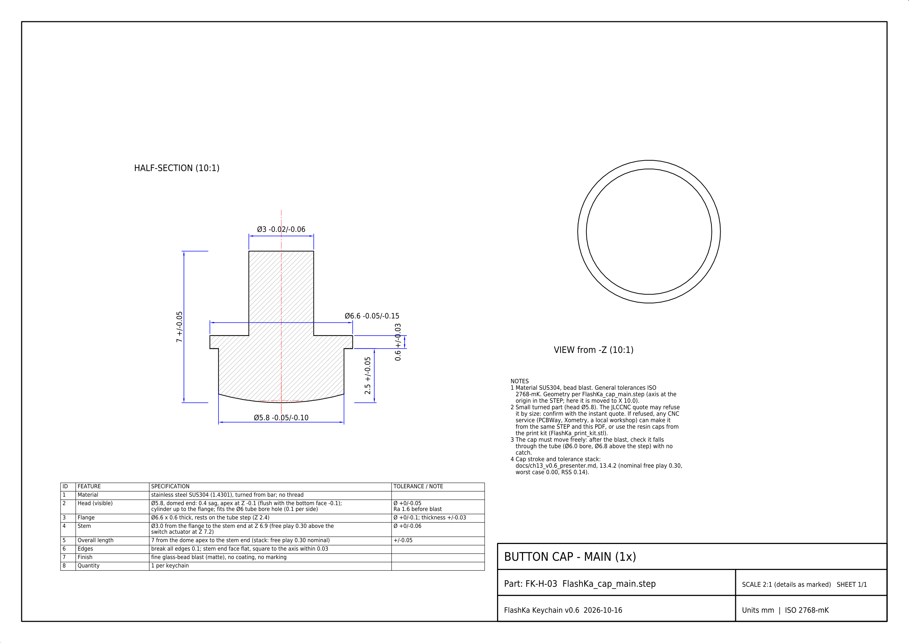

*Figure 13.14 — Main cap (FK-H-03), half-section at 10:1: SUS304, head Ø5.8 mm, flange Ø6.6 mm, stem Ø3.0 mm, 7.0 mm long. Note 2 gives the size caveat of 13.4.4 and note 3 the free-fall test.*

<!-- landscape -->
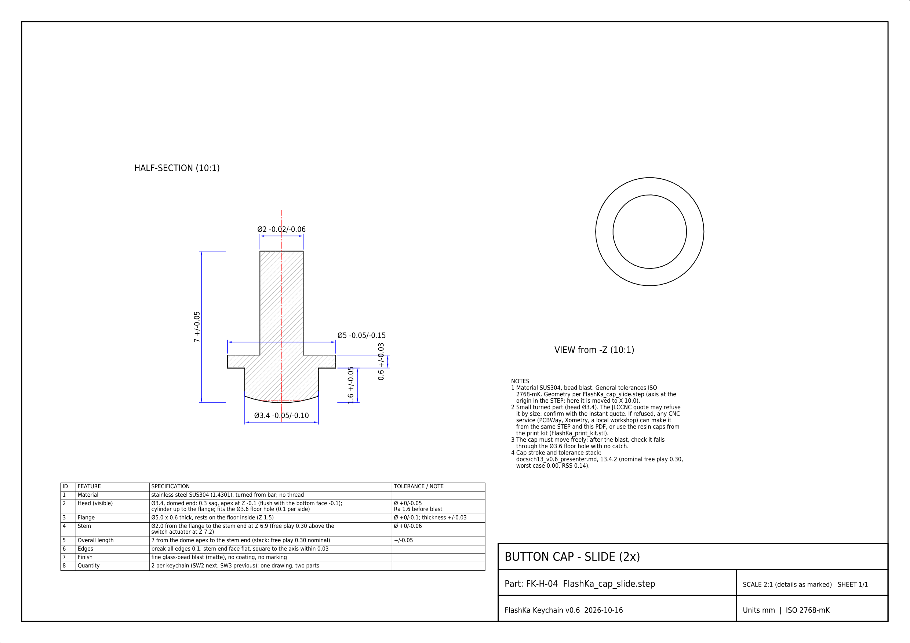

*Figure 13.15 — Slide cap (FK-H-04, two parts), half-section at 10:1: SUS304, head Ø3.4 mm, flange Ø5.0 mm, stem Ø2.0 mm, 7.0 mm long.*

<!-- landscape -->
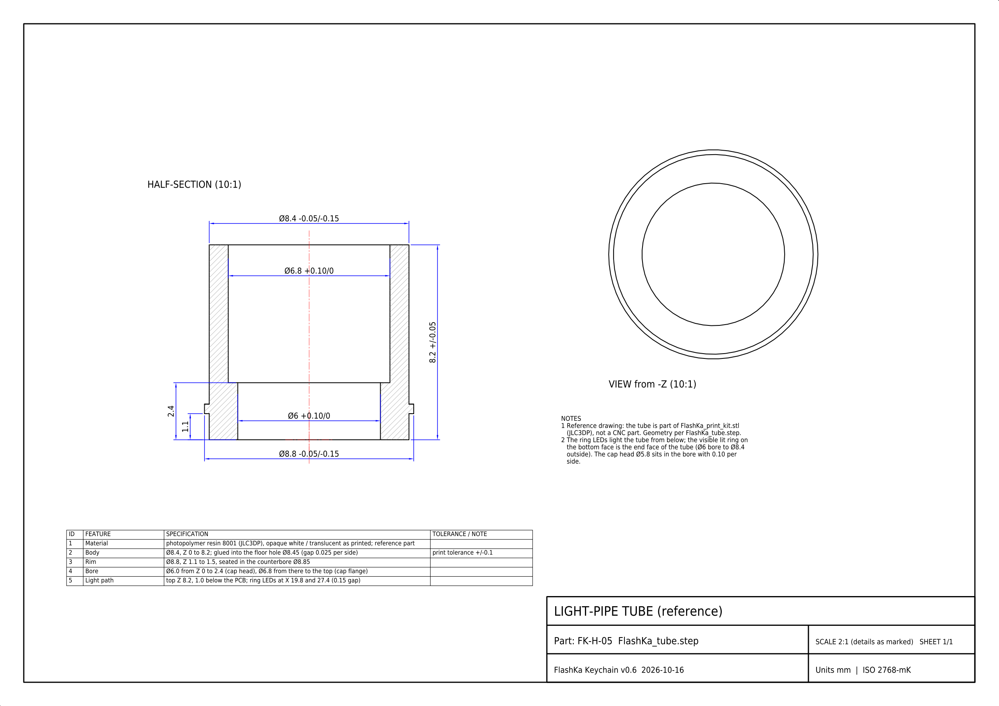

*Figure 13.16 — Light-pipe tube (FK-H-05, reference drawing: a resin part of the print kit, not a CNC part). The lit ring is the end face of the tube between the Ø6.0 mm bore and the Ø8.4 mm outside diameter (13.4.3, note 2).*

## 13.5 Firmware

The firmware is Rust code for the ESP32-C3, in two crates. `flashka-core` holds every decision of the light. It has no access to hardware, so it is tested on the host computer. `flashka-fw` runs on the chip: it reads the pins, drives the LEDs, runs Bluetooth and writes flash. In v0.5 the crates were called `aurora-core` and `aurora-fw`. The version is 0.6.0.

The libraries are the same as in v0.5: esp-hal 1.1.2, esp-rtos 0.3.0, esp-radio 0.18.0, esp-bootloader-esp-idf 0.5.0, esp-storage 0.9.0 and trouble-host 0.6.0 (the Bluetooth host). trouble-host gets two new features. `security` adds LE Secure Connections pairing and bonding. It pulls in the crates p256, aes, cmac and rand_chacha. `connection-event-queue-size-8` makes the event queue 8 long instead of 2. With the short queue the "pairing complete" event can get lost, and then the bond is never stored.

New files in v0.6:

| File | Content |
|---|---|
| `flashka-core/src/buttons.rs` | ladder classes and the gestures of the two slide buttons |
| `flashka-core/src/presenter.rs` | presenter settings and the key map |
| `flashka-core/src/hid.rs` | HID report map, key codes, PnP ID and the byte logic of the OOB guard |
| `flashka-core/src/bonds.rs` | the table of paired computers (a *bond* is the pairing key a computer and the light store) |
| `flashka-fw/src/gatt.rs` | the GATT database, one layout for both modes |
| `flashka-fw/src/hci.rs` | the wrapper around the radio's HCI transport that holds the OOB guard |

The other files changed where the new features needed it. Section 13.5.8 lists what a builder or user may notice. The numbered list of deviations is in 13.8.

### 13.5.1 Button input

The control loop runs every 10 ms. Each round it makes one ADC conversion of the BTN net on GPIO3 (ADC1_CH3, 2.5 dB range, 0 to 1050 mV, factory curve calibration) and sorts the result into a class (13.3.2). A class counts after it has been stable for 25 ms. ● wins: while it is pressed, the other classes are ignored until every button is released. If the ADC fails, GPIO9 decides (low is ●, high is no button), and the light behaves as the single-button light of v0.5.

| Button | Gesture | Rule |
|---|---|---|
| ● | clicks, hold, click then click-and-hold | as v0.5: a click is a press shorter than 0.4 s, and the pause between the clicks of one gesture is at most 0.4 s |
| › and ‹ | click | a press shorter than 0.8 s, counted when the button is released |
| › and ‹ | hold | at 0.8 s, once; there is no repeat |
| ‹ + › | hold 2 s | enter or leave presenter mode, at 2 s while the hold goes on |
| ‹ + › | hold 10 s | forget the paired computers |

A click on › or ‹ counts at the release so that pressing both buttons together never sends a click of the one that went down first. A slide gesture is cancelled, and everything is ignored until every button is released, when:

* ● is pressed;
* one of the two buttons of a ‹ + › press is released first (the ladder then shows the other button alone, which must not count);
* a finger rolls from one slide button directly to the other.

The time of a hold starts when the new class started, not when the 25 ms debounce ended, so a press of 790 ms stays a click. The host tests cover every class boundary (105 and 106 mV, 255 and 256 mV, 447 and 448 mV, 810 and 811 mV), the tolerance case of 13.3.2, a click of 790 ms and a hold of 810 ms, the release of two buttons one after the other, and a start with a button held.

### 13.5.2 Sleep and wake

The light uses only deep sleep, as v0.5. In deep sleep the chip is off apart from a small wake-up circuit, and it starts again from the boot loader when it wakes. Before sleep the firmware turns GPIO3 back into a digital input, and a low level on it wakes the chip. Every press is a valid digital low (13.3.3), so any of the three buttons wakes the light, and USB does too. After a wake-up the light stays awake at least 1.5 s.

* **Which button woke it.** The first ADC sample after the boot tells it. Booting takes about 0.2 s. A press that ends before that sample is read as a ● click, even if it was › or ‹, and the light switches on (13.8, item 24). Hold › or ‹ a little longer when waking the light.
* **GPIO9.** It is a digital input with the internal pull-up switched off after start-up, so that R9 alone sets the ladder levels. The firmware never drives it.
* **A stuck button.** A button that is held for 10 s while it does nothing (in lockout, or › or ‹ with the light off, for example in a pocket) counts as stuck. The chip then sleeps without that button as a wake source and looks at it again every 20 s (13.8, item 27; [BAT-7](../../../docs/design-rules.md#bat-7)).
* **Fail-safe outputs.** LED_EN (GPIO7) and LASER_ON (GPIO10) are set low before anything else. Until then their 100 kΩ pull-downs hold them low. A panic clears both pins directly and resets the chip. A watchdog of 3 s resets a hang ([DRV-7](../../../docs/design-rules.md#drv-7)).

### 13.5.3 Presenter mode

The state machine is in `controller.rs`. Entering presenter mode (‹ + › held 2 s, or the PRESENTER command) switches the main LED off, ends the app link and starts keyboard advertising. It is refused in lockout and below 3.20 V. While it is on:

* A click or hold becomes a key (the table in 13.2.3). The key goes into a queue of 8. The Bluetooth task sends the key-down report as a notification, then the key-up report 10 ms later. A report has 8 bytes: `00 00 <usage> 00 00 00 00 00`. The usages are Page Down 0x4E, Page Up 0x4B, Right 0x4F, Left 0x50, F5 0x3E, Esc 0x29 and B 0x05.
* A key is sent only when a paired computer is connected and the link is encrypted. A key pressed at any other time is dropped, not stored (13.8, item 35).
* ● 4 clicks start the lockout and also leave presenter mode, so that a light locked in a pocket cannot be left as a keyboard (13.8, item 22).
* The laser follows the rules of flashlight mode: S2 armed, at most 60 s per press, not above 60 °C, not below 3.20 V, never in lockout. No Bluetooth command and no key can switch it. It works with or without a computer.
* The idle timer counts from the last button press. At the end (default 30 min, 5 to 120 min) the light leaves presenter mode.
* The battery guard leaves presenter mode when the voltage is below 3.20 V for 2 s (five red blinks), and refuses to enter it below 3.20 V (one red blink). 3.20 V is the voltage limit of the laser (13.8, item 23).
* The light does not sleep. The radio stays on, and the current is about 20 mA (an estimate, not measured; 13.9).
* Presenter mode is not saved. After a reset the light starts in flashlight mode. Plugging in USB resets the chip, as in v0.5, so presenter mode ends then. Enter it again, and the computer reconnects by itself.

The presenter settings are the key set, the idle time and the swap flag (13.6.1). They are stored with SAVE, or before the next sleep.

### 13.5.4 Bluetooth

The light has one Bluetooth connection at a time. The address comes from the chip's factory MAC address (with the Bluetooth offset), and it never changes, so paired computers find the light again. The name is `FlashKa-XXXX`, where XXXX is the last two bytes of the address in hexadecimal, upper case. The Bluetooth controller starts the first time the firmware asks for advertising while no button gesture is in progress, because its start-up blocks the other tasks for a moment and would make the buttons deaf right after a wake-up.

| | Flashlight mode (for the app) | Presenter mode (keyboard) |
|---|---|---|
| Advertising data | 21 bytes: flags and the 128-bit UUID of the FlashKa Control service | 25 bytes: flags, appearance 0x03C1 (keyboard), HID service UUID 0x1812, local name |
| Scan response | local name | local name |
| Interval | 100 ms for 30 s, then 500 ms | 30 ms for 30 s, then 152.5 ms (the value of Apple's accessory guideline QA1931) |
| When | only in windows: light on, 120 s after it goes off, 120 s after ● 3 clicks, while USB is connected, while the app is connected and 30 s after it, and with KEEPALIVE | whenever no computer is connected |

The keyboard advertising data, checked on the host:

```text
02 01 06  03 19 c1 03  03 02 12 18  0d 09 "FlashKa-ABCD"
flags     appearance   HID UUID     local name (13 bytes)
```

There is one GATT layout for both modes, so a paired computer never sees it change. It has 38 attributes. The handles are those that trouble-host 0.6 generates (dumped on the host from the same `gatt.rs`):

| Handles | Service or characteristic | Access |
|---|---|---|
| 1 to 5 | GAP: device name, appearance (0x03C1, keyboard, in both modes) | read |
| 6 | GATT service. There is no Service Changed characteristic | – |
| 7 to 10 | Battery Service: Battery Level (9) and its CCCD (10) | read, notify |
| 11 to 13 | Device Information: PnP ID (13) | read |
| 14 to 26 | HID service 0x1812: HID Information (16), Report Map (18), Control Point (20), Protocol Mode (22), Input Report (24) with its CCCD (25) and Report Reference (26) | see below |
| 27 to 38 | FlashKa Control: Status (29) and its CCCD (30), Command (32), Profile (34), Info (36), Presenter (38) | as in 13.6.1 |

A *CCCD* is the small switch with which a computer turns notifications on for one characteristic. The Report Map has 45 bytes: a boot keyboard with an 8-byte input report, no report ID and no LED output report. The PnP ID is `02 09 12 01 00 60 00`: vendor ID source USB-IF, vendor 0x1209 (pid.codes), product 0x0001 and version 0.6.0. **Product 0x0001 is a test number.** Apply for a free number at pid.codes before the firmware is given to other people (13.9).

**Pairing.**

* The light supports only *LE Secure Connections* with the input and output capability "none". That gives *Just Works*: no PIN, and the computer asks you to confirm. Windows 10 before 1803 and Android before 6 cannot pair.
* The security manager is seeded from the chip's hardware random number generator after the radio is running. If it has no entropy yet, Bluetooth stays off and the flashlight still works.
* A connection can bond only in presenter mode.
* The Report Map, the Input Report (value and CCCD) and the Report Reference can be read only on an encrypted link. An unencrypted access is answered with "Insufficient Authentication" (0x05). trouble-host would answer 0x0F by default. 0x05 makes iOS start pairing. The Control Point (20) and the Protocol Mode (22) are open on purpose: trouble-host answers a refused write *command* with an error response, which the protocol does not allow.
* If a computer has not started pairing or encryption 3 s after it connects, the light sends a Security Request. A link that is still unencrypted after 30 s is dropped, so that a stray device cannot block the computer.
* A pairing request that has the "OOB data present" flag is refused. *OOB* (out of band) means that the pairing data is passed by another channel, for example by touch. trouble-host 0.6.0 would reach an unfinished code path (`todo!("OOB not implemented")`) and the chip would panic. `hci.rs` looks at every packet from the radio. In a Pairing Request with the OOB flag it clears the Secure Connections bit, so trouble-host refuses the request at once. The byte logic is host-tested. It has not been tried on air (13.9).
* When the mode changes, the link is dropped 300 ms later, after the answer to the PRESENTER write has gone out.

**Bonds.** The light stores up to 4 bonds. A fifth pairing replaces the oldest one. Each bond has the computer's address, its two keys and its CCCD table. They are written to flash after a pairing, after a CCCD change and after "forget", and they are given back to trouble-host at boot, before advertising. A computer that reconnects uses its stored key and starts encryption without a new pairing. The firmware sees the encrypted link (it looks every 20 ms) and puts back the stored CCCD table, so key notifications work at once. "Forget" clears the table, the flash record and trouble-host's own list, and drops a computer that is connected.

**In flashlight mode.** A paired computer may reconnect by itself, as keyboards do. The light does not count it as "app connected", because that would keep the radio window open for ever. It drops the link after 10 s, unless the computer uses the FlashKa Control service (the app running on that computer). While such a computer holds the link, an app on another device cannot connect.

The radio uses the default transmit power of esp-radio (+9 dBm). The light does not send a connection-parameter request. It uses what the computer asks (13.8, item 32).

### 13.5.5 Ring

The ring is driven by three LEDC channels (the chip's PWM units) at 9.77 kHz with 13 bits. The LEDs are common anode, so a duty of 100 % means dark. The three colours are scaled by `RGB_FULL_R`, `RGB_FULL_G` and `RGB_FULL_B`, which are 255, 70 and 110 out of 255. They are the v0.5 values for the 1 kΩ red resistor and are not tuned for the 330 Ω red of v0.6 (13.3.4, 13.9). GPIO21 is also the UART0 transmit pin, so the boot log makes the ring flicker red at start-up, as in v0.5.

The patterns are in 13.2.5. The rules for showing them:

* The steady red of the laser is on top of everything.
* A one-shot pattern (a blink series) is drawn over the steady and the breathing states.
* Among the one-shots, the order of the table in 13.2.5 decides which one may interrupt another. White × 3 is never hidden by a key blip, and a key blip is never hidden by a lower pattern.
* Read literally, the specification would let the cyan breathing hide the magenta × 2 that is shown at the moment the waiting starts. The firmware does not do this (13.8, item 19).

### 13.5.6 Flash and settings

The flash layout is the one of v0.5 (`firmware/partitions.csv`, the same as the default table of espflash):

| Offset | Size | Content |
|---|---|---|
| 0x0000 | 0x8000 | bootloader (ESP-IDF second stage, from espflash 4.6.0) |
| 0x8000 | 0x1000 | partition table with its MD5 |
| 0x9000 | 0x6000 | `nvs`: the settings log at 0x9000 to 0xAFFF, the log of paired computers at 0xB000 to 0xCFFF, the rest unused |
| 0xF000 | 0x1000 | `phy_init` (not used by esp-radio) |
| 0x10000 | 0x3F0000 | `factory`: the application (469,200 bytes, 11.36 % used) |

Both logs work like the v0.5 settings log. Each uses two 4 KiB sectors. A save is appended after the newest record. When a sector is full, the log continues in the other sector, which is erased first. The newest record with a valid CRC wins, so a power failure never loses the previous state. Nothing is written if nothing changed. A failed write is tried again every 2 s and given up after 3 failures, so that sleep and reboot still happen.

| Record | Size | Content |
|---|---|---|
| Settings | 64 bytes, 64 per sector | magic `AUR5` and format 2 (a v0.5 record, format 1, still loads); profile, level, flags, sequence number; the Custom profile (20 bytes); the presenter settings at bytes 32 to 35; CRC-32 |
| Paired computers | 256 bytes, 16 per sector | magic `FKB1`; sequence number; 4 bonds of 59 bytes each (flags, address, IRK, LTK, pairing number, CCCD table of 4 entries); CRC-32 |

The settings are saved on SAVE, when the button switches the light off, when lockout or the battery-empty latch changes, before sleep and before the reboot of a factory reset.

### 13.5.7 Image and build

| Item | Value |
|---|---|
| Merged image, written at 0x0 | `firmware/dist/flashka-fw-v0.6.0-merged.bin`, 534,736 bytes, SHA-256 `e21058791bab990439835fbd977eecfed385af5837405e36ae923cb6083a8fdd` |
| ELF | `firmware/dist/flashka-fw-v0.6.0.elf`, 932,620 bytes, SHA-256 `3a5a231d1d5d6083137c401a841b166161516727d068e4604a10fe900d1cad4b` |
| Application | 469,200 bytes, 11.36 % of the 4,128,768 bytes (0x3F0000) of its partition |
| Flash | 428,778 bytes of code and constants |
| RAM | 90,104 bytes static (code in IRAM 30,676; data 9,636; bss 49,792, which includes a 36 KiB heap), 230,400 bytes left for the stack, and a further 64 KiB heap in the RAM that the bootloader frees |
| Build | release build 2 min 01 s, 0 warnings |
| Host tests | 149 passed, 0 failed (93 from v0.5 and 56 new); clippy 0 warnings |
| Tools | the distribution's rustc 1.91 with `build-std` (`RUSTC_BOOTSTRAP=1`), espflash 4.6.0 |

The image was checked with a script: bootloader magic 0xE9 at 0x0; partition table at 0x8000 with a valid MD5; `nvs` at 0x9000 (0x6000 long), `phy_init`, `factory` at 0x10000 (0x3F0000 long); application magic 0xE9; application descriptor 0xABCD5432 with version "0.6.0", name "flashka-fw" and date 2026-10-17; the `nvs` region is 0xFF.

**Reproducible.** The image depends only on the sources and the compiler (rustc 1.91.1), not on the folder it is built in: a clean build in the repository and a clean build of a copy in another folder gave the same merged image and the same ELF, byte for byte. `build.sh` sets `SOURCE_DATE_EPOCH=1792195200000000`, which is 2026-10-17 00:00:00 UTC, so that the build date inside the image does not come from the clock; the bootloader crate reads the value in microseconds (13.8, item 33). `build.sh` also maps the machine-specific source paths that panic messages contain (`--remap-path-prefix`), and the two crates form one Cargo workspace, so cargo hashes their paths relative to `firmware/`. The CI job *Firmware build* rebuilds the image on GitHub and compares it with the published one.

**Writing it.** Hold any button while you plug in USB: the ROM of the chip starts download mode. Then use the web installer (13.6.4), or:

```bash
espflash write-bin 0x0 firmware/dist/flashka-fw-v0.6.0-merged.bin
espflash monitor            # firmware log over USB-Serial-JTAG
```

The merged image covers the `nvs` region with 0xFF, so it **erases the settings and the paired computers**. Remove FlashKa on each computer and pair again. To keep both, write only the application:

```bash
espflash flash --partition-table firmware/partitions.csv firmware/dist/flashka-fw-v0.6.0.elf
```

Building with `ESP_LOG=debug` logs every change of ladder class with its reading in mV. Use it for the bring-up (13.9).

### 13.5.8 What a builder or user may notice

These points follow from the firmware report. Each has an item in 13.8 with the reason.

| What you may notice | Item |
|---|---|
| A very short press on › or ‹ that wakes the light from sleep switches it on, as ● would | 24 |
| › or ‹ held 10 s with the light off, or any button held 10 s in lockout, makes the chip sleep without that button as a wake source | 27 |
| ‹ + › held from flashlight mode enters presenter mode at 2 s. If you keep holding, it forgets the paired computers at 10 s and stays in presenter mode | 20 |
| › and ‹ held in flashlight mode step one level at 0.8 s. There is no repeat | 21 |
| In presenter mode ● 2 and 3 clicks send nothing, ● 4 clicks lock the light and leave presenter mode, and the commands ON, LEVEL and OUTPUT_MA are refused with 0x81 | 22 |
| Presenter mode is refused below 3.20 V and ends when the voltage stays below it for 2 s | 23 |
| A paired computer that connects while the light is a flashlight is dropped after 10 s | 25 |
| FACTORY_RESET keeps the paired computers. FORGET_HOSTS removes them | 30 |
| The presenter current is about 20 mA, because the light does not use light sleep | 18 |

These limits come from the Bluetooth host and the hardware:

* There is no Service Changed characteristic. A computer that cached the v0.5 layout of the light may need Bluetooth switched off and on once. If a later firmware changes the layout, the computer must forget FlashKa and pair again.
* There is no Bluetooth modem sleep in esp-radio 0.18, so presenter mode costs about 20 mA.
* While a paired computer holds the link in flashlight mode, an app on another device cannot connect.
* F5 starts a PowerPoint or Impress show on Windows and Linux. Programs on a Mac use other shortcuts, and in a browser F5 reloads the page (Google Slides).
* The red ring flickers at boot (the boot log is on GPIO21). Below about −7 °C the NTC reads as open, as in v0.5.

## 13.6 Web app and protocol version 2

Two web pages belong to the light. Each is one HTML file in `app/` that works offline and runs entirely inside the browser: nothing is uploaded, there is no account, no CDN and no web font. A check of the control app found no external request.

| File | What it does | Works in |
|---|---|---|
| `index.html` | start page with two links | every browser |
| `flashka-app.html` | **control app**: switch the light, set levels and profiles, see the battery, set up presenter mode, all over Bluetooth. It has a demo mode that needs no light | Chrome or Edge on Android, Windows, macOS, Linux and ChromeOS; on iPhone and iPad the free Bluefy browser. Not Firefox or Safari, which have no Web Bluetooth |
| `flashka-flasher.html` | **firmware installer** through the USB-C port (Web Serial) | Chrome or Edge on a computer. Not on phones or tablets |

`docs/web_apps.md` describes both pages in full.

### 13.6.1 Protocol version 2

The contract between firmware and app is `docs/ble_protocol.md`. Version 2 is version 1 (v0.5) plus:

| Item | Version 2 |
|---|---|
| Status | 20 bytes (v1: 18). Byte 0 is 2. Byte 18 is the mode: 0 flashlight, 1 presenter mode waiting for the computer, 2 presenter mode with a computer connected and the link encrypted. Byte 19 is the number of paired computers, 0 to 4 |
| Presenter characteristic | `a7d40006-3c5e-4b8a-9f61-2d0c8e5b7a13`, read and write (with response), 4 bytes |
| New commands | 0x0A PRESENTER (one byte: 1 enter, 0 leave) and 0x0B FORGET_HOSTS (one byte: 0xA5) |
| SAVE (0x08) | also stores the presenter settings |
| Names | the service is called "FlashKa Control". Every UUID of version 1 is unchanged |

The four bytes of the Presenter characteristic:

| Byte | Field | Range (default) |
|---|---|---|
| 0 | key set: 0 is Page Up and Page Down, 1 is Left and Right arrow | 0 to 1 (0) |
| 1 | idle time in minutes: presenter mode ends after this time without a button press | 5 to 120 (30) |
| 2 | flags: bit 0 swaps › and ‹ (clicks and holds) | (0) |
| 3 | reserved: write 0, reads 0 | – |

A write that is not 4 bytes long, or has a key set above 1, is refused with 0x81. The idle time is clamped to 5 to 120. Undefined flag bits and the reserved byte are ignored. Read the characteristic back to see what the light really uses. A write takes effect at once, and SAVE (or the next sleep) stores it.

PRESENTER 1 switches the main LED off, disconnects the app about 0.3 s after the answer to the write, and starts keyboard advertising. PRESENTER 0 leaves presenter mode. FORGET_HOSTS removes all paired computers and shows white × 3 on the ring. The errors are ATT application error codes:

| Code | Meaning |
|---|---|
| 0x80 | refused: the button has priority. A button action happened in the last 3 s (Status byte 14 shows the time left) |
| 0x81 | invalid length, opcode or value. Also ON, LEVEL and OUTPUT_MA while presenter mode is on |
| 0x82 | refused by protection: battery empty, too hot. Also PRESENTER 1 below 3.20 V |
| 0x83 | refused: lockout is on. Also PRESENTER 1 |

If more than one applies, the firmware answers 0x81 first, then 0x80, 0x83 and 0x82. Every button action starts the 3 s lock, and during it the writes OFF, ON, LEVEL, PROFILE, OUTPUT_MA and PRESENTER fail with 0x80. IDENTIFY, SAVE, KEEPALIVE, LOCKOUT, FORGET_HOSTS, FACTORY_RESET and writes to the Presenter characteristic are never blocked. The spec gave no error codes for the new commands; the codes above are the ones the firmware and the app agreed on (13.8, item 38).

The versions work together:

| Combination | Result |
|---|---|
| A version 1 app with a v0.6 light | works. It reads bytes 0 to 17 and sees the version byte 2 |
| The FlashKa app with a v0.5 light (Status version 1) | everything of v0.5. The Presenter card is hidden, the Presenter characteristic is never read, the footer says "protocol v1". The device chooser also finds names that start with "Aurora" (13.8, item 36) |
| The FlashKa app with a v0.6 light that has no Presenter characteristic | the card is hidden |
| A Status version other than 1 or 2 | the app works as far as it can and shows "Version mismatch" |

### 13.6.2 The presenter card

The Presenter card is shown only for a light that reports protocol 2 and offers the Presenter characteristic (Figure 13.17). It lists what each button does, with the key names of the chosen key set. Its controls are:

* **Start presenter mode** sends PRESENTER 1. A light has one Bluetooth connection, so the app is disconnected. The card says so before you tap. The app then shows a blue "Presenter mode" banner and does not reconnect by itself. If the light has not ended the link after 1.5 s, the app lets go itself (13.8, item 40). The way back is to hold ‹ and › together for 2 s on the light, or to wait for the idle time, and then tap **Reconnect**. While the light is still a keyboard, Reconnect fails and the app asks you to leave presenter mode first.
* **Keys for next and previous**: Page Down and Page Up, or Right and Left arrow (byte 0).
* **Switch presenter mode off after**: whole minutes, 5 to 120 (byte 1). The app checks the range, and the light clamps it too.
* **Swap › and ‹** (byte 2, bit 0).
* **Apply (try it)** writes the four bytes and reads them back. **Save to flashlight** applies them and then sends SAVE. If the light changes a value, the app says so and shows the value that is used.
* **Paired computers: N of 4** is Status byte 19. **Forget paired computers** asks first (the focus starts on Cancel) and then sends FORGET_HOSTS. It is disabled while nobody is paired. The Bluetooth list of the computer still shows "FlashKa": remove that entry there as well.
* **How to pair a computer or phone** (collapsed) gives the steps for Windows 10 and 11, macOS, Android, iPhone and iPad, and Linux and ChromeOS (13.2.4). The help text was written from general knowledge and must be checked once on each system (13.9).

A light in lockout refuses PRESENTER 1 with 0x83, and a light with an empty battery refuses it with 0x82. The app checks the lockout itself before it sends. Browsers rarely pass an ATT error code on as a number. The app reads the code from the error text, and otherwise it guesses the reason from the last Status packet and says "probably".

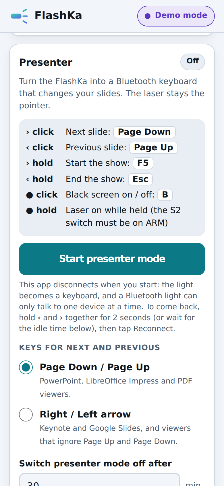

*Figure 13.17 — The Presenter card of the control app in demo mode, on a phone-sized screen (390 px wide): the key list, the Start button with the warning that the app disconnects, and the choice of keys. Below the visible part come the idle time, the swap option, Apply and Save, the number of paired computers, Forget and the pairing help.*

### 13.6.3 The demo light

"Try demo mode" on the start screen runs a flashlight written in JavaScript inside the page. It is not a picture of a screen. It takes the same commands (1 to 3 bytes), 20-byte profile writes and 4-byte presenter writes as a real light, answers with the same 20-byte Status packets (made by the encoder and decoder that the real Bluetooth link uses) and returns the same error codes. A "Demo tools" card does what a person does to a real light: press the light's button (which starts the 3 s lock), lose the connection, plug in USB, a hot day, a battery slider and faster time. It can also play a v0.6 light or a v0.5 light with protocol 1, and it has a switch "a paired computer is in range" and a button "hold ‹ and › for 10 s (forget computers)". While the demo light is a keyboard the app is disconnected, so the banner offers "a computer pairs with the light" and "hold ‹ and › for 2 s (leave presenter mode)", and then Reconnect.

**The demo light follows the firmware rules for presenter mode** (13.8, item 39):

* PRESENTER is refused with 0x80 during the 3 s after a button action, with 0x83 in lockout, and with 0x82 below 3.20 V (loaded battery voltage).
* ON, LEVEL and OUTPUT_MA are refused with 0x81 while presenter mode is on. The main button is the B key and does not switch the light.
* Presenter mode ends after the idle time (the speed-up of the demo applies to it too), and when the loaded battery voltage stays below 3.20 V for 2 s (not while USB is plugged in).
* A computer that pairs turns the mode from 1 to 2. At most 4 computers are kept. FORGET_HOSTS removes them. FACTORY_RESET keeps them, like the firmware (13.8, item 30).
* The demo light draws 20 mA extra in presenter mode, the same estimate as the firmware.
* The demo ends the link 0.4 s after the answer to PRESENTER 1. The firmware does it after 0.3 s.

The model of battery, heat and charging is small and simplified. Its numbers are plausible, not measured.

### 13.6.4 The firmware installer

The installer writes the firmware through the USB-C port with esptool-js 0.7.0 over Web Serial. The page, esptool-js, the helper program for the ESP32-C3 and the firmware image are all in one file of 936,041 bytes, so nothing is downloaded while the firmware is installed. **The file now holds the real firmware 0.6.0**: `flashka-fw-v0.6.0-merged.bin`, 534,736 bytes, SHA-256 `e21058791bab990439835fbd977eecfed385af5837405e36ae923cb6083a8fdd`. For this chapter the image was decoded from the page and compared with `firmware/dist/flashka-fw-v0.6.0-merged.bin`: the two are identical.

* **Connect** opens the port and resets the chip into its ROM download mode with the USB-Serial/JTAG reset sequence, so a running light needs no button. It reads the chip type, refuses anything that is not an ESP32-C3 before it writes, loads the small helper program into RAM and reads the flash size.
* **The image is checked** before it is written: ESP image marker, ESP32-C3 chip ID, partition table at 0x8000, application at 0x10000. The SHA-256 of the image inside the page is computed again when the page loads and compared with the value stored at build time. One changed byte shows "The firmware inside this page is damaged" and disables Install.
* **Install firmware** writes the image at 0x0, lets the chip compute the MD5 of what it wrote and compares it with the image ("Installed and checked"), and restarts the chip.
* Without Web Serial (Firefox, Safari, phones, tablets) the page says why and disables Connect.

Every installation puts the settings back to the factory defaults and removes the paired computers, because the image covers the `nvs` region with 0xFF (13.5.7). The page says so next to its factory-reset option: the saved settings go back to the defaults and the paired computers are forgotten. Its help text for the download mode names the round metal button and says that either small button works too (13.8, item 41).

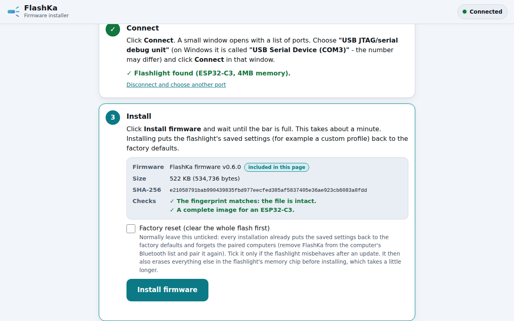

*Figure 13.18 — The installer after Connect, with the real firmware inside the page: name, version, size and SHA-256 of what will be written, and the two checks. The window is 1280 px wide.*

## 13.7 Checks

The table lists every check that was run on the v0.6 design, with its result. The last column says where the result comes from:

| Code | Source |
|---|---|
| PCB | `production/DRC_report.txt` and the checks of `tools/kicad/build_all.py` (`check_pcb.py`, `verify_netlist.py`) |
| HOU | `docs/checks/housing_v06_build_checks.txt` and the files next to it (`tools/housing/flashka_housing.py`) |
| FIT | `docs/checks/fit_pcb_report.txt` |
| FW | `cargo test` in `firmware/flashka-core` and `firmware/build.sh` |
| APP | `npm run test:all` in `tools/web` |
| new | run again or calculated for this chapter (a calculated value says so) |

Everything was checked in software. No v0.6 board exists yet (13.9).

| Area | Check | Result | Source |
|---|---|---|---|
| **Board** | Netlist (`verify_netlist.py`) | 44 named nets, as expected | PCB |
| | Schematic label overlaps | 0 | PCB |
| | Pad nets of the board equal `flashka_parts.py` (`check_pcb.py`) | courtyards, top keep-out X 15.6 to 19.4 mm / Y 0 to 3.3 mm, bottom circle r 4.4 mm, trough, housing parts and USB escape: all OK | PCB |
| | KiCad DRC | **0 errors, 0 unconnected pads, 0 footprint errors**; 65 silkscreen warnings (40 overlap, 10 to the board edge, 7 over copper, 8 text size; v0.5: 33). Counted again from the report | PCB, new |
| | Router checks | 0 incomplete nets, 0 ground pads off the plane, clearance audit 0 (at least 0.101 mm) | PCB |
| | BOM and CPL against the board | 34 BOM lines. 68 designators in both files, none twice, sides match, every line has an LCSC number. CPL: 38 top, 30 bottom. Counted again | PCB, new |
| | Rebuild twice with `--no-route` | identical: BOM, CPL, netlist CSV, `flashka.net`, DRC report, schematic, board, PNG files and placement file. Gerber and drill files differ only in KiCad's date lines | PCB |
| | Full rebuild from the placement file | same copper: stage 1 is byte-identical and the finish gives the same tracks and vias. About 35 min | PCB |
| | Ladder levels, worst case | smallest margins: › 22.7 mV, ‹ + › 25.4 mV, ‹ 115.7 mV. ● 96 mV and "none" at least 240 mV (calculated) | FW, new |
| | Pressed level against the digital low limit | worst case 0.617 V, limit VIL 0.825 V (calculated) | new |
| | Ring current per LED | red 3.9 mA, green 7.0 mA, blue 6.0 mA at the typical forward voltage (calculated) | new |
| **Housing** | Valid solids | 11 of 11 | HOU |
| | Smallest walls | counterbore ledge 0.2 mm (radial); front tap to the head rear face 0.875 mm; lid over the RF pocket 0.9 mm; floor between the main counterbore and the slide hole 0.975 mm; floor between the previous-button hole and the RF window 1.0 mm; tail front wall 1.0 mm; window bore to the control-side face 1.075 mm; laser bore to the laser-side face 1.1 mm; floor RF window to the side wall 1.5 mm | HOU |
| | Metal under a seam groove | at least 1.11 mm (limit 1.1 mm) | HOU |
| | Seams to openings and holes | at least 0.945 mm (limit 0.5 mm) | HOU |
| | Laser marks | to grooves at least 0.358 mm, to openings at least 0.525 mm, 0 violations on 4 faces. Rivets: lid 151, floor 148, −Y 117, +Y 124 | HOU |
| | Stand-in board against the housing: centred, at −Y, at +Y | 0 / 0 / 0 overlaps above 0.02 mm³ | HOU |
| | Part-to-part overlaps (9 parts in place, caps at rest) | 0 above 0.02 mm³ | HOU |
| | Insertion path of the stand-in board (tilt about the S2 knob, 9° to 0°) | 0 hits | HOU |
| | Cap stroke, 3 caps at 3 board positions | free play 0.30 mm; actuator reached within 0.35 mm; cap pressed to 0.55 mm; no other contact | HOU |
| | Cap tolerance stack | free play 0.30 mm nominal, worst case 0.00 to 0.60 mm, root-sum-square minimum 0.142 mm; no preload on a switch at rest | HOU |
| | LED to tube gap | LED3 0.15 mm, LED4 0.15 mm; tube top to board 1.0 mm; SW1 body to tube bore 0.97 mm | HOU |
| | Hold-down preload | 34.0 N (soft 11.9 N, hard 66.3 N); target at least 3 N: **met** | HOU |
| | Hold-down movement at 3 N | at most 0.017 mm nominal and at most 0.033 mm soft and hard: **met**. The board leaves the ledge at SW2 / SW1 / SW3 at 8 / 6 / 2 N (nominal) | HOU |
| | Hold-down movement at 10 N | nominal SW1 0.030 mm, SW2 0.051 mm, SW3 0.121 mm; soft 0.078 / 0.155 / 0.276 mm; hard 0.028 / 0.034 / 0.070 mm. Limit 0.05 mm: **not met at SW3, marginal at SW2** (13.4.5, 13.8 item 8) | HOU |
| | Drawings: every number against the parameter table | 347 entries, 275 distinct, 0 mismatches | HOU |
| | Drawings: probes through the 3D solids | 30 probes, 0 mismatches | HOU |
| | Drawings: layout check | 8 cosmetic notes (for example a tag over a line) | HOU |
| | Interface keys `components` and `pcb_outline` of `housing_interface.json` | identical to the file at the start of the work | HOU |
| | Masses (calculated from the solids) | tray 22.68 g, lid 7.14 g, tube 0.20 g, RF window insert 0.21 g, spacer ring 0.10 g, antenna spacer 1.07 g, main cap 0.86 g, slide cap 0.32 g | HOU |
| | Size comparison | length 94.4 mm is 88 % of v0.4 and 1.56 times the A9 Pro; envelope 30.2 cm³ (0.84 times v0.4, 2.08 times the A9 Pro) | HOU |
| **Fit with the real board** | Collisions of 0.01 mm³ or more, board centred and pushed 0.24 mm to either wall | **0** | FIT |
| | Contact-level slivers | 2 of 0.0026 mm³ each, at X 10.15 mm, Y ∓8.48 mm, Z 9.60 mm (board against a wall) | FIT |
| | Insertion path, 12 steps from 9° to 0° | no hit above the 0.002 mm³ threshold. J1 touches the tray with 0.0019 / 0.0018 / 0.0016 / 0.0011 mm³ at 9.0 / 8.25 / 7.5 / 6.75°; S2 to tray at least 0.215 mm | FIT |
| | Smallest clearances | tray 0.000 mm (J1 at the −Y wall; 0.211 mm centred); lid 0.410 mm (R25); RF window insert 1.900 mm; antenna spacer 0.150 mm; tube 0.150 mm (LED3); caps 0.300 mm; laser 0.300 mm; cell 1 2.640 mm; cell 2 1.100 mm; LED board 3.600 mm | FIT |
| | Free travel of the board | ±Y 0.229 mm; +X 0.149 mm; −X 0.261 mm; +Z 0.393 mm (S2 knob against the tray) | FIT |
| **Firmware** | Host tests (`cargo test` in `flashka-core`) | **149 passed, 0 failed** (93 from v0.5, 56 new). Run again: 149 passed | FW, new |
| | Lints (`cargo clippy --all-targets`) | 0 warnings. Run again: 0 warnings | FW, new |
| | Release build | 0 warnings; 2 min 01 s | FW |
| | Merged image | 534,736 bytes; SHA-256 `e2105879…3a8fdd`; application 469,200 bytes (11.36 % of its partition). The SHA-256 of the file on disk was computed again: it matches | FW, new |
| | ELF | 932,620 bytes; SHA-256 `3a5a231d…0cad4b`; matches the file on disk | FW, new |
| | Memory | flash 428,778 bytes; static RAM 90,104 bytes; 230,400 bytes left for the stack | FW |
| | Image structure | bootloader magic 0xE9; partition table with a valid MD5; application descriptor 0xABCD5432 with "0.6.0" and "flashka-fw", dated 2026-10-17; `nvs` region 0xFF | FW |
| | Reproducibility | two builds from a clean target: image and ELF byte-identical | FW |
| | GATT layout | 38 attributes; handles 18, 24, 25 and 26 need encryption, 16, 20 and 22 are open | FW |
| | Advertising bytes | keyboard 25 bytes, app 21 bytes | FW |
| | Ladder tolerance (`ladder_tolerance`) | with 1 % resistors and ±10 mV every class stays inside its band | FW |
| **Web pages** | Type check (`tsc`) | clean | APP |
| | Node unit tests | **143 of 143 pass**, 0 skipped. Run again with the real image present. The report, written before the image existed, counted 142 passed and 1 skipped | APP, new |
| | Browser tests of the app | **67 passed**, 0 failed | APP |
| | Browser tests of the installer | **29 passed**, 0 failed | APP |
| | External requests in the app | none | APP |
| | Contrast | 4.5:1 or better on the Presenter card, the forget dialog, the banner and the pill, in light and dark | APP |
| | Layout | no horizontal scroll at 320, 360, 390 and 1280 px; touch targets at least 40 px | APP |
| | Firmware inside the installer page | 534,736 bytes, SHA-256 equal to `firmware/dist`. Decoded from the page and compared byte for byte | new |

The screenshots in `app/screenshots/` were written by a run of the browser tests on 2026-10-18, after the real image was embedded in the installer page.

## 13.8 Deviations from the specification, and why

The numbers below follow the order of this chapter: items 1 to 7 are electronics, 8 to 17 mechanics, 18 to 35 firmware and 36 to 41 the web pages. Each item says what the working specification asked for, what was built and why. Item 8 is the only place where a target of the specification is not met, and item 11 is the only place where a design rule is not followed. The other items follow from the tools, the parts or the Bluetooth host.

**Electronics (13.3)**

1. **In1 carries signals in one box.** In v0.5 In1 was a solid ground plane. In v0.6 it holds 41 track segments, 27.5 mm in total, in the box X 19.0 to 24.3 mm, Y −7.6 to 7.6 mm: the nets 3V3, VBUS, VBAT, LASER_ON and RGB_G. The plane has slots there. The router needed the layer to finish the dense column of 0402 parts between the USB-C shell and the module. The layer costs four times as much in the router, so it is used only there. The module and the antenna area are not affected.
2. **Ground pour clearance 0.12 mm and minimum width 0.13 mm** (v0.5: 0.15 mm and 0.15 mm). Both are still above the 0.10 mm design rule. The pours then reach the pads between the dense 0402 rows.
3. **Courtyards 0.10 mm smaller per side** (the margin goes from 0.25 mm to 0.15 mm), now also for the ESP32 module. A column of 0402 parts then fits between the USB-C shell and the module pads. The USB-C socket, the slide switch S2 (PCM12) and the inductor L1 keep their larger courtyards.
4. **The courtyards of LED3 and SW2 overlap by 0.2 mm.** Both positions are fixed by the housing. The copper of the two parts is 0.44 mm apart. The check script exempts this pair.
5. **J5 has a narrow-pad footprint** (`FlashKa:WirePad_SMD_2_P3.0mm_N`, at X 15.55 mm, Y 6.35 mm, bottom side), so that the peg of S2 fits between the pads.
6. **J2 is at the rear −Y corner** (X 31.3 mm, Y −4.8 mm, rotated 90°). The specification (3.3) put the cell pads near the rear +Y corner. SW3 and its ladder resistor take the +Y corner. The antenna spacer has a cell-wire notch (1.6 mm wide, 2.2 mm high) at both lower corners, so the wires can leave on either side. The wire path is not tested (13.9).
7. **Router settings.** A via costs 5 grid steps and the congestion history is 1.5 (v0.5: 10 and 0.6). The board has 71 parts instead of 63 and 544 mm of track instead of 375 mm. The design rules did not change: 0.13 mm tracks, at least 0.10 mm space (router target 0.115 mm), vias 0.2 / 0.45 mm, the JLCPCB rule file.

**Mechanics (13.4)**

8. **The hold-down target is not met at 10 N.** The specification (2.4) asks for no lift below 3 N and at most 0.05 mm of lift at 10 N. At 3 N the target is met: no button moves more than 0.017 mm in the nominal case, and none more than 0.033 mm in the soft and hard cases. At 10 N it is met for SW1 (0.030 mm), marginal for SW2 (0.051 mm) and not met for SW3 (0.121 mm nominal, 0.276 mm soft, 0.070 mm hard). At SW3 the board also leaves its ledge at 2 N in the nominal case, which is below the 3 N of the target. **This is accepted for v0.6.** The switches click at 1.6 N, where the board does not move measurably. A press of 10 N is a hard squeeze after the click. The movement is elastic: the board returns when the thumb lets go. The plate model ignores the stiffness that the parts and the copper add, so the real board is stiffer. The pad moduli (1.0 MPa and 5.3 MPa) are assumptions from the Shore hardness, not datasheet values. The soft and hard cases bound them (13.4.5). If ‹ feels soft on the first prototype, the fixes are a harder can pad (about 3 MPa, about 70 N of preload) or a third pad near SW3 (modelled: 0.061 mm at 10 N). The third pad needs a free area on the top side of the board, so it is a v0.7 change.
9. **The S2 stop in the plate model.** The model stops the board after 0.225 mm of rise at the S2 knob. The 3D model of the real board gives 0.393 mm (13.4.8). The plate model was not run again with 0.393 mm. A stop that comes later can only allow more movement, and it matters only if a press lifts the knob that far.
10. **The weight of the light.** The specification (2.1) gives 0.3 N. About 50 g is 0.49 N (calculated). The 50 g is the v0.5 figure with cells; the three steel caps add 1.5 g. The result does not change: the weight is far below the 1.6 N of a switch.
11. **The caps are proud, not recessed.** The specification (2.1) puts the dome of every cap 0.1 mm above the bottom face, with a flat floor and no pocket. [MEC-6](../../../docs/design-rules.md#mec-6) prefers a shrouded or recessed button. What protects the light from an accidental press instead: a switch needs 1.6 N and the light weighs 0.49 N (calculated); the dome is only 0.1 mm proud; › and ‹ do nothing while the light is off; in lockout everything except ● 4 clicks is ignored ([BAT-7](../../../docs/design-rules.md#bat-7)); a button that is held for 10 s and does nothing counts as stuck (13.5.2); and the laser needs S2 armed, a deliberate gesture and no lockout ([LAS-2](../../../docs/design-rules.md#las-2)). A hard press on ● can still switch the light on when it is not locked. The pocket test of the rule is in 13.9.
12. **The lid joint is a rabbet.** The specification (2.8) asks for frame seams that line up across the lid seam. A butt joint would put a knife edge under a seam. The joint is a 0.6 mm rabbet (lip Z 13.9 to 14.5 mm, 0.05 mm clearance per side, lip thickness 1.45 mm at the side), so the frame seams cross the joint on the flat side.
13. **Gussets and a relief that the specification does not have.** The four long corners of the cavity have a 0.3 mm 45° gusset (cut in the tray, added to the lid), so that metal stays under the corner seams. The antenna spacer has a 0.7 mm chamfer cut and a relief for the flange of the SW3 cap (flange X 28.3 to 33.3 mm, spacer from X 32.95 mm).
14. **The label field is smaller.** The specification (2.7) says X 9 to 30.8 mm and Y ±7.5 mm. The field is X 11.72 to 28.57 mm and Y ±6.9 mm (16.85 × 13.8 mm). The frames at X 10.2 mm and X 30.1 mm and the rivet rows take the rest. The capitals are 0.6 to 0.67 mm high. The text holds every mandatory line.
15. **Two frames are not complete.** The frame seams at X 10.2 mm and X 30.1 mm were placed from the clearances of the countersinks and the RF pocket. The first is split into two halves and the second has no bottom half, because the S2 slot and the wall of the laser bore block the +Y side.
16. **The counterbore ledge is only 0.2 mm wide** (radial: (8.85 − 8.45) / 2 mm), and the tube has 0.025 mm per side in the floor hole. This follows from the diameters in the specification (2.1). The printed tube is tight, so glue it in and do not press it.
17. **An old name in the interface file.** The footprint name `Aurora:LED_RGB_1010_NH-B1010RGBT` is still inside the `components` key of `cad/housing_interface.json`. That key is an interface value that the PCB build reads, so it was not changed. (Two file errors found during the review were fixed before release: note 2 on the tube drawing now says that the lit ring is the end face of the tube, and the bottom marking DXF was rebuilt so that its chevrons point the right way; the cause was an argument bug in `flashka_marking.py` that wrote the rebuilt files into the wrong folder.)

**Firmware (13.5)**

18. **No light sleep.** The specification (4.1) calls GPIO9 a wake source in light sleep. The firmware uses only deep sleep, as v0.5, because esp-radio 0.18 has no Bluetooth modem sleep and the firmware does not use light sleep. GPIO9 is the digital "any button" input: the fallback when the ADC fails, and the wake detection. The cost is the presenter current of about 20 mA.
19. **Ring priorities.** The specification (4.4) lists the presenter patterns "highest priority first": laser red, white × 3, cyan double blink, cyan breathing, key blip, magenta × 2. Read literally, the breathing would hide the magenta × 2 that is shown exactly when the waiting starts. The firmware draws the laser red on top and lets every one-shot overlay the breathing. The order of the table (white × 3, cyan double blink, key blip, magenta × 2, then the v0.5 patterns) decides only which one-shot may interrupt another.
20. **‹ + › at 2 s and at 10 s.** The specification has two rows for one key combination. The mode changes at 2 s while the hold goes on, and the computers are forgotten at 10 s. From flashlight mode the light enters presenter mode at 2 s and forgets the computers at 10 s, and it stays in presenter mode, ready to pair a new computer. From presenter mode it leaves at 2 s and forgets the computers at 10 s.
21. **› and ‹ held in flashlight mode** step one level at 0.8 s and do not repeat. The specification does not say. (The ● hold repeats every 0.6 s, as in v0.5.)
22. **● in presenter mode.** The specification does not say what 2, 3 or 4 clicks do. ● 2 or 3 clicks send nothing (two B presses would cancel each other). ● 4 clicks lock the light and leave presenter mode, which keeps the laser safe in a pocket. The commands ON, LEVEL and OUTPUT_MA, which only a computer that uses the FlashKa Control service can send in presenter mode, are refused with 0x81, because the specification gives no code.
23. **The battery limit in presenter mode.** The specification (4.3) ends presenter mode "when the battery is empty". The v0.5 rule for an empty battery needs the LED to be on. The firmware uses the laser limit: below 3.20 V for 2 s ends presenter mode (five red blinks), and presenter mode is refused below 3.20 V (error 0x82, one red blink).
24. **A short wake-up press counts as ●.** The specification says › and ‹ are ignored while the light is off. From deep sleep the chip needs about 0.2 s to boot, and the first ADC sample then tells which button woke it. A press that ends before that sample cannot be told apart, because every button gives the same digital low. It counts as a ● click even if it was › or ‹, and the light switches on. Holding › or ‹ a little longer when waking avoids this.
25. **A paired computer in flashlight mode** (not in the specification). A computer that reconnects by itself is not counted as "app connected", because that would keep the radio window open for ever. The light drops it after 10 s unless it uses the FlashKa Control service.
26. **Link rules in presenter mode** (additions). A Security Request goes out after 3 s without pairing or encryption. An unencrypted link is dropped after 30 s, so that a stray device cannot block the computer. The link is dropped 300 ms after a mode change, so that the answer to the PRESENTER write goes out first.
27. **The stuck-button rule covers all buttons.** In v0.5 only ● in lockout counted as stuck. Now any button held for 10 s while it does nothing (in lockout, or › or ‹ with the light off) lets the chip sleep without that button as a wake source.
28. **Two v0.5 tests changed.** `status_layout` now expects 20 bytes and version 2. `laser_never_from_ble` now starts its loop over invalid opcodes at 0x0C, because 0x0A and 0x0B exist, and it checks both explicitly. The specification changes what these tests assert. No other v0.5 test was removed or weakened.
29. **The settings magic stays `AUR5`**, with format version 2, so that a v0.5 record still loads.
30. **FACTORY_RESET keeps the paired computers.** The specification is silent. FORGET_HOSTS removes them.
31. **One GATT layout.** The appearance is Keyboard (0x03C1) in both modes, so that the layout never changes (v0.5 used Generic Light Source). The Protocol Mode characteristic, optional in the specification, is included. The report map has no LED output report.
32. **No connection-parameter request.** The research suggested an interval of 15 to 30 ms, latency 4 and a timeout of 6 s. The light uses what the computer chooses. This avoids a code path that cannot be tested yet.
33. **`build.sh` sets `SOURCE_DATE_EPOCH` and maps the source paths.** The image must be the same on every build, wherever it is built. The value is 1792195200000000, because esp-bootloader-esp-idf 0.5.0 reads it in microseconds; that is a quirk of the crate. The path remapping and the shared Cargo workspace keep the folder of the build out of the image.
34. **Presenter writes.** The specification gives no write rules. A write that is not 4 bytes long, or has a key set above 1, is refused with 0x81. The idle time is clamped to 5 to 120 min. Undefined flag bits and the reserved byte are ignored. Presenter writes are not blocked by the 3 s button priority. PRESENTER 1 and 0 are blocked, because they switch the light off or change the mode.
35. **Keys are dropped, not stored, while no computer is connected.** The specification is silent.

**Web pages (13.6)**

36. **The device chooser filters on two name prefixes**, `FlashKa` and `Aurora`, so that a v0.5 light is still found. The specification names only `FlashKa-XXXX`.
37. **The app is called "FlashKa control"** (it was "Aurora++ flashlight control"). The start page is called "FlashKa".
38. **Error codes for the new commands.** The specification gives no error for PRESENTER and FORGET_HOSTS. Firmware and app use 0x83 for PRESENTER 1 in lockout and 0x82 for PRESENTER 1 with an empty battery, in line with 4.2 and 4.3. The app also checks the lockout itself before it sends.
39. **The demo light** keeps the paired computers on FACTORY_RESET (the specification is silent) and draws 20 mA extra in presenter mode (the estimate of the specification). It follows the firmware rules for PRESENTER (13.6.3).
40. **The app lets go of the link itself** if the light has not ended it 1.5 s after PRESENTER 1. The specification does not have this.
41. **The wording of the installer.** Its help text for the download mode was written for the single button of v0.5; in v0.6 any of the three buttons starts the download mode. The text now names the round metal button and says that either small button works too, and the note on the factory-reset option says that every installation also forgets the paired computers (13.5.7).

## 13.9 Open points for the first prototype

The design was checked in software only. The points below need a board, a radio or a person. The bring-up steps of the firmware are in `docs/firmware.md`, section 7.1: steps 13 to 23 are new, and steps 1 to 12 of v0.5 still apply.

| No. | Point | What to do and what to expect |
|---|---|---|
| | **Before ordering** | |
| 1 | JLCCNC and the stainless caps | Upload both cap STEP files to the instant quote and read the answer (13.4.4). If it refuses them, send the STEP files and the PDF drawings to another CNC shop, or use the resin caps of the print kit |
| 2 | Orientation of the new parts at JLCPCB | Check pin 1 and the orientation of SW1 to SW3, LED3 and LED4 in the 3D preview of the order. The CPL rotations are 180° minus the KiCad rotation on the bottom side, with no correction ([DFM-7](../../../docs/design-rules.md#dfm-7)) |
| 3 | Chevrons in the marking file | Open `cad/FlashKa_marking_bottom.png`. It is drawn as seen from below with the head at the left. The chevron at › (X 16.4 mm) must point to the head, which is left in that drawing, and the one at ‹ (X 30.8 mm) to the tail, as in Figure 13.3. The released files are right; check again after any rebuild of the marking files (13.10), and copy the new DXF files to `order_files/2_JLCCNC/` |
| 4 | Product ID | 0x1209:0x0001 is a test number. Apply for a free product ID at pid.codes before the firmware goes to other people |
| | **On the board** | |
| 5 | NH-B1010RGBT-HF pad map | The drawing of the datasheet could not be read. The text says pin 1 anode, pin 2 red, pin 3 green, pin 4 blue. Light each colour on its own and see that the ring shows the right colour. If not, the pad map has to change |
| 6 | Ladder levels | With USB power, measure BTN against GND with a multimeter: none 3.30 V, ● 0 V, › 0.300 V, ‹ 0.595 V, ‹ + › 0.212 V, each ±10 mV with 1 % parts. After boot the readings must not move by more than about 5 mV (the internal pull-up of GPIO9 is off) |
| 7 | ADC readings | Build with `ESP_LOG=debug` and press each button. The logged millivolts must agree with the multimeter within ±10 mV, and the classes must change at 106, 256, 448 and 810 mV |
| 8 | Wake from deep sleep | Wake the light with ●, ›, ‹ and ‹ + ›. Hold ‹ + › from sleep: presenter mode after 2 s. A short press on › or ‹ switches the light on (13.8, item 24) |
| 9 | Ring brightness and balance | Tune `RGB_FULL_R`, `_G` and `_B` for the 330 Ω red (3.9 mA, 13.3.4). Look at each colour first with a bare tube and then in the housing, through 8.2 mm of printed resin. The ring must be even and bright enough in daylight |
| 10 | Presenter current | Measure it with and without a connected computer (estimate: about 20 mA, about 30 to 40 h from 800 mAh). Then let the idle timer end presenter mode (5 min in the app) and measure the sleep current |
| | **In the housing** | |
| 11 | Fit | Tilt the board in about the S2 knob. The front corner of J1 touches the tray at the start of the path (13.4.8). Check the 0.15 mm gaps (antenna spacer, tube), the wire path of J2 at the −Y corner and the notches of the antenna spacer |
| 12 | No button pressed at rest | With the lid closed, no cap may press its switch. The free play of 0.30 mm shrinks by the 0.08 mm bow of the board (13.4.2). After blasting, every cap must fall through its bore by its own weight (13.4.4) |
| 13 | The light-pipe tube | The ledge is only 0.2 mm wide, so glue the tube in. Check the printed step at Z 2.4 mm (±0.10 mm), and that the lit ring is even (13.4.3) |
| 14 | Button feel and the hold-down | Judge the feel of all three buttons: the 0.30 mm free play must not feel loose, and the click must come at about 1.6 N. Press ‹ (SW3) hard. If it feels soft, fit a harder can pad or plan the third pad (13.8, item 8). Measure the hardness of the real pads: the moduli of the model are assumptions |
| 15 | Pocket test | Carry the light for a week, locked and unlocked, and write down every accidental switch-on ([MEC-6](../../../docs/design-rules.md#mec-6), 13.8 item 11) |
| 16 | Laser | Measure the output of the finished laser with a power meter and read the label on a real part. The capitals are only 0.6 to 0.67 mm high ([LAS-3](../../../docs/design-rules.md#las-3)) |
| 17 | Bluetooth range | Measure the range with a hand over the floor and with a hand over the lid. The floor window is plugged with resin, which does not shield the radio, but the effect is not known (13.4.6) |
| | **Radio and computers** | |
| 18 | Pairing | Pair with Windows 11, Windows 10 (1803 or newer), macOS, Android, iOS and Linux, and check the help text of the app on each. With a phone app such as nRF Connect, the keyboard must advertise (appearance 0x03C1, service 0x1812) before pairing, and reading the Report Map must give error 0x05 |
| 19 | Reconnect and bonds | Power-cycle the light, enter presenter mode: the computer must reconnect without pairing, and the keys must work at once. Pair 5 computers: the first must be replaced. Hold ‹ + › for 10 s: white × 3, and no computer reconnects |
| 20 | Keys and programs | In a text editor, each click must give exactly one key. › held for 3 s must give exactly one F5 and no repeated Page Down; ‹ one Esc; ● one B. Try PowerPoint, Keynote, Google Slides, LibreOffice Impress and a PDF viewer with both key sets. The firmware manual and the app recommend the arrow keys for Keynote and Google Slides: confirm it, and correct both if a program behaves differently |
| 21 | The guard against OOB pairing | Send a pairing request with the OOB flag from a test tool: it must be refused (13.5.4). It has not been tried on air |
| 22 | A paired computer in flashlight mode | With a paired computer near, the computer reconnects by itself and is dropped after 10 s. The app on that computer must keep its link |
| 23 | The app against a real light | Test Web Bluetooth against a v0.6 light, in particular what Chrome does when a bonded light stops offering the control service in presenter mode |
| 24 | The installer | Write the image to a real light, and enter the download mode with each of the three buttons. Make the help text say "any button" and mention the paired computers (13.8, item 41) |
| 25 | A new placement | If the placement of the board changes, the router may need other load orders (`FLASHKA_LOAD_SEED`) or may not finish at all |

## 13.10 Files, names, licences and rebuild commands

**Names.** The product is FlashKa Keychain v0.6, written "FlashKa" in text. The v0.5 folder keeps its Aurora names, and so do the v0.5 documents: chapter 12, the v0.5 housing notes and the v0.5 hardware package are in `../flashka-keychain-v05/`. Output files start with `FlashKa_`. The two main scripts are `tools/housing/flashka_housing.py` and `tools/kicad/flashka_parts.py` (in v0.5: `aurora_housing.py` and `aurora_parts.py`). The firmware crates are `flashka-core` and `flashka-fw`, the image is `firmware/dist/flashka-fw-v0.6.0-merged.bin`, and the Bluetooth name is `FlashKa-XXXX`.

**Licences.** Scripts: GPL-3.0-or-later. Hardware design files: CERN-OHL-W-2.0. Documents, this chapter included: CC-BY-SA-4.0. The FlashKa Rust firmware, the web app and the web tools: MIT OR Apache-2.0. The source files carry an SPDX line with their licence.

| Folder | Content |
|---|---|
| `kicad/FlashKa_main/`, `kicad/FlashKa.pretty/` | the KiCad project (schematic and board) and the footprint library |
| `tools/kicad/` | the generators and the router. `flashka_parts.py` is the one table of parts, values and connections |
| `production/` | gerbers, BOM, CPL, DRC report, layer pictures |
| `order_files/` | `1_JLCPCB`, `2_JLCCNC` and `3_JLC3DP`. The last two have a `README.txt` |
| `cad/` | STEP and STL of every part, the drawings (PDF, DXF, PNG), the marking files, `housing_interface.json`, `FlashKa_main_pcb.step` and the placement files |
| `tools/housing/` | `flashka_housing.py` (the parameter table `P` and the checks), `flashka_marking.py`, `drawings.py`, `fit_pcb.py`, `assemble.py` and the render scripts |
| `renders/`, `assets/v06/` | pictures |
| `firmware/` | `flashka-core`, `flashka-fw`, `build.sh`, `partitions.csv`, `dist/` |
| `app/`, `tools/web/` | the web pages with their screenshots, and the build script and tests |
| `tools/parts_list.py` | writes the cost workbook `FlashKa_Parts_List_v0.6.xlsx` (its notes are in `docs/bom_notes.md`) |
| `docs/` | this chapter, the build guide `build_guide_v0.6.md`, `firmware.md`, `ble_protocol.md`, `web_apps.md`, `housing_v06_notes.md`, `bom_notes.md` and `checks/` (the logs of the checks) |

**Where the specification went.** Some code comments cite the working specification of the design by section number ("spec 2.8"). That file is not part of the repository; this table says where each part is described now:

| Specification | Subject | In this chapter |
|---|---|---|
| 0 | naming, licences | 13.10 |
| 1 | coordinates, the interface between housing and board | 13.3.5, 13.4 |
| 2.1 to 2.3 | bottom face, light-pipe tube, caps | 13.4.2, 13.4.3, 13.4.4 |
| 2.4 | PCB hold-down | 13.4.5 |
| 2.5 | second RF window | 13.4.6 |
| 2.6 to 2.8 | parts removed, laser label, fighter-jet skin | 13.1, 13.4.7 |
| 2.9, 2.11 | print kit, outputs | 13.4.1, 13.4.9, 13.10 |
| 2.10 | checks of the housing script | 13.4.8, 13.7 |
| 3.1 to 3.4 | parts table, ladder, placement and checks, outputs | 13.3.1, 13.3.2, 13.3.5, 13.3.6, 13.10 |
| 4.1, 4.2 | buttons, flashlight mode | 13.2.2, 13.5.1, 13.5.2 |
| 4.3 | presenter mode | 13.2.3, 13.2.4, 13.5.3, 13.5.4 |
| 4.4 | ring colours | 13.2.5, 13.5.5 |
| 4.5 | protocol version 2 | 13.6.1 |
| 4.6 | build outputs | 13.5.7 |
| 5 | docs and costs | 13.10 |
| 7 | open points | 13.9 |

Section 6 of the specification (how the files were organised during the design work) has no counterpart.

**Rebuild commands.** From the project folder:

```bash
# Board: outputs from the routed board (about 3 min), or a full rebuild (about 40 min)
python3 tools/kicad/build_all.py --no-route
python3 tools/kicad/build_all.py

# Firmware: host tests, release build, merged image, sizes, SHA-256
cd firmware && ./build.sh
rm -rf target && ./build.sh                     # the published image, byte for byte, in any folder
cd flashka-core && cargo test && cargo clippy --all-targets

# Web pages
cd tools/web && npm install
npm run build:release                           # app/flashka-flasher.html with the real image
npm run test:all                                # type check, node tests, browser tests

# Cost workbook
python3 tools/parts_list.py

# This chapter as PDF (needs python-markdown and Playwright with Chromium)
python3 docs/build_pdf.py ch13
```

The housing is rebuilt from `tools/housing/`. The first command writes the solids and runs all checks (about 75 s). `fit_pcb.py` needs `cad/FlashKa_main_pcb.step`.

```bash
python3 flashka_housing.py ../../cad
python3 flashka_marking.py ../../cad ../../cad --tex-dir ../../cad
FK_CACHE=.fk_cache python3 drawings.py ../../cad ../../cad
xvfb-run -a python3 render.py ../../cad ../../renders
python3 render_marking.py ../../cad ../../renders
xvfb-run -a python3 size_comparison.py ../../cad ../../renders
python3 fit_pcb.py ../../cad/FlashKa_main_pcb.step ../../docs/checks
python3 assemble.py ../../cad ../../cad/FlashKa_main_pcb.step ../../cad
```

The logs of the checks are in `docs/checks/`.
