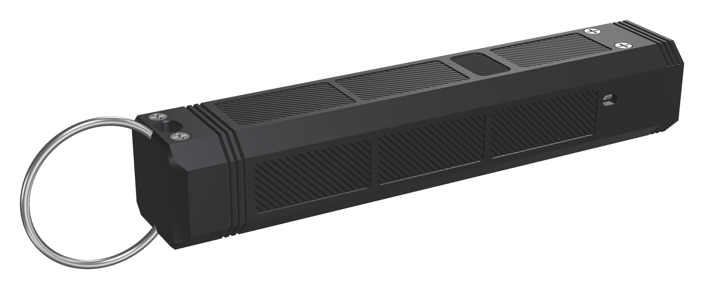
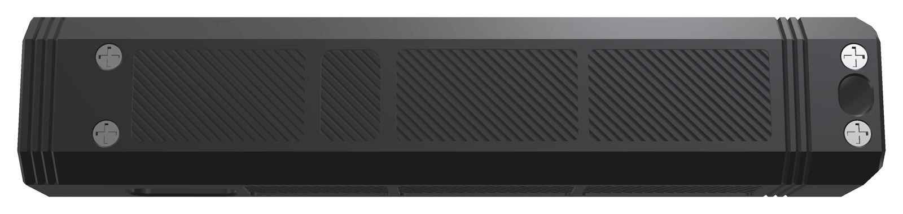
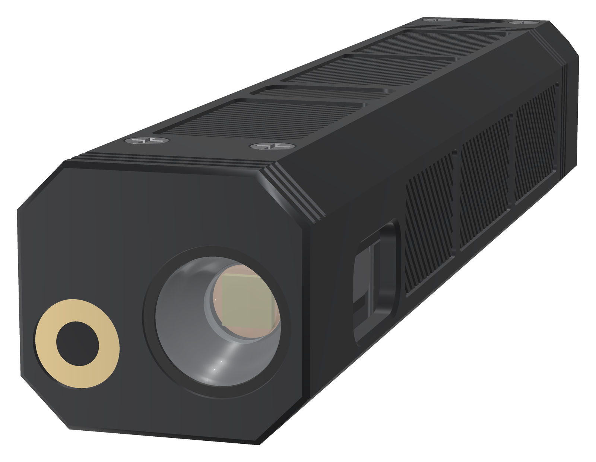
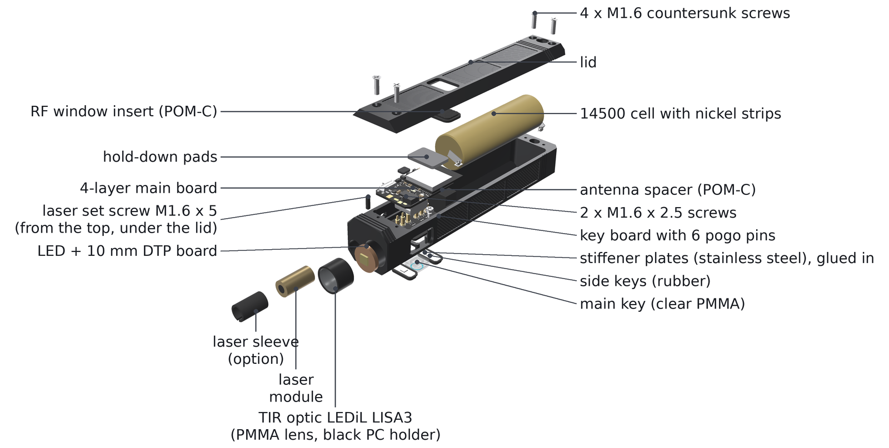

<!-- SPDX-License-Identifier: CC-BY-SA-4.0 -->
[LuxLibre](../../README.md) › [Lights](../README.md) › FlashKa Keychain v0.7

# FlashKa Keychain v0.7

**On this page:** [What's new in v0.7](#whats-new-in-v07) · [Specifications](#specifications) · [Gallery](#gallery) · [Web app and firmware installer](#web-app-and-firmware-installer) · [Presenter mode](#presenter-mode) · [Building one](#building-one) · [Cost](#cost) · [What has been checked](#what-has-been-checked) · [Known limitations](#known-limitations) · [Firmware](#firmware-two-options) · [What is in this folder](#what-is-in-this-folder) · [Licences](#licences)

FlashKa is LuxLibre reference design #1: a 99.2 × 20 × 18 mm aluminium keychain light. Version
0.7 is the **1000 lm FlashKa**: a Luminus SST-20 Gen 2 LED behind a LEDiL TIR optic, driven by a
4 A buck converter at up to 2,850 mA, gives about 1,045 lm (G1 bin) out of the front at switch-on
and about 160 m of throw (both simulated), then holds about 600 lm on High for about three and a
half minutes and about 280 lm until the battery runs low, about 2 h 17 min from turbo. It keeps
what made FlashKa a FlashKa: a 3 mA moonlight, a Class 2 green laser behind a hardware safety
switch, USB-C charging, Bluetooth and a **presenter mode** in which the light is a Bluetooth
keyboard that turns your slides. One 14500 Li-ion cell (Vapcell INR14500 F15, 1,500 mAh) is
protected on the main board and charges at about 500 mA. The three keys sit on the centre line of
the bottom face: a clear acrylic main key whose frosted ring glows in the ring colour, and two
black rubber keys whose chevrons point along the light, **^** next and **v** previous. The switches
sit on a small key board that talks to the main board through six gold spring contacts. No part of
the light is 3D-printed, there is no marking on it, and the aluminium body is a faceted octagon
with textured panels. It runs FlashKa firmware 0.7.0, the v0.7 build of the FlashKa firmware.


*Render — FlashKa has not been built yet.*

> **Status: designed, not yet built.** Everything here has been checked by software (see
> [What has been checked](#what-has-been-checked)), but nobody has assembled a FlashKa yet, and
> every picture of the light is a render. The light figures are simulated from the LED and optic
> datasheets, not measured. The first build must follow the bring-up in the LuxLibre testing
> guide, [docs/testing.md](../../docs/testing.md#bring-up-of-a-new-board), and the plans in the
> [firmware document](../flashka-keychain-v06/docs/firmware.md#7-verification-status), sections 7
> and 9.9, before more are made. The light holds a lithium cell and a laser: read
> [SAFETY.md](../../SAFETY.md) first.

## What's new in v0.7

* **About 1000 lm and 160 m of throw.** The owner asked for at least 1000 lm and about 100 m of
  throw, like the RovyVon Aurora A2. The LED is now an SST-20 **Gen 2** (more light per amp) under
  a **LEDiL LISA3-RS-PIN TIR optic** (20° beam, 87 % efficiency, LEDiL's data). Turbo runs at
  2,850 mA: about 1,045 lm out of the front at switch-on and 966 lm with the LED at 85 °C, the
  datasheet's reference; 6,605 cd and 162.5 m at switch-on (all simulated). The optic is also the
  front window: the glass window and the plastic spacer ring are gone.
* **A long higher output.** High (1,530 mA, about 601 lm) runs for about 210 s at full output in
  25 °C still air; then a temperature regulator holds the light at about 280 lm with the body at
  about 46 °C (simulated). Full turbo lasts about 58 s. The profile's temperature limit (50 °C) is
  the regulator's set point: full output until the light gets there, then it holds it.
* **A stronger driver with board protection.** A TI TPS62095 4 A buck (100 % duty mode) in the
  same current loop, full scale 3,552 mA; the firmware never asks for more than 3.0 A, the LED's
  maximum. The cell has no protection board, so a DW01A protection IC and a dual MOSFET in the
  cell minus (net BATN) protect it on the main board; the IC reads the MOSFETs' drop on its own
  tracks (Kelvin sensing). After a trip the light stays off until USB is plugged in.
* **One 14500 cell.** A Vapcell INR14500 F15 Li-ion cell (1,500 mAh typical, 1,150 mAh minimum,
  3 A, 14.0 × 49.0 mm, flat top) instead of the two small pouch cells of the earlier layout: more
  than twice the capacity, about 137 min from turbo to the low-voltage step-down (simulated).
  Nickel strips are spot-welded to its ends, or you buy it with welded tabs; never solder onto the
  cell. It charges at about 500 mA (a full charge in about 3.5 h). One cell sags under the turbo
  current, so **turbo dims as the cell empties**: 966 lm from a full cell, 948 lm at 90 %, 916 lm
  at 75 %, 775 lm at half charge and 651 lm at 25 % (30 s after switching on, LED at 85 °C,
  simulated). The bay takes any flat-top 14500 up to 14.5 × 50.4 mm; a high-drain cell such as the
  Vapcell K10 (1,000 mAh, 8 A) sags less and keeps full turbo to a lower charge (not simulated),
  with about a third less runtime.
* **A faceted octagon.** The body is 20 × 18 mm with eight flat facets (bottom and top 13.2 mm,
  sides 11.2 mm, diagonals 4.8 mm) instead of the 20 × 16 mm rectangle: the same 99.2 mm length
  (within the owner's 99.4 mm limit), the same textured panels and grooves. The lid is a 3.4 mm cap
  over the top and the two upper diagonal facets, held by four M1.6 × 6 screws; its joint follows a
  facet edge.
* **Firmware 0.7.0.** The same firmware code, built for the v0.7 board: new levels and profiles,
  a 2,850 mA turbo for at most 60 s, a temperature regulator, the F15's capacity and voltage
  curve, a 2.8 A cell-current limit. The installer asks which FlashKa you have, and the app
  recognises the board ([Firmware](#firmware-two-options)).
* **Keys on the centre line.** ^ next, ● main and v previous sit in one shallow frame in the
  middle of the bottom face, a little below its surface, so a table cannot press them. The main
  key is clear polished acrylic (PMMA); its frosted ring carries the light of the two ring LEDs.
  The side keys are black urethane rubber with a raised chevron along the light and a stainless
  stiffener, so they click wherever you press them. Held like a presenter (head towards the
  screen), the key nearest the head shows **^** (next) and the key nearest your hand **v**
  (previous).
* **A key board with pogo pins.** The switches and ring LEDs moved to a 19.0 × 14.8 mm board
  screwed to the floor. Six gold pogo pins press on six pads of the main board: no cable, nothing
  to plug in ([chapter 14, section 14.2.2](docs/ch14_v0.7_keys_and_skin.md#1422-a-key-board-under-the-main-board)).
* **One panel at JLCPCB.** Both boards come in one panel with black solder mask: one order, one
  set of upload files.
* **Premium materials, and a rugged skin.** Anodised 6061-T6, cast PMMA, POM-C, urethane rubber
  and stainless steel. The facets frame recessed panels with a diagonal V texture, and grooves
  ring the head and the tail. No writing at all; the laser set screw hides under the lid. The laser
  warning label is printed in the build guide (section 1, *Laser safety*) and goes on the
  packaging; an optional lid label is included for lights that are sold or given away.
* **Compared with the RovyVon Aurora A2**, beam for beam and size for size ([below](#compared-with-the-rovyvon-aurora-a2)).
* **Lower cost.** Since the first v0.7 layout one light costs 59.61 USD less (918.89 → 859.28 USD)
  and each of five 11.89 USD less, although the optic, the driver, the protection and the bigger
  cell were added: a printed resin casting mould instead of an aluminium one, a cheaper casting
  rubber of the same hardness, one merged parcel from JLCCNC and JLC3DP that stays below the EU's
  150 EUR customs line, no window and no spacer ring, a cheaper LED board. The one-cell octagon
  itself costs 4.47 USD more for one light and 4.35 USD less per light for five ([Cost](#cost)).

## Specifications

| Item | Value |
|---|---|
| Size and mass | 99.2 × 20 × 18 mm, a faceted octagon (eight flat facets). Aluminium tray + lid 30.9 g, all housing parts together 32.7 g, 32.8 g with the optional laser sleeve (both calculated from the CAD solids). About 62 g with the optic, the cell (about 22 g) and the electronics (an estimate, not weighed) |
| LED and optic | Luminus SST-20 Gen 2, 6500 K, G1 bin, on a 10 mm copper DTP board, under a LEDiL LISA3-RS-PIN TIR optic (Ø10.0 × 6.9 mm, pins cut off, glued into the head bore; LEDiL's simulated data for this LED: 20° beam, 87 % efficiency, 5.5 cd per LED lumen). No front window: the optic's face sits 0.2 mm behind the front face |
| Light output | **Not measured yet.** Simulated with the firmware 0.7.0 thermal model, the LED datasheet and the optic data (25 °C still air, full cell, default profile): turbo 2,850 mA gives **about 1,045 lm out of the front at switch-on** (1,201 lm at the LED, G1 bin) and 1,019 lm at 30 s; with the LED at 85 °C, the datasheet's reference, 966 lm. Full turbo for about 58 s, then the temperature regulator. High 1,530 mA: about 601 lm (655 lm at switch-on) for about 210 s. Then about 280 lm sustained (281 lm with the LED taken at 85 °C, 296 lm with its simulated temperature; 325 lm after 10 min). Turbo dims as the cell empties: 775 lm from a half-full cell (LED at 85 °C). Peak **6,605 cd, 162.5 m** ANSI throw at switch-on (6,110 cd and 156.3 m with the LED at 85 °C). Runtime from turbo: 137 min to the ANSI end point (here the low-voltage step-down), off after about 235 min; a cell at the maker's minimum capacity runs about 23 % shorter ([sources](assets/v07/sources_comparison.md), [firmware document, section 9](../flashka-keychain-v06/docs/firmware.md#9-flashka-keychain-v07-firmware-070)) |
| LED driver | TI TPS62095 4 A synchronous buck (100 % duty mode) in a current loop (TLV333 op-amp, 20 mΩ sense resistor); full scale 3,552 mA. Built-in levels from 2 mA (moonlight in the Endurance profile; 3 mA by default) to the 2,850 mA turbo; the firmware caps every request at 3,000 mA |
| Battery | One Vapcell INR14500 F15 Li-ion cell, 14.0 × 49.0 mm, flat top, no protection board: 1,500 mAh typical, 1,150 mAh minimum (maker's data, at 0.2C), 3.60 V, 3 A maximum continuous, about 22 g. Nickel strips spot-welded to both ends (or a cell with welded tabs), one 24 AWG wire to each J2 pad. The firmware's estimates use 1,400 mAh. Any flat-top 14500 up to 14.5 × 50.4 mm fits; for full turbo to a lower charge a high-drain cell such as the Vapcell INR14500 K10 (1,000 mAh, 8 A; not simulated) |
| Protection | on the main board: DW01A protection IC and SE8830A dual MOSFET in the cell minus, Kelvin-sensed (the IC reads only the MOSFETs' drop); over-current trip 5.3-5.6 A typical at 25 °C and 4.3-4.5 A with hot MOSFETs, as low as 3.0-3.15 A in the worst case; the firmware keeps its estimate of the cell current at or below 2.8 A: 93 % of the F15's 3 A rating (a documented deviation from LuxLibre rule BAT-1, only in turbo) and 7-12 % below the worst-case trip. After a trip the light stays off until USB is plugged in |
| Keys | On the centre line of the bottom face, in a 0.5 mm deep frame, 18.65 / 25.65 / 32.65 mm from the front: ^ next and v previous, black cast urethane rubber (Shore A 80), 4.2 × 10.0 mm, raised chevron along the light, glued-in stainless stiffener; ● main, clear cast PMMA, 6.8 × 6.8 mm, frosted ring. Faces 0.15 mm (main) and 0.30 mm (side) below the bottom face. Alps SKRKAEE020 switches (click at 1.6 N) |
| Ring | Two RGB LEDs (NH-B1010RGBT-HF) shine into the clear main key; its frosted ring glows. Patterns: [firmware.md](../flashka-keychain-v06/docs/firmware.md#25-ring-colours), section 2.5 |
| Key board | 19.0 × 14.8 mm, 4 layers, 0.8 mm, ENIG, screwed to the floor with two M1.6 × 2.5 screws; six Harwin P70-1010045R pogo pins press on six gold pads of the main board |
| Laser | 520 nm module, Class 2 (≤ 1 mW), slide-switch interlock S2 in its supply. No marks on the body: towards the head is SAFE, towards the tail ARM |
| Charging | USB-C (two 5.1 kΩ CC resistors), TP4057 linear charger, about 500 mA (494 mA, the F15's standard charge; a full charge in about 3.5 h), through the protection MOSFETs; status on the ring. With a nearly empty cell the charger warms the board next to the temperature sensor and charging pauses above 45 °C until it cools to 43 °C: normal, not a fault |
| Brain | ESP32-C3-MINI-1 module (Bluetooth LE, USB serial/JTAG) |
| Bluetooth and presenter mode | One connection at a time; the name is `FlashKa-XXXX`; protocol version 2 ([ble_protocol.md](../flashka-keychain-v06/docs/ble_protocol.md)). Presenter mode is a Bluetooth LE keyboard, LE Secure Connections "Just Works", up to 4 computers, about 20 mA while it is on (estimate) |
| Circuit boards | Main board 24 × 16.5 mm (the v0.6 outline) with the new power stage, and the key board: one JLCPCB panel of 45.0 × 32.5 mm, 4 layers, 0.8 mm, ENIG, black solder mask. JLCPCB assembles 79 parts of 35 kinds, on both sides of both boards |
| Housing | CNC-machined 6061-T6 tray and lid (JLCCNC), a faceted octagon, bead-blasted and black anodised, recessed textured panels, no marking; the lid is a 3.4 mm cap held by four M1.6 × 6 screws; the laser set screw (M1.6 × 5) sits under the lid. The cell lies on two floor rails, held by foam. PMMA main keys and black POM-C parts as two machining kits (JLCCNC). Side keys cast at home in a resin mould that JLC3DP prints once per builder (an aluminium mould is the durable option) |
| Firmware | FlashKa firmware 0.7.0 for the v0.7 board (`flashka-fw-v0.7.0-merged.bin`); the firmware, the installer and the app are in the [v0.6 folder](../flashka-keychain-v06/README.md), which builds both boards' firmware |

### Levels (firmware 0.7.0)

Lumens are estimated light out of the front with the LED at 85 °C (the LED datasheet × the
optic's 87 %); a cool LED gives up to about 8 % more in the first seconds. The profile is chosen in
the app.

| Profile | Moonlight | Low | Medium | High | Turbo | Temperature limit (held) | Low-voltage step-down | Cell current limit |
|---|---|---|---|---|---|---|---|---|
| Balanced (default) | 3 mA, ~1 lm | 40 mA, 19 lm | 250 mA, 119 lm | 1,530 mA, 601 lm | 2,850 mA, 966 lm, at most 60 s, then High | 50 °C | 3.20 V | 2,800 mA |
| Extreme | 3 mA, ~1 lm | 50 mA, 24 lm | 400 mA, 187 lm | 1,800 mA, 683 lm | 2,850 mA, 966 lm, at most 60 s, then High | 50 °C | 3.15 V | 2,800 mA |
| Endurance | 2 mA, ~1 lm | 15 mA, 7 lm | 100 mA, 48 lm | 500 mA, 230 lm | none | 47 °C | 3.25 V | 800 mA |

The temperature limit is the set point of a regulator: the light keeps full output until the
temperature it predicts 8 s ahead reaches the limit, then holds its sensor just below it. In 25 °C
still air turbo holds full output for about 58 s (the 60 s timer then ends it) and High for about
210 s; both then settle at about 280 lm with the body (the surface in your hand) at about 46 °C.
One Li-ion cell sags under the turbo current, so **turbo dims as the cell empties**: 30 s after
switching on it gives 966 lm from a full cell, 948 lm at 90 % charge, 916 lm at 75 %, 775 lm at
50 % and 651 lm at 25 % (LED at 85 °C); High keeps its full 601 lm down to about 15 %. The
low-voltage step-down (under load) drops the light to Low when the cell is nearly empty, about
137 min after a turbo start in the default profile. Endurance High (230 lm) never steps down for
heat (simulated, [firmware document, sections 9.6](../flashka-keychain-v06/docs/firmware.md#96-simulated-behaviour-25-c-still-air)
and [9.11](../flashka-keychain-v06/docs/firmware.md#911-thermal-regulator-v07)).

## Gallery

All pictures are renders made from the design files.

|  |  |
|---|---|
| **Bottom face.** v previous, ● main with its frosted ring (lit cyan) and ^ next, on the centre line in one frame. The head is at the upper right. | **The keys.** Clear PMMA main key (the switch shows through it) between the two rubber keys. The chevrons point along the light: the one nearest the head to the head (next), the other to the tail (previous). |
|  |  |
| **Control side.** The USB-C opening, the facets and textured panels, the lid with its radio-window insert and four screws. | **Laser side.** The slot of the slide switch S2 near the head. No marks: towards the head is SAFE, towards the tail ARM. |
|  |  |
| **Lid.** Three textured panels and the textured POM-C radio-window insert over the antenna. | **Front.** The laser module and the TIR optic, set 0.2 mm into the head, with the LED behind it. |
|  |  |
| **Without the lid.** The real routed board, the hold-down pads, the S2 slide switch, the 14500 cell on its two rails and the lanyard slot. | **Exploded view.** Lid, the cell with its nickel strips, main board, key board with its pogo pins, keys and the parts of the head. |
|  |  |
| **Every part, labelled.** | **Casting mould.** The printed resin mould; four keys per pour. The stainless plate and doubler are glued into each key. |

## Compared with the RovyVon Aurora A2


*Render. FlashKa: simulated, not yet built. RovyVon Aurora A2: maker's data and the
[1lumen measurement](https://1lumen.com/review/rovyvon-a2/). Every number and its source:
[sources_comparison.md](assets/v07/sources_comparison.md).*

| | FlashKa v0.7 (simulated) | RovyVon Aurora A2 (measured by 1lumen, Gen 3) |
|---|---|---|
| Light out of the front at switch-on | 1,045 lm (966 lm with the LED at 85 °C) | 633 lm (maker: 650 lm) |
| After 30 s | 1,019 lm | 394 lm |
| After 10 minutes | 325 lm | 118 lm |
| Peak intensity / throw | 6,605 cd / 162.5 m | 3,775 cd / 123 m |
| Size | 99.2 × 20 × 18 mm | 57.3 × Ø15.6 mm |
| Mass | about 62 g (estimate) | 19.5 to 33.9 g |
| Battery | 1,500 mAh (one 14500 cell) | 300 mAh |
| Runtime from turbo to the ANSI end point | 137 min | 1 h 04 min |
| Extras | Class 2 laser, Bluetooth slide remote, app | none listed |

With the TIR optic FlashKa out-throws the A2: 162.5 m against 123 m at switch-on, and about
1.65 times its light (calculated). After 30 s it gives about 2.6 times as much (1,019 against
394 lm) and after ten minutes about 2.8 times (325 against 118 lm); it has five times the battery
capacity, runs about twice as long from turbo and adds the laser and the presenter mode. It is longer and
heavier: 99.2 mm against 57.3 mm, about 62 g against 20-34 g. From a half-full cell FlashKa's turbo
gives about 775 lm (LED at 85 °C), still above the A2. The A2's figures are measured, FlashKa's are
simulated; the first build must measure them.


*Light out of the front at 25 °C. FlashKa simulated with turbo (solid) and High (dashed), both
from the default profile; the A2 as the three points 1lumen published.*

## Web app and firmware installer


The web pages serve both FlashKa v0.7 and v0.6. Each page is one HTML file that works offline and
runs entirely in the browser.

| Page | Address on GitHub Pages | File |
|---|---|---|
| Start page | <https://dompka.github.io/LuxLibre/flashka/> | [v0.6 app/index.html](../flashka-keychain-v06/app/index.html) |
| **Control app** | <https://dompka.github.io/LuxLibre/flashka/flashka-app.html> | [v0.6 app/flashka-app.html](../flashka-keychain-v06/app/flashka-app.html) |
| **Firmware installer** | <https://dompka.github.io/LuxLibre/flashka/flashka-flasher.html> | [v0.6 app/flashka-flasher.html](../flashka-keychain-v06/app/flashka-flasher.html) |

The installer holds both firmware images and first asks **"Which FlashKa do you have?"**: choose
**"FlashKa v0.7 - three keys in the middle"**. After connecting it reads the firmware already on
the light, warns if it belongs to the other board and refuses image files made for the other
board: the two firmwares set the LED current with different scales and limits. It writes the
firmware through the USB-C port and needs Chrome or Edge on a computer.

The control app reads from the light whether it is a v0.7 or a v0.6. On a v0.7 it shows the v0.7
profiles, limits a custom turbo to 2,850 mA and shows the estimated lumens next to the current
(for example "1530 mA · 601 lm", marked as estimates). It shows the battery, temperature and
runtime, switches the light, holds the profiles and sets up presenter mode; its demo mode works
without a light and can simulate a v0.7. It needs Chrome or Edge (Bluefy on an iPhone or iPad).
Details: [web_apps.md](../flashka-keychain-v06/docs/web_apps.md).

## Presenter mode

Hold both side keys (^ and v) for 2 s. The ring blinks magenta twice, then breathes cyan while the
light waits for the computer. Hold the light like a presenter, keys up under your thumb and the
head towards the screen: the key nearest the head shows **^** and turns to the next slide, the key
nearest your hand shows **v** and turns back.

| Input | What it does | Key sent |
|---|---|---|
| ^ click | next slide | Page Down (Right Arrow in the "arrows" key set) |
| v click | previous slide | Page Up (Left Arrow in the "arrows" key set) |
| ^ hold 0.8 s | start the show | F5, once |
| v hold 0.8 s | end the show | Esc, once |
| ● click | black screen on or off | B |
| ● hold | laser on while held (S2 must be on ARM) | none |
| ● 4 clicks | lock the light; this also leaves presenter mode | none |
| ^ + v hold 2 s | enter or leave presenter mode | none |
| ^ + v hold 10 s | forget all paired computers (ring white × 3) | none |

In flashlight mode ^ steps one level up and v one level down while the light is on. Pairing works
like a Bluetooth keyboard: no PIN, no app, up to 4 computers. It has not been tried on any real
system yet. The complete user manual is section 2 of the
[firmware document](../flashka-keychain-v06/docs/firmware.md) and Appendix A of the build guide
PDF; the v0.7 levels are in its section 9.3.

## Building one

1. Read [FlashKa_v0.7_Build_Guide.pdf](FlashKa_v0.7_Build_Guide.pdf) from start to end once. It is
   written for people without electronics experience; the source is
   [docs/build_guide_v0.7.md](docs/build_guide_v0.7.md).
2. Upload the files in [order_files/](order_files/README.txt), one folder per shop:

   | Shop | What it makes | Folder |
   |---|---|---|
   | JLCPCB | both circuit boards in one panel, black solder mask, all small parts mounted on both sides (with the new buck, protection IC and MOSFET) | `1_JLCPCB` |
   | JLCCNC + JLC3DP, one merged order | the aluminium tray and lid (black anodised, no marking), the PMMA kit with the clear main keys and the POM-C kit (JLCCNC); once per builder the two resin plates of the casting mould (JLC3DP) | `2_JLCCNC`, `3_rubber_keys` |
   | you | the two rubber side keys, cast in the mould, with a stainless plate and doubler glued in | `3_rubber_keys` |

   Shops that take small parts can make the PMMA and POM-C parts from the single files in
   `2_JLCCNC`.
3. Buy the remaining parts from the workbook [FlashKa_Parts_List_v0.7.xlsx](FlashKa_Parts_List_v0.7.xlsx):
   the 14500 cell (a Vapcell INR14500 F15 from an EU battery shop) with 0.2 mm pure nickel strip
   for its tabs, the LED board (SST-20 Gen 2 on a 10 mm copper board), the TIR optic (a pack of 5
   from an electronics distributor), the laser module, the M1.6 × 6 lid screws, the two M1.6 × 2.5
   pan-head key-board screws and the M1.6 × 5 laser set screw, two silicone hold-down pads, 24 AWG
   wire, thermal paste, polyimide tape, 0.5 mm foam, two-part epoxy for the optic and other
   adhesives, the casting supplies (ECON 80 urethane rubber, pigment, mould release, 0.3 mm
   stainless shim, glue) and, once per builder, four M3 × 16 bolts with washers and nuts for the
   resin mould. Unless the cell comes with welded tabs you also need a small spot welder: never
   solder onto the cell. Every part has a price, a link and its fees; the notes are in
   [docs/bom_notes.md](docs/bom_notes.md). Buy only a Class 2 laser module (1 mW or less):
   [LAS-1](../../docs/design-rules.md#las-1).
4. Cast the side keys, weld the strips onto the cell, install the firmware with the
   [installer](../flashka-keychain-v06/app/flashka-flasher.html) (choose "FlashKa v0.7"; Chrome or
   Edge on a computer), put the keys and the key board into the floor, test in the open tray, glue
   the optic over the LED board in the head, assemble and use the light as the guide says.

Ask JLCCNC whether it accepts the two machining kits (the parts hang on small tabs) and whether it
can cut the 0.2 mm panel texture; the parts work without the texture, which is a priced option in
the workbook.

## Cost

Prices as of 2026-10-23 (readings of parts that did not change: 2026-10-14, 2026-10-18,
2026-10-21 and 2026-10-22), delivered to Lithuania (EU, 21 % VAT), from the workbook and
[docs/bom_notes.md](docs/bom_notes.md):

| USD (EUR) | 1 light | 2 lights (total) | 5 lights (total) |
|---|---|---|---|
| PCB + assembly (JLCPCB, one panel), before shipping | 236.90 (211.74) | 236.90 (211.74) | 282.07 (252.11) |
| Housing (JLCCNC + JLC3DP: aluminium tray and lid, PMMA and POM-C kits, resin casting mould) | 132.91 (118.79) | 204.99 (183.23) | 432.50 (386.58) |
| Bought parts (the cell, LED board, TIR optic, laser, screws, ring, mould hardware) | 65.79 (58.80) | 95.75 (85.58) | 203.00 (181.44) |
| Consumables (nickel strip, wire, paste, tapes, foam, pads, adhesives, casting supplies) | 115.53 (103.26) | 115.53 (103.26) | 115.53 (103.26) |
| Shipping, VAT, customs duty, carrier and card fees | 308.16 (275.44) | 361.75 (323.34) | 463.25 (414.06) |
| **Total** | **859.28 (768.04)** | **1,014.92 (907.15)** | **1,496.35 (1,337.46)** |
| **Per light** | **859.28 (768.04)** | **507.46 (453.58)** | **299.27 (267.49)** |
| Tools, once (a spot welder for the cell's strips included) | about 204 (182) | | |

**What changed since the first v0.7 layout.** Against the workbook of the first v0.7 layout
(price check 2026-10-21; same scenarios and exchange rate):

| USD | 1 light | 2 lights | 5 lights |
|---|---|---|---|
| Per light, first v0.7 layout | 918.89 | 532.04 | 311.16 |
| Per light, now | 859.28 | 507.46 | 299.27 |
| **Change per light** | **−59.61** | **−24.58** | **−11.89** |
| Housing (total) | 169.16 → 132.91 | 242.46 → 204.99 | 473.59 → 432.50 |
| Consumables (total) | 142.19 → 115.53 | 142.19 → 115.53 | 142.19 → 115.53 |
| Shipping, VAT, customs, fees (total) | 315.13 → 308.16 | 349.12 → 361.75 | 452.61 → 463.25 |
| PCB + assembly (total) | 228.66 → 236.90 | 228.66 → 236.90 | 269.12 → 282.07 |
| Bought parts (total) | 63.75 → 65.79 | 101.65 → 95.75 | 218.30 → 203.00 |

The savings and what they cost in quality: the **resin casting mould** printed by JLC3DP (3.32 USD
instead of 35.12 USD for the aluminium mould) holds looser tolerances and wears sooner, so try the
first key in its opening; **ECON 80** instead of PMC-780 DRY (85.95 USD instead of 114.40 USD for
all casting supplies) has the same Shore 80A hardness and needs no scale, only a shorter pot life;
the **merged JLCCNC + JLC3DP parcel** of one light (EUR 118.79) stays below the EUR 150 customs
line and so pays no duty and no carrier fee (21.31 USD less), at no cost in quality; **no window and
no spacer ring**, because the optic is the window; a **cheaper LED board** (2.99 USD instead of
5.40 USD) that is also the better Gen 2 LED; thermal paste instead of tape and two AliExpress
parcels less. The optic (17.37 USD for five plus the distributor's parcel), the power stage and the
24 AWG wire add cost back. For two and five lights the parcels are above the customs line anyway,
so the saving per light is smaller. More options that trade quality for cost (no panel texture,
economy shipping, a cheaper pogo pin, Sugru instead of urethane) are priced in the workbook and in
[bom_notes.md, section 2.3](docs/bom_notes.md#23-options-what-else-would-save-money-and-what-it-costs);
together they would bring one light to about 712.15 USD.

**What the battery and body change costs.** Against the same workbook just before the change, with
two 320 mAh pouch cells in the 20 × 16 mm body (price check 2026-10-22):

| USD | 1 light | 2 lights | 5 lights |
|---|---|---|---|
| Per light, two pouch cells | 854.81 | 508.47 | 303.62 |
| Per light, one 14500 cell in the octagon | 859.28 | 507.46 | 299.27 |
| **Change per light** | **+4.47** | **−1.01** | **−4.35** |

The F15 costs 3.47 USD (read at nkon.nl) against an estimated 5.00 USD for each pouch cell, and one
cell replaces two: the bought parts drop by 8.06 USD for one light. The bigger tray and lid
(+1.02 USD), the nickel strip (+2.08 USD) and the battery shop's own parcel (an estimated
13.43 USD courier fee plus VAT, one web-shop parcel less) add more than that back for one light;
from two lights on the change saves money. A small spot welder (about 40 USD, a one-time tool, not
in the totals) is needed unless the cell comes with welded tabs. Details:
[bom_notes.md, section 2.2](docs/bom_notes.md#22-what-the-battery-and-body-change-costs).

One light is expensive because the fixed costs are paid once, whatever the quantity: JLCPCB's
assembly fees (145.15 USD: set-up for two board sides 51.12, feeder loading for 35 kinds of parts
53.55, stencils 16.42, X-ray inspection 13.12, the panel fee 8.21, the rest 2.73), the casting
supplies (85.95 USD, once per builder: one rubber kit casts many keys) and the resin mould
(3.32 USD), and shipping, VAT and fees (36 % of the total for one light). A builder who already
has the mould and the casting supplies pays 746.37 USD for one light. Building several lights at
once is the biggest saving.

Version 0.6 cost 620.21 USD for one light. The 239.07 USD difference: the casting supplies and the
other consumables (+87.74), shipping, VAT and customs (+69.38), the circuit boards (+62.57: the key
board, six pogo pins, the power stage, the panel fee and the two-design surcharge), the housing
(+10.35: the octagonal body, the two plastic kits and the mould replace the stainless caps, the
print kit and the laser marking) and the bought parts (+9.04: the optic, the 14500 cell, the new
screws and the mould hardware).

**Many prices are estimates.** The aluminium parts, the two plastic kits, the resin mould, the
bare panels and the two-design surcharge, the MOSFET Q3, the courier fees of the optic distributor
and of the battery shop, the shipping prices and the marketplace prices are estimates until the
shops quote. Two parts on the boards (the switches and a resistor) could not be priced from the
shop pages. The workbook marks every estimate in blue on amber.

## What has been checked

From the v0.7 build scripts and the checks of chapter 14
([section 14.10](docs/ch14_v0.7_keys_and_skin.md#1410-checks)):

| Area | Result |
|---|---|
| Boards | Joined through the six pogo contacts, main board and key board give the 44 nets of v0.6 apart from the new power stage, whose 38 pins match their intended connections; the schematic and the boards have the same 52 nets. Every v0.6 part keeps its value and footprint except the power stage (U2, R16, the wire pads J2 and J3; C7 and C9 removed) and R3 (2.0 kΩ for the 500 mA charge of the 14500 cell). Main board, key board and panel: 0 KiCad DRC errors and 0 unconnected pads (silkscreen warnings only: 45, 1 and 46). BOM and CPL match the boards: 35 lines, 79 parts (60 + 19). The protection IC is Kelvin-sensed and the ESP32 module's ground pad has 4 thermal vias, as on v0.6 |
| Housing | 10 of 10 solids are valid and no two parts overlap. The optic's face sits 0.2 mm behind the front face (0.0 to 0.4 mm over its height tolerance) with 2.62 mm of aluminium behind the LED board; every metal wall is at least 0.5 mm (the thinnest: 0.51 mm at the thread root of the front lid taps). The F15 at its smallest and largest size, the K10 and the largest flat-top 14500 the bay takes (14.5 × 50.4 mm) fit with their strips and joints with 0 mm³ of interference. 441 different numbers on nine drawings match the parameter table, 0 mismatches (74 probes into the solids). At least 1.0 mm of metal stays under the texture and the grooves |
| Keys | Free play 0.15 mm (main) and 0.25 mm (side), no contact before full travel. A side key pressed 2 mm from its end clicks at 1.035 N after 0.729 mm (calculated); without the stiffener it would bend 3.9 mm |
| Pogo pins and hold-down | Working height 3.95 mm, 3.76 to 4.14 mm in the worst case, inside the pin's 3.7 to 4.2 mm. The lid pads hold the board down with 39.68 N against 7.37 N of pin force; it lifts 0.0004 mm (calculated; limit 0.02 mm) |
| Boards in the housing | The real board models, unchanged for the octagon: 0 collisions centred; pushed 0.236 mm to either wall, only a contact sliver of 0.0013 mm³ at the board's front corner; the pins land on their pads (offset 0.0 mm); the main board goes in over the pins without a hit; the LED wires and the two cell wires hit nothing (the far-end wire runs in the lower corner of the bay) |
| Casting moulds | Resin and aluminium: valid solids, no undercut, the cast key stays inside its tolerance; the aluminium mould can be machined in two set-ups |
| Comparison | 25 checks pass: the simulated lumens equal the firmware's LED table times the optic's 87 %, the energy balance of both beam models, the flux painted on the wall equals the angular flux |
| Firmware and web pages | Firmware 0.7.0: 166 unit tests and 9 thermal simulation tests (regulator step response, a noisy sensor and turbo from a half-full cell included); the v0.6 build: 153 host tests, and its 0.6.0 image rebuilds byte for byte. Web tools: 165 unit tests, 71 + 33 browser checks. v0.7 image SHA-256 `6554028f31b3e86c958335a1b03b4fd6f2a95000f727d752f4cb891318e79f96` |
| Cost workbook | 8 sheets, 1,047 formulas, 0 error cells. 663 cells equal an independent Python model |

None of this replaces a built and measured light.

## Known limitations

The open points that the first build has to settle are
[section 14.12](docs/ch14_v0.7_keys_and_skin.md#1412-open-points-for-the-first-build) of chapter
14. The deviations from the working specification, with reasons, are
[section 14.11](docs/ch14_v0.7_keys_and_skin.md#1411-deviations-from-the-specification-and-why).

| Topic | Limitation | Rule | Plan |
|---|---|---|---|
| Verification | not built and measured yet; light output, temperatures and runtime simulated, mass estimated | [FW-8](../../docs/design-rules.md#fw-8), [THM-6](../../docs/design-rules.md#thm-6) | first build with the full test plan |
| Turbo current | 2,850 mA is 95 % of the LED's 3.0 A maximum, above the 80 % that LED-2 asks for; it is the price of 1000 lm. Turbo is timed (60 s) and the temperature regulator takes it down after about 57 s | [LED-2](../../docs/design-rules.md#led-2) | measure the LED current and calibrate the full scale on the first board |
| Cell current | the firmware's 2.8 A cell-current limit is 93 % of the F15's 3 A rating, above the 70 % of BAT-1: a documented deviation, because only turbo comes near it (at most 60 s, regulated). No independent test of the F15 at 3 A was found. The limit is an estimate (no current sensing) | [BAT-1](../../docs/design-rules.md#bat-1) | measure the battery current at turbo with a hot light (firmware document 9.9, step 26) |
| Protection margin | the protection trips at 4.3-4.5 A with hot MOSFETs, but in the worst corner (hot MOSFETs at their maximum resistance, the DW01A at its lowest threshold) at 3.0-3.15 A; the 2.8 A limit keeps 7-12 % from it. A trip switches the whole light off until USB is plugged in; nothing is damaged. If it ever trips in turbo, set the Custom profile's cell limit to 2,500 mA | [BAT-1](../../docs/design-rules.md#bat-1) | measure the trip current itself (raise the load on a current-limited supply until the protection cuts) |
| Turbo and the charge | one cell sags: below about 3.7 V at the pads the buck runs at 100 % duty and turbo falls below 2,850 mA, about 2.1 A (775 lm) from a half-full cell; the driver's headroom in the simulation is an estimate | | measure turbo from a full and a half-full cell (firmware document 9.9, step 25); a high-drain cell such as the Vapcell K10 (8 A) would keep full turbo to a lower charge (not simulated) |
| Cell model | the F15's DC resistance (about 90 mΩ) is estimated from the maker's AC value and no discharge curve is published, so the percentage (about ±5 %), the runtime and the low-voltage step-down are estimates; a cell at the maker's 1,150 mAh minimum runs about 18 % shorter than the app shows; the cell's heat path to the body (along the rails, through the foam) is an estimate | [BAT-1](../../docs/design-rules.md#bat-1) | measure the cell path's resistance and the runtime (steps 26 and 29) and correct the firmware's constants |
| Temperature sensor | the thermistor sits on the main board near the driver; the regulator assumes it follows the head, and it holds the sensor, not the body: in warmer air the body runs closer to the limit (about 47 °C in 30 °C air, simulated) | [THM-4](../../docs/design-rules.md#thm-4), [THM-6](../../docs/design-rules.md#thm-6) | compare it with the head temperature on the bench and adjust the limit or the regulator's prediction |
| Charging | with a nearly empty cell the charger warms the board next to the thermistor, so charging pauses above 45 °C and resumes at 43 °C: a full charge takes about 3.5 h, up to about 3.8 h with the pauses, longer in warm air (estimates) | | measure the charge current, the pauses and the time at the first build (step 30) |
| Optic and LED | the optic's figures are LEDiL's simulation; the optic's pins are cut off and it is glued; the LED board's flux bin is not stated by the seller (ask for G1) | | measure lumens and candela |
| Cell tabs and fit | the nickel strips must be spot-welded (or the cell bought with welded tabs): soldering onto the cell damages it. The foam strip and tail pad are picked by measuring the cell with its strips; the strips and joints must be taped so that no bare metal touches the aluminium | | follow the build guide; check the cell, the welds and the insulation before closing the lid |
| Radio range | the radio windows are 10.8 mm wide (14.0 mm on the rectangular body), and aluminium now surrounds one edge strip of the module; the range is not measured | | check the Bluetooth range on the first light |
| Walls | every metal wall is at least 0.5 mm, JLCCNC's absolute minimum; below its recommended 0.8 mm are the front lid taps (0.51 mm at the thread root) and the upper LED wire groove (0.751 mm). The 0.3 mm land on the lid's top face between a rear countersink and the lanyard-slot chamfer is an edge to break lightly | | name them in the quote chat |
| Lid seat | the lid closes on a flat seat at a facet edge: if the seat or the tops of the tray walls are not flat, a gap shows along the edge | | the drawing asks for 0.05 mm flatness (FK-H-02); test-fit the first set |
| Keys | in the worst case of the tolerance stack the main key rests on its switch with a light preload (−0.07 mm) and touches the ring LEDs at full travel (−0.08 mm); both are model numbers | [MEC-6](../../docs/design-rules.md#mec-6) | measure free play and LED gap at the first build |
| Side keys | cast and glued by hand; the casting has not been tried; the resin mould does not hold the aluminium mould's tolerances; the rubber stiffness is taken from its hardness | | first pour as the build guide says; report the result |
| Pogo pins | the maker's drawing of the pin could not be read; JLCPCB's own stock was not confirmed; the cheaper pin option is unverified | | check the drawing; buy the pins into the JLCPCB parts library if needed |
| Ring | the pad map of the ring LED comes from the datasheet text; nobody has seen the ring through the clear key; the colour balance is not tuned; the red LED shares the UART TX pin and flickers during the boot messages | | light each colour at the first build and tune the balance |
| Laser label | the light carries no laser label; a light that is sold or given to others needs one on the light (EN 60825-1) | [LAS-1](../../docs/design-rules.md#las-1) | use the optional lid label in `order_files/optional_laser_label/` |
| Cell fixed in the light | the cell's strips are welded and its wires soldered to the board, so the user cannot replace it without tools. The EU requires user-replaceable portable batteries from 18 February 2027. Not changed since v0.5 | [BAT-2](../../docs/design-rules.md#bat-2) | open |
| Power use | deep sleep about 29 µA expected, presenter mode about 20 mA (both estimates): no light sleep in the firmware, no Bluetooth modem sleep in the radio library | [BAT-6](../../docs/design-rules.md#bat-6) | measure both at the first build |
| Buck input and start-up | C5, the single 22 µF 6.3 V X5R 0603 input capacitor of the buck on VBAT (up to 4.2 V), is rated below twice its working voltage, keeps only about a third of its capacitance at 4.2 V and carries about 1.1 A rms ripple at 3 A; the input loop is about twice the ideal size (C5's ground reaches the buck through the inner plane). The buck's soft-start pin is open: by the analysis the start never carries LED current and the LED current rises without overshoot, but nothing is measured | [DRV-4](../../docs/design-rules.md#drv-4) | scope VIN and SW at 3 A and switch on into turbo 20 times on the first board (no hiccup, no flicker); next revision: a second 22 µF ≥ 10 V input capacitor next to U2, and a 4.7 nF soft-start capacitor only if the bench asks for it |
| SE8830A pinout | its LCSC data sheet shows the pin order only as a picture; the board is laid out for S1, D, S2, G2, D, G1 (as the FS8205A), and another pinout would disable the protection or short the cell | | confirm the pin order before ordering |
| USB detection | no VBUS sense pin: plugging in USB resets the chip, so presenter mode ends. Not changed since v0.5 | [CHG-3](../../docs/design-rules.md#chg-3) | a VBUS divider to a GPIO in a later version |
| Wake-up | a very short press on ^ or v that wakes the light from deep sleep counts as ● and switches the light on | | hold ^ or v a little longer when waking |
| Pairing | untested on every system. Windows 10 before 1803 and Android before 6 cannot pair (LE Secure Connections only). The product ID 0x1209:0x0001 is a test number | | pair with each system at the first build; apply for a free product ID at pid.codes before the firmware goes to other people |
| Assembly cost | parts on both sides of both boards, 35 kinds of parts, leadless parts that need X-ray inspection | [DFM-1](../../docs/design-rules.md#dfm-1) to [DFM-3](../../docs/design-rules.md#dfm-3) | the panel keeps one order and one set-up per side |
| Orders | JLCCNC may refuse parts on tabs or the panel texture; the two-design surcharge and the bare panels are priced only after the upload; the merged housing order of one light is estimated at EUR 118.79, so a quote more than about 35 USD higher would push it over the EUR 150 customs line; the battery shop's courier fee for the cell was not read | | ask in the quote; enter the real quotes in the workbook |
| Bluetooth in LuxLibre | only in the FlashKa Rust firmware, not in the LuxLibre port | | open |

## Firmware: two options

v0.7 runs **FlashKa firmware 0.7.0**: the code of the v0.6 firmware, built for the v0.7 board with
the Cargo feature `board-v07`. The keys, the ladder resistors and the ring LEDs are the same nets as
on v0.6, so every gesture works the same; what differs is the LED driver's current scale, the
levels and profiles, the 2,850 mA turbo limit, the 3,000 mA ceiling, the temperature regulator,
the F15's capacity (1,400 mAh in the estimates) and voltage curve, the low-voltage step-down, the
2,800 mA cell limit and the cell-current model.

1. **The FlashKa firmware** (Rust), version 0.7.0, is the reference: flashlight mode with
   profiles, the Bluetooth app, presenter mode and deep sleep. The image
   `flashka-fw-v0.7.0-merged.bin` (535,328 bytes) is in the
   [v0.6 firmware folder](../flashka-keychain-v06/firmware/) (`firmware/dist/`) and inside the
   [installer](../flashka-keychain-v06/app/flashka-flasher.html). It is reproducible: rebuilt in
   two folders it gives the same bytes. **Never install the v0.6 image (0.6.0) on a v0.7**, nor
   0.7.0 on a v0.6: the installer checks. On a v0.6 board the v0.7 image would scale every current
   by 0.911 (turbo about 2,600 mA) with a 2.8 A cell limit against a pack rated 1.6 A; on a v0.7
   board the v0.6 image would scale every current by 1.098, so a Custom turbo of 3,000 mA would
   become about 3,290 mA, above the LED's 3.0 A. Details:
   [firmware.md](../flashka-keychain-v06/docs/firmware.md) (section 9 for the v0.7),
   [ble_protocol.md](../flashka-keychain-v06/docs/ble_protocol.md),
   [web_apps.md](../flashka-keychain-v06/docs/web_apps.md).
2. **LuxLibre** with the board header
   [firmware/boards/flashka-keychain-v07/board.h](../../firmware/boards/flashka-keychain-v07/board.h)
   and the [ESP32-C3 port](../../firmware/ports/esp32c3/README.md) runs on the same boards. It is
   experimental: main key and ring only, no Bluetooth, no presenter mode. Its full scale (level
   150) is the same 2,850 mA, its cell limit 2,800 mA, its charge estimate uses the F15's voltage
   curve, and the header refuses to build with more than 3,000 mA.

## What is in this folder

| Folder / file | Contents |
|---|---|
| [FlashKa_v0.7_Build_Guide.pdf](FlashKa_v0.7_Build_Guide.pdf) | safety and the laser warning label, ordering, casting the keys, firmware, assembly, first use, troubleshooting; appendix: user manual |
| [FlashKa_v0.7_Hardware_Package.pdf](FlashKa_v0.7_Hardware_Package.pdf) | why and how v0.7 was designed: chapter 14 of the design documents (source [docs/ch14_v0.7_keys_and_skin.md](docs/ch14_v0.7_keys_and_skin.md)) |
| [FlashKa_Parts_List_v0.7.xlsx](FlashKa_Parts_List_v0.7.xlsx) | cost workbook: every part with price, link and fee, for 1, 2 or 5 lights, what changed since the first layout, what the battery and body change costs, and the options (notes in [docs/bom_notes.md](docs/bom_notes.md)) |
| [order_files/](order_files/README.txt) | exactly the files to upload at JLCPCB, JLCCNC and JLC3DP, the casting files of the side keys and the optional laser label, each with a README |
| [production/](production/) | Gerbers of the panel and of each board, BOM and CPL for JLCPCB assembly, schematic PDF, DRC reports, assembly drawings, layer pictures, netlists |
| [kicad/](kicad/) | KiCad projects (the schematic of the whole light, the routed main board, the key board and the panel) and the project footprints and 3D models; [flashka.net](flashka.net) is the netlist |
| [cad/](cad/) | housing STEP and STL files, the two machining kits, the side key with its stiffener, the two casting moulds (resin and aluminium), drawings FK-H-01 to FK-H-08 (DXF, PDF, PNG), the STEP models of both boards, `housing_interface.json` (the contract between housing and boards), the assembly STEP and `_ref_*.stl`, simplified stand-ins (boards, the cell with its strips, screws, optic, mould) for the renders and fit checks, not for ordering |
| [renders/](renders/), [assets/](assets/) | pictures and animations of the light, the comparison with the RovyVon Aurora A2 and its [sources](assets/v07/sources_comparison.md) |
| [tools/](tools/) | the generators: `kicad/` (schematic, placement, router, key board, panel, production files, netlist check), `housing/` (CAD, moulds, drawings, renders, fit checks), `compare/` (comparison pictures), `parts_list.py` (cost workbook), `make_banners.py` (the LuxLibre banners and social preview from the v0.7 renders), `label_picture.py` (the laser label picture of the build guide) |
| [docs/](docs/) | Markdown sources: [chapter 14](docs/ch14_v0.7_keys_and_skin.md) (the design), the [build guide](docs/build_guide_v0.7.md), [bom_notes.md](docs/bom_notes.md), [housing_v07_notes.md](docs/housing_v07_notes.md), `build_pdf.py` and [checks/](docs/checks/) (logs of the checks) |

The firmware (both boards), the web pages and their documents are in the
[v0.6 folder](../flashka-keychain-v06/README.md); v0.7 links to them.

### Rebuilding after a change

Run each line from this folder (`hardware/flashka-keychain-v07/`):

```sh
python3 tools/kicad/build_all.py --no-route          # board outputs from the routed boards
python3 tools/kicad/build_all.py                     # or a full rebuild (routing about 10 min)
(cd tools/housing && python3 flashka_housing.py ../../cad)   # housing solids, kits and checks (about 3.5 min)
(cd tools/housing && python3 key_mould.py ../../cad)        # the two casting moulds of the side keys
(cd tools/compare && xvfb-run -a python3 compare_a2.py ../../cad ../../assets/v07)   # comparison pictures
python3 tools/parts_list.py                          # cost workbook (checks itself)
python3 tools/label_picture.py                       # laser label picture for the build guide
python3 docs/build_pdf.py                            # the two PDFs
```

The rest of the housing chain (drawings, fit check, assembly, renders) is in
[docs/housing_v07_notes.md](docs/housing_v07_notes.md). The firmware is rebuilt in the v0.6 folder
with `BOARD=v07 firmware/build.sh`. The generators need Python 3 with CadQuery (OCP), ezdxf and
KiCad 7 (for `kicad-cli` and KiKit 1.5.1); the renders and the comparison need VTK, and the
comparison also Rust (cargo) for the firmware simulation; the label picture needs matplotlib and
Pillow; the PDF script needs python-markdown and Playwright with Chromium.

## Licences

Hardware design files (KiCad, CAD, drawings and their PDFs, production files): CERN-OHL-W-2.0. The
Python generator scripts: GPL-3.0-or-later. The build guide, design chapter and other documents:
CC-BY-SA-4.0. The FlashKa Rust firmware, the web app and the web tools (in the v0.6 folder): MIT OR
Apache-2.0. Details and what they mean for building and selling FlashKa lights:
[LICENSING.md](../../LICENSING.md).

**Previous design:** [FlashKa Keychain v0.6](../flashka-keychain-v06/README.md) (stainless buttons
off the centre line, resin print kit, laser-marked skin, about 445 lm at the LED; its folder holds
the firmware and web pages of both versions).

---

[All lights](../README.md) · [LuxLibre home](../../README.md) · [EDCO Prism →](../edco-prism/README.md)
