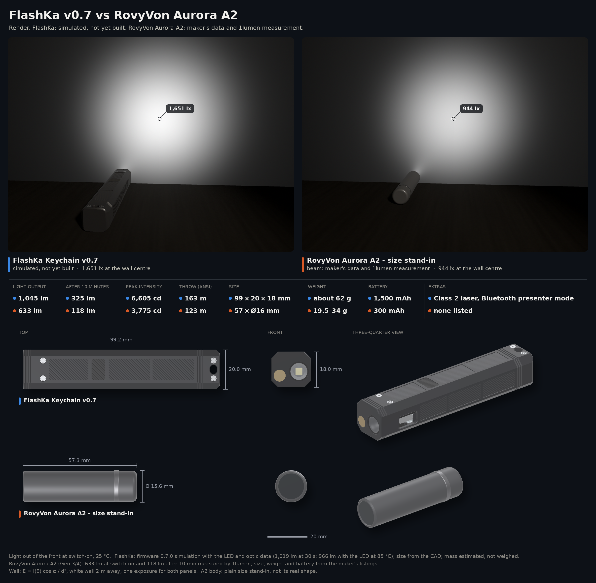
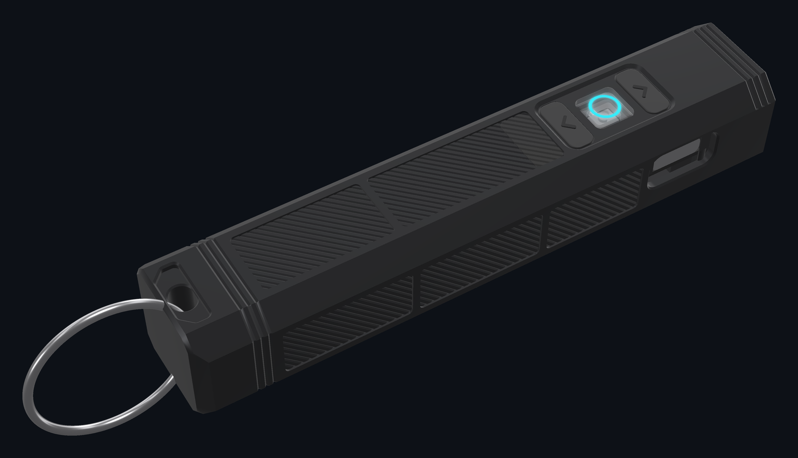

<!-- SPDX-License-Identifier: CC-BY-SA-4.0 -->
[LuxLibre](../../../../README.md) › [Lights](../../../../hardware/README.md) › [FlashKa v0.7](../../README.md) › Pictures

# FlashKa v0.7: pictures

Renders and animations made from the design files. Nothing here is a photo: the light has not been built yet. The renders are made by [render.py](../../tools/housing/render.py).

## Animations

|  |  |
|---|---|
| Exploded view, animated `flashka_v07_exploded.gif` | FlashKa v0.7 turning on a turntable `flashka_v07_turntable.gif` |

## Renders

|  |  |
|---|---|
| Comparison beams `comparison_beams.png` | FlashKa v0.7 and the RovyVon A2: beams on a wall, numbers and size `comparison_combined.png` |
|  |  |
| Comparison combined dark `comparison_combined_dark.png` | Light output over the first 15 minutes `comparison_output.png` |
|  |  |
| Comparison size `comparison_size.png` | Hero dark `hero_dark.png` |
|  |  |
| Housing bottom flat `housing_bottom_flat.png` | Bottom face with the three keys and the lit ring `housing_closed_bottom.png` |
|  |  |
| Control side with the USB-C opening `housing_closed_control_side.png` | Lid from above `housing_closed_lid.png` |
|  |  |
| Laser side with the slot of the slide switch `housing_closed_rear.png` | Exploded view with labels `housing_exploded.png` |
|  |  |
| Front with the TIR optic and the laser `housing_front.png` | Housing open iso `housing_open_iso.png` |
|  |  |
| Housing without the lid `housing_open_top.png` | Close-up of the three keys `key_cluster_macro.png` |
|  |  |
| The resin casting mould of the rubber keys `key_mould.png` | Key mould aluminium `key_mould_aluminium.png` |
|  | |
| Laser label class2 `laser_label_class2.png` | |
