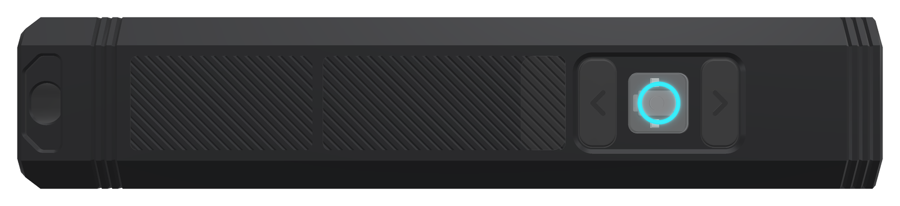
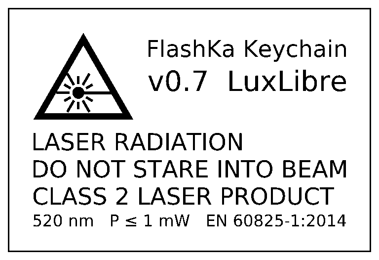
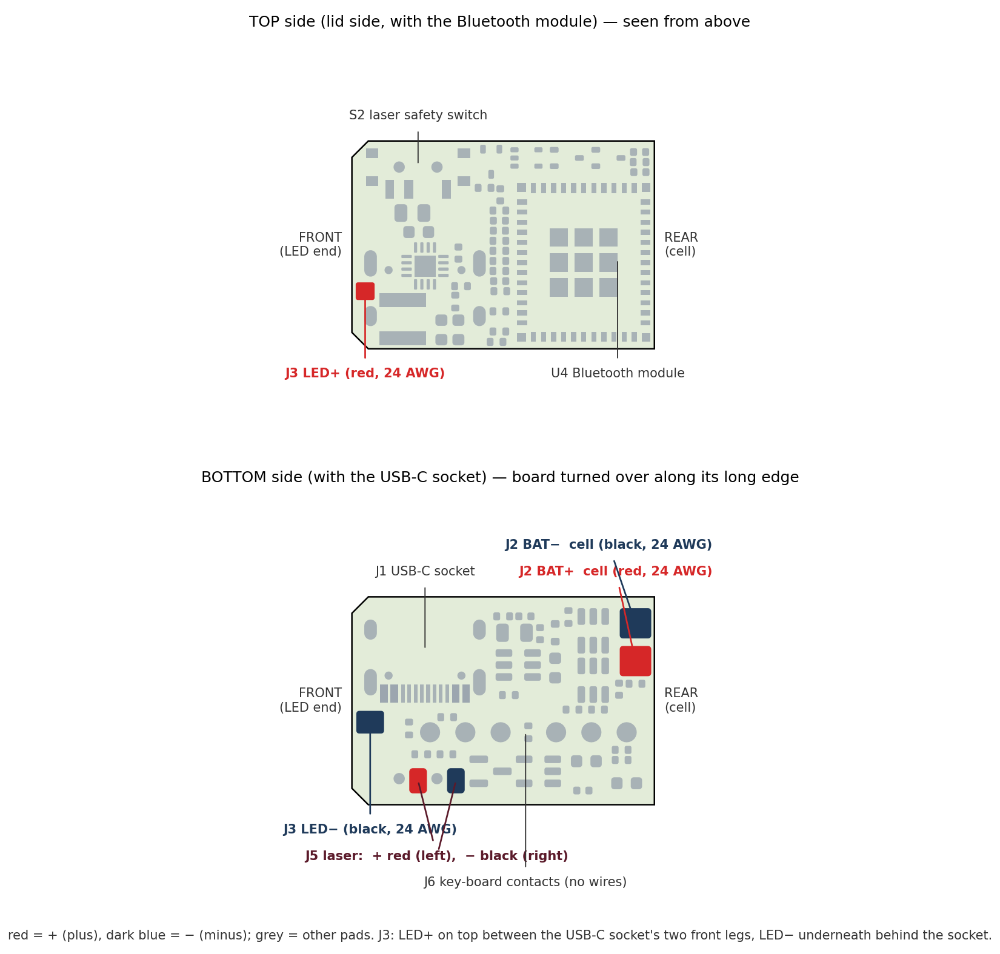
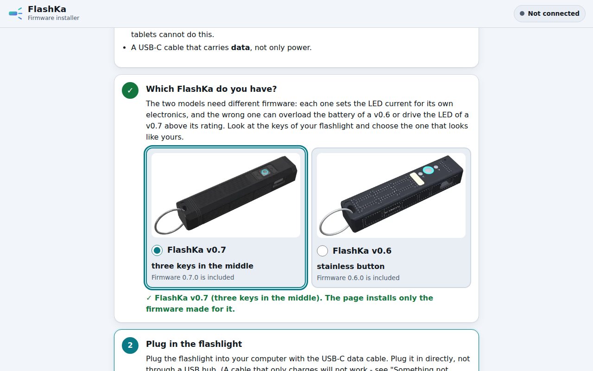

<!-- SPDX-License-Identifier: CC-BY-SA-4.0 -->
# FlashKa Keychain v0.7 — Build guide from zero

This guide takes you from "I have never ordered a circuit board" to a working flashlight and
slide remote in your hand. You do not need to know electronics or programming. You need
patience, a soldering iron and a computer with the Chrome or Edge browser. Read the whole guide
once before you order anything.

> **Status: designed, not yet built.** Nobody has assembled a FlashKa yet. Everything in this
> guide is checked by software only (chapter 14, section 14.10), so you may be the first to build
> one. Where a step or a behaviour is untested, the guide says so. The light figures are
> simulated from datasheets, not measured. Please tell the project what you find (section 18).

*Render, not a photo: FlashKa has not been built yet. Every picture of the light in this guide is a computer render made from the design files. The finished light seen from below: 99.2 × 20 × 18 mm, a faceted octagon of black anodised aluminium with textured panels, three keys on the centre line of the bottom face (the clear main key glows in the ring colour), USB-C charging on the side, a white LED behind a lens and a small green laser in the head, and Bluetooth for the phone app and for presenting.*

---

## 0. What you are building

FlashKa is a keychain flashlight with a green laser pointer. It has a second job: it turns
slides. In *presenter mode* the light is a Bluetooth keyboard, and the laser stays the pointer.
Version 0.7 is the 1000 lm FlashKa: a strong LED behind a lens (a "TIR optic") throws a narrow
beam far. It runs on one 14500 lithium-ion cell, the size of an AA battery. The three keys sit on
the centre line of the bottom face, the body is a faceted octagon with a rugged surface, and no
part of the light is 3D-printed.

| | |
|---|---|
| Size | 99.2 × 20 × 18 mm, an octagon with eight flat faces; about 62 g (an estimate: 32.7 g of housing parts from the CAD, 1.7 g for the optic and the LED board, about 22 g for the cell and 6 g of electronics; not weighed) |
| Keys | three keys in a row on the bottom face: **^** next (black rubber), **●** main (clear acrylic with a glowing ring), **v** previous (black rubber) |
| Ring | two RGB LEDs under the clear main key light up a frosted ring on its face and show what the light is doing |
| Main light | Luminus SST-20 Gen 2 LED under a LEDiL TIR optic, from 3 mA (moonlight; 2 mA in the Endurance profile) to a 2,850 mA turbo: about 1,045 lm out of the front at switch-on and about 966 lm once the LED is hot, a beam that reaches about 160 m. High: about 600 lm for about three and a half minutes, then about 280 lm for more than two hours. Turbo is weaker when the cell is half empty: about 775 lm (all simulated, not measured) |
| Laser | green 520 nm module, Class 2 (≤ 1 mW), with a hardware safety switch |
| Presenter mode | the light is a Bluetooth keyboard: ^ next slide, v previous slide, ● black screen; the laser is the pointer |
| Battery | one 14500 lithium-ion cell (Vapcell INR14500 F15, 1,500 mAh, 3 A), with two nickel strips welded to its ends; a circuit on the main board protects it |
| Charging | USB-C, about 500 mA (a full charge in about 3.5 hours), status shown on the ring |
| Brain | ESP32-C3 module with Bluetooth Low Energy |
| Phone and computer app | a web page: no app store, works in Chrome or Edge (Android, Windows, Mac, Linux) |
| Firmware | FlashKa firmware 0.7.0, installed from a web page over the same USB-C cable: no programmer needed. The installer asks which FlashKa you have: choose **"FlashKa v0.7 - three keys in the middle"** |

How it is made:

* **Two circuit boards in one panel** are made *and fitted with all their small parts, on both
  sides,* by JLCPCB: the main board (24 × 16.5 mm) with the LED driver and the battery
  protection, and a small **key board** (19 × 14.8 mm) that carries the three key switches and
  the two ring LEDs. Six gold spring contacts ("pogo pins") on the key board press on six gold
  pads of the main board, so no cable joins them. You only solder a few wires by hand.
* **The aluminium body** (two parts: tray and lid) is machined and anodised black by JLCCNC. It
  carries no marking at all.
* **The clear main key and three small black plastic parts** are machined by JLCCNC too, as two
  "machining kits" (the parts hang on small tabs in a frame, because the shop does not take parts
  that small one by one).
* **The two rubber side keys** you cast yourself, four at a time, in a small mould: two resin
  plates that JLC3DP prints once and ships in the same parcel as the JLCCNC parts. A thin
  stainless-steel plate glued into each key makes it stiff.
* **The LED board, the TIR optic, the laser, the cell, the screws, two silicone pads, the
  rubber and the glue** are bought ready-made (for example on AliExpress, from an electronics
  distributor and in EU shops).

Hold the light with the bottom face up and the head pointing away from you (at the screen, when
you present). The keys then read, from the head to the tail: **^ next · ● main · v previous**.
The chevron on each rubber key points along the light: on the next key, nearest the head, it
points to the head and reads **^**; on the previous key, nearest your hand, it points to you and
reads **v**. Next is towards the screen, previous towards you.

*Render. The bottom face, tail with the lanyard slot on the left, head on the right. The three keys sit in one shallow frame (the bezel): v previous, ● main with its ring (shown cyan), ^ next. Seen this way the chevron of the next key points right, to the head, and that of the previous key left, to the tail. The textured panel next to the keys also hides the radio window of the floor: a black plastic plug fills it flush. No screw or hole shows near the head: the laser set screw sits under the lid.*

If you know the v0.6 guide: chapter 14, section 14.1 lists what changed and why.

## 1. Before you spend money

**Cost.** The workbook `FlashKa_Parts_List_v0.7.xlsx` lists every part and every fee. The short
version (delivery to Lithuania, EU, 21 % VAT; prices read on 2026-10-23, unchanged parts on
2026-10-14, 2026-10-18, 2026-10-21 and 2026-10-22):

| | one light | two lights | five lights |
|---|---|---|---|
| Everything, including shipping, VAT and set-up fees | 859.28 USD (768.04 EUR) | 1,014.92 USD (907.15 EUR) | 1,496.35 USD (1,337.46 EUR) |
| Per light | 859.28 USD | 507.46 USD (453.58 EUR) | 299.27 USD (267.49 EUR) |
| Tools you may not have yet (one-time) | about 204 USD (164 USD without the spot welder) | | |

The 1000 lm design and the one-cell body made the light about 60 USD cheaper than the first v0.7
design (918.89 USD for one light), although they added the lens, the stronger driver and the
battery protection: the casting mould is now a cheap resin print, the casting rubber is a cheaper
one of the same hardness, the housing parcel of one light stays below the EUR 150 customs line,
and the glass window and the spacer ring are gone. The one 14500 cell, instead of the two small
pouch cells drawn before, costs about 4 USD more for one light (the battery shop's own parcel and
the nickel strip) and saves about 4 USD per light for five. Version 0.6 cost about 620 USD for one
light. v0.7 costs about 239 USD more:

* about 88 USD for the casting supplies of the rubber keys and other consumables (a 0.86 kg
  rubber kit, pigment, mould release, stainless shim, glue, cups, syringes and polishes; 24 AWG
  wire, thermal paste, nickel strip). You buy the casting supplies once: one rubber kit casts many keys, so you
  can share it with other builders;
* about 63 USD for the circuit boards: the key board in the same panel, six gold pogo pins, the
  stronger LED driver with the battery protection, the panel fee and the surcharge for two
  designs in one file;
* about 69 USD more shipping, VAT and customs, because the orders are dearer, and the lens and
  the cell come from their own shops in their own parcels;
* about 9 USD for bought parts: the lens, the 14500 cell, the key-board screws and the mould's
  bolts;
* about 10 USD for the housing: the bigger octagonal body, the two plastic kits and the resin
  mould (once per builder) replace the stainless caps, the resin print kit and the laser marking
  of v0.6.

A builder who already has a mould and the casting supplies (a second batch, or a mould shared
with a friend) pays about 746 USD for one light. One light is expensive because the fixed costs
(assembly set-up, stencils, the rubber kit, several parcels from the shops and the marketplace)
are paid once, whatever the quantity. JLCPCB makes at least 5 panels and assembles at least 2.
Building with friends brings the price down a lot. The workbook also prices cheaper options (no
panel texture, economy shipping, a cheaper pogo pin, Sugru for the keys) and says what each costs
in quality.

> **Many prices are estimates.** The shops show their price only after you upload the files,
> and some pages could not be read. The aluminium parts, the two plastic kits, the resin mould,
> the bare panels and the two-design surcharge, the courier fees of the lens and of the battery
> shop, the spot welder, the shipping and the marketplace parts are estimates. The workbook
> marks them (blue on amber). Replace them with the real quotes before you pay.

**Time and the order of the orders.** Building takes two or three evenings, plus a night in which
the rubber of the keys cures; the waiting takes longer. Order in this sequence (the workbook's
sheet *Ordering checklist* has the same steps):

1. **Day 1:** order the bought parts (section 6), including the lens from the electronics
   distributor and the cell from the EU battery shop; order the casting supplies (section 5) and
   the circuit boards (section 3), about 2 weeks.
2. **When the cell, the LED board, the lens and the laser have arrived** (2–5 weeks from
   AliExpress): measure them (section 8). They must match the specification, because the body is
   made for them.
3. **Then** order the body, the two plastic kits and, once, the resin casting mould in one
   merged order (section 4; 10–12 days).
4. **When the mould is there**, cast the side keys first (section 9): the rubber cures overnight,
   and you can do the electronics meanwhile.

At every checkout choose shipping with **taxes and duties paid (DDP / "tax included")**. The
cost figures above assume it.

**Skills.** Soldering wires to pads and to nickel strips (practise on scrap first), spot-welding
two nickel strips onto the cell if it comes without tabs (practise on scrap strip first), using a
small screwdriver, cutting two tiny pieces of rubber with a sharp knife, mixing a small amount
of casting rubber with two syringes (like a two-part glue), cutting thin stainless sheet with tin
snips, gluing with a very small amount of glue, and following instructions exactly. Nothing else.

**Safety — read this.** The project's safety notes are in [SAFETY.md](../../../SAFETY.md) at the
root of the LuxLibre repository. The design rules named in this guide (for example LAS-1) are in
`docs/design-rules.md` at the same root.

* **A lithium cell** can burn if it is short-circuited, punctured, crushed or charged wrongly.
  The 14500 cell of v0.7 has **no protection board of its own**: until it is connected to the
  main board, nothing protects it, and a short circuit can drive more than 10 A through a tool, a
  wire or a ring on your finger. The whole metal can is the minus (−) and the small raised cap at
  one end the plus (+): never let a piece of metal touch the cap and the can at the same time, and
  never let a red and a black wire touch. **Never solder onto the cell:** the heat of an iron
  damages it. Its strips are spot-welded on (section 10); you solder only to the strips. Keep one
  strip covered with Kapton tape while you work on the other. Never use a cell with a torn sleeve
  (the plastic skin) or a dented can. Keep a metal box or a sand-filled pot nearby while you work.
  Stay near the light during its first charges.
* **The laser** is a real laser. Class 2 is safe for an accidental glance, but never look into
  it or point it at people, animals, cars or aircraft. Wear 520 nm laser safety glasses while
  testing. Buy only a module whose seller states **Class 2 / ≤ 1 mW**, and measure it if you
  can ([LAS-1](../../../docs/design-rules.md#las-1), [LAS-3](../../../docs/design-rules.md#las-3)).
  Its warning label is printed below (*Laser safety*).
* **The main light is very bright.** About 1000 lm in a narrow beam: never shine it into
  someone's eyes, and do not look into the lens from close range. The head gets hot in turbo
  and on High; the firmware limits the temperature (the body stays below about 47 °C in still air,
  simulated), but do not wrap the light in your hand or in a pocket while it runs.
* **The keys sit a little below the bottom face** (the main key 0.15 mm, the side keys 0.30 mm,
  inside a 0.5 mm deep frame), so a table does not press them. A hard press in a pocket can still
  switch the light on. Lock the light before you carry it: 4 clicks on ● (section 15). The design
  rule is [MEC-6](../../../docs/design-rules.md#mec-6); the lockout is
  [BAT-7](../../../docs/design-rules.md#bat-7).
* **Casting rubber, mould release, epoxy and super glue** are chemicals. Read the safety data
  sheet of the rubber before you open it, wear nitrile gloves and eye protection, and work in a
  room with fresh air. Keep the cyanoacrylate ("super glue") away from the clear main key and the
  lens: its vapour leaves a white bloom on clear plastic. Use two-part epoxy for the lens.

### Laser safety

The laser of FlashKa is a green **520 nm** module of **Class 2** (EN 60825-1:2014): its output
is at most **1 mW** (P ≤ 1 mW). Class 2 means that the blink reflex protects the eye from an
accidental glance; do not stare into the beam. The light itself carries no marking, so its
warning label is printed here, and it belongs on the packaging too:

*The laser warning label, black on white. The picture is made from the artwork of the optional lid label in `order_files/optional_laser_label/`, which marks it on the lid.*

Its text, beside the laser warning sign: "FlashKa Keychain", "v0.7 LuxLibre", then
**"LASER RADIATION"**, **"DO NOT STARE INTO BEAM"**, **"CLASS 2 LASER PRODUCT"** and
**"520 nm   P ≤ 1 mW   EN 60825-1:2014"** (the wavelength, the highest output power and the
standard).

* Never look into the beam, and never point it at people, animals, vehicles or aircraft. Arm the
  laser only when you need it (slide switch S2, section 15.2).
* **A light that you give or sell to other people needs this label on the light itself**
  (EN 60825-1). That is what the optional label file is for: order the lid with the label
  laser-marked, from `order_files/optional_laser_label/` (its README says how; section 4).
* LuxLibre allows Class 1 and Class 2 lasers only
  ([LAS-1](../../../docs/design-rules.md#las-1)), so there is no label for a stronger class. A
  module that measures more than 1 mW must not be used: send it back and buy another one
  ([LAS-3](../../../docs/design-rules.md#las-3)).

## 2. The files

Everything you upload is ready in the folder `order_files/` of the package, one subfolder per
shop. The paths below start in that folder.

| Shop | File | What it is |
|---|---|---|
| JLCPCB | `1_JLCPCB/FlashKa_panel_gerbers.zip` | the drawings of the panel with both circuit boards (Gerber files) |
| JLCPCB | `1_JLCPCB/BOM_JLCPCB.csv` | list of the parts to mount (35 lines, 79 parts per panel) |
| JLCPCB | `1_JLCPCB/CPL_JLCPCB.csv` | where each part goes and how it is turned |
| JLCCNC | `2_JLCCNC/FlashKa_tray.step` + `FlashKa_tray.pdf` | aluminium tray: 3D model + drawing (2 sheets) |
| JLCCNC | `2_JLCCNC/FlashKa_lid.step` + `FlashKa_lid.pdf` | aluminium lid: 3D model + drawing |
| JLCCNC | `2_JLCCNC/FlashKa_pmma_kit.step` + `.pdf` | three clear main keys on tabs in a frame (one kit = one light and two spare keys) |
| JLCCNC | `2_JLCCNC/FlashKa_pom_kit.step` + `.pdf` | the black POM-C parts of one light on tabs in a frame: two radio window inserts (one spare) and the antenna spacer |
| other shop | `2_JLCCNC/FlashKa_key_main.step`, `FlashKa_rf_window.step`, `FlashKa_antenna_spacer.step` and their drawings | the same parts one by one, for a shop that takes small parts |
| other shop | `2_JLCCNC/FlashKa_laser_sleeve.step` | only if your laser module is thinner than 6 mm |
| JLC3DP, once | `3_rubber_keys/FlashKa_key_mould_resin_cavity.stl` + `FlashKa_key_mould_resin_lid.stl` | the two resin plates of the casting mould (the default; same merged order as JLCCNC) |
| JLCCNC, once (option) | `3_rubber_keys/FlashKa_key_mould_cavity.step` + `FlashKa_key_mould_lid.step` + `FlashKa_key_mould.pdf` | the aluminium mould instead: dearer, but it lasts for many pours |
| you | `3_rubber_keys/README.txt`, `FlashKa_key_side.pdf` | how to cast the side keys; drawing of the key and its stiffener |
| nobody | `optional_laser_label/` | a laser label for the lid, only for a light that you sell or give away (section 1, *Laser safety*) |

Files you keep:

| File | What it is |
|---|---|
| `hardware/flashka-keychain-v06/app/flashka-flasher.html` | the firmware installer (open it in Chrome or Edge); it holds the firmware of both FlashKa v0.7 and v0.6 and asks which one you have |
| `hardware/flashka-keychain-v06/app/flashka-app.html` | the phone and computer app (open it in Chrome or Edge); it recognises a v0.7 by itself |
| `FlashKa_Parts_List_v0.7.xlsx` | every part, price, link and fee |

(The same files, with all the source data behind them, are also in `production/` and `cad/`.
`order_files/README.txt` describes every folder; `2_JLCCNC`, `3_rubber_keys` and
`optional_laser_label` also have a short `README.txt` of their own.)

## 3. Order 1 — both circuit boards in one panel (JLCPCB)

1. Make an account at **jlcpcb.com** and log in.
2. Click **Order now** (or "Instant quote") and **Add gerber file**. Choose
   `order_files/1_JLCPCB/FlashKa_panel_gerbers.zip`. Wait until the picture appears: one panel
   of about 45 × 32.5 mm with the small key board on the left, the main board on the right and a
   rail along the top and the bottom.
3. Set these options (leave everything not listed at its default):

    | Option | Choose |
    |---|---|
    | Base material | FR-4 |
    | Layers | **4** |
    | Delivery format | **Panel by Customer**, panel format 1 × 1 (the file already is the panel) |
    | Different design | **2** (two different boards in one file; JLCPCB adds a surcharge, shown in the price) |
    | PCB qty | 5 (the minimum) |
    | PCB thickness | **0.8 mm** |
    | PCB Color (the solder mask) | **Black solder mask**, white silkscreen (the design and all renders use black boards; a colour surcharge, if any, shows in the price) |
    | Surface finish | **ENIG** (flat gold pads: needed for the Bluetooth module, the small chips and the pogo-pin pads) |
    | Outer / inner copper | 1 oz / 0.5 oz (1 oz inner copper is an option: it halves the resistance of the battery strip inside the board, which the board does not need) |
    | Via covering | Tented |
    | Min via hole size/diameter | the value JLCPCB detects (no surcharge) |
    | Remove order number | No (the default). JLCPCB prints a small number on a free spot; it stays inside the closed body |

4. Scroll down and switch **PCB Assembly** on:

    | Option | Choose |
    |---|---|
    | PCBA type | **Standard** (parts on both sides need Standard) |
    | Assembly side | **Both sides** |
    | PCBA qty | 2 (the minimum), or as many lights as you build if more |
    | Tooling holes / edge rails | by customer: the rails of the panel already carry 3 fiducials and 4 tooling holes. If JLCPCB's review asks for a bigger panel, accept the rails it offers |
    | Confirm parts placement | **Yes** (an engineer checks the orientation of every part; recommended) |

5. Click **Next**, then upload **BOM** = `order_files/1_JLCPCB/BOM_JLCPCB.csv` and
   **CPL** = `order_files/1_JLCPCB/CPL_JLCPCB.csv`. Click **Process BOM & CPL**.
6. The parts list appears: 35 lines. Every line should show a matched part with stock.

    These lines need a closer look:

    * **C22100007**: the six gold pogo pins P1–P6 (Harwin P70-1010045R). LCSC had only 100 on
      2026-10-21, and JLCPCB's own stock was not checked. If the line shows no stock, buy the
      pins into your JLCPCB parts library first (*Parts Manager*, order them from LCSC stock),
      then come back and place the order.
    * **C139643, C351410, C238645**: the LED driver U2 (TI TPS62095RGTR), the battery protection
      chip U6 (DW01A) and its double transistor Q3 (SE8830A). They make the 1000 lm possible. Check
      their stock; if one shows none, buy it into your parts library as for the pogo pins, or
      wait. **The SE8830A has no simple substitute:** a common "8205A" double transistor has about
      twice the resistance, and the protection would then cut the light off in turbo (at about 2 to
      3 A). **Check its pin order before you order:** its LCSC data sheet shows the pins only in a
      picture, and they must be S1, D, S2, G2, D, G1 (pins 1 to 6, as on the FS8205A); the board is
      made for exactly this order, and another one would switch off the protection or short the
      cell. If you are not sure, ask in the project (section 18).
    * **C115357**: the three key switches SW1–SW3 (Alps SKRKAEE020). Its shop pages could not be
      read. There is no simple substitute: ask in the project before you pick another switch,
      because the footprint must match.
    * **C25104**: the two 330 Ω resistors. Any 330 Ω, 1 %, 0402 resistor can replace it.

    If another part is out of stock, the workbook (sheet *Panel BOM*) names an alternative. For
    example, the Bluetooth module **C2838502** (ESP32-C3-MINI-1-N4) can be replaced by
    **C41349510** (ESP32-C3-MINI-1-H4X), a drop-in alternative. Four small parts had low or zero
    *retail* stock at LCSC on 2026-10-14 (C15850, C15195, C1525, C11702). JLCPCB has its own
    warehouse, and the upload page shows its real stock.

7. **Check the placement preview.** JLCPCB draws every part on the panel. For each chip, the
   small dot or line that marks pin 1 must sit on the pin-1 mark of the board. The pads of every
   part must fall on the pads of the board. If a part is turned, select it and use *Rotate*.

    Look closest at the parts whose drawing in JLCPCB's library is often turned against
    KiCad's ([DFM-7](../../../docs/design-rules.md#dfm-7)): on the main board the Bluetooth
    module **U4**, the small chips **U1, U2, U3, U5, U6**, the transistors **Q1, Q2, Q3, Q4, Q5**
    and the USB-C socket **J1**. The LED driver **U2** (top side) is a 3 × 3 mm chip with no legs:
    its pin 1 is at the corner nearest the coil L1, towards the USB-C opening. On the bottom side
    the protection chip **U6** sits right above the double transistor **Q3**, both turned the same
    way, pin 1 of each on the side nearer the battery pads. On the key board (the left board) check
    the three switches **SW1, SW2, SW3** and the two ring LEDs **LED3, LED4** on its bottom side,
    and the six pogo pins **P1–P6** on its top side. The six round gold pads **J6** on the bottom
    of the main board get no part: that is right.

    If you are unsure, do not worry. With "Confirm parts placement" an engineer checks it and
    sends you a picture before production.

8. Save to cart, pay. The order (5 bare panels, 2 of them assembled, all parts included) costs
   about 237 USD before shipping and VAT (the workbook, sheet *JLCPCB order*, shows every line;
   the bare-panel price and the two-design surcharge are estimates). Choose a shipping method
   with taxes paid (DDP).

> **Why one panel?** Both boards carry parts on both faces. Ordered on their own, each board
> would pay its own set-up fees and stencils. In one panel they share one order, one set-up per
> side and one stencil per side, and you upload one Gerber, one BOM and one CPL. (Each board on
> its own is in `production/` as a fall-back.)

> **Why the gold surface (ENIG)?** The Bluetooth module and the LED driver sit on flat pads
> under their bellies, and the pogo pins press on the six gold pads J6. Tin (HASL) surfaces are
> bumpy and can tarnish. ENIG costs a few dollars more and avoids both problems.

## 4. Order 2 — the aluminium body, the keys, the small plastic parts and the mould (JLCCNC + JLC3DP)

Everything comes from `order_files/2_JLCCNC/`, except the mould plates, which are in
`order_files/3_rubber_keys/`. One merged order holds all of it: JLCCNC machines the metal and
plastic parts, JLC3DP prints the resin mould, and both come in **one parcel** (put both in the
same cart and use JLC's merged ordering: select "All" in the cart, and the cart calculates one
shipping rate for the merged order).

1. Go to **jlccnc.com**, log in with the same account, *Instant quote → CNC machining*.
2. **Tray and lid.** Upload `FlashKa_tray.step` + `FlashKa_tray.pdf` and `FlashKa_lid.step` +
   `FlashKa_lid.pdf`. JLCCNC matches a drawing to a 3D file by its name, which is why both are
   called the same. The drawings carry the threads and the tolerances.

    | Option | Choose |
    |---|---|
    | Process | CNC milling |
    | Material | Aluminum **6061-T6** |
    | Surface finish | **Bead blasting + anodizing, black** (the drawings ask for type II, 8–12 µm). **No marking** of any kind |
    | Tolerance | ISO 2768-m (standard); the critical values are on the drawings |
    | Threads | yes. Write in the remark: "Tray: 4 × M1.6×0.35 for the lid, 2 × M1.6×0.35 BLIND in the key-board bosses (must not break through the floor), 1 × M1.6×0.35 from the head-block top into the laser bore (under the lid); see drawing; tapped before anodising, screws must fit after finishing" |
    | Texture | write in the remark: "panels with a 0.2 mm 90° V texture and 0.3 mm V grooves, one V engraving cutter, before blasting and anodising (drawing FK-H-01 sheet 2)". If the shop cannot cut it, the parts still fit and work. To save money you may leave it out on purpose (the workbook prices it, about 13 USD for one light): then write "skip feature 17 (texture) of drawing FK-H-01", because the 3D files carry the texture |
    | Quantity | one of each per light. Order **one set first**, test-fit it with your real parts, then order the rest |

    *Bead blasting* shoots tiny glass beads at the part for a matt surface. *Anodising* grows a
    hard, black oxide layer on the aluminium.

3. **The clear main keys (PMMA kit).** Upload `FlashKa_pmma_kit.step` + `FlashKa_pmma_kit.pdf`.

    | Option | Choose |
    |---|---|
    | Material | **Acrylic (PMMA), clear**, cast (not extruded) |
    | Surface finish | **polished** (drawing FK-H-03 asks for a vapour or flame polish; the frosted ring stays matte). If the shop offers only machine polishing, take it, or "as machined" and polish at home (section 12) |
    | Quantity | 1 kit (three keys) for 1 or 2 lights, 2 kits for 5 lights: kits = (lights + 1) ÷ 3, rounded up |

4. **The black plastic parts (POM-C kit).** Upload `FlashKa_pom_kit.step` + `FlashKa_pom_kit.pdf`.
   Material **POM (acetal), black**, as machined. One kit per light. It holds the radio window
   insert of the lid (plus a spare) and the antenna spacer with the plug for the floor window.

    The shop machines plastic parts only from 30 × 20 × 8 mm up, which is why the small parts come
    in a frame on thin tabs (the kits are 52.8 × 22 × 8.5 mm and 45.4 × 39.3 × 17 mm). Ask in the
    quote whether it accepts parts on tabs. If it refuses, any CNC shop that takes small parts
    can make the single files from the same folder.

5. **The casting mould, once per builder (JLC3DP).** Open *3D printing* (jlc3dp.com, the same
   account) and upload `FlashKa_key_mould_resin_cavity.stl` and `FlashKa_key_mould_resin_lid.stl`
   from `order_files/3_rubber_keys/` as two parts.

    | Option | Choose |
    |---|---|
    | Process | **SLA (resin)**, a standard resin |
    | Orientation | write in the remark: "print with the flat parting face up; supports only on the ribbed back" (the parting face carries the key cavities and must stay smooth) |
    | Quantity | 1 of each. Leave the mould out if you can borrow one |

    The plates are 48 × 28 mm, 6.0 and 5.0 mm thick, with ribs on the back; together they cost
    about 3 USD (estimate). Four **M3 × 16** socket head screws with washers and nuts (section 6)
    close the mould: the resin carries no threads. A print does not hold the ±0.02 mm of a
    machined mould, so you try the first key in its opening (section 9).

    *Durable option:* the aluminium mould from JLCCNC (`FlashKa_key_mould_cavity.step` and
    `FlashKa_key_mould_lid.step` as two parts, `FlashKa_key_mould.pdf` attached; aluminium
    6061-T6, cavity half fine glass-bead blasted, lid as machined, no anodising, 4 × M3 threads in
    the cavity half, cavities ±0.02 mm, chevron groove with a 0.6 mm end mill). It costs about
    40 USD more, lasts for many pours and needs two dowel pins and four M3 × 12 screws instead of
    the bolts. Order one mould or the other, not both.

6. JLCCNC answers with a price within a day. Things that can come up:

    * Walls: every metal wall is at least 0.5 mm, JLCCNC's absolute minimum. Two are below its
      recommended 0.8 mm: the two front lid threads behind the lens bore keep 0.51 mm of metal at
      the root of the thread (to the floor of the bore and to the rear face of the head), and the
      upper LED wire groove keeps 0.751 mm under the lid seat (drawing FK-H-01, note 7). Name both
      in the quote chat. If the shop says a wall is too thin for it, do not order: tell the
      project (section 18).
    * The lid rests on two narrow flat seats on top of the side walls of the tray: they must be
      flat to 0.05 mm (drawing FK-H-02), or a gap shows along the edges of the facets. On the top
      face of the lid, the countersinks of the two rear screws come within 0.3 mm of the chamfer of
      the lanyard slot: the drawing asks to break that edge lightly (note 5).
    * The drawing asks the shop to cut every thread (drawing FK-H-01, note 3: tapped before
      anodising, checked after finishing). If they say M1.6 threads are not possible, accept
      plain holes: the drawing gives the tap-drill size (1.25 mm), and you cut the threads
      yourself with M1.6 hand taps (about 10 USD). The two key-board holes are blind: they are
      drilled only 2.375 mm deep, and the screw needs 1.7 mm of full thread. A normal (taper or
      plug) tap cannot cut full thread that close to the bottom, so you also need a **bottoming
      tap** (only one or two tapered threads at its tip): start with the normal tap, finish with
      the bottoming tap, turn gently and stop when it reaches the bottom. The laser set-screw hole
      runs through into the laser bore, so the normal tap is enough there.
    * **Customs.** The merged order of one light (tray, lid, two kits and the resin mould) is
      estimated at about 133 USD (EUR 118.79), below the EUR 150 line: the VAT and a flat EUR 3
      per customs line are paid at the checkout, with no carrier fee. If the real quote is more
      than about 35 USD higher, the parcel goes over the line and through formal customs clearance
      (about 21 USD more). For two or more lights the parcel is above the line anyway; splitting
      it pays only with economy shipping (the workbook, section "EUR 150" in `docs/bom_notes.md`).

> **Laser label.** The light itself carries no marking. The laser warning label (Class 2,
> EN 60825-1) is printed in this guide (section 1, *Laser safety*) and belongs on the packaging,
> which is fine for a light you build for yourself. A light that you sell or give to other
> people needs the label on the light: then order the lid with laser marking from
> `optional_laser_label/` (its README says how).

## 5. Order 3 — the rubber for the side keys

The two side keys are cast at home in the mould of section 4: one pour gives four keys (two for
the light, two spares). What you need, once:

| Item | Specification | Where |
|---|---|---|
| Casting rubber | **Smooth-On ECON 80**, 0.86 kg trial unit (part A + part B): urethane rubber, Shore 80A, mixed **1 part A to 1 part B by volume**, pot life about 13 minutes, cured overnight | an EU shop that sells Smooth-On rubber, for example kaupo.de (EUR 28.56 on 2026-10-22) |
| Black pigment | **Smooth-On SO-Strong black** (a pigment made for urethane rubber; without it the keys come out translucent) | the same shop |
| Mould release | a release made for urethane rubber, for example **Universal Mold Release** (spray) | the same shop |
| Mixing cups, two 5 ml syringes, wooden sticks, toothpicks, nitrile gloves | small disposable cups; one syringe for part A, one for part B | any shop |
| Stainless steel shim | **0.3 mm**, stainless (1.4301 / 304), a small sheet (100 × 100 mm makes dozens of stiffeners) | AliExpress or a model shop |
| Cyanoacrylate | rubber-toughened grade (a "super glue" for rubber and metal) | any shop |
| Polish and abrasive paper | a metal polish (paste) for the chevron grooves of the mould, wet-and-dry paper 400 for the mould and 1000–3000 with a plastic polish for the main keys | any shop |
| Mould bolts | **M3 × 16 socket head** (ISO 4762), 4, with 8 washers and 4 nuts, stainless | AliExpress or a hardware shop |

Read the technical bulletin and the safety data sheet of the rubber before you buy (they are on
the maker's page). The rubber, the pigment and the release come in one parcel from inside the EU:
no customs. The workbook prices the casting supplies at about 86 USD and the resin mould at about
3 USD (estimate). Smooth-On **PMC-780 DRY** (Shore 80A, 2 : 1 by weight) works as well but costs
more and needs a 0.01 g scale. **Sugru** (pressed in by hand, petroleum jelly as release) is the
cheapest option, but its keys are softer (Shore 70A) than the drawing asks for.

*Render. Left: the resin cavity half with two freshly cast keys still in it and two empty cavities; the keys lie face down, so the chevron is a groove in the cavity floor. Front: a key face up, and one turned over with its stainless plate and doubler glued in. Right: the lid, turned over; its four small plateaus form the recess for the plate in each key.*

## 6. Order 4 — parts you buy ready-made

Search these on AliExpress, Kaidomain or any electronics shop; the cell and the nickel strip come
from an EU battery shop. The workbook (sheet *Bought parts*) has a search term, a link example
and the typical price for each. Order them first
(section 1) and **measure what you receive** before you order the aluminium body.

| Part | Exact specification | Quantity per light |
|---|---|---|
| Li-ion cell | **Vapcell INR14500 F15**: one cylindrical 14500 lithium-ion cell (the size of an AA battery), 3.6 V, 1,500 mAh, **3 A continuous**, **flat top**, **no protection board** (the main board protects it), 14.0 × 49.0 mm. Buy it from an EU battery shop that ships lithium cells (for example nkon.nl, EUR 3.10 without VAT on 2026-10-23); it comes in the shop's own parcel. **If the shop offers it with welded tabs, take that:** then you need no spot welder. Not a button-top or a protected cell: they are longer. Alternative: the **Vapcell INR14500 K10** (1,000 mAh, 8 A, flat top), which keeps the full turbo to a lower charge but runs about a third shorter; no EU shop had it in stock | 1 (+1 spare) |
| Nickel strip | **pure nickel strip, 0.2 × 5 mm** (not nickel-plated steel), 1 m from the same shop: two pieces of about 15 mm per light, welded to the ends of the cell | about 30 mm |
| LED board | **Luminus SST-20 Gen 2**, 6500 K, on a **10 mm** round copper DTP board (direct thermal path), **1.6 mm** thick. Ask for the **G1** flux bin. Not the older SST-20 (Gen 1), and not a 16 or 20 mm board (it does not fit) | 1 (+1 spare) |
| TIR optic (the lens) | **LEDiL LISA3-RS-PIN** (LEDiL code FP16558): round, 10.0 mm, 6.9 mm high, clear lens in a black holder with two pins. **Not** the clip version LISA3-RS-CLIP16 (too tall). Sold in packs of 5 by electronics distributors (for example RS, stock no. 186-2699) | 1 (a pack of 5) |
| Laser module | 520 nm green, **6 × 12 mm** body, **with a built-in constant-power (APC) driver for a 3.0–4.2 V supply**, **Class 2 (≤ 1 mW)**, with wires. Ask the seller for a measured output power | 1 |
| Lid screws | **M1.6 × 6 mm countersunk** (ISO 7046 / DIN 965), stainless steel. Not shorter: the lid is 3.4 mm thick where they pass | 4 (+4 spare) |
| Key-board screws | **M1.6 × 2.5 mm pan head** (ISO 7045 / DIN 7985), stainless steel. **Not longer:** the two holes are blind | 2 (+4 spare) |
| Laser set screw | **M1.6 × 5 mm set screw**, flat point (ISO 4026) or cup point (ISO 4029), hex socket for a 0.7 mm key, stainless steel. **Not longer:** it sits under the lid, and a longer screw stops the lid from closing | 1 (+4 spare) |
| Wire | **24 AWG PTFE**, red and black (usually sold as 5 m rolls; one light needs about 0.4 m). The thicker wire carries the 3 A of turbo. The laser keeps its own thin leads | – |
| Thermal paste | non-curing silicone paste, a small syringe: a thin film under the LED board | a little |
| Kapton tape | polyimide tape, 0.05 mm thick, 5–10 mm wide: on the two rails of the cell bay, over the strips and every joint, and in the corner where the black cell wire runs | a little |
| Closed-cell foam | **0.5 mm** thick, soft (PE or EVA), a small sheet: you stack a few layers into a strip that presses the cell down under the lid and a pad at the tail end (section 14.9) | a little |
| Two-part epoxy | **5 minute**, small syringe: fixes the lens in the head. **Not cyanoacrylate** (white bloom) | a little |
| Silicone gap pad | **1.5 mm** thick, **Shore 00 70–80** (soft; the thermal rating does not matter), a sheet of at least 20 × 20 mm. You cut **8.8 × 12.4 mm** from it for the module-can boss | 1 piece |
| Silicone rubber sheet | **1.0 mm** thick, **Shore A 70** (firmer), at least 20 × 20 mm. You cut **3.7 × 3.0 mm** from it for the front boss | 1 piece |
| Silicone adhesive | small tube, **neutral cure** (no vinegar smell: the acid kind can attack the copper of the board). Sticks the two pads | a drop per pad |
| Split ring or lanyard | stainless split ring, 20–25 mm, wire at most about 1.5 mm thick (its double coil must pass the 3.6 × 4.6 mm tail slot), or a thin cord | 1 (+1 spare) |

The two pads hold the main board down against the six pogo pins of the key board (section
14.6). The firmer pad goes on the small boss, the softer one on the big boss. The casting
supplies and the mould bolts are in section 5.

*Another cell:* any flat-top 14500 lithium-ion cell from a known maker, with a datasheet, fits
if it measures at most 14.5 mm across and 50.4 mm long (without its strips); the foam takes up the
difference (section 14.9). The battery numbers of the firmware are made for the F15.

## 7. Tools

| Tool | Why | About (USD) |
|---|---|---|
| Soldering iron with a fine tip (temperature-controlled, e.g. Pinecil or TS101) | the wires, also onto the nickel strips (never onto the cell) | 35 |
| Solder 0.5 mm with flux core | clean joints on small pads | 8 |
| Flux (gel syringe or pen) | makes the solder flow on small pads and on the nickel strips | 6 |
| Desoldering braid (wick) | to remove solder if a joint goes wrong, and the temporary wires of the test | 3 |
| Fine tweezers | hold small parts and wires | 5 |
| Flush side cutters | wires, the tabs of the two kits, the two pins of the lens, the stubs of the cast keys | 5 |
| Wire stripper (fine), for 24 AWG | strip the wires without cutting the strands | 7 |
| Hobby knife or scalpel and a small cutting mat | cut the two silicone pads and the foam to size, trim the cast keys | 7 |
| Precision screwdriver and hex key set | M1.6 lid and key-board screws (check the head type you bought); 0.7 mm hex key for the M1.6 laser set screw; 2.5 mm hex key for the M3 mould bolts | 8 |
| Digital caliper | measure the cell, the LED board, the lens, the laser, the pads and the cast keys | 12 |
| Multimeter | check cell voltage, polarity and shorts | 15 |
| **Laser safety glasses for 520 nm** (OD 4 or better, CE / EN 207 marked) | laser tests | 14 |
| Isopropyl alcohol 99 %, cotton swabs | cleaning flux, the mould and the glue faces | 6 |
| **USB-C cable that carries data** | firmware; many cheap cables only charge | 4 |
| Small vice with soft jaws | flatten the cut shim | 15 |
| Small straight tin snips | cut the stiffener plates from the 0.3 mm shim, and the nickel strip | 8 |
| Small spot welder for nickel strip (not needed if the cell comes with welded tabs, or a shop welds them) | weld the two nickel strips onto the ends of the cell: **never solder onto the cell**. Practise on scrap strip first; wear safety glasses | 40 |
| Needle files | file the tab stubs of the kits and the shim pieces | 6 |
| Computer with **Chrome or Edge** (Windows, macOS, Linux or ChromeOS) | firmware installer | – |

These tools add up to about 204 USD (164 USD without the spot welder). Optional and not counted: a 0.01 g pocket scale (about
10 USD, only for PMC-780 DRY), a magnifier or USB microscope (about 15 USD; good for checking the
small parts and the cast chevrons), a bench power supply with a current limit (about 30 USD, for a
careful first power-up), a laser power meter for 520 nm (about 45 USD, to check that the module is
really Class 2), M1.6 hand taps, a normal one and a bottoming tap (about 10 USD, only if JLCCNC
cannot cut the threads, section 4), and a small vacuum chamber with a pump (about 60 USD) to take
the air out of the mixed rubber.

## 8. When the parcels arrive — check

* **Panel:** break the two boards out of the rails at the small perforated tabs (hold the board,
  bend the rail) and file the 0.3 mm nubs flush, two on each long side of each board. Look at
  both sides of both boards under good light (a phone camera zoom works): no part missing, no
  part crooked, no solder bridges between pins of the Bluetooth module, the LED driver U2 or the
  USB-C socket. The **key board** (the small one) has three small push switches in a row and two
  tiny ring LEDs beside the middle one on one side, and six gold spring pins and eight tiny
  resistors on the other, with the white print **"←&nbsp;HEAD"** and **"PINS:&nbsp;S2&nbsp;SIDE"**
  (section 12.4 needs it). Press each spring pin lightly with a fingernail: it must spring back.
  The **main board** has six round gold pads in a row on its bottom side (the side with the USB-C
  socket), with no part on them. The slide switch S2 must move with a click.
* **Body:** the main board must drop into the tray (section 14.8 shows how) and the lid must
  close flat. The four lid threads must accept a screw by hand, and so must the small thread in
  the top of the head block for the laser set screw: it sits in front of the front lid-screw hole
  on the S2 side and opens into the laser bore. The two small round bosses on the floor inside
  (one each side of the middle key opening) must accept the **M1.6 × 2.5** screws by hand; they
  are blind, so stop when the screw is snug. The floor has a shallow frame with three openings: a
  square one in the middle (7.0 × 7.0 mm) and two long ones (4.4 × 10.3 mm). Behind them, towards
  the tail, is a rectangular window, 5.1 × 10.8 mm, and in the cell bay two low rails run along
  the floor. In the head, the big bore (10.1 mm) for the LED
  board and the lens must be clean and flat at its bottom: that face carries the heat of the LED.
  The edges must be clean, with no burr.
* **Plastic kits:** three clear keys in the PMMA frame, and in the black frame two radio window
  inserts and one antenna spacer. No cracks. Do not cut them out yet (section 12).
* **Mould:** two resin plates, 48 × 28 mm; the cavity half with four key shapes and two printed
  pins, the lid with four small raised plateaus and two sockets for the pins; four through holes
  for the M3 bolts. The parting faces must be smooth, without support marks.
* **Pads:** the gap pad is 1.5 mm and the rubber sheet 1.0 mm thick (check with the caliper).
* **Cell:** measure it with the multimeter: 3.0–4.2 V is normal for a new cell (they are often
  shipped about half charged). Measure its diameter and its length with the caliper and write them
  down: an F15 is about 14.0 × 49.0 mm (13.8–14.2 × 48.7–49.3 mm), and section 14.9 picks the foam
  for your cell from these numbers. The sleeve must be whole and the can without dents. Keep it
  away from coins, keys and tools.
* **LED board:** 10.0 mm diameter, 1.6 mm thick, the "+" and "−" marks are readable.
* **Lens (TIR optic):** 10.0 mm diameter, about 6.9 mm high, the two small pins on its back. Keep
  it in its bag: the clear lens must stay clean and free of scratches.
* **Laser:** 6.0 mm diameter, at most 12 mm long. Red wire = +, black wire = −. If you have a
  power meter, measure the output now; it must be 1 mW or less.

## 9. Step 1 — Cast the side keys

Start with the keys: the rubber cures overnight before the mould can be opened, and you can do
steps 2 and 3 meanwhile. The numbers below come from the rubber maker's data. **Casting has not
been tried with this mould yet** (section 18: tell the project how it went). The same steps, a
little shorter, are in `order_files/3_rubber_keys/README.txt`; it also gives the steps for
PMC-780 DRY and for Sugru.

### 9.1 Prepare the mould (once)

1. **Try the plates.** Put the lid on the cavity half: the two printed pins go into the two
   sockets, one way only. Push the four M3 bolts through: they must pass freely. Take it apart.
2. **Polish the chevron grooves.** Each key shape has a small V-shaped groove in its floor: it
   becomes the raised chevron of the key. Sharpen a toothpick to a chisel tip narrower than the
   groove (0.6 mm), dip it in metal polish and rub it along the groove until the floor shines.
   The chevron of every key then comes out glossy. Without this step the chevron is matt and
   still reads by touch.
3. **Matt key faces.** The key face takes the surface of the print. For the matt face of the
   pictures, rub each cavity floor (around the groove, not in it) with 400-grit paper on a flat
   stick.
4. Wipe both plates with isopropyl alcohol and let them dry.

### 9.2 Mix and pour (four keys per pour)

Wear gloves and eye protection, work in fresh air, and keep the room at about 23 °C.

1. Check that the small pour and vent holes of both plates are free. Spray mould release on
   every face that touches rubber: the four cavities, the small channels, the flat faces and the
   lid's plateaus and holes. Let it dry as its label says. Without release the rubber sticks to
   the resin.
2. The four keys need only about 0.22 cm³ of rubber, far too little to measure. Draw **5 ml of
   part A** into one syringe and **5 ml of part B** into the other (1 : 1 by volume), empty both
   into a cup and add the **black pigment** at the maker's dose (a few drops; too much can stop
   the cure).
3. Mix for the time the bulletin gives, scraping the sides and the bottom of the cup several
   times. You have about **13 minutes** (the pot life) to pour: do not wait.
4. Optional: put the cup in the vacuum chamber to take the air out (the rubber rises before it
   settles, so use a cup that holds several times the rubber).
5. Lay the cavity half flat, key shapes up. With a toothpick, work a little rubber into the
   chevron groove of each cavity first, so that no air stays in it. Then pour slowly, in a thin
   stream, into one corner of each cavity and let the rubber run across the floor. Stop when it
   is level with the flat face.
6. Lower the lid over the pins slowly. Its plateaus push the extra rubber out through the pour
   and vent holes. Fit the four M3 bolts with a washer under each head and each nut, and tighten
   them evenly, in turn: **firmly, not hard** (the plates are resin). Rubber should now show in
   every hole; fill a hole that stays empty with the toothpick.
7. Leave the mould flat and still overnight (**24 hours** at 23 °C). A colder room takes longer.

### 9.3 Open the mould and trim

1. Take the bolts out, put a flat screwdriver into one of the two slots at the short ends and
   twist gently until the lid lifts. Pull each key out by its flange (the thin rim around it).
2. Trim with a sharp scalpel or the flush cutters: the small stub at the end of the flange where
   the rubber came in, the stub at the other end, and the stub on the floor of the recess, each
   flush. **Check each key face:** no bubble, chevron complete. A key with a fault goes into the
   spares box; pour again.
3. **Try the first key in its opening** in the floor of the tray (when the body has arrived): it
   must drop through with a hair of play. A printed mould does not hold the exact size of a
   machined one; if the key is too tight, tell the project (section 18).
4. Clean the mould at once: push the cured stubs out of the holes with a pin.

### 9.4 The stiffener: plate and doubler

A rubber key alone would bend when you press it near one end, and it would feel soft. A thin
stainless plate glued into the key makes it rock as one stiff part, so it clicks wherever you
press it. Each key gets two pieces of the 0.3 mm shim:

* the **plate**: 3.6 × 9.4 mm, with the four corners cut off at 45° (0.8 mm along each edge).
  It must fit the 3.8 × 9.6 mm recess in the back of the key, so cut it to the line or a hair
  smaller (up to 0.2 mm), never bigger;
* the **doubler**: 2.0 × 2.0 mm. It is the part that presses the switch.

1. Mark the outlines on the shim with a fine marker and a steel rule. Cut just outside the line
   with the tin snips, then file or sand to the line. Deburr both faces and press the pieces
   flat between two smooth blocks in the vice (the snips curl thin sheet).
2. Wipe the recess of the key and both pieces with isopropyl alcohol (it removes the mould
   release), roughen the glue faces lightly with fine abrasive paper, and wipe again.
3. Glue the doubler on the centre of the plate with a small drop of cyanoacrylate and press it
   flat.
4. Glue the plate into the recess with a thin film, **doubler up** (away from the key face), and
   hold it flat until the glue has set. Wipe any glue off the flange: the flange must sit flat on
   the floor of the tray.

**You should see:** the plate lies a little below the rim of the flange and the doubler stands a
little above it (0.15 mm each way in the model). Make four keys this way: two for the light and
two spares. (A sheet-metal shop can also laser-cut the plates from `FlashKa_key_stiffener.step`.)

## 10. Step 2 — Prepare the cell

The flashlight takes its power from the cell, also while you install the firmware, so the cell
comes first. The 14500 cell of v0.7 has no protection board of its own. Two nickel strips on its
ends carry the current; you solder one wire to each strip, and the two wires go to the two cell
pads of the main board, where the protection circuit sits.

**The pads you will solder.** The front end of the board is the end with the LED pads J3 (the
head of the light). The rear end is the end with the cell pads J2. Keep this picture next to
you. Sections 13 and 14 use it again.

*A drawing of the two sides of the main board, not a photo (the real board is black). Red pads are +, dark blue pads are −. J2: the two cell pads, one wire on each; J3: the LED, LED+ on the top side between the two front legs of the USB-C socket and LED− on the bottom side behind the socket; J5: the laser. The row of six round pads on the bottom side is J6, where the key board makes contact: no wires there. The small "+" and "−" printed on the board are tiny: trust the picture.*

**How the cell lies in the light.** It lies on two low rails along the floor of the bay, its
**+ end (the small raised cap) towards the head**. The **+ strip** leaves the cap towards the
USB-C side and bends forward into the open channel of the antenna spacer, the black plastic part
between the board and the bay; the red wire is soldered to it there. The **− strip** leaves the
flat end at the tail downwards into the lower corner of the bay on the USB-C side; the black wire
is soldered to it there and runs forward along that corner, beside the cell, to the board. The
two wires never cross. Cut the antenna spacer out of its kit now (section 12.1 shows how): you
need it, and the tray, to try the shape of the strips.

1. **Check the cell.** The small raised cap is **+**; the flat other end and the whole metal can
   under the plastic sleeve are **−**. Confirm with the multimeter: red probe on the cap, black
   probe on the flat end, the reading must be positive, between 3.0 and 4.2 V. The sleeve must be
   whole: never use a cell with a torn sleeve or a dented can.
2. **The two nickel strips.** *If your cell came with welded tabs*, check that they hold (tug
   gently) and go on with step 3. *If not*, weld 0.2 × 5 mm pure nickel strip onto both ends with
   the small spot welder (or have a battery shop do it). Cut two pieces of about 15 mm. Practise
   first on two scrap pieces of strip until a weld holds when you tear them apart. Then weld one
   piece onto the middle of the + cap with two or three spots, and the other onto the middle of
   the flat − end. Wear safety glasses. **Never solder onto the cell:** the heat of an iron on the
   cap or the can damages its seal and its safety vent, and the cell can fail later.
3. **Insulate the + end.** The thin rim of the can around the + cap is − (it is part of the can).
   Cover that rim with a small piece of Kapton tape, so that the + strip can never touch it.
4. **Bend the strips.** Put the antenna spacer into the empty tray (section 14.8, step 1) and lay
   the cell on its two rails, + end towards the head. Bend the **+ strip** sideways along the cap
   towards the USB-C side and then forward, so that its free end lies in the open channel of the
   spacer. Bend the **− strip** down the flat end into the lower corner of the bay on the USB-C
   side and then forward along that corner. Take the cell out again and trim the strips so that
   their ends just reach the channel and the corner. Cover the − strip with Kapton tape where it
   runs over the edge of the can.
5. **Wires.** Cut one red and one black 24 AWG wire, strip 3 mm at both ends, twist the strands
   and tin them with solder. The black wire must reach from the end of the − strip along the
   corner of the bay and up through the spacer's channel to the J2 pads: about **60 mm** between
   the two joints in the design, so cut it about **75 mm** and shorten it in step 8 if needed. The
   red wire is short: less than **10 mm** between the end of the + strip and the J2 + pad in the
   design, so cut it about **25 mm**. Hold the cell, the spacer and the board in place in the tray
   to check the lengths: a little slack is good, a loop is not.
6. **Solder the wires to the strips, one at a time, never to the cell.** Cover the − strip with
   Kapton, put a little flux on the free end of the + strip and solder the red wire to it: hold the
   tinned wire on the strip and touch with the iron for 2–3 seconds, no longer, as far from the
   cell as the strip allows. Let it cool and cover the joint with Kapton. Then uncover the − strip
   and solder the black wire to its free end the same way, and cover that joint too. **Never let
   the two wires, or a wire and the can, touch each other.**
7. **Check the board for a short.** Set the multimeter to the beep (continuity) setting and
   touch the two J2 pads (see the picture above). It must **not** give a steady beep. (On the
   resistance setting, a reading near 0 Ω is a short. A reading that climbs slowly is normal:
   the capacitors on the board are charging from the meter.) If it beeps, stop and look at the
   board under a magnifier. Do not connect the cell.
8. **Solder to the board.** The cell pads J2 are the two big pads at the rear end, in the corner
   on the **bottom side** (the side with the USB-C socket). **J2 − (the black wire)** is the pad
   nearer the long edge with the USB-C socket; **J2 + (the red wire)** is the pad nearer the middle
   of the board (see the picture). Put a little flux on the pad, hold the tinned red wire on the
   + pad and touch with the iron for 2–3 seconds; then the black wire on the − pad. Red first,
   then black. Each pad takes one wire.
9. The board is now powered. Nothing lights up: the ring LEDs are on the key board, and the
   firmware is not installed yet. (The protection chip on the board may also start switched off;
   the first time you plug in USB, in section 11, wakes it.) Lay the board and the cell on a
   non-metal surface.

> **If anything gets hot, smells or smokes:** pull the cell away with pliers by its wire and put
> it in the metal box. A reversed cell destroys the board. That is why the picture and step 8
> matter: the − pad of v0.7 is the one nearer the USB-C edge.

*Optional, for the first power-up.* Nobody has powered a FlashKa yet. If you own a bench power
supply with a current limit, you can follow the bring-up of the LuxLibre testing guide
([bring-up of a new board](../../../docs/testing.md#bring-up-of-a-new-board)) before you solder
the cell: set about 3.7 V and a current limit of 100 mA on the J2 pads. The protection chip may
hold the board off when power first reaches J2 (the supply then shows almost no current): plug in
USB for a moment, or connect the supply's minus to the board ground (the USB-C shell) instead of
J2 −. This guide goes on directly with the cell.

## 11. Step 3 — Install the firmware (no experience needed)

The firmware is the program that runs in the flashlight. v0.7 runs **FlashKa firmware 0.7.0**:
the FlashKa firmware built for the v0.7 electronics (its LED driver, its levels, its battery).
You install it from a web page, through the flashlight's own USB-C socket. Nothing to download,
nothing to install on your computer. **Never install the v0.6 firmware on a v0.7:** the two set
the LED current differently. The installer makes sure of it.

**You need:** the main board with the cell soldered on (step 2), a USB-C cable **that carries
data**, and a computer with **Google Chrome** or **Microsoft Edge**. (Firefox and Safari cannot
do this, and phones cannot flash.)

**1. Open the installer.** The project publishes it at
`https://dompka.github.io/LuxLibre/flashka/flashka-flasher.html`. The same page is the file
[`app/flashka-flasher.html` of the v0.6 folder](../../flashka-keychain-v06/app/flashka-flasher.html):
open it in Chrome or Edge (double-click the file; if it opens in another browser, right-click →
*Open with* → Chrome). You can also put the `app` folder of v0.6 on any website with https (see
[web_apps.md of v0.6](../../flashka-keychain-v06/docs/web_apps.md)).

**2. Choose your FlashKa.** The page asks **"Which FlashKa do you have?"** and shows two pictures.
Choose **"FlashKa v0.7 - three keys in the middle"** (firmware 0.7.0). Nothing can be installed
before you choose.

*The installer asks which FlashKa you have (a screenshot of the page). Choose FlashKa v0.7, three keys in the middle.*

**3. Plug in.** Connect the board's USB-C socket to the computer. (The ring that shows charging
is on the key board, so you see nothing on the bare main board. That is normal.)

**4. Connect.** Click **Connect**. A small browser window lists the serial ports. Choose:

* on Windows: **"USB Serial Device (COM3)"** (the number can differ),
* on macOS: **"USB JTAG/serial debug unit"** (`cu.usbmodem…`),
* on Linux and ChromeOS: **"USB JTAG/serial debug unit"** (`ttyACM0`),

and click **Connect** in that window. The page says **"Flashlight found (ESP32-C3, 4MB
memory)"**. It also reads the firmware already on the light: a new board has none. If it finds the
firmware of the other FlashKa, it warns you, and you can install only after you tick that you have
checked your light.

*The installer after Connect (a screenshot of the page): it names the firmware inside the page (FlashKa firmware v0.7.0 for FlashKa v0.7, 535,328 bytes) and shows three green checks.*

**5. Install.** Leave the box "Factory reset" **unticked** (every installation already puts the
settings back to the factory defaults). Click **Install firmware**. A progress bar runs for
about one minute. Do not unplug while it runs.

**6. Done.** The page says "Installed and checked". Unplug the cable.

That's it. To update the firmware later, do exactly the same with a newer installer page.

> **Every installation resets the saved settings** (your custom profile) to the factory
> defaults **and makes the light forget the paired computers.** After an installation, remove
> "FlashKa" from the Bluetooth list of each computer and pair it again (section 15).

### If "Connect" shows no port

* **The cable.** Most failures are charge-only cables. Try another cable. One that can move
  files to a phone is a data cable.
* **Another USB port**, directly on the computer (not through a hub).
* **Windows 7/8** have no built-in driver for this USB serial port; use Windows 10/11.
* **Linux:** your user must be allowed to use serial ports:
  `sudo usermod -a -G dialout $USER`, then log out and in again.

### If the port appears but connecting or installing fails

Force the chip into its built-in installation mode (it cannot be broken this way): a key must be
held while the USB cable is plugged in. In v0.7 the key switches are on the key board, so:

1. Do step 4 (keys and key board into the tray) first, then lay the main board into the tray
   as in section 13 and hold it down with a fingertip.
2. Unplug the USB cable. **Press and hold the main key ●** from below.
3. While holding it, **plug the USB cable in** through the opening in the side. Keep holding for
   about a second, then release.
4. Click **Connect** again and choose the port. Then **Install firmware**.
5. When it is done, unplug and replug the cable.

In a closed light it works the same way: hold ● while you plug in. Why this works: plugging in
USB restarts the chip (a small circuit on the board does that), and a chip that starts with a
key pressed waits for new firmware instead of running the old one. Every press of any of the
three keys pulls the same pin low. (The pin reaches the key board through the last of the six
round J6 pads, the one nearest the rear end; the first one, nearest the front end, is ground.)

### What happens inside (for the curious)

The ESP32-C3 has a USB port built in. The installer page uses your browser's *Web Serial*
feature and the open-source **esptool-js** to write one file (`flashka-fw-v0.7.0-merged.bin`,
535,328 bytes: bootloader, partition table and program) to address 0 of the module's 4 MB flash
memory. The file sits inside the page, next to the v0.6 firmware. The page checks its fingerprint
(SHA-256, `6554028f31b3e86c958335a1b03b4fd6f2a95000f727d752f4cb891318e79f96`) and that it was
made for the board you chose before writing.

## 12. Step 4 — Keys and key board

The three keys go into the floor from the inside, and the key board, screwed to two bosses of the
floor, holds them in place.

### 12.1 Cut the kits

Cut the parts out of the two frames with the flush cutters, close to the part, and file the stub
of each tab flush with a needle file. The tabs sit on faces that are hidden in the light. Never
cut or file the outer face of a clear key or its frosted ring. The frames are scrap.

### 12.2 Polish the main key (only if the shop did not)

The clear key carries the light of the ring, so its faces should be clear and smooth. Polish
with fine wet-and-dry paper (1000, then 2000 and 3000, wet) and plastic polish. Keep the frosted
ring matt. Clean the key with water and a little mild soap only: solvents (also isopropyl
alcohol) can craze acrylic, and cyanoacrylate vapour leaves a white bloom.

*Render, close-up of the bottom face (head to the upper right). The keys sit in a shallow frame: the previous key (left), the clear main key with the frosted ring (shown lit cyan; the switch is visible through it) and the next key (right). The chevrons point along the light: on the next key towards the head, on the previous key towards the tail.*

### 12.3 Keys into the floor

Lay the tray open side up on a towel.

1. **Main key:** drop it into the square opening from inside, outer face (with the frosted
   ring) first, until its flange (the thin rim) rests on the floor. It must drop in by its own
   weight, with a hair of play, and its face ends a little below the bottom face.
   **Turn it the right way:** the square key fits the opening every way round, but the pocket in
   its inner face is 4.4 × 3.4 mm, and its long side must run along the light (from the head to
   the tail). The key is clear, so you see the rectangular pocket, with the round nub in its
   middle, when you look through the key. Turned by 90°, the pocket is too short for the switch
   (3.9 × 2.9 mm): the key blocks the switch, and the key board cannot come down onto its
   bosses. Never force it with the screws.
2. **Side keys:** the two are the same part, turned round. Drop each into a long opening from
   inside, face (with the chevron) first, plate and doubler up. **Turn them so that, seen from
   outside, both chevrons point along the light:** the key nearer the head points to the head
   (it is the next key, **^**), the key nearer the tail points to the tail (the previous key,
   **v**). Look from below and compare with the picture above.
3. Tilt the tray a little: each key moves freely in its opening, without catching. Do not turn
   the tray over now: the keys are loose until the key board is on.

### 12.4 The key board

1. Hold the key board with the **switches and the two ring LEDs down** (towards the keys) and
   the six gold pins up. Its two holes go over the two round bosses beside the main key.
2. **Turn it the right way round.** The board fits the bosses both ways, but only one is right:
   the row of six gold pins goes to the **S2 side** (+Y, the side wall with the slot of the
   slide switch, on the laser side), away from the USB-C opening. (In the picture of section
   14.6 the S2 side is the upper wall; the USB-C opening is in the lower one.) The white print on
   the board shows it: on the pin side **"←&nbsp;HEAD"** (the arrow points to the head, where the LED
   sits) and **"PINS:&nbsp;S2&nbsp;SIDE"**; on the switch side an arrow between the switches that points
   to the head as well. The drawing `production/FlashKa_keys_assembly_top.pdf` shows the pin
   side. Turned the other way, the switches of ^ and v change places, the pins miss their six
   gold pads, and two of them hit the USB-C socket of the main board, so the main board cannot go
   down onto its ledges. Never force it.
3. Lay it on the bosses. The switches come to rest just above the keys.
4. Fit the two **M1.6 × 2.5** pan-head screws and tighten them gently, in turn: **snug only**.
   The threads are blind holes in aluminium and strip easily. Never use a longer screw.

### 12.5 Check the keys

Turn the tray over and press each key from outside with a fingertip. **You should feel:** a hair
of free movement (0.15 mm for the main key, 0.25 mm for the side keys), then a clear click. Press
each side key near its two ends too: it must still click (that is the job of the stiffener). No
key may stay down, and none may click by itself when the tray lies on the table.

## 13. Step 5 — Test in the open tray (lid open)

Find a fault now, while the light is still open. The switches are on the key board, so the test
runs with the main board lying in the tray on the six pogo pins. **This way of testing is new and
untested.** Work on a non-metal surface. Keep the USB cable unplugged unless a step says so.

**Lay the board in.** The cell stays outside the tray for now, beside it on the table.

1. Hold the main board with its bottom side (USB-C socket) down, front end (LED pads) towards the
   head. Tilt it a little (about 5°) with the **S2 side low** (the side opposite the USB-C
   socket).
2. Push the front edge under the head step and guide the **S2 knob into its slot** in the side
   wall first. Swing the USB-C side down: the socket goes into its opening in the wall, and the
   board comes down on the six spring pins.
3. **Hold the board down** with a fingertip on the big metal can of the Bluetooth module (the
   place where the big pad will press later). The pins push back with about 7 N (the force of a
   small bag of sugar); only when the board lies on its ledges do the pins make good contact.

**How to click a key.** Hold the board down with one hand and press the keys from below with the
other (lift the tray a little, or turn it on its side). A **click** is a press shorter than 0.4 s;
the pause between the clicks of one gesture is at most 0.4 s. A hold is longer. If a gesture does
not work, you were too slow: click faster, like a double-click.

### 13.1 Charging and the ring

1. Plug in the USB cable through the opening in the side. **You should see:** the ring on the
   clear main key breathes red slowly, about once in 3 seconds. That means charging. Steady green
   means the cell is full. If the ring stays dark, press the board down more firmly (the pins
   must touch the six gold pads).
2. Unplug the cable.

### 13.2 Ring colours and gestures (no wires needed)

With the light off, do each gesture and look at the ring:

| You do | You should see |
|---|---|
| ● 4 clicks | red × 3 (lockout on) |
| ● 4 clicks again | green × 3 (lockout off) |
| ● 3 clicks | blue × 2 (a Bluetooth window opens for 2 minutes), then a blue double blink every 3 s |
| ^ or v click | nothing: ^ and v do nothing while the light is off |

Red, green and blue must look like red, green and blue. **If a colour is wrong** (for example
the lockout shows green first), the pad map of the ring LED differs from the plan. That is a
known open point of the design (chapter 14, section 14.12). Do not assemble. Write down what you
see and report it (section 18). The mixed colours (white, yellow) may look tinted: the colour
balance is not tuned yet.

**To check Bluetooth with the app (optional):** open the app (section 16) in Chrome or Edge on a
computer, click ● three times (ring blue × 2), click **Connect** in the app and choose
**FlashKa-XXXX**. **You should see:** the battery percentage, the voltage and the temperature,
and the app knows that it is a FlashKa v0.7.

*Do not click ● once for now.* A single click switches the main LED on, and no LED is connected
yet. Nobody has tried that on a real board, so leave it for the LED test below.

### 13.3 LED and brightness levels (recommended)

1. Lift the board out (the pins push it up; hold the cell). Solder a red 24 AWG wire (60 mm) to
   the **+** pad and a black one (60 mm) to the **−** pad of the LED board, on the LED side, with
   the wires pointing away from the board's centre. You will use the same wires in the body
   later.
2. Solder the red wire (LED +) to the **J3 +** pad on the **top** side, between the two front
   legs of the USB-C socket, and the black wire (LED −) to the **J3 −** pad on the **bottom** side,
   behind the socket (see the picture in section 10).
3. Lay the board into the tray again as above, with the LED board lying on the table in front of
   the head, LED up, and hold the board down.
4. Click ● once. **You should see:** the LED lights at Low (40 mA), and the ring shows green for
   2 seconds (battery above 50 %; yellow means 20–50 %, red below 20 %).
5. Click ^ **once**: one step brighter (Medium, 250 mA). Click v twice: Low, then Moon (3 mA, very
   dim). A third v does nothing: the levels do not wrap.
6. Click ● again: the LED goes off. Now click ^ and v: **nothing happens** (no light, no ring).

**Do not run High or Turbo on the bench**, and keep Medium to a few seconds. Outside the
aluminium body the LED board has nothing to shed heat into, and High puts more than 4 W into the
LED. Do not look into the bare LED.

### 13.4 Laser with the safety switch (recommended)

> **Warning — laser.** Put on the 520 nm safety glasses first. Point the module at a matt dark
> card at the end of the table. Nothing shiny in the beam, nobody in line with it. Never look
> into the beam. The laser is on only while you hold the gesture.

1. With the board out of the tray, solder the module's wires to **J5**, the pair of narrow pads
   on the bottom side: **red to the pad nearer the front end (+)**, black to the other one (−).
   Lay the board into the tray again and let the module lie on the table, pointing at the card.
2. Push the knob of the slide switch **S2** towards the **rear (cell) end**: ARM. (The v0.7 body
   carries no SAFE and ARM marks: towards the head is SAFE, towards the tail is ARM.)
3. With the light off and not locked: click ●, then press ● again and **hold** it. **You should
   see:** a green dot on the card and the ring steady red, for as long as you hold. Let go: both
   go off.
4. Push S2 to the **front end**: SAFE. Repeat the gesture. **You should see no green dot.** (The
   ring may still turn red: the firmware cannot see S2.)
5. If the dot comes on with S2 at the front end, your switch works the other way round. Do not
   use that light as it is. Report it (section 18).

### 13.5 Presenter mode (pairing and keys)

Unplug the USB cable first: plugging in USB restarts the chip and ends presenter mode. The
cell must be above 3.20 V (presenter mode is refused below that: one red blink).

1. Press ^ and v **together** for 2 seconds (two fingertips). **You should see:** the ring blinks
   magenta twice, then breathes cyan, slowly. The light waits for a computer.
2. On the computer open the Bluetooth settings and pair **FlashKa-XXXX** (XXXX is the end of the
   light's Bluetooth address). On Windows 10 or 11: *Settings → Bluetooth & devices → Add device →
   Bluetooth*. There is no PIN; the computer may ask you to confirm. The steps for other systems
   are in section 15.4. **You should see:** the ring blinks cyan twice and goes off.
3. Open a text editor with a long text. Click ^ (quick press): the page moves down by one screen
   (Page Down). Click v: it moves up (Page Up). Click ●: a letter **b** is typed. Each key press
   makes a short white blip on the ring. Each click must give **exactly one** key.
4. Hold ^ for about a second: **one** F5 is sent. Hold v for about a second: **one** Esc.
5. Press ^ and v together for 2 seconds: the ring blinks magenta twice. The light is a
   flashlight again.

Nobody has tried the pairing with a real FlashKa yet; if it does not work, see section 17.

### 13.6 Clean up

Lock the light (4 clicks on ●, red × 3): it stays locked until section 15. Lift the board out
and unsolder the LED wires from **J3** and the laser wires from **J5** with the desoldering
braid: you need them with free ends in section 14. Check that nothing bridges the pads. The keys
and the key board stay in the tray.

## 14. Step 6 — Assemble

Work on a clean towel. The order matters, because some joints cannot be reached later. Two steps
use glue (the lens and the two pads): give each the time on its pack to harden, and do the other
work meanwhile. Close the lid last.

### 14.0 Make it safe first

The cell is connected, so the board is live. Push the knob of the slide switch **S2 towards
the front (LED) end: SAFE**. The light is locked since section 13.6 (if not: lay the board into
the tray, hold it down and click ● 4 times, red × 3).

*Render, exploded view. From the front into the head: the TIR optic (the lens), the LED on its 10 mm board, and the laser module (with the optional sleeve); above the head block the laser set screw (M1.6 × 5), which goes in from the top, under the lid. Below the tray, ready to go into its floor from inside: the clear main key and the two rubber side keys with their glued-in stainless plates. In the tray: the key board with its six pogo pins, held by two M1.6 × 2.5 screws. Then the main board with the hold-down pads drawn above it, the antenna spacer, the 14500 cell with its nickel strips, and the lid with its radio window insert and four M1.6 × 6 countersunk screws.*

### 14.1 Keys and key board

They are already in (section 12). Check once more that every key clicks.

### 14.2 LED board

If you did not do this in section 13.3: solder a red 24 AWG wire (60 mm) to the **+** pad and a
black one (60 mm) to the **−** pad of the LED board, on the LED side, with the wires pointing away
from the board's centre. Keep the joints small and flat: the lens stands on this face.

### 14.3 Into the head

Look into the big bore from the front. Its wall has two narrow grooves that end in two small
holes at the bottom: seen from the front, the **upper groove at about 11 o'clock** (tilted towards
the laser) and the **lower one at about 5 o'clock**.

1. **Turn the LED board** so that its **+ pad faces the upper groove and its − pad the lower
   one**: the wires then run straight into the grooves and never pass under the board.
2. Push the red wire into the upper groove and on through its hole into the inside of the body,
   the black wire through the lower groove and hole.
3. Put a thin film of **thermal paste** on the back of the LED board (the face without the LED)
   and push the board to the bottom of the bore, wires pulled gently from inside. It must lie flat
   on the bottom: that face carries the heat of the LED. If the board does not drop into the bore,
   sand its edge lightly and try again.

### 14.4 The lens (TIR optic)

1. **Cut the two pins** on the back of the lens holder off flush with the flush cutters: the LED
   board has no holes for them, the bore holds the lens in place. Do not touch the clear lens
   faces.
2. **Try it dry.** Push the lens into the bore, clear face out, until its black holder stands on
   the LED board. Its face ends about 0.2 mm inside the front face of the body (0.0 to 0.4 mm): it must never stand out.
   It must stand flat. If it rocks on the two solder joints of the LED board, take it out and file
   two small notches into the rim of the holder where the joints are.
3. **Glue it.** With the lens in place, press it gently onto the LED board with a fingertip on a
   clean tissue, and put three or four tiny dots of mixed **two-part epoxy** with a toothpick into
   the gap between the black holder and the bore wall. Keep epoxy off the lens face. Hold it
   pressed until the epoxy has set (see its pack). **Never use cyanoacrylate here:** its vapour
   fogs the clear lens. The glued lens also holds the LED board on the bottom of the bore.

### 14.5 Laser

Push the module into the small bore beside the LED bore, on the S2 side, from the front, wires
first, until its front sits about 0.3 mm behind the front face (no thermal paste needed: a Class 2
module makes almost no heat). If you use the plastic sleeve (only for a module thinner than
6 mm), turn its slit down, away from the screw.

Then fix it with the **M1.6 × 5 set screw**, now, while the lid is off. The screw goes into the
small thread in the **top of the head block** (the face that the front end of the lid covers),
in front of the front lid-screw hole on the S2 side; look into it and you see the laser module at
the bottom. Turn it in with the 0.7 mm hex key until it presses on the module: **snug only**, the
module body is soft brass. In the model the screw then ends 0.77 mm below the top face, so the lid
closes over it and nothing of it shows on the closed light. A screw that stands out of the top
face is too long: use an M1.6 × 5.

### 14.6 Lid: pads, and the radio window insert

*Render, the open tray seen from the lid side, head on the left. The two hold-down pads are drawn on the board, where the lid bosses press: the big grey one on the metal can of the Bluetooth module and the small one nearer the head. Behind the board: the radio-window zone over the antenna and the 14500 cell on its two rails.*

**Pads.** Under the lid there are two raised blocks, the **bosses**. A boss presses on the board
through its pad: the big one is 8.8 × 12.4 mm and goes over the metal can of the Bluetooth
module; the small one is 3.7 × 3.0 mm and goes at the front of the board.

1. Cut the pads on the cutting mat with the knife and a ruler, in one firm stroke per edge (do not
   saw). Measure with the caliper:
    * from the **1.5 mm silicone gap pad** (soft): **8.8 × 12.4 mm**, for the big boss;
    * from the **1.0 mm silicone rubber sheet** (firmer): **3.7 × 3.0 mm**, for the small boss.
2. Put a small drop of **neutral-cure silicone adhesive** on each boss, spread it thin, and press
   the matching pad on. Keep the adhesive off the board and off the rim of the lid.
3. Leave the lid face up until the adhesive has skinned over (see the pack; this is a good moment
   to do the other steps). The pads must stay on the lid when you open it later.

When the lid closes, the big pad is compressed from 1.5 to 1.15 mm and the small one from 1.0 to
0.75 mm. Together they press the board down with about 40 N (calculated): five times the push of
the six pogo pins, so the board stays on its ledges.

**Radio window insert.** The black insert closes the window of the lid; the Bluetooth signal
passes through it. It is **not glued**: its plug fits the window, its flange sits in a pocket
on the inside, and the antenna spacer below holds it when the lid is closed. Put it in from the
inside just before you close the lid (section 14.10), with the textured face out.

### 14.7 Wires to the board (bottom side first)

* **Laser:** J5 is the pair of narrow pads side by side on the bottom side (see the picture in
  section 10): **red to the pad nearer the front (LED) end (+)**, black to the other one (−).
  Shorten the wires so that about 15 mm of slack remains.
* **LED black (−):** to the **J3 −** pad on the **bottom** side, behind the USB-C socket. The
  black wire comes out of the lower hole and runs under the USB-C socket to it.
* **LED red (+):** to the **J3 +** pad on the **top** side, between the two front legs of the
  USB-C socket. The red wire comes out of the upper hole and bends a little sideways to the pad.
  You can also do this one after the board is in; the top side stays reachable.

Shorten the LED wires so that they lie flat without loops.

### 14.8 Antenna spacer, cell and board

The antenna spacer goes in **before** the board. The antenna of the Bluetooth module sticks out
of the board's rear edge and lies just above the spacer once the board is in, so the spacer
cannot go in afterwards. The two cell wires run through the open channel of the spacer, which the
board then covers. The cell goes in together with the board, because the short red wire joins
them.

1. **Antenna spacer.** Push it into the tray right behind the key board, the textured plug down,
   its tall side towards the S2 side and its low, open channel along the USB-C side. The plug
   drops into the window in the floor and must end level with the floor (turn the tray over and
   look).
2. **Tape.** Put a strip of Kapton tape along the top of each of the two rails in the bay, and
   one into the lower corner of the bay on the USB-C side, where the black wire will lie.
3. **Tail pad.** Make the tail pad of section 14.9 (8 × 8 mm) and press it against the tail wall
   of the bay.
4. **Cell.** Hold the main board above the tray, bottom side (USB-C socket) down, front end (LED
   pads) towards the head. Lower the cell into the bay, + end towards the head: tail end first,
   pressing the tail pad together, then the front end down onto the rails. Press the black wire
   into the lower corner on the USB-C side all along the cell. Lay the + strip with its joint and
   both wires into the open channel of the spacer: they must lie below the top of the channel.
5. **Board.** Tilt the board a little (about 5°) with the **S2 side low**. Push the front edge
   under the head step and guide the **S2 knob into its slot** in the side wall first.
6. Swing the USB-C side down. The USB-C socket goes into its opening in the wall, the antenna
   comes down over the spacer, and the board meets the six spring pins of the key board and
   pushes them down as it goes. Do not force it. If it does not go down, look for a wire in the
   way: the cell wires must stay in their channel, the LED wires flat.
7. Press the board onto its ledges with a fingertip on the module can. It must lie flat. Without
   the lid the pins lift it again when you let go: that is normal.

### 14.9 Foam on the cell

The cell must not rattle, and the lid must close without force. Two small stacks of the 0.5 mm
foam sheet do both: a **strip** under the lid, about 6 × 46 mm, that presses the cell onto its
rails, and the **tail pad**, about 8 × 8 mm, between the − end and the tail wall. Use the size
of your cell that you measured in section 8:

| Your cell (diameter × length) | Foam strip under the lid | Tail pad |
|---|---|---|
| 13.8 × 48.7 mm (the smallest F15) | 3 layers (1.5 mm) | 7 layers (3.5 mm) |
| 14.0 × 49.0 mm (a typical F15) | 3 layers (1.5 mm) | 6 layers (3.0 mm) |
| 14.2 × 49.3 mm (the largest F15) | 2 layers (1.0 mm) | 5 layers (2.5 mm) |
| 14.3 × 50.4 mm (the largest K10) | 2 layers (1.0 mm) | 1 layer (0.5 mm) |

1. Cut the layers with the knife and stack them (a touch of double-sided tape between them, or
   none: the lid holds them).
2. Lay the strip on top of the cell, along its middle.
3. The cell stands about 1 mm above the rim of the tray: the lid has a pocket for it. Check that
   no strip, joint or wire stands above the cell or outside the bay.

The way of the strips and the cell wires has not been tried on a real light. If it does not fit,
report it (section 18).

### 14.10 Close the lid

1. Put the radio window insert into the lid (section 14.6) and the lid on the tray: the end with
   the slot for the split ring is the tail. The lid rests on the flat tops of the two side walls,
   and its edges meet the tray at the edges of the facets.
2. The pads and the foam push back. **Press the lid down firmly** with one hand and start the four
   **M1.6 × 6** countersunk screws with the other, two at the head and two at the tail. Start all
   four, then tighten them in turn. **Snug only:** the threads are in aluminium and strip easily.

**You should see:** the lid flat on the tray, no gap along the edges of the facets, no wire
pinched in the joint. Shake the light gently: the cell must not rattle (if it does, add a foam
layer).

### 14.11 Test every key

1. Unlock the light: **4 clicks on ●**, ring green × 3.
2. Click ●. **You should see:** the LED lights at Low. Click ^: brighter (Medium). Click v twice:
   Low, then Moon. Click ●: off.
3. Every key should move a hair (the free play) and then click. No key may stay down, and the
   light must not switch on by itself when you put it on the table or turn it over.
4. Push S2 to SAFE and lock the light again (4 clicks, red × 3).

If a key does not work or feels wrong, see section 17 (keys).

### 14.12 Split ring

Thread a split ring (wire at most about 1.5 mm) or a thin cord through the slot in the tail.

## 15. Step 7 — First use

Plug in the USB cable and charge the light until the ring is **steady green**. Then:

### 15.1 Flashlight mode

* **● one click:** on (Low the first time). **One click** again: off.
* **● hold** while off: on in Moon. **Hold** while on: steps Low → Medium → High → Low, every
  0.6 s.
* **^ and v** while the light is on: one level up or down (Moon, Low, Medium, High). They do not
  wrap and never go into Turbo. While the light is off or locked they do nothing.
* **● double click:** turbo, about 1000 lm (2,850 mA in the default profile). It lasts at most
  60 s; in a room the temperature regulation starts to turn it down after about 57 s, and at 60 s
  the light steps down to High by itself. Another double click goes back. **Turbo is brightest
  with a full cell:** one cell cannot give the full current when it is half empty, so turbo then
  gives about 775 lm instead of 966 lm. That is normal.
* **High** (about 600 lm) runs for about three and a half minutes in a room before the
  temperature regulation turns it down. Then the light keeps about 280 lm for more than two hours
  (about 137 minutes from a full cell, simulated), with the body warm but not hot (about 46 °C in
  still air, simulated): it holds its temperature just below the profile's limit. Outdoors in a
  cool wind it stays bright longer.
* **● triple click** (off): Bluetooth for 2 minutes (ring blue × 2). While the light is on, a
  triple click shows the battery on the ring: 1 to 5 blinks, green, yellow or red.
* **● four clicks:** lockout (red × 3); four clicks again unlock (green × 3). A locked light
  ignores everything else. **Lock it before you carry it in a pocket.**

The levels of the default profile: Moon 3 mA (about 1 lm), Low 40 mA (19 lm), Medium 250 mA
(119 lm), High 1,530 mA (601 lm), Turbo 2,850 mA (966 lm with the LED hot, about 1,045 lm in the
first second). These are estimates from the LED's datasheet, not measurements. All levels and
profiles are in Appendix A, section A.9.

### 15.2 Laser check

*Render, the laser side (+Y), head on the right, tail with the split ring on the left. Near the head, the small slot of the slide switch S2. There are no marks on the body: knob towards the head = SAFE, towards the tail = ARM.*

The laser warning label and what it means are in section 1 (*Laser safety*). With the light off,
**click ●, then click and hold ●**: the laser is on while you hold. The ring
is steady red. The slide switch S2 in the side wall must be **armed**: knob pushed **towards the
tail** (ARM). With the knob towards the head (SAFE) the laser cannot come on, whatever the
software does: the switch cuts the laser's supply in hardware
([LAS-2](../../../docs/design-rules.md#las-2)). The laser stops after 60 s, above 60 °C, below
3.2 V and in lockout.

**Check it once with the safety glasses on and the light pointed at a wall** (unlock first: 4
clicks, green × 3): knob towards the head → no green dot; knob towards the tail → the dot
appears. If the laser comes on with the knob towards the head, your switch works the other way
round. Do not use the light as it is, and report it (section 18).

### 15.3 Presenter mode

In presenter mode FlashKa is a Bluetooth keyboard that turns slides. The laser stays the pointer.
Hold the light like a presenter, keys up under your thumb and the head towards the screen: the
key nearest the head shows **^** and goes to the next slide, the key nearest your hand shows
**v** and goes back.

**Enter it:** hold **^ and v together for 2 seconds**. The ring blinks magenta twice and then
breathes cyan, slowly: the light waits for a computer. The main LED cannot be switched on in
presenter mode.

**What the keys do** (the key set "Page keys", the default):

| You press | Key sent |
|---|---|
| ^ click | next slide: **Page Down** (key set "arrows": Right arrow) |
| v click | previous slide: **Page Up** (key set "arrows": Left arrow) |
| ^ hold 0.8 s | start the show: **F5** (sent once) |
| v hold 0.8 s | end the show: **Esc** (sent once) |
| ● click | black screen on or off: **B** |
| ● hold | **laser** while you hold (S2 on ARM) |

Every key goes out once, as a quick press and release, so holding a key never makes the computer
repeat it. Keys are sent only while a computer is connected (ring off). While the ring breathes
cyan, presses are dropped.

### 15.4 First pairing (untested on real systems)

Pairing works only in presenter mode. The light uses a pairing method without a PIN ("Just
Works"): the computer asks you to confirm. When the computer is connected, the ring blinks cyan
twice and goes off. The steps below come from the documentation of each system. **Nobody has
tried them with a real FlashKa.** If your screen differs, trust your system and tell the project.

| System | Steps | Note |
|---|---|---|
| Windows 11, Windows 10 (1803 or newer) | Settings → Bluetooth & devices → Add device → Bluetooth → "FlashKa-XXXX" (keyboard icon) | older Windows 10 cannot pair |
| macOS | System Settings → Bluetooth → "FlashKa-XXXX" → Connect | close the Keyboard Setup Assistant if it opens |
| Android 6 or newer | Settings → Connected devices → Pair new device → "FlashKa-XXXX" → Pair | |
| iPhone, iPad (iOS 9 or newer) | Settings → Bluetooth → "FlashKa-XXXX" (Other devices) → Pair | the on-screen keyboard hides while the light is connected |
| Linux (BlueZ, kernel 3.19 or newer) | `bluetoothctl`: `scan on`, `pair <addr>`, `trust <addr>`, `connect <addr>` | |

The light remembers up to **4 computers**; a fifth replaces the one paired longest ago. After
the first pairing, entering presenter mode is enough: the computer reconnects by itself and the
ring blinks cyan twice.

### 15.5 Keys for your program

Which keys suit which program has **not been tested**. Choose the key set in the app (section
16).

| Program | Key set | Note |
|---|---|---|
| PowerPoint (Windows, Mac), LibreOffice Impress | Page keys (default) | B is the black screen, Esc ends the show |
| PDF viewers | Page keys (default) | |
| Keynote, Google Slides | arrows (Right / Left) | on a Mac, F5 does not start a show: start it on the computer |
| A program that ignores Page Up and Page Down | arrows | |

F5 starts a show in Windows and Linux programs only. If the slides do not move, try the other
key set.

### 15.6 Leaving presenter mode, and forgetting computers

Presenter mode ends when:

* you hold **^ and v together for 2 seconds** (ring magenta × 2);
* you press nothing for the idle time (30 minutes by default, 5–120 minutes in the app);
* the battery stays below 3.20 V for 2 seconds (five fast red blinks);
* you click ● four times: that locks the light, so it also leaves presenter mode;
* you plug in USB (the chip restarts). Enter presenter mode again; the computer reconnects.

Presenter mode keeps the radio on, about 20 mA (an estimate, not measured), which is about 50 to
70 hours from a full cell (calculated with the 1,400 mAh that the firmware assumes).

**Forget all paired computers:** hold ^ and v together for **10 seconds**. The ring blinks white
× 3. On the way the light changes mode at 2 seconds (ring magenta × 2), as for any 2-second hold:
from flashlight mode it enters presenter mode and stays there, ready to pair a new computer; from
presenter mode it leaves. Also remove "FlashKa" from the Bluetooth list of each computer,
otherwise that computer keeps trying the old key.

## 16. The app

The app serves both FlashKa v0.7 and v0.6 and recognises your light by itself. **On a computer**
(Windows, Mac, Linux, ChromeOS with Bluetooth): open
[`app/flashka-app.html` of the v0.6 folder](../../flashka-keychain-v06/app/flashka-app.html) in
Chrome or Edge. **On a phone** the page must come from a web address (https). The project
publishes it at `https://dompka.github.io/LuxLibre/flashka/flashka-app.html`. Open that address
in Chrome on Android, or in the free **Bluefy** browser on an iPhone or iPad. You can also put the
`app` folder of v0.6 on a web site of your own (free on GitHub Pages, about 10 minutes, step by
step in [web_apps.md of v0.6](../../flashka-keychain-v06/docs/web_apps.md), section 4).

The light listens for the app only in short Bluetooth windows: while it is on, for 2 minutes
after it was switched off, after a triple click, or while USB is connected. So switch it on (or
triple-click it) before you tap **Connect**. The app cannot connect while presenter mode is on:
a light has one Bluetooth connection at a time.

What the app shows and does (the picture below shows the pages):

* **Battery, voltage, temperature, runtime left** at the top.
* **On/Off and the levels**, with the current and, on a v0.7, the estimated light out of the front
  (for example "1530 mA · 601 lm"; estimates, not measurements). The key on the light always wins:
  for 3 s after you press it, the app cannot switch or dim the light ("the button has priority").
* **Profiles:** *Extreme* (the most light: High 1,800 mA, turbo 2,850 mA), *Balanced* (default),
  *Endurance* (longest battery life, the LED never runs above 500 mA, no turbo), *Custom* (your
  own: every level, the turbo current (at most 2,850 mA on a v0.7) and time, the temperature limit,
  the battery limits - the battery current limit is 2,800 mA in the built-in profiles of a v0.7;
  if the battery protection ever cuts the light off in turbo, use 2,500 mA; then **Save to
  flashlight**).
* **Presenter card:** **Start presenter mode** (the app disconnects, because the light is now a
  keyboard; to come back hold ^ and v for 2 seconds, then tap **Reconnect**), the keys for next
  and previous (Page keys or arrows), the idle time, **Swap** (exchanges next and previous), how
  many computers are paired (N of 4), **Forget paired computers**, and a short help for pairing.
  **Save to flashlight** stores your choices.
* **Demo mode** shows the app without a flashlight; it can simulate a FlashKa v0.7 with its cell.

*Screenshots of the web pages in demo mode, not of a real light. Left: the light controls and the profiles. Middle: the Presenter card (dark theme). Right: the firmware installer.*

## 17. Troubleshooting

### Power, charging and the ring

| What you see | What to do |
|---|---|
| Nothing at all when you click | Charge it (USB). The ring breathes red while charging. |
| USB does not charge | Charging pauses above 45 °C (it goes on at 43 °C) and below 0 °C, and while the LED runs above 500 mA. Check the cable. |
| Charging pauses, or a full charge takes more than 4 hours | Normal with a nearly empty cell: the charger warms the board next to the temperature sensor, so charging pauses above 45 °C until it cools to 43 °C. A full charge takes about 3.5 hours at room temperature, up to about 3.8 hours with the pauses, and longer in a warm room. |
| A short red flash when you click ● | Locked: four clicks unlock it (green × 3). |
| Five fast red blinks | Battery empty: charge it. (It also means that presenter mode ended because the battery fell below 3.20 V.) |
| One red blink | The light refused a request: turbo when too hot, the laser when not allowed, switch-on with an empty battery, presenter mode in lockout or below 3.20 V. |
| ^ or v do nothing | Normal while the light is off or locked. They step the levels while the light is on, and turn slides in presenter mode. |
| The ring flickers red for a moment when the light starts | Normal: the boot message runs over that pin. |
| A very short press on ^ or v switches the light on | Known: from deep sleep a very short press counts as ●. Hold a little longer when you wake the light. |
| Light gets dimmer by itself | Normal: in turbo the temperature regulation takes over after about 57 s and the turbo time ends at 60 s; High steps down after about 3.5 minutes (210 s); then the light holds about 280 lm at a steady temperature. A low battery also steps it down. |
| Turbo is weaker when the cell is not full | Normal: one cell sags under the turbo current, and below about 3.7 V the driver cannot hold the full current. From a half-full cell turbo gives about 775 lm instead of 966 lm (simulated). A high-drain cell such as the Vapcell K10 keeps the full turbo longer, but runs shorter. |
| The light goes dark during turbo and no key wakes it | The battery protection on the board cut the cell off and stays off: the light has no power switch, so only USB power resets it. Plug in USB for a moment; the light then works again. It should not happen in normal use: report it (section 18) and use High until the cause is known (or set the Custom profile's battery current limit to 2,500 mA). |
| After connecting the cell nothing reacts | Before the firmware is installed this is normal. Plug in USB once: it also wakes the protection chip. |

What the ring shows (the complete table is in Appendix A, section A.5):

| Ring | Meaning |
|---|---|
| red, slow breathing / green, steady | USB connected: charging / charge complete |
| red × 3 / green × 3 | lockout on / off |
| green, yellow or red for 2 s after switch-on | battery above 50 % / 20–50 % / below 20 % |
| red blink every 4 s while the light is on | battery below 10 % |
| blue × 2 | Bluetooth window opened (● 3 clicks while off) |
| blue double blink every 3 s | flashlight mode: Bluetooth window open, nobody connected |
| cyan (dim), steady | flashlight mode: the app is connected |
| cyan × 3 | "Identify" from the app |
| magenta × 2 | presenter mode entered or left |
| cyan, breathing | presenter mode: waiting for the computer |
| cyan twice, then off | presenter mode: computer connected |
| short white blip | a presenter key was sent |
| white × 3 | paired computers forgotten |
| red, steady | laser on |
| one red blink | request refused |
| five fast red blinks | battery empty |

### Presenter mode and pairing

| What you see | What to do |
|---|---|
| The computer does not list FlashKa | The ring must breathe cyan (waiting). If not, enter presenter mode (^ and v together, 2 s). One red blink means the light refused: it is locked, or the battery is below 3.20 V. Bluetooth must be on in the computer. |
| Pairing fails, or the computer says it cannot connect | **Remove FlashKa from the computer's Bluetooth list and pair again.** Do this after every firmware installation too: the installation makes the light forget its computers, but the computer still holds the old key. |
| A computer cannot pair at all | A computer that only supports old ("legacy") pairing cannot pair: Windows 10 before 1803 and Android before 6. The light uses only LE Secure Connections. |
| Paired, but the keys do nothing | The ring must be off (connected). Cyan breathing means no computer is connected, and keys are dropped. Click into the slide window first so that it has the keyboard focus. Try the other key set in the app. |
| F5 does not start the show | F5 starts a show in Windows and Linux programs only. On a Mac start the show on the computer. |
| The app cannot connect | One connection at a time: the app cannot connect while presenter mode is on. Leave presenter mode first (^ and v together, 2 s). A paired computer in range may also hold the link for up to 10 s; wait, or switch off its Bluetooth. |
| Presenter mode ended by itself | The idle time ran out (30 minutes by default), the battery fell below 3.20 V, or USB was plugged in. |
| A computer should forget the light | Hold ^ and v together for 10 s (ring white × 3) and remove FlashKa in the computer's list. |

### Laser, installer and app

| What you see | What to do |
|---|---|
| Laser does not come on | S2 must be armed (knob towards the tail). The gesture is click, then click-and-hold from off (● hold in presenter mode). It stops above 60 °C, below 3.2 V and after 60 s, and never works in lockout. |
| Installer: no port | Data cable, other USB port (section 11). |
| Installer: connection fails | Hold the main key while plugging in (section 11). |
| Installer: it says the firmware on the light belongs to the other FlashKa | Check your light: a v0.7 has the three keys in the middle of the bottom face. If it is a v0.7, tick the box that says you have checked it, and install. |
| Installer: it refuses a file you chose yourself | The file was made for the other FlashKa. Use the firmware inside the page. |
| Installer: "The firmware inside this page is damaged" | Get the page again (a changed file fails the check). |
| App: "the button has priority" | Wait 3 seconds after pressing a key, then try again. |
| App finds no flashlight | Bluetooth is off to save power: switch the light on, or click ● three times (ring blue × 2), then *Connect*. It also finds nothing in presenter mode. |

### Head, lens and cell (new in v0.7)

| What you see | What to do |
|---|---|
| The LED board does not drop into the bore | Sand its edge lightly on fine paper, turning it, and try again. |
| The lens rocks or stands out of the front face | It stands on the solder joints of the LED board: file two small notches into the rim of its holder (section 14.4), or make the joints flatter. |
| The lens is foggy or white | Cyanoacrylate vapour, or epoxy on the face. Use a spare lens (they come in packs of 5), and only epoxy, in tiny dots at the rim. |
| The beam has a dark spot or a ring | The LED board is turned or not flat on the bottom of the bore, or the lens does not stand on the board. Report what you see (section 18). |
| The lid does not close over the cell | The foam strip is too thick for your cell (take a layer off, section 14.9), a strip or a joint stands out (bend it flatter, into the channel or the corner), or the cell is not on its rails. Never press the lid down onto the cell by force. |
| The cell rattles | Add a layer of foam to the strip or to the tail pad (section 14.9). |
| A strip came off the cell | Weld it on again (or have it welded). Never solder it onto the cell. |

### Keys, key board and pogo pins (new in v0.7)

| What you see | What to do |
|---|---|
| The ring stays dark and no key works, but USB charging starts | The pogo pins do not reach the main board. With the lid closed the pads press the board down; with the lid open, press the board onto its ledges. Check that no pin is bent and that the six gold pads J6 are clean (wipe them with isopropyl alcohol). Are the key-board screws in and the board flat on its bosses? Is the key board the right way round, its pins on the S2 side (section 12.4)? |
| One key does nothing, the others work | Open the lid, take the main board out and look at that switch on the key board: is it soldered on all pads? Is a cast stub or a drop of glue between the key and the switch? |
| A key sticks or does not come back | Take it out: it must drop through its opening by its own weight. Look for a burr in the opening, a tab stub on the clear key, or glue on the flange of a side key. A cast key that is too big (the resin mould) can be trimmed carefully at its edge, or cast again. |
| The main key is blocked, or the key board does not sit flat on its bosses | The main key is turned by 90°: the long side of the pocket in its inner face must run along the light (section 12.3). |
| A key clicks by itself, or the light switches on when it lies on the table | The free play is gone. Check that the key flange lies flat on the floor (no stub or glue under it), that the side key's doubler is not too thick (only one layer of 0.3 mm shim) and that the key-board screws are not overtightened. The main key has a calculated worst case of a light touch on its switch (chapter 14, section 14.4.4): report it. |
| A side key clicks in the middle but not at its ends | The stiffener is missing or loose: glue the plate and the doubler again (section 9.4). |
| A side key shows its chevron the wrong way | Turn it round (section 12.3): the key nearer the head points to the head (^), the other to the tail (v). |
| The ring is dim, uneven or only a spot | Not known yet: nobody has seen a real ring through the clear key. Check that the key is the right way up (frosted ring outside) and clean. Report what you see (chapter 14, section 14.12). |
| The lid does not close flat | The board is not flat on its ledges, a wire is under it, the antenna spacer is not down or is turned (its tall side goes to the S2 side), a pad is too thick (1.5 mm and 1.0 mm), the foam on the cell is too thick, or the laser set screw stands out of the head block (use an M1.6 × 5). |

### Casting the side keys

| What you see | What to do |
|---|---|
| The rubber stays sticky after a day | The mix ratio was wrong (equal volumes of A and B, from two syringes), the room was too cold, or there was too much pigment. Clean the mould and pour again. |
| Bubbles on the key face, or an incomplete chevron | Work rubber into the chevron grooves with the toothpick before pouring, pour slowly into one corner, and degas the rubber if you can. ECON 80 sets fast: pour right after mixing. Keep the good keys as spares. |
| A key tears or sticks in the mould | Not enough mould release: spray every face that touches rubber and let it dry before each pour. Without release the rubber sticks hard to the resin. |
| A thin film (flash) on the edge of the key | Trim it with the scalpel. Tighten the four bolts evenly next time. |
| The key face is glossy or shows lines of the print | Rub the cavity floors with 400-grit paper (section 9.1); the key still works. |
| The chevron is matt | Polish the chevron grooves of the mould (section 9.1); the key still works. |

## 18. Where to read more

* `docs/ch14_v0.7_keys_and_skin.md`: the design story of v0.7 (why every decision was made, the
  1000 lm design and the 14500 cell with their simulated numbers, the cost), the checks that were run and the open
  points of the first prototype (section 14.12). It is also printed as
  `FlashKa_v0.7_Hardware_Package.pdf`.
* `docs/bom_notes.md`: where every price in the workbook comes from, what got cheaper, the
  options, and what to re-check.
* `docs/housing_v07_notes.md`: the housing files, the moulds and how to rebuild them.
* `order_files/3_rubber_keys/README.txt`: the casting steps with the rubber maker's numbers.
* The firmware and the apps, in the v0.6 folder: [firmware.md](../../flashka-keychain-v06/docs/firmware.md)
  (how the firmware works, the user manual in section 2, the bench test plan in section 7 and
  everything about the v0.7 in section 9; the manual and the v0.7 levels are also **Appendix A** at
  the end of the PDF of this guide),
  [ble_protocol.md](../../flashka-keychain-v06/docs/ble_protocol.md) (the Bluetooth protocol, for
  anyone who wants to write their own app) and
  [web_apps.md](../../flashka-keychain-v06/docs/web_apps.md) (the app and the installer, and how to
  put them on GitHub Pages).
* The LuxLibre [testing guide](../../../docs/testing.md#bring-up-of-a-new-board) (`docs/testing.md`
  at the root of the repository): the bring-up of a new board and the
  [optical safety](../../../docs/testing.md#optical-safety) checks.
* The previous design: [FlashKa v0.6](../../flashka-keychain-v06/README.md)
  (`hardware/flashka-keychain-v06/` in the repository).

**Tell the project what you find.** No FlashKa had been built when this guide was written, so
every result helps: what you ordered and what the shops said, how the casting went, what worked,
what you measured, what went wrong. Open a **Build report** in the issue tracker of the LuxLibre
repository (`https://github.com/DomPka/LuxLibre/issues`).
