<!-- SPDX-License-Identifier: CC-BY-SA-4.0 -->
# Chapter 14: v0.7 - 1000 lm, one 14500 cell, keys on the centre line, a key board and a machined octagonal skin

*This chapter replaces the working specifications of v0.7: the first one, the one for 1000 lm and the one for one 14500 cell in an octagonal body. It is the final description of the design as checked, with the reasons.*

Version 0.6 gave the FlashKa keychain light three buttons on the bottom face, a glowing ring and a presenter mode (chapter 13, kept in the v0.6 folder). Version 0.7 changes what the hand touches and how the light is made, and, after the owner's review of the first v0.7 layout, it turns FlashKa into a **1000 lm light**. The three keys now sit on the centre line of the bottom face. They press on a small new **key board** that is screwed to the floor and talks to the main board through six gold spring contacts. The main key is clear polished acrylic and carries the ring light; the two side keys are black cast rubber with a moulded chevron that points along the light. The head holds a Luminus SST-20 Gen 2 LED under a LEDiL TIR optic, driven by a 4 A buck converter at up to 2,850 mA; one 14500 Li-ion cell, a Vapcell INR14500 F15 protected on the main board, feeds it. No part of the light is 3D-printed, the light carries no marking at all, and the aluminium body is a faceted octagon with textured panels. The firmware is FlashKa firmware 0.7.0, the v0.7 build of the v0.6 code. The chapter also compares the light with a popular keychain light, the RovyVon Aurora A2, and shows where the cost went down.

The chapter was written after the PCB, housing, firmware and comparison work for 1000 lm was finished, updated after the second release review (Kelvin sensing of the cell protection, the front lid taps, the temperature regulator and the cell limit) and again after the owner chose one 14500 cell in an octagonal body (sections 14.2.10, 14.5.4 and 14.6.4). Numbers come from the build checks in section 14.10. A number marked *calculated* was worked out for this chapter from those sources.

> **Status.** No v0.7 part exists yet. Everything below is checked in software only: netlist, design rules, 3D fit, tolerance stacks, a plate model of the hold-down, a thermal simulation driven by the firmware's own controller and an optical model of the beam. The light output, temperature and runtime figures of FlashKa are simulated from datasheets, not measured. Section 14.12 lists what the first build must confirm.

## 14.1 What v0.7 changes and what stays

| | v0.6 | v0.7 | Why |
|---|---|---|---|
| Keys | three stainless caps, off the centre line (Y +3.2 mm), domes 0.1 mm proud of the bottom face | three keys on the centre line in a 0.5 mm deep frame (the bezel), faces 0.15 mm (main) and 0.30 mm (side) inside the bottom face | the owner asked for centred, wider, rubberised keys; recessed keys are not pressed by a table ([MEC-6](../../../docs/design-rules.md#mec-6)) |
| Main key | round stainless cap inside a resin light-pipe ring | square clear PMMA key, 6.8 × 6.8 mm, with a frosted ring on its face that glows in the ring colour | the key itself is the light guide |
| Side keys | small round stainless caps | wide black rubber keys, 4.2 × 10.0 mm, Shore A 80, with a raised chevron along the light and a glued-in stainless stiffener | easy to find and press with the thumb; the chevrons read ^ (next) and v (previous) |
| Switches and ring LEDs | on the main board | on a key board (19.0 × 14.8 mm) screwed to the floor, joined to the main board by six pogo pins | see 14.2.2 |
| Circuit boards | one board, one JLCPCB order | main board + key board in one JLCPCB panel, black solder mask | see 14.2.3 |
| LED and optic | SST-20 behind a flat glass window, no optic: about 445 lm at the LED, about 324 lm out of the front, 130 cd (simulated) | SST-20 Gen 2 under a LEDiL LISA3-RS-PIN TIR optic, no window: about 1,045 lm out of the front at switch-on, 6,605 cd, 162.5 m (simulated) | the owner asked for at least 1000 lm and about 100 m of throw (14.6) |
| LED driver | TLV62585 buck in a current loop, full scale 3,235 mA, turbo 1.2 A (2.2 A in the Extreme profile) | TPS62095 4 A buck (100 % duty mode) in the same loop, full scale 3,552 mA, turbo 2,850 mA | 14.6.3 |
| Battery and protection | 2 × LP601646, about 800 mAh, each with its own protection board | one Vapcell INR14500 F15 Li-ion cell, 1,500 mAh, 3 A, no protection board; a DW01A and a dual MOSFET protect it on the main board | up to 2.8 A from the cell, nearly twice the capacity (14.2.10, 14.6.4, 14.6.5) |
| Charging | TP4057, about 280 mA | TP4057, about 494 mA (R3 2.0 kΩ): a full charge in about 3.5 h | the F15's standard charge (14.6.4) |
| Body | 94.4 × 20 × 16 mm, rounded long edges | 99.2 × 20 × 18 mm, a faceted octagon (head 11.45 mm, cell bay 51.6 mm) | the optic and the 14500 cell; the owner's limit was 99.4 mm (14.5.4) |
| Small parts | resin print kit (JLC3DP): tube, caps, inserts, spacers | CNC-machined POM-C and PMMA in two machining kits (JLCCNC); side keys cast at home in a printed resin mould (JLC3DP) or an aluminium mould (JLCCNC) | no 3D-printed part in the light, only premium materials; the mould is a tool |
| Surface | panel seams and laser-marked rivets, stencils, a laser label on the lid | eight flat facets, recessed panels with a diagonal V texture, transverse grooves; no marking at all | the owner's reference picture; no writing on the light |
| Firmware | FlashKa firmware 0.6.0 | FlashKa firmware 0.7.0, the same code built for the v0.7 board | new current scale, levels, limits and a temperature regulator (14.7) |

These changes follow from the ones above:

| Change | Reason |
|---|---|
| 13 parts leave the main board (SW1 to SW3, LED3, LED4 and eight resistors); six target pads J6 appear on its bottom face | the parts moved to the key board |
| The power stage of the main board is new (U2, U6, Q3, five small parts), 21 of the remaining v0.6 parts moved to make room, and the board was routed again | the 4 A driver and the board protection (14.3.3) |
| The floor gets two blind-tapped bosses and four ribs that carry the key board | the key board must sit at a fixed height above the keys |
| The two cell wires (24 AWG) run above the key board, through a rebate in the antenna spacer; the far-end wire runs forward along the lower corner of the bay | the key board covers the floor where the wires ran in v0.6 |
| The cell lies on two floor rails, held by foam; nickel strips welded to its ends carry the current to the wires | one round cell instead of flat pouch cells (14.6.4) |
| The lid is a 3.4 mm cap held by four M1.6 × 6 screws at Y ±4.5 mm; the lanyard slot is 3.6 × 4.6 mm | the octagonal body (14.5.4) |
| The lid keeps both hold-down bosses with their pads | the six pogo pins push the main board up with about 7.4 N |
| The laser label lives in the manual and on the packaging; an optional label file stays for lights that are sold or given away | the owner wanted no writing on the light (14.2.7) |
| The laser set screw moves from the bottom face to the top of the head block, under the lid (M1.6 × 5) | no hole or dot on the closed light (14.5.1) |
| The front lid taps move behind the optic bore, and the LED wires run in two grooves of the bore wall | the head now holds the optic (14.6.2) |

What stays the same:

| Item | Value |
|---|---|
| Body material | tray and lid in 6061-T6 aluminium, bead-blasted and black anodised; now 30.91 g together (calculated from the solids: 22.49 g + 8.43 g; v0.6: 29.8 g) |
| Main board | 24 × 16.5 mm outline, 4 layers, 0.8 mm, ENIG |
| Electronics | the v0.6 circuit apart from the power stage: ESP32-C3-MINI-1 module, TP4057 charger on USB-C, the current loop of the main LED (TLV333 op-amp, 20 mΩ sense resistor), the button ladder on one ADC pin, two RGB ring LEDs, the hardware laser interlock S2; no GPIO changes |
| Laser | Class 2 green laser module, 6 × 12 mm |
| Firmware code and apps | one code base for both boards; the control app and the firmware installer serve both. They stay in the v0.6 folder (14.7) |


*Figure 14.1 — v0.7 seen from below (render). The three keys sit in one frame on the centre line: v previous (rubber), ● main (clear PMMA, the frosted ring lit cyan), ^ next (rubber, nearest the head). The head is at the upper right, the USB-C opening on the near side facet. Recessed panels with a diagonal texture and the transverse grooves at the head and the tail cover the facets of the octagonal body; there is no marking.*


*Figure 14.2 — The key cluster (render, close-up). The switch and the pocket around it can be seen through the clear main key. The chevrons point along the light: on the next key (right) towards the head, on the previous key (left) towards the tail.*

## 14.2 The decisions, and the alternatives that were rejected

### 14.2.1 What the owner asked for

The owner of the project asked for six changes for v0.7, after reviewing the first v0.7 layout for six more, and after the second release review chose one 14500 cell in an octagonal body. The tables say where each one is answered.

| Request (v0.7) | Answer | Section |
|---|---|---|
| The three keys in the middle of the light, on the centre line of the bottom face (v0.6: Y +3.2 mm) | keys at Y 0, on a key board under the main board | 14.2.2, 14.4.1 |
| Wider, rubberised keys; a square clear main key with a circle icon that carries the ring light; wide rubber side keys with moulded "^" and "v" chevrons | clear PMMA main key with a frosted ring; cast rubber side keys with a raised chevron | 14.4 |
| No 3D-printed part, premium materials only | anodised 6061-T6, cast PMMA, POM-C, urethane rubber, stainless steel; the bought optic has a PMMA lens | 14.2.4 |
| No small dots and no writing on the light; the laser label in the manual and on the packaging only | no marking, and the laser set screw hidden under the lid; an optional label file for lights that are sold or given away | 14.2.7, 14.5.1 |
| A rugged chamfered frame with recessed, diagonally textured panels and grooves like on the RovyVon Aurora A2 | exterior variant A | 14.2.8, 14.5.4 |
| A render that compares the light output with the RovyVon Aurora A2: beams and size | beam, size and output pictures with their sources | 14.8 |

| Request (after the first layout) | Answer | Section |
|---|---|---|
| At least 1000 lm | SST-20 Gen 2 under a TIR optic, 2,850 mA turbo: about 1,045 lm out of the front at switch-on, 966 lm with the LED at 85 °C (simulated) | 14.6 |
| About 100 m of throw, like the A2 | 6,605 cd and 162.5 m at switch-on (simulated) | 14.6.2, 14.8 |
| A long higher output with a clear advantage: not 1000 lm, but about 600 lm for a long time; turbo may step down after about a minute | High 1,530 mA, about 601 lm, for about 210 s in 25 °C still air (turbo: 58 s), then about 280 lm until the cell runs low; a temperature regulator holds the light just below its limit | 14.6.6 to 14.6.8 |
| Arrows on the rubber keys along the light: held like a presenter, the key nearest the head shows "^" (next), the key nearest the hand "v" (previous); chevrons, not full arrows; key functions as before | chevrons along the body, one part turned by 180° | 14.2.9 |
| Lower cost wherever it does not hurt the design | resin mould, a cheaper rubber of the same hardness, one merged parcel below the EUR 150 customs line, no window and no spacer ring, a cheaper LED board: 59.61 USD less for one light than the first layout | 14.9 |
| At most 5 mm longer, the same 20 × 16 mm section and the same exterior style | 99.2 mm (+4.8 mm) and the same style; the section changed later with the owner's choice of the octagon (below) | 14.6.2 |

| Request (one cell, octagonal body) | Answer | Section |
|---|---|---|
| One Vapcell INR14500 F15 instead of the two pouch cells; the Vapcell K10 as the documented alternative | one F15 on two floor rails, nickel strips welded to its ends, charged at about 500 mA; any flat-top 14500 up to 14.5 × 50.4 mm fits; turbo dims as the cell empties, stated plainly | 14.2.10, 14.6.4 |
| A faceted octagon about 20 × 18 mm instead of the rectangle; the same rugged texture and the same length | 20 × 18 mm, eight facets with 3.4 mm legs, 99.2 mm; the lid a 3.4 mm cap on a flat seat | 14.2.10, 14.5.4 |
| Everything else unchanged | boards, keys, key board, optic and levels unchanged; on the main board only R3 changed (charge current) | 14.3.3 |

### 14.2.2 A key board under the main board

The switches and the ring LEDs move from the main board to a small key board that is screwed to two bosses on the floor, right above the keys. Six gold spring contacts (pogo pins) on its top face press on six ENIG pads on the main board's bottom face.

Why not keep the switches on the main board and move them to the centre line:

* **USB-C is in the way.** The USB-C receptacle J1 sits on the bottom face of the main board from X 9.3 to 19.9 mm (board frame) and from the −Y edge to Y +0.67 mm (its courtyard). Switches at Y 0 would need J1 moved about 1.3 to 1.8 mm towards the head. Its front shell legs would land in the chamfered corner of the board, the USB opening would move into the head screw zone, and about 35 bottom-side parts would have to be placed again and the whole 4-layer board routed again.
* **Long keys feel mushy.** The switch tips on the main board are 7.2 mm above the bottom face. Rubber keys that long would be soft and wobbly. On a key board just above the floor the keys are short, 1.85 mm for the side keys (with the chevron) and 2.75 mm for the main key: a crisp switch and a short key, the usual construction of a remote control.
* **Freedom for later versions.** The key layout no longer depends on the main board. The 1000 lm design used this freedom: the main board was laid out again around its new power stage, and the key board did not change; for the octagonal body neither board changed.

Why pogo pins between the two boards:

* Nothing has to be plugged in during assembly: the main board drops in as before and the lid closes.
* The pins take up the height tolerance between the key board on the floor and the main board on its ledges (14.3.2).

Rejected: a flat flex cable with two ZIF connectors (a fiddly fold under the board during assembly, a cable loop to place, two more parts); a board-to-board stacking connector (it has no float in height, so the two boards would be over-constrained between the floor and the ledges); six hand-soldered wires (six more joints for the builder, and a board that can no longer be lifted out).

### 14.2.3 Both boards in one JLCPCB panel

Both boards carry parts on both faces, so each needs JLCPCB's Standard assembly, which charges a set-up fee and a stencil per side. In one panel the two boards share one order, one set-up per side ($25.56 each), one stencil per side ($8.21 each) and the feeders of the parts they have in common. The builder uploads one Gerber file, one BOM and one CPL. The key board takes the main board's 4-layer 0.8 mm ENIG stack-up with a solid ground plane, and the panel (45.0 × 32.5 mm) stays in JLCPCB's cheapest 4-layer size class (up to 50 × 50 mm). The price is JLCPCB's surcharge for two designs in one file, which the shop shows only after the upload.

Rejected: two separate orders. The PCB work estimated about $208 in assembly fees for two orders (two set-ups and four stencils) against about $136 for the panel: the panel is about $55 to $80 cheaper per order (estimate). Each board on its own stays in `production/` as a fall-back. Also rejected: a 2-layer key board, which would need its own stack-up and so a separate order.

Both boards are ordered with black solder mask and white silkscreen, as every render shows them.

### 14.2.4 Materials: no printed part

| Part | v0.7 material and process | Replaces (v0.6) |
|---|---|---|
| Tray, lid | 6061-T6, CNC, fine glass-bead blast, black anodise type II (JLCCNC) | the same, without laser marking |
| Main key | clear cast PMMA (not extruded), CNC, vapour or flame polish, frosted ring (JLCCNC, PMMA kit) | stainless main cap and the resin light-pipe tube |
| Side keys (2) | black urethane rubber, Shore A 80, cast at home in a two-plate mould (a resin print from JLC3DP by default, or machined aluminium from JLCCNC); stiffener of 0.3 mm stainless shim, glued in | two stainless slide caps |
| Lid RF window insert, antenna spacer with the floor plug | POM-C black, CNC (JLCCNC, POM-C kit) | the same parts in printed resin |
| Laser sleeve (option, only for a module thinner than 6 mm) | POM-C black, CNC, single part | printed resin |
| Optic | LEDiL LISA3-RS-PIN TIR optic, PMMA lens in a black polycarbonate holder (bought); its lens is the front window | mineral glass window Ø10 × 1 mm and a resin spacer ring |
| Screws | stainless steel: 4 × M1.6 × 6 countersunk (lid), 2 × M1.6 × 2.5 pan head (key board), 1 × M1.6 × 5 set screw (laser, under the lid) | the lid screws are 2 mm longer for the 3.4 mm cap; the set screw replaces the M2 × 2 in the bottom face |

POM-C is stiff, machines cleanly and lets the radio signal through, so it can take the place of every resin part. Cast PMMA polishes clear and is the usual material for light guides. The casting mould of the side keys is the only printed part of the project; it is a tool for the builder, not a part of the light.

### 14.2.5 Side keys cast at home

The side keys are 0.064 g each. Three ways to make them were compared:

| Way | Cost | Decision |
|---|---|---|
| Vacuum casting by a service (PU rubber in a silicone mould) | generic figures: $200 to $1,000 for the mould, $10 to $100 per part | rejected for two tiny keys; it stays possible from the same STEP file |
| Compression-moulded silicone keypad | tooling about GBP 2,500 to 4,000 (a 2018 figure) | for a series only |
| **Home casting in a small two-plate mould** | resin mould $3.32 (JLC3DP, estimate) or aluminium mould about $35 (JLCCNC, estimate), once per builder; casting supplies $85.95 (once per builder; one rubber kit casts many keys) | **chosen**, with the resin mould as the default |

The default rubber is Smooth-On ECON 80 (Shore 80A, mixed 1A : 1B by volume, pot life about 13 minutes, cured overnight; the maker's data) with a black pigment. Smooth-On PMC-780 DRY (Shore 80A, 2 : 1 by weight, 25 min pot life, 48 h cure) works as well but costs more and needs a 0.01 g scale; Sugru (Shore 70A, pressed in by hand) is the cheapest option and gives softer keys (14.9). A rubber key alone is too soft: pressed near one end it bends by more than the whole switch travel (14.4.3). A first design moulded a stainless plate into the key; for home casting the key became one rubber piece with a recess, and the stiffener (a plate and a small doubler, both 0.3 mm stainless shim) is cut with tin snips and glued in after casting. That way the mould needs no insert and the plate can be fitted, checked and replaced by hand.

### 14.2.6 Small plastic parts as machining kits

JLCCNC machines plastic parts only from 30 × 20 × 8 mm up (rotary parts: longer than 20 mm and thicker than 6 mm). The PMMA main key and every POM-C part are smaller. They are therefore ordered as two **machining kits**: one solid frame per material, with every part hanging on small tabs in one plane (14.5.5). The builder cuts the tabs and files them flush. The single-part files stay for shops that take small parts.

### 14.2.7 No marking, and the laser label

The owner wanted no dots and no writing on the light. v0.7 therefore has no laser marking: no label, no stencil, no SAFE and ARM marks at the slide switch (the knob towards the head is SAFE, towards the tail ARM; the build guide and the manual say so). The Class 2 laser label of EN 60825-1 is printed in the manual and on the packaging. That is the owner's decision, and it is fine for a light someone builds for themselves. A laser product that is sold or given to other people needs the label on the product itself, so `order_files/optional_laser_label/` keeps a label for the lid (DXF and preview) with a README that says when to use it. The build guide prints the label in its section 1 (*Laser safety*), with its text: 520 nm, Class 2, P ≤ 1 mW, EN 60825-1:2014.

### 14.2.8 The exterior: variant A

Three exterior variants were drawn on the same body; variant A was built, kept on the longer body and carried over to the octagon (14.5.4):

1. A splits every face into two bay panels that line up with the RF windows and the tail, so the transverse grooves and the frame bands form one rhythm. B (three panels per bay and a bone-shaped key bezel) was busier.
2. A's 1.5 mm long-edge chamfers with 1.2 mm bands and rails read as a deliberate frame. C (1.2 mm and 1.0 mm, one panel per face) looked plain. On the octagon the facets take the place of the chamfers, with the same 1.2 mm bands and rails.
3. A texture pitch of 0.9 mm and a depth of 0.2 mm (0.4 mm grooves, 0.5 mm lands) catches the light, is cut with one 90° V cutter and keeps at least 1.0 mm of metal under the panels.

### 14.2.9 Chevrons along the body

The first v0.7 layout turned the chevrons across the body, as in the owner's reference picture. After the review the owner asked for arrows along the light, and the keys now follow the working specification again: the chevron of the next key (the key nearest the head) points to the head, the chevron of the previous key (nearest the tail) to the tail. Held like a presenter (head towards the screen, keys up under the thumb) the key nearest the head reads **^** and the key nearest the hand **v**. Both are the same rubber part, turned by 180°. The shape is a chevron, 1.8 mm along the body and 3.0 mm across, not a full arrow. The key functions do not change: the switch at X 15.9 mm (board frame) is next, the one at X 29.9 mm previous; next sends Page Down and previous Page Up in presenter mode, as in v0.6. In this chapter and in the build guide the keys are called ^ next and v previous.

### 14.2.10 One 14500 cell in an octagonal body

After the second release review the owner replaced the two small pouch cells by one cylindrical 14500 Li-ion cell, a **Vapcell INR14500 F15**, and the 20 × 16 mm rectangle by a **faceted octagon** about 20 × 18 mm, with the same rugged texture and the same length.

Why one 14500 cell:

* **A cell with a maker's datasheet.** The F15's data are published: 1,500 mAh typical and 1,150 mAh minimum (at 0.2C to 2.5 V), 3.60 V nominal, 4.20 V charged, 3 A maximum continuous, about 60 mΩ (AC, 1 kHz), 14.0 × 49.0 mm, about 22 g, flat top, no protection circuit. It is sold by an EU battery shop (nkon.nl: EUR 3.10 without VAT, in stock on 2026-10-23). The pouch cells drawn before were sold on request, without a datasheet, and their current rating was not confirmed.
* **More than twice the energy in the same length:** 1,500 mAh instead of 2 × 320 mAh. From turbo the light now runs about 137 min to the low-voltage step-down instead of about an hour (simulated, 14.6.8).
* **Fewer parts in the bay:** one cell, two welded nickel strips and two wires instead of two cells, four wires and a foam pad between them.
* **What it costs in light:** one cell is rated 3 A, so the firmware's 2.8 A cell limit in turbo is 93 % of its rating, a documented deviation from LuxLibre rule BAT-1 (14.6.4, 14.11); and one cell sags more under 2.7 A than two in parallel, so **turbo dims as the cell empties** (14.6.4). A high-drain 14500 such as the **Vapcell K10** (1,000 mAh, 8 A) is the documented alternative: it fits the same bay and keeps full turbo to a lower charge, with about a third less runtime.

Why the octagon: a round 14 mm cell needs more height than the 13 mm inside the 20 × 16 mm body. Inside 1.5 mm walls the octagon gives 17.0 × 15.0 mm; the cell lies on two floor rails with 0.25 to 1.0 mm left under the lid for a foam strip (14.6.4). The 45° facets follow the round cell, so the body grew by only 2 mm in height and looks no bulkier. Three proportions of the same 20 × 18 mm octagon were rendered, with 45° legs of 3.0, 3.4 and 3.8 mm. The 3.4 mm legs were built: with 3.0 mm the body still reads as a rectangle with chamfered edges; with 3.8 mm the bottom facet keeps only 0.4 mm of frame beside the key bezel and the chamfer of the USB-C opening ends 0.1 mm above the lower diagonal facet. The 3.4 mm legs leave a 0.8 mm frame beside the bezel, 0.5 mm of side facet under the USB-C chamfer and diagonal facets wide enough to catch the light.

What stayed: the length (99.2 mm), the head with the optic and the laser, both boards at their positions (the main board zone keeps its 17.0 mm between straight walls), the keys and the key board, the texture, the grooves, the positions of the RF windows (now 10.8 mm wide instead of 14.0 mm), the part types of the two kits and the casting moulds. The change costs 4.47 USD more for one light and saves 4.35 USD per light for five (14.9).

## 14.3 Key board and pogo contact

The KiCad boards keep the coordinates of the first v0.7 layout, whose body was 94.4 mm long. In the 99.2 mm body the boards sit 2.75 mm further back: housing X = board X + 2.75 mm. Positions on the boards (this section, the netlist and the KiCad files) are in the board frame; positions in the housing (14.4 to 14.6) are in the housing frame, X 0 at the front face.

### 14.3.1 The key board

| Item | Value |
|---|---|
| Outline | X 13.4 to 32.4 mm, Y ±7.4 mm (19.0 × 14.8 mm), corners R1.0 (board frame; housing X 16.15 to 35.15 mm) |
| Board | FR-4, 4 layers (In1 a solid ground plane), 0.8 mm, ENIG, black solder mask |
| Height | bottom face Z 4.4 mm, top face Z 5.2 mm |
| Mounting | two Ø1.8 mm holes at (22.9, ±5.8) mm with Ø3.8 mm copper keep-outs on both faces; two stainless M1.6 × 2.5 pan-head screws into blind-tapped floor bosses (14.5.2) |
| Bottom face (towards the keys) | SW1 main at (22.9, 0) with its pads along X; SW2 next at (15.9, 0) and SW3 previous at (29.9, 0) with their pads along Y; ring LEDs LED3 at (22.9, +2.4) and LED4 at (22.9, −2.4), shining down. Nothing else |
| Top face (towards the main board) | the six pogo pins P1 to P6 and eight 0402 resistors (R23, R32: 330 Ω; R24, R25, R33, R34: 100 Ω; R30: 1 kΩ; R31: 2.2 kΩ), none taller than 0.40 mm |
| Kept free | four support areas at X 15.2 to 16.6 and X 29.2 to 30.6 mm, \|Y\| 5.9 to 7.4 mm, and the two boss tops (bottom face); the cell-wire zone X > 29.5 mm, Y < −1.0 mm (top face: nothing taller than 1.0 mm); the area under J1 (X < 20.2 mm, Y < 0.9 mm: nothing taller than 0.4 mm) |
| Silkscreen | white on the black mask, because the board fits the bosses both ways round and only one is right: on the top face "←&nbsp;HEAD" (the arrow points to the head) and "PINS:&nbsp;S2&nbsp;SIDE", on the bottom face an arrow to the head between SW2 and SW1. Turned by 180°, the pins would miss J6, two of them would hit the USB-C receptacle J1, and SW2 and SW3 (^ and v) would change places |
| Parts | 19: Alps SKRKAEE020 switches (C115357), NH-B1010RGBT-HF LEDs (C2874113), Harwin P70-1010045R pogo pins (C22100007), resistors; all placed by JLCPCB |

The circuit is the v0.6 circuit, split in two: the button ladder R30 / R31 with the pull-up R9 (10 kΩ) that stays on the main board, and the two ring LEDs with a common anode on 3V3 and their own resistors. Each LED resistor pair sits under the pogo pin of its colour, the ladder resistors next to their switch. The board was routed by the same router as the main board in a new `--keys` mode, in 12 s. Neither the 1000 lm design nor the octagonal body changed it.

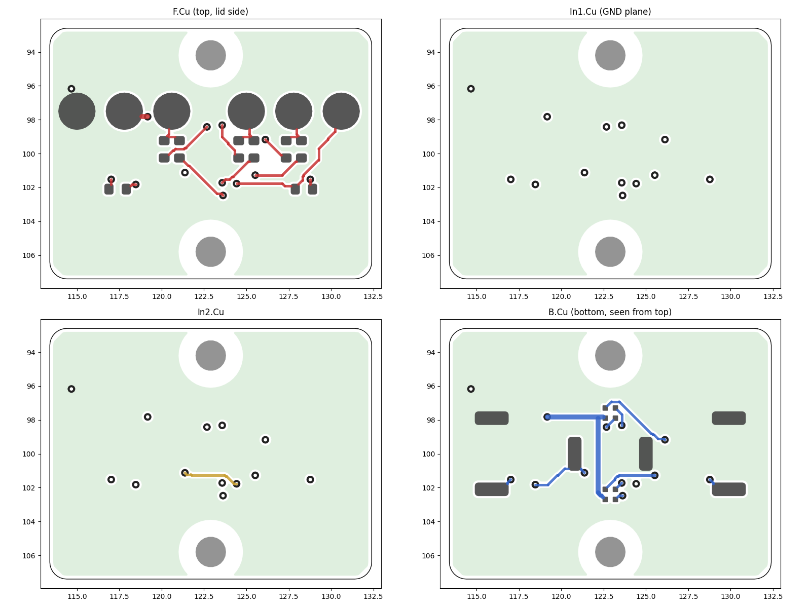

*Figure 14.3 — The routed key board, 19.0 × 14.8 mm: F.Cu (top face with the six pogo-pin pads and the eight resistors), In1 (ground plane), In2 and B.Cu (bottom face with the three switches and the two ring LEDs, seen from above). The two large round openings are the screw holes with their keep-outs.*

### 14.3.2 The pogo pins

The pin is the **Harwin P70-1010045R** (LCSC C22100007): surface-mounted, no locating peg (a peg hole would hit the parts on the bottom face), gold-plated, free height 5.0 mm, working height 4.0 mm, rated range 3.7 to 4.2 mm, solid height about 3.5 mm (inferred), plunger Ø0.9 mm, base Ø2.0 mm, 1.17 ± 0.29 N at 4.0 mm, 2 A. LCSC had 100 in stock on 2026-10-21. Two other P70 variants that JLCPCB lists have the wrong height (2.9 mm operating height, or through-hole with 4.6 mm), so they were not used. A cheaper pin (Xinyangze YZ00615050R-08, LCSC C7429459) is priced as an option in the workbook; its plating and whether it has a peg are not stated, so it is not the default (14.9).

**Positions.** The specification put the six pins at a 2.0 mm pitch. A Ø2.0 mm base cannot sit at that pitch: the pads would merge and the pick-and-place caps would collide. The row stays at Y 2.5 mm with a 2.8 mm pitch in two groups of three and a 4.4 mm gap at X 22.9 mm, where the fan-out vias of LED3 run:

| Pin / J6 pad | 1 | 2 | 3 | 4 | 5 | 6 |
|---|---|---|---|---|---|---|
| X (mm, board frame) | 15.0 | 17.8 | 20.6 | 25.0 | 27.8 | 30.6 |
| Net | GND | 3V3 | RGB_R | RGB_G | RGB_B | BTN |

**Pads.** On the key board each pin sits on a Ø2.2 mm copper pad (Ø2.3 mm mask opening, Ø2.0 mm paste). On the main board the targets J6 are Ø1.6 mm ENIG pads with a Ø1.8 mm mask opening and no paste, directly over the pins. The plunger may move 0.80 mm off the pad centre before it leaves the pad; the design allows 0.40 mm.

**Working height.** The pins work between the key board's top face and the main board's bottom face (Z 9.2 mm). The parts are modelled 0.05 mm off the board for the solder, as in the KiCad export, so the pin base sits at Z 5.25 mm and the nominal working height is **3.95 mm**:

| Tolerance item | ± mm |
|---|---|
| main-board ledge height | 0.05 |
| key-board boss top | 0.03 |
| key-board thickness | 0.08 |
| pogo solder joint | 0.03 |
| **Working height** | 3.95 nominal; worst case 3.76 to 4.14; root sum square 3.847 to 4.053 |

The worst case stays inside the rated 3.7 to 4.2 mm with 0.06 mm to spare at both ends. With the spring taken as linear through the free height (1.17 N at 4.00 mm), each pin pushes with 1.229 N nominal, 0.757 to 1.81 N over the height and spring tolerances; all six push the main board up with **7.37 N** (4.54 to 10.86 N). The fit check of the real board models measures 3.96 mm from pin base to pad (the KiCad board is 0.79 mm thick).

### 14.3.3 What changed on the main board

**Parts that moved to the key board.** The 13 parts SW1, SW2, SW3, LED3, LED4, R23, R24, R25, R32, R33, R34, R30 and R31 were removed, and J6 (six target pads, no part to place) was added.

**The power stage.** For 3 A in the LED and up to 3 A from the cell the stage around the LED driver is new (14.6.3 to 14.6.5):

| Part | v0.6 | v0.7 |
|---|---|---|
| U2, LED buck | TLV62585 (SOT-563) | TI TPS62095RGTR, 4 A, VQFN-16 3 × 3 mm with exposed pad (LCSC C139643, JLCPCB Extended part) |
| C22, C23 | – | second 22 µF output capacitor; 10 nF for the buck's charge pump (CP / CN) |
| R16 | 2.0 kΩ | 2.2 kΩ: full scale 3,552 mA instead of 3,235 mA |
| C7, C9 | 100 nF on the buck input; 22 pF feed-forward | removed (the TPS62095 needs no feed-forward; the TLV333 loop sets the dynamics) |
| U6, Q3, R35, R36, C24 | – | cell protection: DW01A (C351410), SE8830A dual MOSFET (C238645), 100 Ω and 100 nF for the DW01A supply, 1 kΩ to its current-sense pin, right beside Q3 (Kelvin sensing, 14.6.5) |
| J2 | cell pads for 28 AWG | two pads 2.4 × 2.5 mm, BAT+ and BAT− (the cell minus, net BATN), each sized for two 24 AWG wires; the 14500 cell uses one per pad |
| R3 | 3.3 kΩ: the charger gives about 280 mA | 2.0 kΩ (UNI-ROYAL 0402WGF2001TCE, LCSC C4109, a JLCPCB Basic part): about 494 mA, the standard charge of the F15; the same footprint and place, the copper unchanged |
| J3 | LED pads for 28 AWG | split for 24 AWG: LED+ on the top face (1.5 × 1.4 mm) between the two front legs of the USB-C shell, LED− on the bottom face (2.2 × 1.8 mm) behind the receptacle, the v0.6 faces |

Of the 56 v0.6 parts that stay on the main board, 35 keep their v0.6 position and rotation; 21 moved: the parts of the power stage itself (U2, L1, RS1, C5, C8, J2, J3 and the feedback resistors) and the parts that made room for it and for the protection (the LDO U5, the laser switch Q1, the thermistor RT1, now on the bottom face, and several resistors; counted by comparing the two board files). On the bottom face U6 sits right above Q3, both turned the same way, so that the two gate lines run straight. The protection is Kelvin-sensed: R36 sits right beside Q3's P− pin and its ground end joins that pin alone with a 0.25 mm track; the DW01A's ground pin reaches Q3's BATN pin on its own 0.25 mm track, two vias and an In2 track; the BAT− pad is tied to Q3 by one 1.0 mm bottom track and nothing else, so no load current flows in either sense track (14.6.5). JLCPCB places 60 parts on the main board; the other three are the wire pads J2, J3 and J5.

**Routing.** The main board was routed again from the start by the same router, with the power paths drawn first by hand: wide pours and groups of vias for VBAT, the ground return, LED+ and LED−, and one 1.0 mm track for the cell minus. A revision after the second release review added the Kelvin sensing and gave the ESP32 module's ground pad its 4 thermal vias back (as on v0.6); the same parts, the BOM unchanged, R36 moved. The result has 894 track segments, 503 mm of track, 97 vias and 11 copper zones (counted from the board file; the first v0.7 layout: 973 segments, 477 mm, 105 vias). The PCB work worked out the copper from the routed board (estimates): the path from the battery pad to the buck input, mostly a 2.0 mm then 1.5 mm wide strip in the inner layer In1 with via groups at both ends, has about 11 mΩ (33 mV and 0.10 W at 3.0 A); the return to Q3 through the In1 ground plane about 4 mΩ with the vias (3.8 squares; 6.4 before the revision); the BAT− track about 0.6 mΩ; LED+ and LED− about 2 and 1 mΩ. That is enough for 3.0 A turbo bursts and the sustained level. The weakest piece is the 1.5 mm inner strip, with an estimated local rise of 15 to 20 °C at a continuous 3 A and a few degrees at 1.5 A; JLCPCB's option of 1 oz inner copper halves its resistance, and the board does not need it.


*Figure 14.4 — The hand-soldered pads of the main board by polarity: on the top face J3 LED+ between the two front legs of the USB-C socket; on the bottom face J3 LED− behind the socket, the cell pads J2 (BAT+ and BAT−, one 24 AWG wire each from the nickel strips of the cell), the laser pads J5 and the six round J6 pads, where the pogo pins of the key board make contact (a drawing, not a photo; the real board is black). J6 pad 1 (GND) is the one nearest the front end, pad 6 (BTN) the one nearest the rear.*

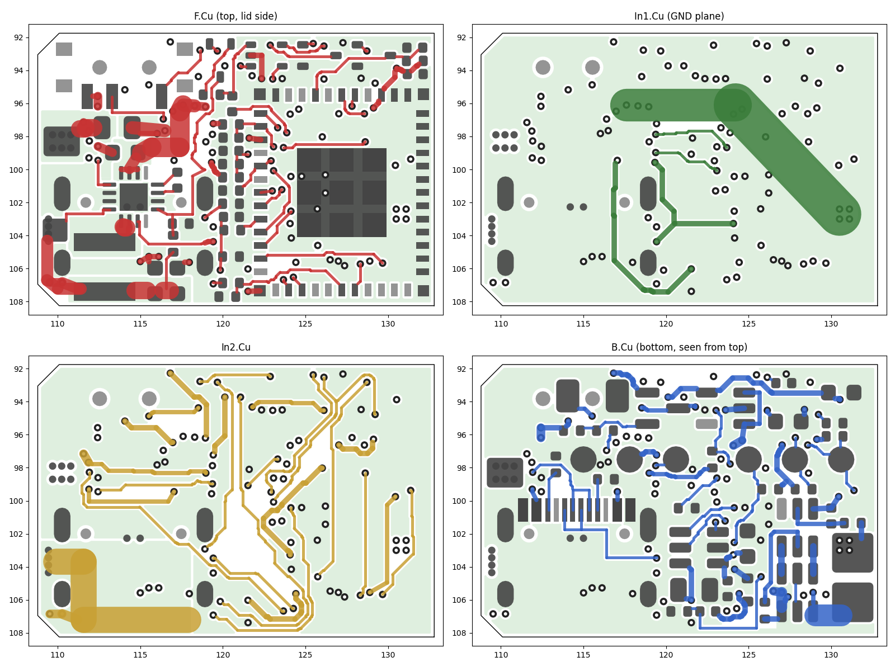

*Figure 14.5 — The routed main board, 24 × 16.5 mm: F.Cu (top, lid side, with the buck U2 and the wide LED+ pour), In1 (ground plane with the battery strip and the small signal box), In2 and B.Cu (bottom, seen from above, with the six J6 pads in a row and the protection U6 / Q3 near the cell pads).*

### 14.3.4 The netlist check across both boards

`tools/kicad/verify_v07.py` joins the two routed boards through the six J6 / P pairs and compares the result with the v0.6 netlist:

* every J6 pad lies over the pin of the same number, on facing faces, with the same net, offset 0.000 mm;
* the joined boards have exactly the 44 nets of v0.6, with the same pins per net, once the pins of the power-stage parts are left out; those 38 pins (C22, C23, C24, J2, Q3, R35, R36, U2, U6) are checked against their intended connections instead, and all match, including the open pins and the removed C7 and C9;
* the v0.7 schematic netlist and the two boards have the same 52 nets;
* all 71 v0.6 parts except C7 and C9 are on one of the two boards; their values and footprints are unchanged apart from the power stage (U2, R16 and the wire pads J2 and J3) and R3 (2.0 kΩ for the charge current); the new items are C22, C23, C24, J6, P1 to P6, Q3, R35, R36, U6 and the two screw holes;
* six nets cross the contact (GND, 3V3, RGB_R, RGB_G, RGB_B, BTN); eight nets exist only on the key board (the ladder and LED cathode nets).

### 14.3.5 The panel

`tools/kicad/panel_jlc.py` builds the panel with KiKit 1.5.1 (KiKit 1.8 uses the layer numbering of KiCad 9, not KiCad 7):

* key board on the left, main board on the right, a 2.0 mm routed gap between them and to the rails; the main board's rear edge, where the module antenna overhangs the board by 5.6 mm, is the free right edge of the panel, so nothing of the panel sits under the antenna;
* 6 mm rails at the top and the bottom (JLCPCB asks for at least 5 mm), three fiducials (Ø1.0 mm copper, Ø2.0 mm mask opening, both faces) and four Ø1.152 mm tooling holes on the rails;
* tabs 4 mm wide, two per long edge of each board, placed clear of the S2 knob, the USB-C opening and the key board's screw bosses; mouse bites Ø0.5 mm at 0.8 mm pitch, centred 0.3 mm outside the board edges, so the builder files 0.3 mm nubs flush after breaking the boards out.

JLCPCB lists 70 × 70 mm as the smallest panel for Standard assembly, so its review may add its own rails (14.12).

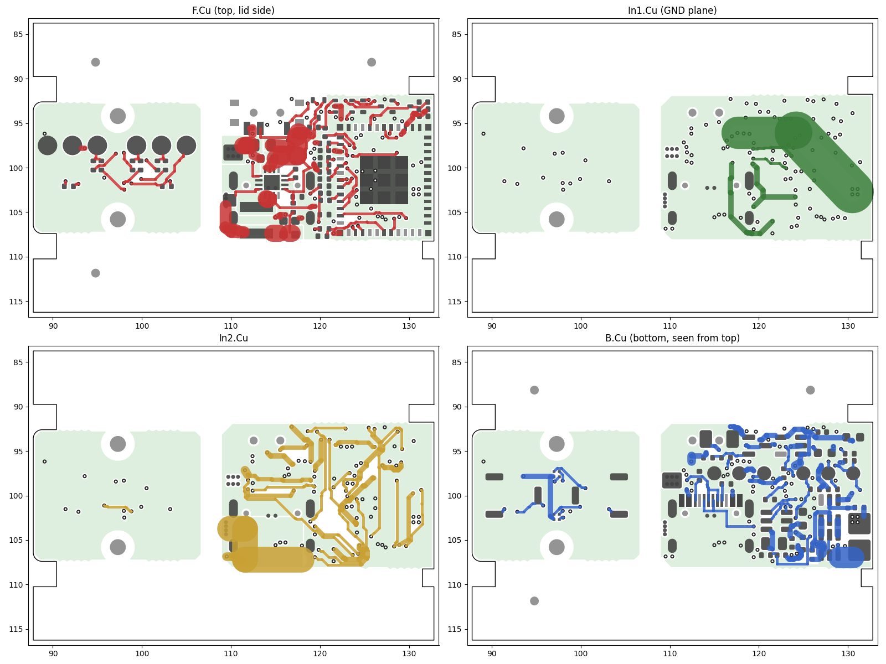

*Figure 14.6 — The panel, 45.0 × 32.5 mm, in its four copper layers: key board on the left, main board on the right, the rails with fiducials and tooling holes at the top and the bottom, and the tabs with their mouse bites.*

**Cost.** In the cost workbook the JLCPCB order is $236.90 for one light before shipping and VAT (v0.6: $174.33; the first v0.7 layout: $228.66): bare panels and the two-design surcharge $45.00 (estimate), assembly fees $145.15 (set-up $51.12, feeder loading $53.55, stencils $16.42, X-ray $13.12, panel fee $8.21, the rest $2.73) and parts $46.75, with 35 BOM lines, 79 placements and 267 solder joints per panel (v0.6: 34 lines, 68 placements, 232 joints). The buck U2 is a QFN, so four parts per panel need X-ray inspection instead of three.

## 14.4 Keys

### 14.4.1 Layout and the bezel

All three keys sit on the centre line of the bottom face (Y 0) at X 18.65 / 25.65 / 32.65 mm (board frame 15.9 / 22.9 / 29.9 mm): ^ next, ● main, v previous. They share one stadium-shaped bezel, 0.5 mm deep with 45° walls, X 15.75 to 35.55 mm, 11.6 mm wide at the face. Each key is a loose part, held between the floor (its flange sits on the inner face of the floor) and its switch, like the caps of v0.6.

The key faces stay inside the bottom-face plane: the main key 0.15 mm, the side keys 0.30 mm, and the top of the 0.2 mm chevron 0.10 mm. A table or a flat surface cannot press a key: the keys are recessed, as [MEC-6](../../../docs/design-rules.md#mec-6) asks (v0.6 had proud domes, chapter 13 deviation 11). The main key stands 0.35 mm proud of the bezel floor, the side keys 0.20 mm and their chevrons 0.40 mm (calculated).


*Figure 14.7 — The bottom face (render), tail with the lanyard slot on the left, head on the right. Seen this way the chevron of the next key points right, to the head, and that of the previous key left, to the tail. The darker panel behind the previous key is the textured POM-C plug of the floor RF window. No screw or hole shows near the head: the laser set screw sits under the lid (14.5.1).*

### 14.4.2 The main key: a clear PMMA light guide

| Item | Value |
|---|---|
| Material | clear cast PMMA (not extruded), CNC, vapour or flame polished on every face; the frosted ring is the only diffuse area |
| Size | 6.8 × 6.8 mm, corners R1.0, 2.75 mm tall; flange 7.6 × 7.6 × 0.45 mm; edges C0.15 |
| Inside | a pocket 4.4 × 3.4 × 1.2 mm round the switch body, with a nub Ø1.6 × 0.5 mm that presses the switch |
| Frosted ring | on the outer face, Ø4.4 mm mean (Ø3.9 to Ø4.9 mm), 0.5 mm wide, 0.03 mm deep |
| Light path | the two ring LEDs at Y ±2.4 mm shine down into the key's top face, 0.6 mm above it at rest; the light leaves through the frosted ring |
| Opening in the floor | 7.0 × 7.0 mm, R1.1: 0.1 mm per side |
| Care | water and mild soap only: solvents and alcohol craze PMMA, and cyanoacrylate vapour leaves a white bloom |

The pocket clears the switch body by 0.25 mm at full travel. The gap between the LEDs and the key is 0.6 mm at rest and 0.2 mm at full travel, worked out with the worst-case LED height of 0.85 mm (14.4.4).

### 14.4.3 The side keys: cast rubber with a stainless stiffener

| Item | Value |
|---|---|
| Material | black urethane rubber, Shore A 80 (75 to 85), one piece, no insert, no pocket, no nub; matte face, glossy chevron top |
| Size | 4.2 × 10.0 mm, corners R1.5; flange 5.2 × 11.0 × 0.45 mm |
| Chevron | raised 0.2 mm, 90°, stroke 0.6 mm, 1.8 mm along the body and 3.0 mm across, apex along the body (14.2.9) |
| Recess in the inner face | 3.8 × 9.6 mm, R1.0, 0.47 mm deep |
| Stiffener | plate 3.6 × 9.4 × 0.3 mm with its four corners cut 0.8 mm × 45° (outline +0 / −0.2 mm), and a doubler 2.0 × 2.0 × 0.3 mm (±0.2 mm) glued on its centre; stainless shim 1.4301, cyanoacrylate |
| Height | doubler top at Z 2.10 mm, 0.15 mm above the inner face; flange underside to doubler top 0.6 ± 0.11 mm worst case. The doubler presses the switch |
| Opening in the floor | 4.4 × 10.3 mm, R1.6: 0.1 mm per side and 0.15 mm at the ends |

**Pressed near one end.** A wide key is pressed anywhere along its length, often near an end. It is modelled as a rigid rocker that pivots on the far end of its flange, with the doubler on the switch: the pivot is 5.5 mm from the switch and the finger 3.0 mm beyond it (2.0 mm from the near end of the key). The rubber is taken as linear with E = 9.4 MPa (Shore A 80, after Gent).

| Pressed 2.0 mm from the end | With the stiffener | Rubber only |
|---|---|---|
| Force at the click | 1.035 N (the pivot takes 0.565 N) | – |
| Key travel at the click | 0.729 mm (0.806 mm at full travel, 0.992 mm with the free play at its root-sum-square maximum) | 3.933 mm |
| Near end of the key | rises 0.9 mm and stays 1.55 mm below the key board (1.45 mm at full travel, 1.21 mm at the root-sum-square maximum) | rises about 5.09 mm: it would touch the key board |
| Key end in its opening | shifts 0.082 to 0.113 mm in its 0.15 mm end gap | – |

With the stiffener the key rocks as one stiff part and clicks wherever it is pressed; the plate itself bends 0.0169 mm at the press point. Without it the rubber bends by more than the whole switch travel and would feel soft at the ends.

### 14.4.4 Key travel and the tolerance stacks

| | Main key | Side keys |
|---|---|---|
| Free play at rest (nub or doubler to the switch tip) | 0.15 mm | 0.25 mm |
| Full travel (free play + 0.25 mm switch travel) | 0.4 mm, no contact before | 0.5 mm, no contact before |
| Clearance at full travel | pocket floor 0.25 mm below a full-height switch box | doubler top 0.15 mm and plate top 0.45 mm below the switch body |
| Tolerance items (± mm) | switch height 0.1, switch solder 0.03, boss top against floor seat 0.03, floor seat 0.03, key length 0.03 | the same four, plus the cast recess floor 0.05, two shims 0.04, glue films 0.02 |
| Free play, worst case | −0.07 to 0.37 mm | −0.05 to 0.55 mm |
| Free play, root sum square | 0.033 to 0.267 mm | 0.119 to 0.381 mm |

A negative value is a small preload on the switch. For the rubber keys the rubber takes it (a few tenths of a newton per 0.1 mm). For the rigid PMMA key only the worst case, with every tolerance at its limit at once, goes below zero, and it stays below the click of the switch (about 0.20 mm). The LED gap at full travel does not depend on the floor or the key-board height: it is the switch height, minus the travel, minus the LED height, minus the depth from the key top to the nub. It is 0.2 mm nominal, 0.051 mm at the root-sum-square minimum and −0.08 mm in the worst case with 0.85 mm LEDs; typical LEDs are lower, which only makes it larger. Both worst cases are open points for the first build (14.12).

### 14.4.5 The casting moulds (FK-H-08)

The builder casts the side keys in a two-plate mould, a tool that is ordered once. Both versions have the same cavities, so the keys come out the same:

* **Resin (the cheap default).** Two SLA resin plates that JLC3DP prints from the STL files, 48 × 28 mm, the cavity half 6.0 mm and the lid 5.0 mm thick, each with a ribbed back (model volumes 6.24 and 4.82 cm³; about $3.32 together, estimate). Two printed pins Ø4.0 mm on the cavity half fit two sockets Ø4.2 mm in the lid (offset, so the lid fits one way only); four M3 × 16 socket head screws with washers and nuts go through both plates, so the resin carries no thread. It is printed with the parting face up, so the supports touch only the ribbed back. JLC3DP ships it in the same parcel as the JLCCNC parts (14.9).
* **Aluminium (the durable option).** Two 6061-T6 plates, 48 × 28 × 8 mm (the lid 8.47 mm with its plateaus), above JLCCNC's 30 × 20 × 8 mm minimum, ±0.02 mm on the cavities; two pressed dowel pins (2 mm m6 × 8 mm, standing 3.0 mm above the parting face, offset), four M3 × 12 socket screws; the cavity half is bead-blasted for a matte key face. It lasts for many pours and costs $40.27 more, landed, than the resin mould.
* **Four cavities, key face down.** One pour gives four keys, two for the light and two spares. The cavity half holds the keys face down, so the chevron is a groove in the cavity floor (Ø0.6 mm end mill in the aluminium mould, R0.3 mm, the smallest internal radius) and bubbles rise away from the visible face. The parting plane is the inner face of the key; the lid's four plateaus (3.8 × 9.6 mm, R1.0, 0.47 mm high) form the recess for the stiffener.
* **Flow.** Each cavity has a Ø2.5 mm pour hole with a runner and a gate on the near flange end, and a vent groove at the far end with a Ø1.0 mm vent hole through the plateau. Every stub lands on the flange end or on the hidden inner face, never on the key face.
* **Shape.** 1° of draft on the walls. The cap sits 0.04 mm per side under nominal, so the cast cap stays inside its −0.05 / −0.15 mm tolerance at every height. There is no shrink allowance: urethane rubbers of this kind shrink less than 0.001 in./in. (PMC-780 data sheet), 0.011 mm over the 11.0 mm flange.
* **Pour.** The rubber is poured into each open cavity and the lid is closed over it; the pour and vent holes then act as overflows. The four keys need about 0.22 cm³ of rubber; with ECON 80 the builder draws 5 ml of each part into its own syringe (1 : 1 by volume), so no scale is needed. A mould release goes on before every pour (petroleum jelly for Sugru). A print does not hold the aluminium mould's tolerances: the first cast key is tried in its opening, and a rub of the cavity floors with 400-grit paper gives the matte face. The builder polishes the chevron grooves once with a toothpick and metal polish, so that the chevron top comes out glossy. The casting steps with the makers' numbers are in `order_files/3_rubber_keys/README.txt` and in the build guide, section 9.


*Figure 14.8 — The resin casting mould (render). Left: the cavity half with two freshly cast keys and two empty cavities with their chevron grooves, the printed pins and the pour and vent channels. Front: a key face up and one turned over with its plate and doubler glued in. Right: the lid, turned over; its plateaus form the recess in each key.*

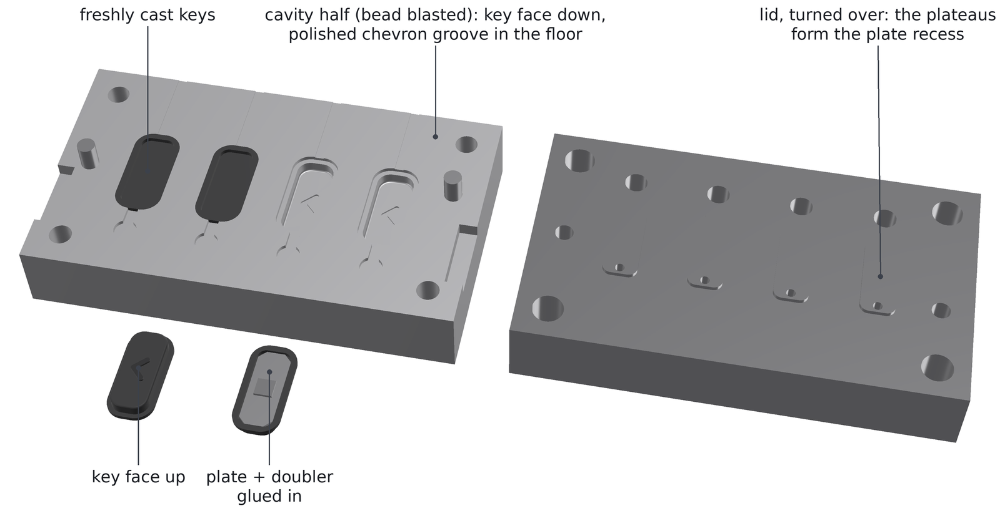

*Figure 14.9 — The aluminium casting mould, the durable option (render): the same cavities, the bead-blasted cavity half with its polished chevron grooves and two dowel pins, and the lid.*

The mould checks: every plate is one valid solid; closed, the halves do not overlap; rays from 448 points on 132 cavity faces (+Z) and from 112 points on 36 plateau faces (−Z) find no undercut in either mould; a 3-axis mill reaches every face of the aluminium plates in two set-ups (588 + 216 points, none blocked); the resin keeps at least 2.0 mm between a cavity and the back pockets and 1.25 mm round every hole. The cast key, computed from the mould, is 4.086 mm wide near the face and 4.12 mm at the flange step (tolerance 4.05 to 4.15 mm) and 9.886 / 9.92 mm long (tolerance 9.85 to 9.95 mm).

## 14.5 Housing

### 14.5.1 Parts

| Part | Material | Mass (calculated from the solids) |
|---|---|---|
| Tray | 6061-T6, bead blast, black anodise | 22.487 g |
| Lid | 6061-T6, bead blast, black anodise | 8.426 g |
| Lid RF window insert | POM-C black | 0.166 g |
| Antenna spacer with the floor plug | POM-C black | 1.164 g |
| Main key | clear cast PMMA | 0.134 g |
| Side key (2) | urethane rubber Shore A 80 | 0.064 g each |
| Stiffener, plate + doubler (2) | stainless shim 0.3 mm | 0.087 g each |
| Laser sleeve (option) | POM-C black | 0.156 g |

All housing parts together weigh 32.7 g (calculated; 32.8 g with the optional laser sleeve). With the optic (0.575 g) and the copper LED board (1.126 g), the cell (about 22 g, the maker's figure) and the electronics (about 5.8 g, an estimate) the light weighs about 62 g; it has not been weighed. Bought parts: the TIR optic, the cell with two nickel strips, four M1.6 × 6 countersunk lid screws, two M1.6 × 2.5 pan-head key-board screws, an M1.6 × 5 set screw for the laser (ISO 4026 flat point or ISO 4029 cup point, 0.7 mm hex key), a 1.5 mm silicone gap pad and a 1.0 mm silicone rubber sheet for the hold-down pads, polyimide tape and 0.5 mm foam sheet for the cell.

**Laser retention.** v0.6 and the first v0.7 design held the laser module with an M2 set screw from the bottom face, which showed as a dot near the head. The M1.6 × 5 set screw now goes in from the top of the head block at X 5.5, Y 4.8 mm, under the front end of the lid, and is fitted while the lid is off. It sits 1.05 mm to the −Y side of the laser axis; its hole lies 0.5 mm behind the lid edge (X 4.2 mm), and its thread keeps 3.05 mm to the thread of the front lid screw, which moved back to X 10.14 mm for the optic. The thread runs 5.836 mm from the head-block top into the laser bore; the screw point meets the module 12.5° off its top, and the screw top stays 0.771 mm below the head-block top (Z 14.6 mm), so the lid closes over it. A ray scan of the closed light (10,873 rays from below, 11,798 from above) finds no hole deeper than 0.6 mm apart from the key openings, the joints of the two RF plugs, the tail window and the four lid screws.


*Figure 14.10 — Exploded view (render). Lid with four M1.6 countersunk screws and the RF window insert; the 14500 cell with its nickel strips; the hold-down pads; the main board; the antenna spacer; the key board with its six pogo pins and two M1.6 × 2.5 screws; below the tray the main key, the two side keys and their stiffener plates; at the head the LED on its 10 mm DTP board, the LEDiL TIR optic, the laser module and the optional sleeve, and above the head block the M1.6 × 5 laser set screw.*

### 14.5.2 The floor: bosses, ribs and openings

* **Floor.** 1.5 mm thick, 1.0 mm under the bezel; webs of 1.3 mm between the key openings.
* **Key-board bosses.** Two Ø3.4 mm bosses at (25.65, ±5.8) mm, joined to the walls of the trough, top at Z 4.4 mm. Each has a blind M1.6 thread: tap drill Ø1.25 mm to Z 2.025 mm (its point reaches Z 1.6495 mm), full thread down to Z 2.55 mm. The M1.6 × 2.5 pan-head screw engages 1.7 mm of thread, and 1.649 mm of metal stays under the drill point. The wall round the thread is 0.9 mm and the thread to the bezel 1.254 mm.
* **Ribs.** Four ribs 1.4 mm wide at X 18.65 and 32.65 mm (\|Y\| 5.9 mm to the wall; at −Y, X 18.65 mm a free post in the gap of the USB-C opening) carry the edges of the key board, right beside the side switches.
* **Floor RF window.** 5.1 × 10.8 mm, R1.5, at X 36.35 to 41.45 mm, filled flush by the textured POM-C plug of the antenna spacer, so it reads as part of the panel and not as a fourth key. The lid has its RF window at X 34.55 to 41.45 mm (6.9 × 10.8 mm). Both fill the width of the bottom and top panels (\|Y\| ≤ 5.4 mm; 14.0 mm on the rectangular body). The module antenna spans X 35.55 to 40.95 mm; across it, Y −5.4 to 5.2 mm of the module's −8.0 to 5.2 mm is free of metal, while the strip from −8.0 to −5.4 mm now has aluminium round it (the floor corner, the side wall, the lid seat and the diagonal wall): the radio range is to be checked on the first light (14.12).
* **Cell rails.** Two rails 1.2 mm wide and 1.1 mm high (top Z 2.6 mm) run along the floor of the cell bay from X 44.75 to 90.35 mm, their inner edges at \|Y\| 3.5 mm; the cell lies on them (14.6.4).

### 14.5.3 Hold-down against the pogo pins

A key press now pushes on the key board, which is screwed to the floor, and no longer lifts the main board. In v0.6 the switches sat on the main board, and a hard press lifted it up to 0.121 mm (chapter 13, deviation 8). What the hold-down has to resist in v0.7 is the constant push of the six pogo pins: 7.37 N nominal, up to 10.86 N. Pins 1 and 2 sit right under the front hold-down area of v0.6.

Two lid bosses press the board down through bought pads:

| Pad | Boss | Pad | Compressed to | Preload (nominal) |
|---|---|---|---|---|
| on the module can | 8.8 × 12.4 mm (X 24.85 to 33.65 mm) | 1.5 mm silicone gap pad, Shore 00 70 to 80 (E taken as 1.0 MPa) | 1.15 mm (23.3 %) | 25.26 N |
| at the front | 3.7 × 3.0 mm (X 18.4 to 22.1 mm, Y 0.25 to 3.25 mm) | 1.0 mm silicone rubber sheet, Shore A 70 (E taken as 5.3 MPa) | 0.75 mm (25 %) | 14.42 N |

The front boss is 0.2 mm narrower than in the first v0.7 layout, so that it keeps clear of the new buck U2 beside it: 0.435 mm with the board centred, 0.195 mm with the board at the +Y wall. A plate model (a Mindlin plate of the 0.8 mm board on its ledges, the pads as springs, the pins as point loads; FR-4 with E 20,000 MPa) gives:

| Case | Preload | Pin force | Largest lift off the ledges | Limit |
|---|---|---|---|---|
| Nominal | 39.68 N (5.38 times the pin force) | 7.37 N | 0.0004 mm; the board leaves the ledges at 3 times the pin force | 0.02 mm |
| Soft (pads 30 % softer, gaps +0.1 mm, pins at their maximum) | 18.69 N | 10.86 N | 0.0006 mm | 0.02 mm |
| Hard (pads 30 % stiffer, gaps −0.1 mm) | 68.47 N | 7.37 N | 0.0008 mm | 0.02 mm |
| Without the front boss | 25.26 N | 7.37 N | 0.0894 mm: **not met** | 0.02 mm |

So the front boss stays (the specification allowed its removal), and the main board keeps a top-side keep-out under it (board frame X 15.6 to 19.4 mm, Y 0.2 to 3.3 mm). The front pad is compressed 25 % instead of 20 %: with 20 % the soft case lifted the board 0.0217 mm once the 0.05 mm solder stand-off of the pins was included. Over the tolerance stack the can pad gap is 0.86 to 1.44 mm (4.0 to 42.7 % compression) and the front pad gap 0.56 to 0.94 mm (6 to 44 %). The pad moduli come from the Shore hardness and are assumptions; the soft and hard cases bound them.


*Figure 14.11 — The open tray from the lid side, head on the left (render). The head block with the TIR optic, the LED board and the laser; the S2 slide switch; the hold-down pads drawn where the lid bosses press; behind the board the RF-window zone over the antenna, then the 14500 cell on its two rails and the lanyard slot.*

### 14.5.4 The octagonal body

The body is a faceted octagon, 20 mm wide, 18 mm high and 99.2 mm long (tray and lid), in 6061-T6 aluminium, bead-blasted and black anodised, without any marking; section 14.2.10 says why. The board zone keeps the inside width of the rectangular body (17.0 mm between straight walls up to Z 14.6 mm), so both boards fit without any change.

* **Facets.** Eight flat facets with 45° legs of 3.4 mm: the bottom facet (the key face) and the top facet (the lid) 13.2 mm wide, the side facets 11.2 mm high, the four diagonal facets 4.81 mm wide; outline perimeter 68.0 mm, section 336.9 mm². Front outline C0.4, tail outline C0.6, two tail facets 2.0 mm × 45°, and a tail window 4.1 × 10.8 × 1.0 mm round the lanyard slot on the bottom facet.
* **Lid.** The lid is the cap above Z 14.6 mm, the plane that meets the outside exactly at the edges between the side facets and the upper diagonal facets: the joint follows a facet edge and needs no lip. The cap carries the top facet and the two upper diagonal facets, 3.4 mm tall, from X 4.2 mm to the tail. Over the cavity (X 11.45 to 93.35 mm) it is pocketed from below: a 1.5 mm plate, 45° walls 1.5 mm thick under the diagonal facets and a flat seat 2.121 mm wide on each 1.5 mm tray wall. Over the head and the tail blocks it is solid, and there the four countersunk M1.6 × 6 screws (X 10.14 and 95.95 mm, Y ±4.5 mm) pass through its 3.4 mm into 2.6 mm of thread. The tray walls rise straight to Z 14.6 mm, so the main board still drops in from above. The seat must be flat to 0.05 mm (FK-H-02), or a gap shows along the facet edge. With its two hold-down bosses the lid is 7.25 mm tall.
* **Lanyard slot.** 3.6 × 4.6 mm with C0.25 (the rectangle had 4.2 × 7.6 mm): the top facet is 13.2 mm wide and the rear lid screws sit 0.45 mm inside it at Y ±4.5 mm, so the slot was shortened until each rear countersink keeps a 0.3 mm land to the slot chamfer on the top face, an edge to break lightly and not a wall. It takes a split ring or a thin cord.
* **Panels.** Recessed 0.3 mm, corners R0.8, with 1.2 mm rails along the facet edges and 1.2 mm frame bands, on the bottom, top and side facets: three on the lid, two on the bottom facet and three on each side, laid out round the key bezel, the RF windows, the USB-C and S2 openings and the screw holes; the bottom and top panels reach \|Y\| 5.4 mm, the side panels Z 4.6 to 13.4 mm. The diagonal facets (2.4 mm between two rails) are too narrow for a panel and stay plain between the grooves.
* **Texture.** 90° V grooves 0.2 mm deep (0.4 mm wide, 0.5 mm lands), pitch 0.9 mm, at 45° on one grid per face. The POM-C RF window inserts carry the same texture and read as panels. The texture adds 625.2 mm² of face area; it is a priced option in the workbook (14.9).
* **Grooves.** Transverse 90° V grooves 0.3 mm deep and 0.6 mm wide at X 1.5 / 2.7 / 3.9 mm (head: top, bottom and diagonal facets; the optic and laser bores leave too little metal under the side facets) and X 87.95 / 89.15 / 90.35 mm (tail, all round), like the rings of the RovyVon Aurora A2.
* **Metal left.** At least 1.0 mm under every panel, 1.076 mm under the tray tail grooves, 1.2 mm under the lid tail grooves and 1.352 mm under the head grooves (limits: 0.9 mm over the cell bay, 1.0 mm elsewhere).
* **Finish.** The order on the drawing: machine the body, then the panels with a flat end mill, then the texture and the grooves with one 90° V engraving cutter, then a fine glass-bead blast and black anodise type II (8 to 12 µm). No marking of any kind. If a shop cannot cut the texture, the parts still fit and work.
* **Mass and heat.** Tray 22.487 g and lid 8.426 g: 30.91 g of aluminium (28.44 g in the rectangular body). The closed light has 7,382.1 mm² of outer surface, 6,886.3 mm² of it aluminium, so it sheds a little more heat than the rectangle (13.2 K/W to still air instead of 13.33 K/W; 14.6.7).


*Figure 14.12 — The control side (−Y) with the USB-C opening near the head (render): the side facet with its three panels, the diagonal facets and, on top, the lid with its textured panels, the RF window insert and the four countersunk screws.*


*Figure 14.13 — The lid from above (render), head on the left: three textured panels, the textured POM-C RF window insert over the antenna, the screws and the lanyard slot.*


*Figure 14.14 — The laser side (+Y), head on the right (render). Near the head the slot of the slide switch S2: there are no SAFE and ARM marks any more.*


*Figure 14.15 — The front (render): the octagonal outline, the laser module on the left, the TIR optic with the LED behind it on the right, set 0.2 mm into the head, and the USB-C opening in the side facet.*

### 14.5.5 Machining kits (FK-H-06, FK-H-07)

Each kit is one solid: a frame with one through-pocket per part, every part hanging on small tabs in one tab plane, machined from the top and from the bottom on a 3-axis mill. The tab witnesses lie on hidden faces that locate nothing.

| Kit | Size | Parts | Tabs |
|---|---|---|---|
| `FlashKa_pmma_kit.step` (FK-H-06), clear cast PMMA | 52.8 × 22.0 × 8.5 mm | three main keys (one light and two spares), outer face up | 9 tabs 0.6 mm wide, as high as the flange (0.45 mm), 3.0 mm long, on the free flange edge; never on the outer face or the frosted ring |
| `FlashKa_pom_kit.step` (FK-H-07), POM-C black | 45.4 × 39.3 × 17.0 mm | two lid RF window inserts (one spare) and the antenna spacer (15.85 mm tall, upright, floor plug up) | 9 tabs 0.6 × 0.6 mm, 3.0 mm long (antenna spacer 5.0 mm) |

The checks: both kits above the 30 × 20 × 8 mm minimum, one valid solid each, 3.0 mm gap between part and frame (4.917 mm round the antenna spacer, for its 12.5 mm deep cut), volume balance exact, the parts identical to the single files, and two-set-up reach from 652 + 786 points on 210 + 243 faces with none blocked. For the octagon the RF insert became narrower (flange 8.3 × 12.2 mm) and the antenna spacer 2 mm taller, so the POM-C kit changed its size; it holds the same three parts. Two small changes made the kits possible: the lid insert's flange has 0.10 mm per side in its pocket (its plug alone locates it, so the flange edge can carry tabs), and the cell-wire channel of the antenna spacer is open to the top. The optional laser sleeve stays a single part, because its slit along the axis needs a side set-up. The PMMA kits needed are (lights + 1) ÷ 3, rounded up; one POM-C kit per light. Without the window there is no spacer ring any more, so the POM-C kit has one part type less than in the first v0.7 layout.

### 14.5.6 Fit check with the real boards

`tools/housing/fit_pcb.py` places the STEP models of both routed boards (main board: 58 solids plus stand-ins for U4, J1 and L1; key board: 20 solids; the pogo pins split into barrel and plunger) in the housing, moved 2.75 mm back from their board frame:

* **Key board.** 0 collisions with the housing parts. Clearances: SW1 to the main key 0.150 mm, SW2 and SW3 to the side keys 0.250 mm (the free play), LED3 to the tray 1.200 mm, key board to the antenna spacer 0.550 mm.
* **Main board centred.** 0 collisions; the plungers end on the J6 pads (offset 0.0 mm) and touch no part. Smallest clearances: J1 to the tray 0.211 mm, U2 to the lid (the front boss) 0.435 mm, key-board R30 to J1 0.400 mm, pogo pin P6 to R9 0.460 mm; the optic and the LED stay 4.420 mm and the LED board 2.820 mm from the main board.
* **Main board pushed to a side wall (0.24 mm).** A contact sliver of 0.0013 mm³ (not a collision) where the chamfered front corner of the board meets the cavity corner at X 12.0 mm; the real side play is 0.236 mm (the new front corner reliefs). At the +Y wall U2 keeps 0.195 mm to the front boss, at the −Y wall P6 comes within 0.295 mm of R9.
* **Free travel of the main board.** ±Y 0.236 mm, +X 0.149 mm (antenna spacer), −X 0.062 mm, +Z 0.393 mm (S2 knob in its slot).
* **Insertion.** The board is tilted about the S2 side and lowered over the key board in 12 steps from 9° to 0°: no hit above 0.002 mm³ in any of the 13 poses; none of the 28 bottom-side parts meets a plunger. The board meets the plunger tips from 9° on and compresses them.
* **Wires.** The paths of the LED+ and LED− wires and of the two cell wires (24 AWG, Ø1.05 mm, as solids: BAT− from the far end along the lower −Y corner of the bay, BAT+ from the front strip in the antenna-spacer rebate, both under the board to J2) hit nothing on either board, in the housing or on the cell; nearest board items 0.207, 0.538, 0.346 and 0.077 mm (the board's underside: the wires run along it to J2). The cell keeps 1.2 mm from the module U4, its front strip 1.0 mm and its front solder joint 1.9 mm.
* **Installed assembly** (`assemble.py`): main board × housing 0, key board × housing 0, main board × key board 0.

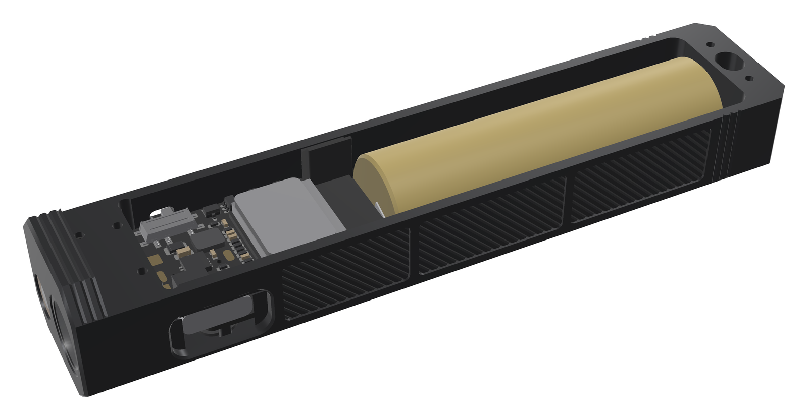

*Figure 14.16 — The open tray (render) with the real routed main board, the antenna spacer and the 14500 cell on its rails.*

### 14.5.7 Drawings

Nine sheets: FK-H-01 tray (two sheets), FK-H-02 lid, FK-H-03 main key, FK-H-04 side key with its stiffener, FK-H-05 POM-C parts, FK-H-06 PMMA kit, FK-H-07 POM-C kit and FK-H-08 casting moulds. Each title block carries "FlashKa Keychain v0.7", the date 2026-10-23 and the STEP file name(s). `drawings.py` checks every printed number against the parameter table `P` (574 entries, 441 distinct numbers, 0 differ) and against the solids with 74 ray probes (0 differ), and finds 0 layout faults.

<!-- landscape -->


*Figure 14.17 — Tray, sheet 1 of 2 (FK-H-01): top view without the lid (with the two cell rails), the octagonal front view, side views, sections A-A (along the optic axis), B-B (the key-board bosses), C-C (the front lid taps and the LED wire holes), D-D (the laser set screw) and E-E (the optic bore with its two wire grooves), the feature table and the notes (6061-T6, anodise type II, ISO 2768-mK, the walls below 0.8 mm and none below 0.5 mm, blind key-board threads).*

<!-- landscape -->
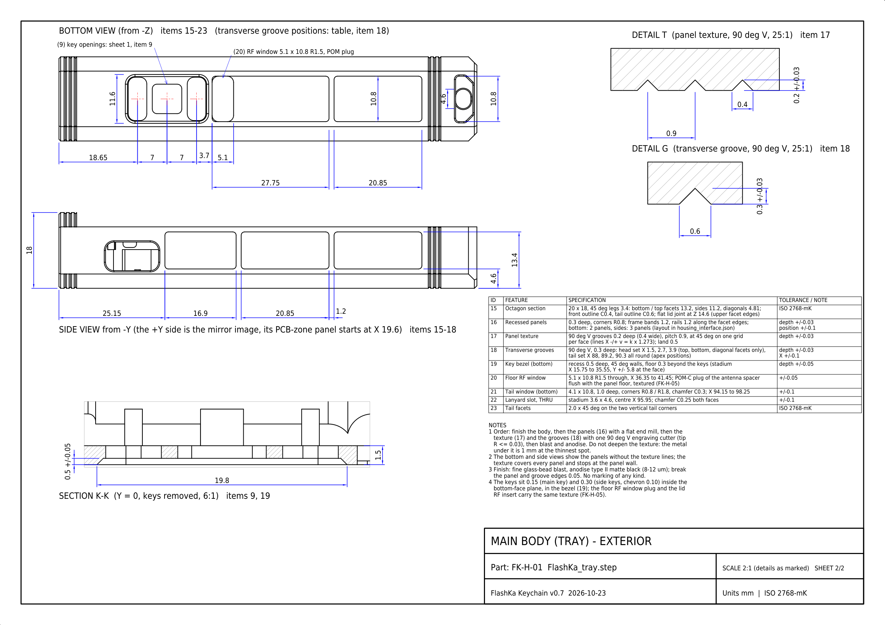

*Figure 14.18 — Tray, sheet 2 of 2 (FK-H-01): the bottom view with the key bezel, the three key openings and the floor RF window, the side view with the panel layout, the details of the texture and of a transverse groove, section K-K through the bezel and the exterior feature table.*

<!-- landscape -->
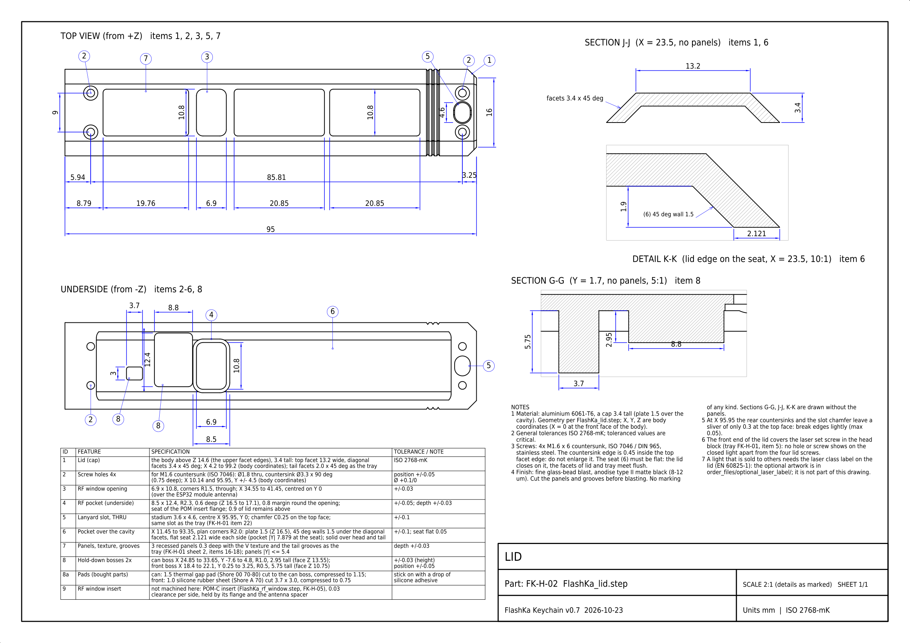

*Figure 14.19 — Lid (FK-H-02): top view, underside with the pocket and the two hold-down bosses, section J-J through the cap with its facets and 45° walls, detail K-K of the lid edge on its flat seat and section G-G through the bosses. Note 5 asks to break the edges where the rear countersinks meet the slot chamfer, note 6 says that the front end of the lid covers the laser set screw, note 7 when the optional laser label is needed.*

<!-- landscape -->
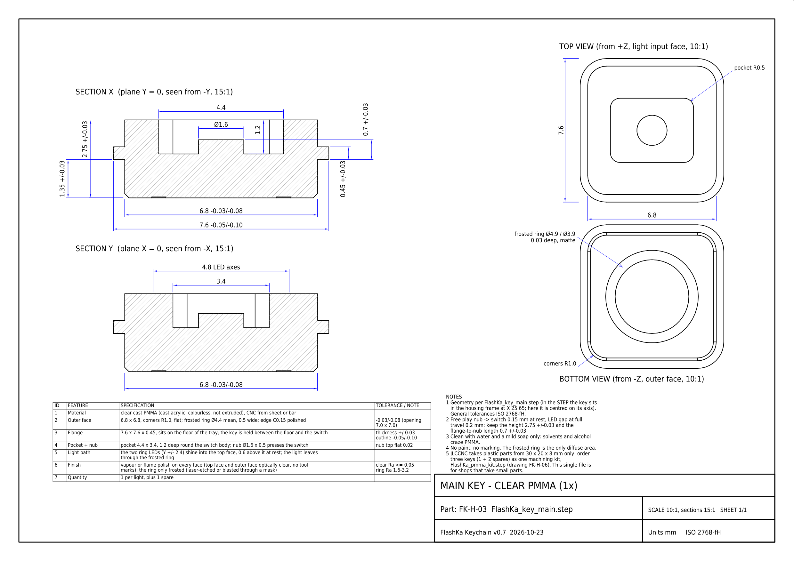

*Figure 14.20 — Main key (FK-H-03), clear PMMA: sections through the pocket and the nub, the top view (light input face) and the bottom view with the frosted ring.*

<!-- landscape -->
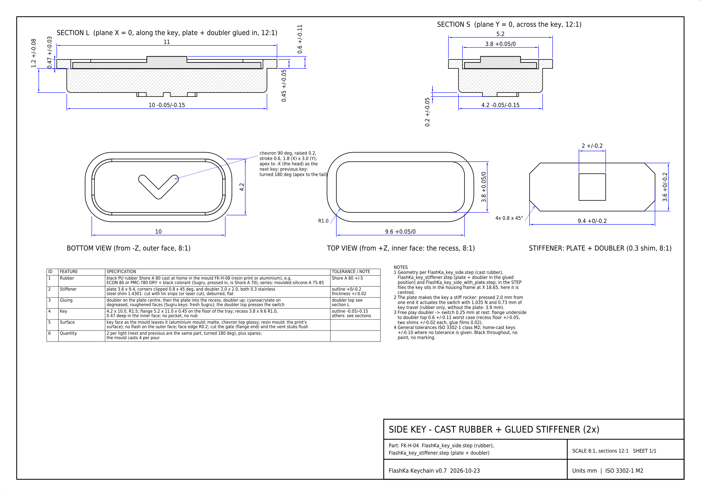

*Figure 14.21 — Side key (FK-H-04): sections along and across the key with the plate and doubler glued in, the outer face with the chevron, the recess, and the stiffener outline.*

<!-- landscape -->
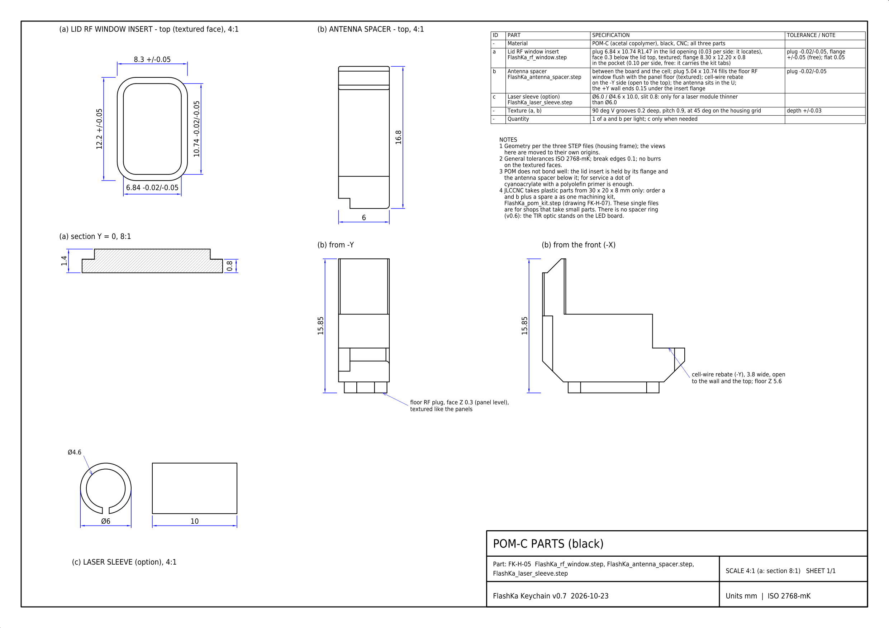

*Figure 14.22 — POM-C parts (FK-H-05): the lid RF window insert, the antenna spacer with its floor plug and cell-wire rebate, and the optional laser sleeve.*

<!-- landscape -->
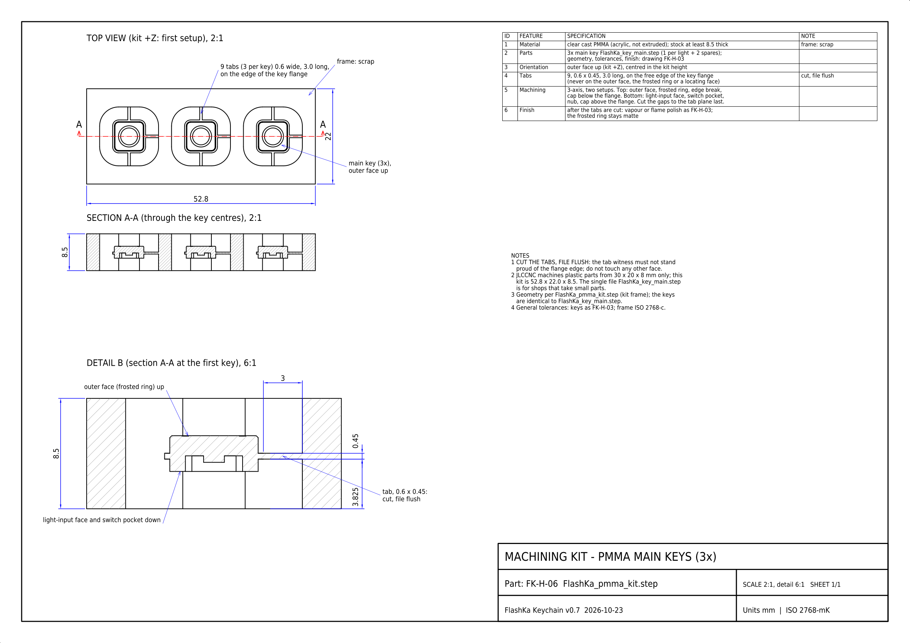

*Figure 14.23 — PMMA machining kit (FK-H-06): three main keys on nine tabs in a 52.8 × 22.0 × 8.5 mm frame.*

<!-- landscape -->
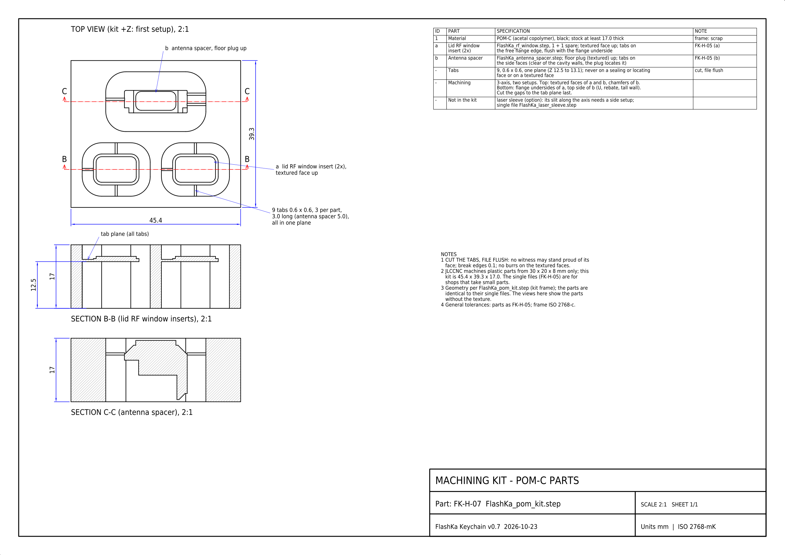

*Figure 14.24 — POM-C machining kit (FK-H-07): two RF window inserts and the antenna spacer on nine tabs in one plane, 45.4 × 39.3 × 17.0 mm.*

<!-- landscape -->
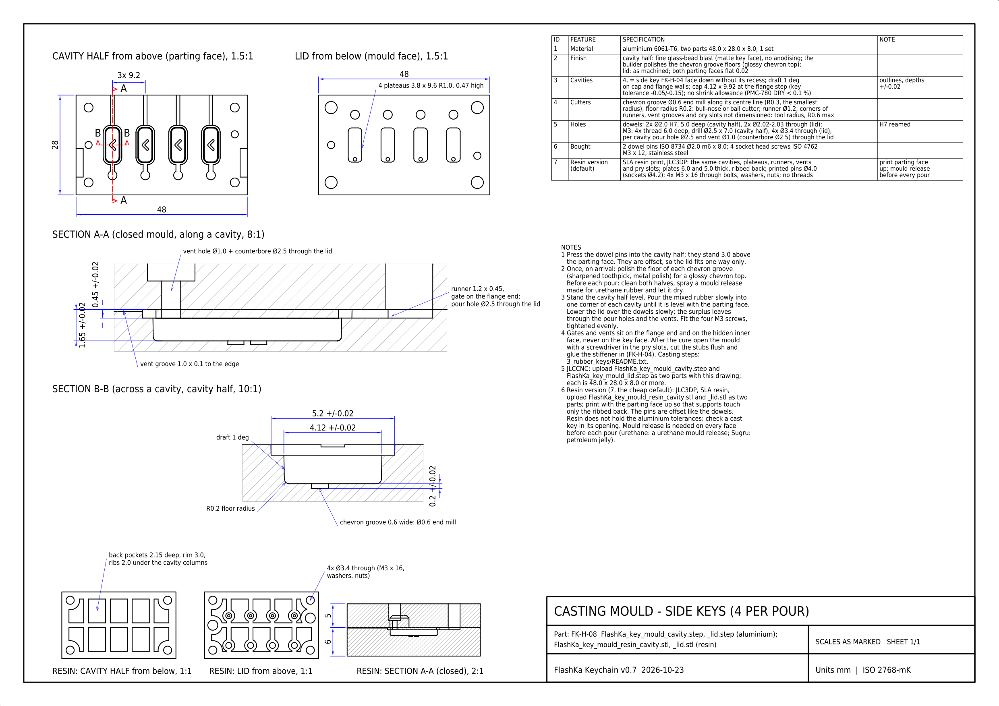

*Figure 14.25 — Casting moulds of the side keys (FK-H-08): the aluminium cavity half and lid, section A-A along a cavity with the pour hole, runner, gate and vent, section B-B across a cavity with the chevron groove, the resin version with its ribbed backs and through bolts, the feature table and the notes.*

## 14.6 1000 lm, and the cell that feeds it

### 14.6.1 The targets, and what limits them

The owner asked for at least 1000 lm, about 100 m of throw and a long higher output, in a body at most 5 mm longer. Three things limit a light this small:

* **The LED.** A 3.45 mm LED that gives 1000 lm out of the front after the optic's losses must give well over 1,100 lm at its own surface, close to its maximum current.
* **The cell.** One 14500 cell must deliver about 2.7 A in turbo without sagging below what the driver needs, and it needs a protection that does not trip at that current.
* **The heat.** A 99 × 20 × 18 mm aluminium body sheds only about 1.7 W in 25 °C still air while its surface stays at or below 48 °C, the most LuxLibre allows for a surface held for long ([THM-1](../../../docs/design-rules.md#thm-1); calculated from the 13.2 K/W of 14.6.7). 1000 lm means about 10 W in the LED: it can last seconds, not minutes. A higher output that lasts must sit at a level the body can carry for a while, and then the light must settle at what the body sheds.

The design therefore aims at about 1000 lm for a short turbo, a High of about 600 lm for as long as the heat allows, and an honest sustained level, and it says which of these numbers are at switch-on and which with a hot LED.

### 14.6.2 LED, optic and head

**LED.** A Luminus SST-20 **Gen 2**, 6500 K, G1 bin, on a ready-made 10 mm copper DTP board ("direct thermal path": the LED's thermal pad sits on the copper core). The datasheet allows 3.0 A DC (4 A only as a surge below 10 ms, 10 W at most); the G1 bin gives at least 1,156 lm at 3.0 A and 680 lm at 1.5 A, both at a junction temperature (Tj) of 85 °C, and 748 lm at 1.5 A and 25 °C. Gen 2 gives more light per amp than the SST-20 of v0.6. The workbook prices it at $2.99 from Kaidomain (the seller does not state the bin: ask for G1; an F9 LED gives about 6 % less).

**Optic.** A **LEDiL LISA3-RS-PIN** (FP16558): a round TIR optic, Ø10.0 mm and 6.93 ± 0.2 mm high (LEDiL drawing; data sheet 6.9 mm), a clear PMMA lens in a black polycarbonate holder with two locating pins. LEDiL's data for the SST-20 Gen 2 (LEDiL's own simulation, not a measurement): 20° full beam width at half maximum, 87 % efficiency, 5.5 cd per LED lumen. The bought 10 mm LED board has no holes, so the builder cuts the two pins off and the bore locates the optic. Other optics were looked at and kept as alternatives: the clip version LISA3-RS-CLIP16 (7.9 mm high: it would stand out of the head), the one-piece LISA4-RS (7.7 mm, 22°, 4.7 cd/lm) and a Carclo 10412 (its square outline was not confirmed).

**Head.** One bore Ø10.1 mm (+0.05 / 0) from the front face to a flat floor centres both the optic (0.05 mm radial play) and the LED board. The holder stands on the board's front face, the LED level, as LEDiL designs it: board front face X 7.13 mm, board 1.6 mm thick on 0.1 mm of thermal paste, bore floor X 8.83 mm, then 2.62 mm of solid aluminium to the head rear face at X 11.45 mm (2.0 mm required): the heat path. The optic's front face lies 0.2 mm behind the body's front face (0.0 to 0.4 mm over its height tolerance): protected, never proud, and it is the window, so the glass window and the spacer ring of v0.6 are gone. The bore keeps its full diameter to the front face: from the edge of the lens exit (Ø8.6 mm, an unlabelled callout of the LEDiL drawing) a ray clears the bore mouth up to 61.9° from the axis at the deepest seat and 75.1° at the nominal one, far outside the 20° beam; the beam model sends 0.28 % of the light beyond 61.9°, so the bore can take at most about 0.3 %. The optic is glued with two-part epoxy (or neutral-cure silicone) on the holder rim and held pressed onto the LED board while it cures; no cyanoacrylate, whose vapour fogs PMMA. It is not a press fit: the thin holder would have to carry the fit, and the board must stay pressed onto the floor. The glued optic traps the LED board on the bore floor (78.51 mm² of contact).

**LED wires.** Two 24 AWG wires run in two grooves of the bore wall (1.4 mm wide, 1.3 mm deep) and two Ø1.5 mm holes on the same lines through the solid behind the floor, tilted 30° from 12 and 6 o'clock (the upper one towards the laser). The builder turns the LED board so that its two pads face the grooves; the wires never pass under the board. The upper wire reaches LED+ on the main board's top face with a 2.7 mm sideways bend, the lower one runs under the USB-C receptacle to LED− on the bottom face. The front lid taps sit at X 10.14 mm, in the middle of the 2.62 mm of solid behind the bore floor: at the thread root they keep 0.51 mm of metal to the bore floor and 0.51 mm to the head rear face (0.685 mm at the tap drill). The second release review found 0.37 and 0.4 mm there, below JLCCNC's absolute minimum of 0.5 mm; the head grew from 11.3 to 11.45 mm and the optic moved 0.1 mm forward, so every metal wall of tray and lid is now at least 0.5 mm. Smaller screws (M1.2, M1.4) were rejected: no confirmation that JLCCNC taps them.

**Length.** Head 11.45 mm (8.5 mm in the first v0.7 layout) + 0.1 mm gap + main board 24.0 mm + antenna 5.4 mm + 0.8 mm gap + cell bay 51.6 mm + tail 5.85 mm = 99.2 mm, 4.8 mm longer than v0.6 and the first v0.7 layout, inside the owner's 99.4 mm. For the 14500 cell the bay took 0.75 mm from the tail, so the length did not change.

### 14.6.3 The LED driver

The current loop of v0.6 stays: the ESP32-C3 sets a current with a 13-bit PWM through an RC filter (VSET), the TLV333 op-amp compares it with the voltage across the 20 mΩ sense resistor RS1 and pulls the buck's feedback pin through Q2, so the buck regulates the LED current, not a voltage. What changed:

* **The buck.** U2 is now a **TI TPS62095**: 4 A, input 2.5 to 5.5 V, a 100 % duty mode (a charge pump keeps the high-side switch on when the cell voltage nears the LED voltage), 1.4 MHz, the same control scheme as the v0.6 TLV62585, 50 / 40 mΩ switches, switch current limit 4.7 A minimum. The PCB work first tried two 6 A parts (DIOO DIO6145QN12 and TI TPS62816-Q1) and dropped both: the first is not in the JLCPCB library and its land pattern is not in its data sheet, the second has a fine-pitch package whose land pattern could not be read from the drawing, and a guessed footprint risks a dead board. The TPS62095 has a standard, verified footprint, is a JLCPCB part and costs half as much; the price is about 0.15 V more dropout at 3.0 A than the TPS62816-Q1.
* **Inductor and sense resistor** stay: L1 1.0 µH (saturation 11 A, 23 mΩ), whose peak current is about 3.25 A at 3.0 A in the LED; RS1 20 mΩ, 0.5 W, Kelvin-connected, 0.18 W at 3.0 A.
* **Full scale.** R16 is 2.2 kΩ instead of 2.0 kΩ, so 100 % PWM duty gives I = 3.3 V × 2.2 / 102.2 / 0.020 Ω = **3,552 mA**. 3.0 A then sits at 84.5 % duty and the 2,850 mA turbo at 80.2 % (calculated), and the 3 mA moonlight still has 60 µV across RS1, about 7 PWM counts (TLV333 offset: about ±3 % typical, ±25 % worst case at 3 mA). The full scale has a tolerance of ±3 % (root sum square) and ±5 % in the worst case, from the 3.3 V rail (±2 %), R15, R16 and RS1 (1 % each).
* **Dropout.** 3.0 A is held down to about 3.7 V at the board's cell pads (J2); below that the buck runs at 100 % and the current falls by itself: about 2.5 A at 3.6 V, 2.2 A at 3.5 V and 1.9 A at 3.4 V; 1.7 A is held down to about 3.3 V (estimates). One cell adds its own drop: the F15's resistance (about 60 mΩ AC, likely 80 to 100 mΩ DC at 3 A) with its strips and wires costs 0.25 to 0.3 V at 2.85 A, so the full turbo current needs about 4.0 V at rest, roughly the top fifth of the charge. The firmware simulation models this (at 100 % duty the LED gets at most (V − 2.80 V) / 0.31 Ω from the pads): turbo dims as the cell empties (14.6.4).
* **Start-up.** The buck's soft-start pin (SS) stays open, which gives TI's internal minimum start of about 50 µs. TI warns that a very short soft start can trip the start-up current limit. Here the buck starts into its 2.4 V idle point with the LED dark (only the two 22 µF output capacitors to charge), and the current loop takes over 1.5 to 2.5 ms later through the set-point filter (R15 100 kΩ, R16 2.2 kΩ, C12 1 µF: 2.15 ms), so the start never carries LED current. The LED current then rises to its set point from below, without overshoot: turbo from off reaches 90 % after about 6 ms (estimates from the circuit, not measured). The worst case TI describes is one 66 µs hiccup and a second soft start, harmless and invisible. A 4.7 nF capacitor on SS (LCSC C1538, a Basic part) is the fall-back for a later revision if the bench check finds hiccups; this board has no free place for it near pin 9.
* **Losses at 3.0 A** (estimates): buck about 0.6 W, inductor 0.23 W, sense resistor 0.18 W, protection MOSFETs about 0.24 W, board copper about 0.17 W; the LED takes about 9.75 W.

### 14.6.4 One 14500 cell: the F15, and the K10 as the alternative

The cell is one **Vapcell INR14500 F15**: a cylindrical Li-ion cell of the AA size, flat top, without a protection board (the main board protects it, 14.6.5). The maker's data: 1,500 mAh typical and 1,150 mAh minimum (both at 0.2C to 2.5 V), 3.60 V nominal, 4.20 V charged, 2.5 V end of discharge, 3 A maximum continuous, about 60 mΩ (AC, 1 kHz), standard charge 500 mA, 14.0 ± 0.2 × 49.0 ± 0.3 mm, about 22 g. Section 14.2.10 says why it replaced the two pouch cells. The firmware's estimates use 1,400 mAh, because this light draws 0.4 to 1.9 A and stops at 3.0 V under load, which leaves about 7 % of a typical cell unused; the simulation uses the full 1,500 mAh. A cell at the maker's minimum runs about 77 % as long as the simulated times (proportional estimate). No independent test of the F15 at 3 A was found.

| | Vapcell INR14500 F15 (chosen) | Vapcell INR14500 K10 (alternative) |
|---|---|---|
| Capacity (maker) | 1,500 mAh typical, 1,150 mAh minimum | 1,000 mAh typical, 900 mAh minimum |
| Maximum continuous current (maker) | 3 A | 8 A |
| Size | 14.0 × 49.0 mm, flat top | 14.1 × 50.1 mm, flat top |
| The 2.8 A cell limit of turbo | 93 % of the rating: a deviation from [BAT-1](../../../docs/design-rules.md#bat-1), which allows 70 % (14.11) | 35 % of the rating: within BAT-1 |
| Turbo as the cell empties | up to 2.5 % less below about 96 % charge (the cell limit), clearly less below about 82 % (table below) | sags less: full turbo to a lower charge (not simulated) |
| Runtime from turbo | 137 min to the low-voltage step-down (simulated) | about a third less (from the capacity; not simulated) |
| Where to buy (read 2026-10-23) | nkon.nl (Netherlands): EUR 3.10 without VAT, in stock | illumn.com (USA): USD 4.30; no EU shop had it in stock |
| In the workbook | in the totals | named as the alternative, not in the totals |

Any other flat-top 14500 cell up to 14.5 × 50.4 mm fits the bay as well. Check the size of a cell before buying it, and use only a cell from a known maker with a datasheet (BAT-1).

**The bay.** It runs from X 41.75 to 93.35 mm, 51.6 mm: the longest cell (50.4 mm), two nickel strips with their folds and weld bumps (2 × 0.4 mm) and 0.4 mm of tail foam at its thinnest. Inside the octagon it is 17.0 mm wide, from the floor (Z 1.5 mm) to the underside of the lid (Z 16.5 mm). The cell lies on **two floor rails** (1.2 mm wide, tops at Z 2.6 mm, inner edges at Y ±3.5 mm, X 44.75 to 90.35 mm), so it cannot roll and its axis sits on the centre line, 8.71 mm above the bottom facet for a nominal F15. A strip of 0.05 mm polyimide tape covers each rail; the cell keeps its own sleeve. A strip of soft closed-cell foam, 6 mm wide, under the lid presses the cell onto the rails, and a foam pad at the tail end takes up the length. Both are stacks of 0.5 mm foam sheet, each about 1.6 times the gap it fills (compressed 20 to 55 %). The builder measures the cell and picks the stacks from this table (CAD; every case fits with its strips and joints with 0 mm³ of interference):

| Cell (diameter × length) | Gap under the lid | Foam strip (free) | Gap at the tail | Tail pad (free) | Gap to each side wall |
|---|---|---|---|---|---|
| F15, smallest (13.8 × 48.7 mm) | 1.00 mm | 1.5 mm | 2.1 mm | 3.5 mm | 1.6 mm |
| F15, nominal (14.0 × 49.0 mm) | 0.79 mm | 1.5 mm | 1.8 mm | 3.0 mm | 1.5 mm |
| F15, largest (14.2 × 49.3 mm) | 0.57 mm | 1.0 mm | 1.5 mm | 2.5 mm | 1.4 mm |
| K10, smallest (13.9 × 49.8 mm) | 0.90 mm | 1.5 mm | 1.0 mm | 1.5 mm | 1.55 mm |
| K10, largest (14.3 × 50.4 mm) | 0.47 mm | 1.0 mm | 0.4 mm | 0.5 mm | 1.35 mm |
| Largest flat-top 14500 (14.5 × 50.4 mm) | 0.25 mm | 0.5 mm | 0.4 mm | 0.5 mm | 1.25 mm |

**Strips and wires.** Two pure nickel strips (0.2 × 5 mm) are spot-welded to the ends of the cell: buy the cell with welded tabs where a shop offers that, have a battery shop weld them, or weld them with a small spot welder (the workbook lists one as a tool). Never solder onto the cell: the heat of an iron on the can or the cap damages the cell's seal and its safety vent. The front end is BAT+ (the cell's plus towards the head): its strip is bent forward into the rebate of the antenna spacer, and the red 24 AWG wire is soldered to the strip there, away from the cell. The far end is BAT−: its strip is bent into the lower −Y corner of the bay, and the black wire soldered to it runs forward along that corner with at least 0.5 mm all round (calculated: 1.046 mm from the wire's axis to the nearest wall, rail or cell, less its 0.525 mm radius). Both wires pass under the main board to the J2 pads, one wire per pad, and they do not cross. Polyimide tape covers the front strip where it passes the rim of the can (the can is the cell's minus), both solder joints and the corner channel.

**Charging.** The TP4057 charges the cell at about 494 mA (R3 2.0 kΩ; the data sheet gives 470 to 530 mA for 2 kΩ), the F15's standard charge: from empty (3.0 V) about 2.9 h at constant current up to 4.2 V (about 90 %), then about 0.6 h at constant voltage, about 3.5 h in all; a cell at the maker's minimum takes about 2.7 h (estimates). With a nearly empty cell (below about 3.6 V) the charger heats the board next to the thermistor, and the firmware pauses charging above 45 °C and resumes at 43 °C: the charge then runs in pauses at about 0.35 to 0.45 A on average, up to about 3.8 h in all, longer in warm air. That is normal, not a fault, and the app says so. USB draws about 0.5 A, the USB 2.0 default.

**Turbo and the charge, stated plainly.** One cell sags under 2.7 A. Turbo gets its full 2,850 mA only from a nearly full cell: below about 96 % charge the firmware's 2.8 A cell limit trims it by at most 2.5 %, and below about 82 % (about 4.0 V at rest) the buck runs at 100 % duty and the LED gets what the cell can push through it. Turbo 30 s after switching on, by the charge at switch-on (simulated with the firmware 0.7.0 model; the right-hand column uses the LED's simulated junction temperature, as the comparison pictures do):

| Charge at switch-on | LED current in turbo | Out of the front, LED at 85 °C | Out of the front, LED at its simulated temperature |
|---|---|---|---|
| 100 % | 2,850 mA | 966 lm | 1,019 lm |
| 90 % | 2,780 mA (the cell limit) | 948 lm | 1,001 lm (estimate) |
| 75 % | 2,658 mA | 916 lm | 969 lm (estimate) |
| 50 % | 2,119 mA | 775 lm | 828 lm |
| 25 % | 1,696 mA | 651 lm | 700 lm (estimate) |

So a half-full cell gives about 775 to 830 lm in turbo instead of about 1,000 lm: a fifth less light, which the eye sees as about 7 % dimmer (calculated), and still more than the A2 gives at switch-on (633 lm, 14.8). At switch-on a half-full cell gives 848 lm instead of 1,045 lm. High (1,530 mA) keeps its full current down to about 15 % charge (Extreme's 1,800 mA down to about 30 %), and the sustained level of about 280 lm does not depend on the charge until the low-voltage step-down. The K10 sags less under the same current and would keep full turbo to a lower charge, with about a third less runtime (not simulated).

**The cell's heat.** The cell touches the body only along the two rails (through the tape) and through the foam, so it follows the body slowly: in the simulation it reaches 46.7 °C at most (14.6.7). A thermal pad along the cell was rejected: pressed between the cell and the lid it would load the lid with tens of newtons.

### 14.6.5 Cell protection on the main board

Because the F15 has no protection board, the main board protects it: a **DW01A** protection IC (U6) and an **SE8830A** dual N-MOSFET (Q3, 20 V, 13 / 14.5 mΩ typical / maximum per transistor at 4.5 V gate drive) in the cell minus. The cell minus is a new net, BATN; the board ground is the minus behind the MOSFETs (P−), and the TP4057 charges through the two MOSFETs. The DW01A reads the drop of the two MOSFETs with Kelvin sensing: its ground pin has its own track to Q3's BATN pin and the ground end of R36 its own track to Q3's P− pin, so no load current flows in either sense track. The copper left in the sense loop is only the two Q3 pads and their joints, about 0.2 to 0.3 mΩ; before this revision the loop also held 1 to 2 mΩ of the BAT− pour and the ground return, which the second release review found.

| Protection | Value (data sheets; the LCSC DW01A may differ by a few tens of millivolts) |
|---|---|
| Over-current | 120 / 150 / 180 mV (minimum / typical / maximum) across the two MOSFETs in series, 10 to 20 ms delay. The DW01A drives the gates with the cell voltage, and a turbo burst heats the MOSFETs (junction about 70 to 85 °C, estimate): **typically 5.3 to 5.6 A at 25 °C and 4.3 to 4.5 A hot; in the worst case (120 mV, both MOSFETs at their maximum resistance and hot, cell at 3.7 to 3.8 V) 3.0 to 3.15 A** (3.9 A at 25 °C) |
| Short circuit | 1.0 to 1.7 V across the MOSFETs: about 30 to 65 A, cut within 5 to 50 µs |
| Over-charge, over-discharge | 4.30 V ± 50 mV, so 4.25 to 4.35 V (PUOLOP's figure on the LCSC part page, read 2026-10-23; its data sheet could not be opened), and 2.3 to 2.5 V (the F15's own end of discharge is 2.5 V): backstops only. The TP4057 ends the charge at 4.20 V ± 1 % (4.16 to 4.24 V), below the lowest over-charge threshold, so the DW01A does not act in normal charging (at least 8 mV apart at the limits, about 100 mV typically); the firmware's low-voltage cut-off at 3.00 V stays the primary one |
| After a trip | 10 to 20 ms above the trip current the whole light goes dark (LED, ring and Bluetooth: the ESP32 loses its power), and no key wakes it. The DW01A stays off until USB power is plugged in (it would also re-arm if the load were removed, which this light cannot do: there is no power switch). Then the light works again, also after unplugging; nothing is damaged. It may also hold the board off when the cell is first connected: plug in USB once |

In turbo the battery current is about 2.64 A at 4.0 V under load and would be 2.86 A at 3.7 V (estimates; the simulated peak from a full cell is 2.74 A); below about 3.7 V the buck is in dropout and the current falls. Only the worst corner comes near the trip. The firmware therefore limits its estimate of the cell current to **2.8 A** (14.6.6): 7 to 12 % below the worst-case trip (5 to 10 % if the real efficiency is 85 % instead of 87 %) and about a third below the typical hot trip. Against the F15 the protection is a fault and short-circuit guard, not its 3 A limit: the typical hot trip (4.3 to 4.5 A) is about 1.5 times the cell's rating and the worst-case trip sits at it; the 2.8 A limit keeps the cell 7 % below 3 A (4 % at 85 % efficiency). A trip needs every corner at once, and it is a nuisance, not a hazard. The estimate is not a measurement (there is no current sensing), so the first board must measure the battery current at turbo, hot, and the trip current itself (14.12). The SE8830A has no drop-in substitute: a common 8205A-type dual MOSFET has about twice the on-resistance, and the DW01A would then cut the light off in turbo (trip at about 2 to 3 A). Its pin order (S1, D, S2, G2, D, G1, as on the FS8205A) is only a picture in the LCSC data sheet: check it before ordering (14.12). One side effect is harmless: the battery voltage is measured against the board ground, so under 3 A the firmware reads up to about 0.08 V less than the cell voltage, on the safe side.

### 14.6.6 Levels, and why turbo is 2,850 mA

The firmware works with an estimated light output out of the front: the LED datasheet's lumens at Tj 85 °C (the firmware's LED table: 680 lm at 1.5 A and 1,156 lm at 3.0 A from the datasheet's G1 minimum, the points between estimated) times the optic's 87 %. That is the rating LuxLibre's [LED-2](../../../docs/design-rules.md#led-2) asks for ("rate flux at 85 °C").

**Turbo: 2,850 mA.** The LED's maximum is 3.0 A DC. The current loop's full scale is ±3 % (root sum square) and ±5 % in the worst case, so a 3,000 mA set point could be 3.09 A or 3.15 A on a real board. 2,850 mA × 1.05 = 2,993 mA: at or below 3.0 A in the worst corner. The cap costs 40 lm: 2,850 mA gives 1,111 lm at the LED and **966 lm out of the front** with the LED at 85 °C, 3,000 mA would give 1,006 lm, 4 % more, which the eye sees as about 1 % brighter. "About 1000 lm" is met within the accuracy of the model, and with a cool LED the first seconds give more (14.6.8). The firmware enforces the LED ceiling in one place: the one function that turns milliamps into PWM duty clamps every request to 3,000 mA (6,918 of 8,192 counts = 2,999.6 mA), and compile-time checks make sure that no built-in level and no custom turbo exceeds 2,850 mA. At 2,850 mA a full F15 gives about 2.7 A; the 2.8 A cell-current limit cuts in below about 3.78 V under load (about 4.14 V at rest, 96 % charge) and trims turbo by at most 2.5 % (2,780 mA at 90 %) until the buck's dropout takes over below about 82 % (14.6.4); the simulated peak is 2.74 A.

**High: 1,530 mA.** About 600 lm out of the front needs about 690 lm at the LED: 1,530 mA gives 690.5 lm at the LED, **601 lm** out of the front (1.7 A would give 653 lm). It draws about 1.34 A from a full cell.

| Profile | Moonlight | Low | Medium | High | Turbo | Temperature limit (held) | Low-voltage step-down | Cell-current limit |
|---|---|---|---|---|---|---|---|---|
| Balanced (default) | 3 mA, ~1 lm | 40 mA, 19 lm | 250 mA, 119 lm | 1,530 mA, 601 lm | 2,850 mA, 966 lm, at most 60 s, then High | 50 °C | 3.20 V | 2,800 mA |
| Extreme | 3 mA, ~1 lm | 50 mA, 24 lm | 400 mA, 187 lm | 1,800 mA, 683 lm | 2,850 mA, 966 lm, at most 60 s, then High | 50 °C | 3.15 V | 2,800 mA |
| Endurance | 2 mA, ~1 lm | 15 mA, 7 lm | 100 mA, 48 lm | 500 mA, 230 lm | none | 47 °C | 3.25 V | 800 mA |

The low levels step by about five to six times in light, so each step looks even. The low-voltage step-down (measured under load) steps the light down with about 5 to 11 % left in the F15; the earlier 3.30 to 3.40 V would have cut in with 10 to 30 % left. If the protection ever trips in turbo, set the Custom profile's cell limit to 2,500 mA (14.6.5).

**Temperature: a regulator.** On the v0.7 the profile's temperature limit is the set point of a regulator (`thermal.rs`, compiled only for the v0.7 board). It filters the sensor, predicts its temperature 8 s ahead (the thermistor lags the head by about 4 s) and keeps the full current until that prediction reaches the limit; then an integrator with a small proportional part holds the sensor 0.1 to 0.3 °C below it. Above the limit + 5 °C the light drops to Low at once, and the 70 °C and 80 °C backstops stay. The protocol's linear derating (from the limit down to Low over 15 °C), which the first build of firmware 0.7.0 used, settles about 9 °C above the limit, so its limits had to be 40 to 41 °C and High started dimming after 83 s while the body was still at about 33 °C: the time was in the control law, not in the physics. With the regulator the limit is 50 °C in Extreme and Balanced. It keeps the simulated body (the surface in the hand) at or below 46.5 °C in 25 °C still air and the head below 51 °C on the way, inside LuxLibre's [THM-1](../../../docs/design-rules.md#thm-1) (48 °C continuous, 51 °C at any time); Endurance's limit is 47 °C, which its 500 mA High does not reach (its sensor settles at about 45.2 °C with the controller's and the cell's own heat in the model). A linearised check of the loop gives a phase margin of at least 57° and a gain margin of at least 10 dB from 0.62 to 2.85 A (firmware.md of v0.6, section 9.11). The sensor is the 100 kΩ thermistor on the main board near the driver, about 12 mm behind the head block, assumed to follow the head: a bench check (14.12). Turbo at 95 % of the LED's maximum does not meet LED-2's "at most 80 %" (a Should rule); it is the price of 1000 lm, and turbo is timed (60 s) and held by the regulator from about 57 s (deviation 12 in 14.11).

### 14.6.7 Heat and the simulation

The firmware's own controller drives a thermal and battery model of the light in a host test (`flashka-core/tests/thermal_v07.rs` in the v0.6 firmware folder), with the masses and areas of the octagonal housing:

| Model input | Value | From |
|---|---|---|
| Head node | 7.06 J/K: head block 6.34 g and the lid over it 1.05 g of aluminium, the copper LED board 1.126 g | housing solids |
| Body node | 21.07 J/K: the rest of the 30.91 g of aluminium (23.5 g) | housing solids |
| Cell node | 22 J/K (22 g at about 1 J/gK), coupled to the body by about 8 K/W through the two rails (tape), the air gaps and the foam; the cell heats itself with I² × 0.10 Ω | estimate |
| Head to body | 2.2 K/W through the metal behind the head (87.75 mm along about 80 mm²) | calculated |
| Body to air | 13.2 K/W: 6,886 mm² of aluminium surface at 11 W/m²K, still air at 25 °C (the texture's extra area not counted) | calculated |
| Sensor | follows the head with a 4 s lag | assumption |
| Cell and LED | one F15, 1,500 mAh, a generic 3.6 V open-circuit curve (no F15 curve is published), 0.10 Ω from the cell to the J2 pads; at 100 % duty the LED gets at most (V − 2.80 V) / 0.31 Ω; LED 2.80 V + 0.15 V/A; 87 % from the cell to the LED; 30 % of the LED power leaves as light; 20 mA for the controller and radio, whose heat goes into the head | data sheets, estimates |

Only the aluminium, the LED board and the cell store heat in that model (not the boards or the keys), and nobody holds the light, so the times are on the short side. With the cell coupled by 4 or 16 K/W instead of 8 K/W, High's full output lasts 234 or 189 s instead of 210 s, and the current settles at the same level. The comparison work adds the LED's junction temperature: Tj = head temperature + 1.6 °C/W × 70 % of the LED power, with the datasheet's relative flux of 1.10 at 25 °C falling linearly to 1.00 at 85 °C. In the simulation the junction never gets hotter than about 60 °C (60.0 °C), so the real LED gives more light than its 85 °C rating.

### 14.6.8 The honest numbers

The table gives the light out of the front of the default profile, simulated at 25 °C in still air with a full cell. The first part uses the LED's simulated junction temperature, as the comparison pictures do; the second the firmware's rating with the LED at 85 °C.

| Simulated | Turbo (2,850 mA) | High (1,530 mA) |
|---|---|---|
| At switch-on (first second, Tj 36.4 °C) | 1,045 lm (1,201 lm at the LED) | 655 lm |
| At 30 s | 1,019 lm | 647 lm |
| Full output lasts | 58 s, then the regulator; the timer ends turbo at 60 s | 210 s |
| At 2 min | 631 lm | 637 lm |
| At 5 min | 399 lm | 435 lm |
| At 10 min | 325 lm | 331 lm |
| Sustained (mean of 15 to 25 min) | 296 lm | about the same (304 lm at 15 min, 297 lm at 20 min) |
| With the LED at 85 °C: start / sustained | 966 lm / 281 lm | 601 lm / 282 lm (at 20 min) |
| Highest temperatures | head 50.5 °C, body 46.5 °C (steady after about 10 min), cell 46.7 °C, LED junction 60.0 °C | body 46.5 °C |
| Runtime | 137 min to the ANSI end point (10 % of the 30 s output), here the low-voltage step-down; off after about 235 min | 138 min; off after about 236 min |

So: about 1,045 lm in the first second and about 966 lm with a hot LED; full turbo for about 58 s; High at about 601 lm for about 210 s (three and a half minutes); then about 280 to 300 lm for more than two hours, about 2.8 times what the A2 keeps after ten minutes (118 lm, 1lumen). In 25 °C still air the regulator takes turbo down from 57 s and the 60 s timer then ends it; in a cold wind turbo runs until the timer. From a half-full cell turbo starts at about 848 lm and never reaches its full current (14.6.4). In the Extreme profile turbo also holds 58 s and its 1,800 mA High 149 s, with the same sustained level; Endurance's 500 mA High (230 lm) never steps down for heat (the body reaches 42.4 °C) and runs 178 min until the low-voltage step-down, off after 303 min. The LuxLibre firmware on the same model (without the cell node) holds turbo 56 s and its High (1,501 mA, 592 lm) 185 s, then about 290 to 300 lm: the two regulators behave alike. The regulator holds the sensor, not the body: in 30 °C air the body settles at about 47 °C, and steps of the air temperature (25 to 30 °C and 30 to 20 °C) are followed without oscillation; with a noisy sensor (±3 mV) High still runs 210 s and then holds its current (all simulated). The sustained level is about 5 % lower than in the earlier simulation of the rectangular body (294 lm with the LED at 85 °C), because the model now counts the heat of the controller and of the cell.

## 14.7 Firmware 0.7.0, apps and the user interface

The key board carries the same circuit as the corner of the v0.6 main board, on the same nets: the three switches pull the one ladder net BTN to their v0.6 levels (R30 1 kΩ, R31 2.2 kΩ, R9 10 kΩ), and the ring LEDs hang on RGB_R, RGB_G and RGB_B with the v0.6 resistors (330 Ω red, 100 Ω green and blue). No GPIO changed. What the firmware must know is the new power stage: the current scale, the limits, the cell and the heat. v0.7 therefore runs **FlashKa firmware 0.7.0**:

* **One code base, two boards.** The v0.6 firmware sources build both: the Cargo feature `board-v07` selects the v0.7 board, and every board-dependent constant sits in one file, `flashka-core/src/board.rs` (version, full scale 3,552 mA, LED ceiling 3,000 mA, turbo limit 2,850 mA, the cell's 1,400 mAh, the load correction of 130 mV/A, the charge current of 475 mA, the driver's headroom, the LED model 2.80 V + 0.15 V/A, 87 % efficiency, the LED lumen table and the optic's 87 %); the v0.7 build also compiles the temperature regulator `thermal.rs` and the F15's open-circuit voltage curve, and its profiles have the 50 °C limits (Endurance 47 °C), the low-voltage step-down at 3.15 / 3.20 / 3.25 V and the 2,800 mA cell limit. Without the feature the sources build firmware 0.6.0 for v0.6 boards, byte for byte the published image.
* **The image.** `flashka-fw-v0.7.0-merged.bin`, 535,328 bytes, SHA-256 `6554028f31b3e86c958335a1b03b4fd6f2a95000f727d752f4cb891318e79f96`, in `firmware/dist/` of the v0.6 folder (`BOARD=v07 firmware/build.sh`). Two copies of the firmware folder, each building both boards in the opposite order, gave identical images.
* **Tests.** 166 unit tests and 9 thermal simulation tests for the v0.7 build (turbo at least 35 s and High at least 150 s from cold, the body at or below 47 °C, the head and sensor at most 51 °C, the regulator's response to a step of the air temperature and to a noisy sensor without hunting, the LED never above 2,850 mA, a custom turbo clamped, turbo from a half-full cell; the battery limits, the low-voltage thresholds and the runtime of the F15); 153 host tests for the v0.6 build; no compiler warnings.
* **The installer** holds both images and first asks which FlashKa the user has: "FlashKa v0.7 - three keys in the middle" or "FlashKa v0.6 - stainless button". Nothing can be installed before a board is chosen. After connecting it reads the firmware already on the light; firmware of the other board gives a warning and needs an explicit tick before installing, and an image file made for the other board is refused. Writing the wrong image matters: on a v0.7 board the v0.6 firmware scales every current by 1.098 (a Custom turbo of 3,000 mA becomes about 3,290 mA, above the LED's 3.0 A); on a v0.6 board the v0.7 firmware scales them by 0.911 (turbo about 2,600 mA) with a 2.8 A cell limit against a pack rated 1.6 A.
* **The control app 0.7.0** recognises the board from the light's info text ("FlashKa fw 0.7.x" is a v0.7). On a v0.7 it shows the v0.7 profiles, limits a custom turbo to 2,850 mA and shows the estimated lumens out of the front, marked as estimates ("1530 mA · 601 lm"). The Custom editor explains the temperature limit per board ("The light keeps its temperature just below this" on a v0.7) and names the protection trip and the 2,500 mA advice next to the battery current limit; charge pauses are shown as normal. Its demo mode can simulate a v0.7 with the same regulator and the F15 (1,400 mAh, its voltage curve, a dimmer turbo from a part-empty cell, the 475 mA charge). The web tools pass 165 unit tests and 71 + 33 browser checks.
* **LuxLibre** has a board header `firmware/boards/flashka-keychain-v07/board.h`: the v0.6 pins and ladder, full scale (level 150) 2,850 mA, a build error above 3,000 mA, the cell limit 2,800 mA (with its BAT-1 note), the F15's voltage curve for the charge estimate (`LX_BAT_OCV_MV`), the v0.7 LED model and the simulator model of the octagonal housing and the F15. The LuxLibre port stays experimental (main key and ring only, no Bluetooth).

The documents stay in the v0.6 folder:

* [firmware.md](../../flashka-keychain-v06/docs/firmware.md): how the firmware works, the user manual (section 2; also Appendix A of the build guide PDF), the bench test plan (section 7) and **section 9, the v0.7** (levels, reasons, LED model, simulation, image, tests, bring-up additions, open points, the temperature regulator);
* [ble_protocol.md](../../flashka-keychain-v06/docs/ble_protocol.md): the Bluetooth protocol, version 2;
* [web_apps.md](../../flashka-keychain-v06/docs/web_apps.md): the control app and the installer, both boards, and how to host them;
* chapter 13, sections [13.5](../../flashka-keychain-v06/docs/ch13_v0.6_presenter.md#135-firmware) and [13.6](../../flashka-keychain-v06/docs/ch13_v0.6_presenter.md#136-web-app-and-protocol-version-2): the design of the firmware and the web pages.

What a user notices:

* The keys read from the head to the tail: ^ next, ● main, v previous. They sit on the centre line, and held like a presenter the chevrons point the way the slides go (14.2.9). In flashlight mode ^ steps a level up and v a level down.
* The levels are new (14.6.6): turbo gives about 1.6 times the light of High and keeps full output for about 58 s, High for about three and a half minutes; then the light holds about 280 lm at a steady temperature. From a half-full cell turbo gives about 775 lm instead of 966 lm (14.6.4).
* A full charge takes about 3.5 h. With a nearly empty cell the charge pauses now and then while the board is warm: that is normal (14.6.4).
* After a protection trip, which should not happen in normal use, the light stays dark until USB is plugged in (14.6.5).
* The ring is the frosted ring on the clear main key. How bright and even it looks has not been seen yet (14.12).
* The slide switch S2 has no SAFE and ARM marks: towards the head is SAFE, towards the tail ARM.
* Holding ● while plugging in starts the download mode for the installer; any of the three keys works, because they all pull the same pin.

## 14.8 Light output and the comparison with the RovyVon Aurora A2

### 14.8.1 From the first v0.7 layout to the TIR optic

The first v0.7 layout had no optic: a bare SST-20 behind a flat glass window, about 445 lm at the LED and about 324 lm out of the front at the default turbo (1.2 A), a peak of 130 cd and a throw of 23 m (simulated). The A2 threw more than five times as far with the same kind of LED behind a TIR optic. The 1000 lm design took that way: with the LISA3 optic and the stronger driver the peak rises to 6,605 cd at switch-on, about 50 times as much (calculated), and the throw to 162.5 m. Every v0.7 text says whether a lumen figure is at the LED or out of the front; FlashKa has not been measured.

### 14.8.2 The optical model of FlashKa

The model takes the LEDiL data for the SST-20 Gen 2 (87 % efficiency, 20° full width at half maximum, 5.5 cd per LED lumen) and builds a beam that meets all three: per LED lumen, I(θ) = a exp(−θ² / 2σ²) + b cos θ S(θ), a Gaussian core plus a spill that fades out between 50° and 70° (S, a raised cosine). Solved: σ = 8.431°, a = 5.4425 cd/lm and b = 0.0575 cd/lm (1.0 % of the peak); the core carries 84.5 % of the light out of the front, the spill 15.5 %. The peak, the lumens and the wall-centre illuminance do not depend on that split; the brightness of the spill does: one degree more or less beam width moves the spill share by about 10 points, so the spill in the picture is uncertain by a factor of about 2, the hotspot is not. The light leaves from the centre of the optic's exit face, 0.35 mm behind the front face; the bore can take at most about 0.3 % of the light (not subtracted). As a plausibility check, the model gives 6.32 cd per lumen out of the front; the A2 measured 5.96 cd/lm at switch-on (3,775 cd / 633 lm).

At switch-on the LED gives 1,201 lm (14.6.8): **1,045 lm** out of the front, a peak of **6,605 cd**, an ANSI throw of **162.5 m** (2√cd; 163 m in the pictures), 1,651 lx at the centre of a wall 2 m away. With the LED at 85 °C: 966 lm, 6,110 cd, 156.3 m.

### 14.8.3 The beam model of the A2

The RovyVon Aurora A2 (Gen 3) was measured by 1lumen: 633 lm at switch-on, 394 lm at 30 s and 118 lm at 10 min on High, 3,775 cd at switch-on (2,750 cd at 30 s), 123 m. The maker rates it at 650 lm and 110 m; it uses an SST-20 LED behind a TIR optic, a 300 mAh cell and a 57.3 × 15.6 mm body. The current Gen 4 shares the LED, the rating, the cell and the size; no independent test of Gen 4 was found, so the Gen 3 measurement stands in for it, and that the two perform alike is an assumption. The official RovyVon page could not be opened; the maker's figures come from 1lumen's copy of the maker's table and from Gen 4 retail listings.

The model: I(θ) = I_h exp(−θ² / 2σ²) + I_s cos θ S(θ), with the same spill edge as above. It is fitted to the peak (3,775 cd) and the lumens (633 lm) with an assumed spill share of 25 %: I_h = 3,708 cd, I_s = 67.4 cd, σ = 8.21° (hotspot 19.3° wide at half maximum). Its throw, 123 m, equals 1lumen's value. A spill share of 15 % or 35 % would make the hotspot about 1° wider or narrower and the far spill about 40 % weaker or stronger; the wall centre and the lumens do not depend on it.

### 14.8.4 How the pictures are made and checked

`tools/compare/compare_a2.py` runs the firmware simulation, renders both lights from their CAD (the A2 as a plain size stand-in from its published dimensions: no logo, no lettering, no design details) and paints the beams on a white wall 2 m away. The wall and the table are computed from E = I(θ) cos α / d²; the bodies are rendered with VTK; both panels share one scene, one camera, one exposure and one tone curve, so the same luminance gives the same pixel value in both. Every run makes 25 checks, and all pass:

* the simulated LED lumens equal the firmware's LED table at every row, the light out of the front equals 87 % of it, and the firmware's optic factor equals LEDiL's efficiency; the junction factor is 1.100 at 25 °C and 1.000 at 85 °C;
* a Lambertian test source integrates to its lumens, and its flux on a large wall equals the view factor;
* for both beam models the angular integral equals the lumens, the peak equals the candela, the wall integral at 2 m and an inclined plane equal the lumens, and E·d² on the axis equals the peak (all within 0.01 %, most exactly); the FlashKa model has its 20° beam width;
* the flux painted into the visible wall area equals the angular flux (0.00 %), and the VTK bodies and the computed beams agree within 0.35 px and 0.36 px.

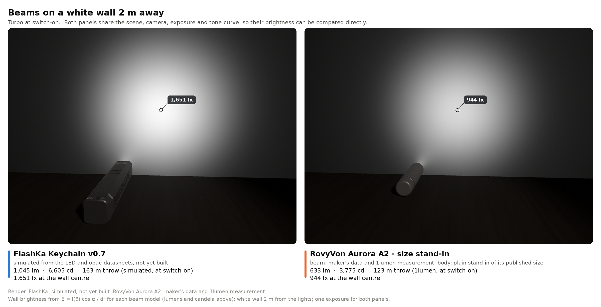

*Figure 14.26 — Both beams at switch-on on a white wall 2 m away, one exposure for both panels (render). FlashKa (simulated): 1,045 lm out of the front, 6,605 cd, 163 m, 1,651 lx at the wall centre. RovyVon Aurora A2 (maker's data and 1lumen measurement): 633 lm, 3,775 cd, 123 m, 944 lx.*


*Figure 14.27 — Light out of the front over the first 2 and the first 15 minutes at 25 °C. FlashKa simulated with turbo (solid) and High (dashed) of the default profile; the A2 as the three points 1lumen published (633 lm, 394 lm at 30 s, 118 lm at 10 min).*

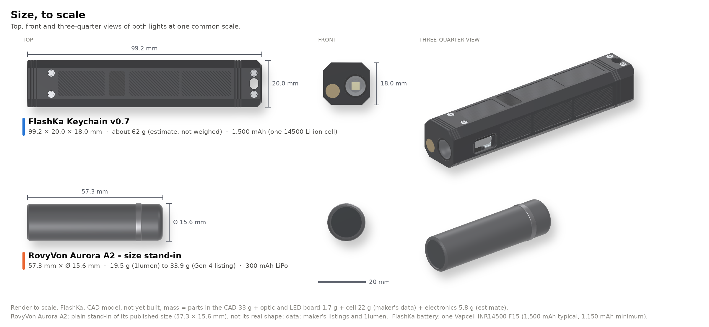

*Figure 14.28 — Size to scale (render): FlashKa 99.2 × 20.0 × 18.0 mm with its octagonal body, about 62 g (estimate), 1,500 mAh (one 14500 cell); the A2 stand-in 57.3 × Ø15.6 mm, 19.5 g (1lumen) to 33.9 g (Gen 4 listing), 300 mAh.*

### 14.8.5 What the comparison says

| | FlashKa v0.7 (simulated, not built) | RovyVon Aurora A2 (1lumen, Gen 3; maker's data) |
|---|---|---|
| Light out of the front at switch-on | 1,045 lm (966 lm with the LED at 85 °C) | 633 lm (maker: 650 lm) |
| After 30 s | 1,019 lm | 394 lm |
| After 10 min | 325 lm | 118 lm |
| Peak intensity | 6,605 cd | 3,775 cd |
| Throw (ANSI) | 162.5 m (163 m in the pictures) | 123 m |
| Size | 99.2 × 20 × 18 mm | 57.3 × Ø15.6 mm |
| Mass | about 62 g (estimate) | 19.5 to 33.9 g |
| Battery | 1,500 mAh (one Vapcell INR14500 F15) | 300 mAh |
| Extras | Class 2 green laser behind a hardware interlock, Bluetooth slide remote, app | none listed |
| Runtime from the top level (not in the pictures) | 137 min to the ANSI end point, off after about 235 min | 1 h 04 min to the ANSI end point, off at 1 h 07 min |

Read honestly: with the TIR optic FlashKa throws further than the A2 (162.5 m against 123 m, about 1.3 times; calculated) and gives about 1.65 times its light at switch-on. After 30 s it gives about 2.6 times as much (1,019 against 394 lm) and after ten minutes about 2.8 times (325 against 118 lm). It has five times the battery capacity, runs about twice as long from the top level (137 min against 64 min) and adds the laser and the presenter mode. From a half-full cell its turbo gives about 775 lm with the LED at 85 °C (828 lm with the LED's simulated temperature), still more than the A2 at switch-on. It is 1.73 times as long and much heavier (about 62 g against 20 to 34 g). The A2's numbers are measured; FlashKa's are simulated from datasheets and the first build must measure them.

## 14.9 Cost

The cost workbook `FlashKa_Parts_List_v0.7.xlsx` prices every part with its source, adds shipping, the 21 % VAT of Lithuania, the EU customs rules of 2026 and the card fees, and compares the result with v0.6, with the first v0.7 layout and with the two pouch cells just before the change. Its notes are `docs/bom_notes.md`. Prices as of 2026-10-23 (parts that did not change keep their earlier readings):

<!-- pagebreak -->
| USD | 1 light | 2 lights (total) | 5 lights (total) |
|---|---|---|---|
| PCB + assembly (JLCPCB, one panel), before shipping | 236.90 | 236.90 | 282.07 |
| Housing (JLCCNC + JLC3DP: tray, lid, PMMA and POM-C kits, resin mould) | 132.91 | 204.99 | 432.50 |
| Bought parts (the cell included) | 65.79 | 95.75 | 203.00 |
| Consumables (incl. the casting supplies, 85.95, and the nickel strip) | 115.53 | 115.53 | 115.53 |
| Shipping, VAT, customs duty, carrier and card fees | 308.16 | 361.75 | 463.25 |
| **Total** | **859.28** (EUR 768.04) | **1,014.92** (EUR 907.15) | **1,496.35** (EUR 1,337.46) |
| **Per light** | **859.28** | **507.46** | **299.27** |

The tools needed once cost about $204, of them about $40 for a small spot welder for the cell's nickel strips; it is not needed with a cell that comes with welded tabs.

**What got cheaper.** The owner asked to bring the cost down. The 1000 lm design added the parts that 1000 lm needs and took cost out wherever it does not hurt the design; the one-cell octagon then changed the battery and the body. Against the workbook of the first v0.7 layout (price check 2026-10-21):

| USD | 1 light | 2 lights | 5 lights |
|---|---|---|---|
| 1. PCB + assembly | 228.66 → 236.90 (+8.24) | 228.66 → 236.90 (+8.24) | 269.12 → 282.07 (+12.95) |
| 2. Housing | 169.16 → 132.91 (−36.25) | 242.46 → 204.99 (−37.47) | 473.59 → 432.50 (−41.09) |
| 3. Bought parts | 63.75 → 65.79 (+2.04) | 101.65 → 95.75 (−5.90) | 218.30 → 203.00 (−15.30) |
| 4. Consumables | 142.19 → 115.53 (−26.66) | 142.19 → 115.53 (−26.66) | 142.19 → 115.53 (−26.66) |
| 5. Shipping, VAT, customs, fees | 315.13 → 308.16 (−6.97) | 349.12 → 361.75 (+12.63) | 452.61 → 463.25 (+10.64) |
| **Total** | **918.89 → 859.28 (−59.61)** | **1,064.08 → 1,014.92 (−49.16)** | **1,555.81 → 1,496.35 (−59.46)** |
| **Per light** | **918.89 → 859.28 (−59.61)** | **532.04 → 507.46 (−24.58)** | **311.16 → 299.27 (−11.89)** |

| Saving (1 light) | Amount | What it costs in quality |
|---|---|---|
| Resin casting mould (JLC3DP) instead of the aluminium mould | $3.32 instead of $35.12, once per builder | a print does not hold ±0.02 mm and wears sooner: try the first key in its opening, sand the cavity floors for the matte face. The aluminium mould stays an option |
| ECON 80 instead of PMC-780 DRY | $31.95 instead of $60.40 for the rubber; all casting supplies $85.95 instead of $114.40 | none: the same Shore 80A, mixed 1 : 1 by volume, so the 0.01 g scale is no longer needed; pot life 13 min instead of 25 |
| The merged JLCCNC + JLC3DP parcel stays below the EUR 150 customs line | EUR 118.79 of goods; $194.15 landed instead of $215.46 (−$21.31) | none: the parcel pays VAT and EUR 3 per customs line at the checkout instead of duty, VAT on the duty and a carrier fee |
| No window, no spacer ring | the window ($2.95 per 5) and one part type of the POM-C kit (kits $31.25 instead of $37.75) | none: the optic is the window |
| Cheaper LED board | $2.99 instead of $5.40 | better: the Gen 2 LED; ask the seller for the G1 bin |
| Smaller items | thermal paste instead of tape, two AliExpress parcels less (8 instead of 10), the resin mould's bolts instead of dowels and screws | none |

What the 1000 lm parts add: the optic (a pack of 5 for $17.37 from RS, plus the distributor's parcel with an estimated $20 courier fee), the power stage ($1.35 for the buck instead of $0.26, the protection IC $0.025 and the MOSFET $0.10, estimate; the fourth X-ray part) and the 24 AWG wire. For two and five lights the housing parcel is above the customs line anyway, so the saving per light is smaller.

**What the battery and body change costs.** Against the workbook just before the change, with two 320 mAh pouch cells in the 20 × 16 mm body (price check 2026-10-22):

| USD | 1 light | 2 lights | 5 lights |
|---|---|---|---|
| 1. PCB + assembly | 236.91 → 236.90 (−0.01) | 236.91 → 236.90 (−0.01) | 282.08 → 282.07 (−0.01) |
| 2. Housing | 131.89 → 132.91 (+1.02) | 202.96 → 204.99 (+2.03) | 427.41 → 432.50 (+5.09) |
| 3. Bought parts | 73.85 → 65.79 (−8.06) | 110.34 → 95.75 (−14.59) | 237.18 → 203.00 (−34.18) |
| 4. Consumables | 113.45 → 115.53 (+2.08) | 113.45 → 115.53 (+2.08) | 113.45 → 115.53 (+2.08) |
| 5. Shipping, VAT, customs, fees | 298.71 → 308.16 (+9.45) | 353.29 → 361.75 (+8.46) | 457.99 → 463.25 (+5.26) |
| **Total** | **854.81 → 859.28 (+4.47)** | **1,016.95 → 1,014.92 (−2.03)** | **1,518.11 → 1,496.35 (−21.76)** |
| **Per light** | **854.81 → 859.28 (+4.47)** | **508.47 → 507.46 (−1.01)** | **303.62 → 299.27 (−4.35)** |

The F15 costs $3.47 (read at nkon.nl) against an estimated $5.00 for each pouch cell, and one cell replaces two, so the bought parts drop by $8.06 for one light. The bigger tray and lid (+$1.02), the nickel strip (+$2.08) and the battery shop's own parcel (an estimated $13.43 courier fee plus VAT; one web-shop parcel less) add more than that back for one light; from two lights on the change saves money. The spot welder (about $40, a one-time tool) is not in the totals. R3 changed its value, not its price class: the boards cost one cent less.

**Options** that the workbook prices but does not choose, because each costs something in quality (saving for 1 / 2 / 5 lights): leave out the panel texture ($12.59 / $26.69 / $66.73; plain panels, and the shop must be told to skip feature 17 of FK-H-01); economy shipping ($47.73 / $50.14 / $50.14; two to five weeks); the cheaper pogo pin ($25.08 / $25.08 / $42.68; plating and peg unconfirmed); Sugru instead of ECON 80 ($61.72 each; Shore 70A, softer than the drawing allows). Together they would bring one light to about $712.15 and five lights to $255.01 each. The aluminium mould costs $40.27 more for one light. Splitting the two-light housing order into two parcels below the customs line pays only with economy shipping ($19.85 less; $3.84 with express); JLCPCB's order (EUR 211.74) cannot be kept below the line. The Vapcell K10 is not priced in the totals ($4.30 at illumn.com in the USA; no EU shop had it in stock).

**Against v0.6** (1 light $620.21, 5 lights $1,194.99, $239.00 each): +$239.07 for one light and +$60.27 per light for five. The casting supplies and the other consumables add $87.74, shipping, VAT and fees $69.38, the boards $62.57 (the key board, six pogo pins, the power stage, the panel fee and the two-design surcharge), the housing $10.35 and the bought parts $9.04.

Many prices are estimates until the shops quote: the aluminium parts, the two kits, the resin mould, the bare panels and the two-design surcharge, the MOSFET Q3, the courier fees of the optic distributor and of the battery shop, the spot welder, the shipping and the marketplace prices. The workbook marks each estimate and names the cell where a real quote goes.

## 14.10 Checks

The table lists every check that was run on the v0.7 design, with its result. The last column says where the result comes from:

| Code | Source |
|---|---|
| PCB | `production/DRC_report.txt`, `DRC_report_keys.txt`, `DRC_report_panel.txt` and the checks of `tools/kicad/build_all.py` |
| NET | `docs/checks/netlist_v07.txt` (`tools/kicad/verify_v07.py`) |
| HOU | `docs/checks/housing_v07_build_checks.txt` (`tools/housing/flashka_housing.py`) |
| MLD | `docs/checks/key_mould_v07_checks.json` (`tools/housing/key_mould.py`) |
| DRW | `docs/checks/housing_v07_drawings_dimension_table.txt` (`tools/housing/drawings.py`) |
| FIT | `docs/checks/fit_pcb_v07_report.txt` (`tools/housing/fit_pcb.py`, `assemble.py`) |
| FW | the firmware's tests and builds (firmware.md of v0.6, sections 9.7 and 9.8) |
| CMP | `tools/compare/compare_a2.py` and `assets/v07/sources_comparison.md` |
| WB | `tools/parts_list.py` (the cost workbook checks itself) |
| new | counted again or calculated for this chapter (a calculated value says so) |

Everything was checked in software. No v0.7 part exists yet (14.12).

| Area | Check | Result | Source |
|---|---|---|---|
| **Boards** | Contacts J6 / P1 to P6 | six pairs on facing faces, same nets, offset 0.000 mm; plunger tip may move 0.80 mm before it leaves the pad (allowance 0.40 mm) | NET |
| | Both boards joined, against the v0.6 netlist | 44 nets, 0 different, once the power-stage pins are left out; the 38 power-stage pins match their intended connections; 71 v0.6 parts present except C7 and C9 (removed), values and footprints unchanged apart from U2, R16, R3, J2 and J3; new: C22, C23, C24, J6, P1 to P6, Q3, R35, R36, U6, two screw holes | NET, PCB |
| | v0.7 schematic netlist against the boards | 52 nets each, 0 different | NET |
| | Placement of the main board | 35 of the 56 remaining v0.6 parts at their v0.6 position and rotation; 21 moved for the power stage. Counted again from the two board files | new |
| | KiCad DRC, main board | **0 errors, 0 unconnected pads, 0 footprint errors**; 45 silkscreen warnings (18 overlap, 9 to the board edge, 11 over copper, 6 text height, 1 text thickness). Counted again from the report | PCB, new |
| | KiCad DRC, key board | **0 errors, 0 unconnected pads, 0 footprint errors**; 1 silkscreen overlap | PCB |
| | KiCad DRC, panel | **0 errors, 0 unconnected pads, 0 footprint errors**; 46 silkscreen warnings | PCB |
| | Routing | main board 894 segments, 503 mm, 97 vias, 11 zones (counted from the board file); Kelvin-sensed protection (R36 beside Q3, both sense tracks on their own); the ESP32 module's ground pad with 4 thermal vias; In1 return from the power stage to Q3 3.8 squares (was 6.4); key board 12 s | PCB, new |
| | BOM and CPL | 35 lines with an LCSC number each, 79 placements (main board 60, key board 19; top 46, bottom 33); the workbook agrees line by line with `build_all.py`, `production/` and `order_files/1_JLCPCB/`; the 79 designators equal the CPL rows. Counted again | WB, new |
| | Solder joints | 267 per panel from the pads of both routed boards (v0.6: 232) | WB |
| **Housing** | Valid solids | 10 of 10 | HOU |
| | Masses | tray 22.487 g, lid 8.426 g, RF insert 0.166 g, antenna spacer 1.164 g, main key 0.134 g, side key 0.064 g, stiffener 0.087 g, laser sleeve 0.156 g | HOU |
| | Interference with stand-in boards (main board centred, at −Y, at +Y; key board; key board against main board; part to part) | none | HOU |
| | Optic seat | optic face X 0.2 mm (0.0 to 0.4 mm), LED board X 7.13 to 8.73 mm, bore floor X 8.83 mm, 2.62 mm of solid behind it (2.0 mm required); exit clear to 61.9° at the deepest seat | HOU |
| | The cell in the bay | the F15 at its smallest, nominal and largest size (13.8 × 48.7 to 14.2 × 49.3 mm), the K10 at its smallest and largest (up to 14.3 × 50.4 mm) and the largest flat-top 14500 the bay takes (14.5 × 50.4 mm), each with its strips and joints: 0 mm³ with the tray, the lid, the RF insert and the antenna spacer; gap under the lid 1.00 to 0.25 mm, at the tail 2.1 to 0.4 mm, to each side wall 1.6 to 1.25 mm | HOU |
| | LED and cell wires | a Ø1.05 mm wire along groove and hole keeps 0.088 mm to the tray (the lower wire; the upper one 0.125 mm) and 0.175 mm to the LED board and the optic holder; the cell-wire rebate is 2.66 mm wide at its narrowest for the two wires side by side (2.1 mm); the far-end wire in the lower −Y corner of the bay keeps 1.046 mm from its axis to the nearest wall, rail or cell | HOU |
| | Smallest walls | no metal wall below 0.5 mm; front lid taps 0.51 mm at the thread root, to the optic bore floor and to the head rear face (0.685 mm at the tap drill); upper LED wire groove to the lid seat (the head-block top) 0.751 mm (hole 0.914 mm); laser set-screw hole 0.5 mm behind the lid edge; tail front wall 0.8 mm; key-board boss wall 0.9 mm; lid round the RF flange pocket 0.9 mm (0.919 mm to the upper diagonal facets); floor under the bezel 1.0 mm; optic bore to the control face 1.125 mm; laser bore to the +Y face 1.1 mm; floor webs 1.3 mm; bezel edge to the floor RF window 0.8 mm (a band); on the lid's top face 0.3 mm between each rear countersink and the slot chamfer (an edge to break, not a wall) | HOU |
| | Metal under texture and grooves | at least 1.0 mm under every panel and the bezel (limits 0.9 mm over the cell bay, 1.0 mm elsewhere), 1.076 mm under the tray tail grooves, 1.2 mm under the lid tail grooves, 1.352 mm under the head grooves | HOU |
| | Laser set screw and the closed light | M1.6 × 5 from the head-block top, under the lid: hole 0.5 mm behind the lid edge, screw top 0.771 mm below the head-block top, thread 5.836 mm, 3.05 mm to the front lid tap; ray scan of the closed light (10,873 rays from below, 11,798 from above): no hole deeper than 0.6 mm apart from the key openings, the joints of the two RF plugs, the tail window and the four lid screws | HOU |
| | RF windows | lid 6.9 × 10.8 mm at X 34.55 to 41.45 mm, floor 5.1 × 10.8 mm at X 36.35 to 41.45 mm; antenna X 35.55 to 40.95 mm; between X 36.35 and 41.45 mm no metal above or below the module from Y −5.4 to 5.2 mm (its strip from Y −8.0 to −5.4 mm has aluminium round it) | HOU |
| | Thermal inputs | aluminium 30.91 g, outer surface 7,382.1 mm² (6,886.3 mm² aluminium; the texture adds 625.2 mm²), head block 6.34 g + 1.05 g of lid, LED board contact 78.51 mm² | HOU |
| | Key stroke | free play 0.15 mm (main) and 0.25 mm (side); no contact before full travel (0.4 / 0.5 mm); pocket 0.25 mm below the switch box; doubler 0.15 mm and plate 0.45 mm below the switch body | HOU |
| | Key tolerance stacks | main −0.07 to 0.37 mm (root sum square 0.033 to 0.267 mm); side −0.05 to 0.55 mm (0.119 to 0.381 mm) | HOU |
| | LED gap to the main key | 0.6 mm at rest, 0.2 mm at full travel; root-sum-square minimum 0.051 mm, worst case −0.08 mm | HOU |
| | Side key pressed 2 mm from its end | 1.035 N and 0.729 mm at the click (0.806 mm at full travel); near end 1.55 mm below the key board (1.45 mm at full travel, 1.21 mm at the root-sum-square free play); end shift 0.082 to 0.113 mm in a 0.15 mm gap; no contacts. Rubber only: 3.933 mm, it would touch the key board | HOU |
| | Pogo working height and force | 3.95 mm nominal, 3.76 to 4.14 mm worst case (range 3.7 to 4.2 mm, margins 0.06 / 0.06 mm), root sum square 3.847 to 4.053 mm; 1.229 N per pin (0.757 to 1.81 N), 7.37 N for six (4.54 to 10.86 N) | HOU |
| | Pad stacks | can pad gap 0.86 to 1.44 mm (4.0 to 42.7 %), front pad 0.56 to 0.94 mm (6 to 44 %) | HOU |
| | Hold-down, nominal | preload 39.68 N (can 25.26 N + front 14.42 N), 5.38 times the pin force; ledge lift 0.0004 mm (limit 0.02 mm); the board leaves the ledges at 3 times the pin force: **met** | HOU |
| | Hold-down, soft and hard | soft 18.69 N against 10.86 N, lift 0.0006 mm; hard 68.47 N, lift 0.0008 mm: **met** | HOU |
| | Hold-down without the front boss | lift 0.0894 mm: **not met**, so the boss stays | HOU |
| | Insertion path of the stand-in board | no collision; the board meets the plunger tips from 9° and compresses them | HOU |
| | Machining kits | 52.8 × 22.0 × 8.5 mm and 45.4 × 39.3 × 17.0 mm (minimum 30 × 20 × 8 mm); one valid solid each; gap 3.0 mm (4.917 mm at the antenna spacer); volume balance exact; parts identical to the single files; two set-ups reach 652 + 786 points, 0 blocked | HOU |
| | Drawings | 574 entries, 441 distinct numbers on nine sheets (dated 2026-10-23), 0 differ from `P`; 74 probes into the solids, 0 differ; 0 layout findings (tolerance 0.0006 mm) | DRW |
| **Moulds** | Resin and aluminium | every plate one valid solid; closed overlap 0; no undercut (448 + 112 points); aluminium: 48 × 28 × 8.0 / 8.47 mm, two set-ups reach 588 + 216 points, 0 blocked; resin: 2.002 mm of resin between a cavity and the back pockets, 1.25 mm round the holes | MLD |
| | Cast key against the model key | cap 4.086 / 4.12 mm wide (tolerance 4.05 to 4.15 mm), 9.886 / 9.92 mm long (9.85 to 9.95 mm); recess 0.47 mm; no shrink allowance | MLD |
| **Fit with the real boards** | Key board against the housing | 0 collisions; SW1 to the main key 0.150 mm, SW2 / SW3 to the side keys 0.250 mm, LED3 to the tray 1.200 mm, key board to the antenna spacer 0.550 mm | FIT |
| | Main board centred and at the walls (±0.24 mm) | **0 collisions**; 2 contact slivers of 0.0013 mm³ at X 12.0 mm with the board at a wall | FIT |
| | Pogo pins on J6 | working height 3.96 mm (pin base to pad), in range; plunger offset 0.0 mm; plungers against parts 0 | FIT |
| | Smallest clearances | J1 to the tray 0.211 mm (0.000 mm at the −Y wall); U2 to the front boss 0.435 mm (0.195 mm at the +Y wall); key-board R30 to J1 0.400 mm; P6 to R9 0.460 mm (0.295 mm at the −Y wall); C10 to the tray 0.085 mm at the +Y wall | FIT |
| | Free travel of the board | ±Y 0.236 mm; +X 0.149 mm; −X 0.062 mm; +Z 0.393 mm | FIT |
| | Insertion path, 12 steps from 9° to 0° | no hit above 0.002 mm³ in the 13 poses; no bottom-side part meets a plunger | FIT |
| | Wire paths | LED+, LED−, BAT+ and BAT− to J2: 0 hits on both boards, in the housing and on the cell; nearest board items 0.207, 0.538, 0.346 and 0.077 mm; the cell keeps 1.200 mm from U4 (front strip 1.000 mm, front joint 1.900 mm) | FIT |
| | Installed assembly | main board × housing 0, key board × housing 0, main board × key board 0 | FIT |
| **Firmware and web pages** | Firmware 0.7.0 | 166 unit tests and 9 thermal simulation tests pass, no warnings; the image is reproducible (two folders, both build orders); the v0.6 build passes its 153 host tests and rebuilds the 0.6.0 image byte for byte | FW |
| | Web pages | 165 unit tests; 71 browser checks of the control app, 33 of the installer and start page | FW |
| **Comparison** | Simulation, energy balance and pictures | 25 checks pass: simulated lumens equal the firmware's LED table × 87 % at every row; both beam models integrate to their lumens and peak at their candela; flux painted on the wall against the angular flux 0.00 %; bodies and beams within 0.35 / 0.36 px | CMP |
| **Cost workbook** | Formulas and model | 8 sheets, 1,047 formulas, 0 error cells; 663 cells equal an independent Python calculation; 30 order files listed and present | WB |

## 14.11 Deviations from the specification, and why

Each item says what the working specification (or the owner's later decisions: 1000 lm, then one 14500 cell in an octagonal body) asked for, what was built and why.

**Electronics (14.3, 14.6)**

1. **The pogo pins are not at a 2.0 mm pitch.** The specification put them 2.0 mm apart. A Ø2.0 mm base does not fit that pitch: the pads would merge and the placement caps collide. The row stays at Y 2.5 mm with a 2.8 mm pitch in two groups and a 4.4 mm gap for the LED3 vias. Pins 1 and 2 sit under the front hold-down area of the main board, which is one reason the front boss stays (item 6).
2. **The nominal pogo working height is 3.95 mm, not 4.0 mm.** The parts on the key board are modelled 0.05 mm off the board for the solder, as in the KiCad export. The worst case stays inside the pin's range with 0.06 mm to spare at both ends.
3. **The driver is a 4 A buck, not one of the 6 A candidates.** Neither 6 A part had a land pattern that could be verified, and one is not a JLCPCB part (14.6.3). The TPS62095 meets every requirement (at least 4 A, 100 % mode, a feedback pin, a JLCPCB part) with a standard footprint; it costs about 0.15 V of dropout at 3.0 A.

**Mechanics (14.4, 14.5, 14.6)**

4. **The LED gap is 0.6 mm at rest** (specification: at most 0.4 mm). With 0.15 mm free play and 0.25 mm switch travel, LEDs of the worst-case height 0.85 mm keep 0.2 mm at full travel.
5. **The bezel is 0.5 mm deep** (specification: about 0.4 mm). The specification asked for key faces 0.15 mm inside the bottom face and at least 0.3 mm proud of a 0.4 mm bezel, which do not fit together (0.4 − 0.15 = 0.25 mm). With 0.5 mm the main key stands 0.35 mm proud of the bezel floor. The side keys sit deeper (face 0.30 mm inside the bottom face), so that the 0.2 mm chevron stays inside too (its top 0.10 mm); their face stands 0.20 mm proud of the bezel floor and the chevron 0.40 mm (calculated).
6. **The front lid boss and its pad stay** (the specification allowed their removal), narrowed to 3.7 × 3.0 mm to keep clear of the new buck. Without them the pins lift the front of the board 0.0894 mm (14.5.3). The front pad is compressed 25 % instead of 20 %: with 20 % the soft case lifted the board 0.0217 mm once the solder stand-off of the pins was included.
7. **Key-board screws M1.6 × 2.5** (specification: M1.6 × 4). A 4 mm screw would need its tap through the 1.5 mm floor.
8. **The side keys are cast at home** in a printed resin mould by default, or an aluminium mould, and get a glued-in stainless stiffener (the specification: vacuum-cast PU rubber for prototypes, compression-moulded silicone for a series, "inner stiffening ribs if needed"). A service mould costs far more than two small keys justify, and rubber alone is too soft at the ends (14.4.3). The resin mould is the cost-down default; it holds looser tolerances than the aluminium mould.
9. **The cell wires run above the key board**, through a rebate in the antenna spacer (3.9 × 4.4 mm, 2.66 mm wide at its narrowest, floor at Z 5.6 mm), because the key board covers the floor; the BAT+ wire is soldered to the cell's front strip inside that rebate, and the BAT− wire comes forward from the far end along the lower −Y corner of the bay. The rebate is open to the top so that the spacer can be machined in two set-ups. The module overhang lies above it, so the spacer and the wires go in before the main board.
10. **The lid RF insert has 0.10 mm per side round its flange** (was 0.03 mm). The plug alone locates the insert, so the flange edge can carry the tabs of the machining kit.
11. **The small plastic parts are ordered as two machining kits**, because JLCCNC machines plastic parts only from 30 × 20 × 8 mm (14.2.6). The optional laser sleeve stays a single part: its slit needs a side set-up.
12. **Turbo is 2,850 mA, not 3.0 A**, and **High is 1,530 mA (about 601 lm), not about 1.7 A.** The owner's 1000 lm decisions asked for a 3.0 A turbo, never above the datasheet; with the ±5 % worst-case tolerance of the current loop a 3.0 A set point could exceed 3.0 A, so the firmware caps turbo at 2,850 mA (966 instead of 1,006 lm with the LED at 85 °C, 4 % less). 601 lm is the "about 600 lm" the owner asked for; 1.7 A would have given 653 lm. 2,850 mA is still 95 % of the LED's maximum, above the 80 % of [LED-2](../../../docs/design-rules.md#led-2), a Should rule (14.6.6).
13. **The body is 99.2 mm long** (limit 99.4 mm): head 11.45 mm for the optic and 2.62 mm of solid behind the LED board, bay 51.6 mm for a flat-top 14500 up to 50.4 mm with its strips, tail 5.85 mm, board front gap 0.1 mm.
14. **The optic is glued** (epoxy on the holder rim), not pressed (14.6.2), and **the cell is not clamped by the metal**: it lies on two floor rails and is held by foam (a strip under the lid and a pad at the tail), which takes up the size of any flat-top 14500 up to 14.5 × 50.4 mm (14.6.4).
15. **The LED wire grooves and holes are tilted 30°** from 12 and 6 o'clock (the upper towards the laser), so that the holes lie on the groove lines and keep 0.914 mm under the lid seat; LED+ is reached with a 2.7 mm sideways bend.

16. **The section is a 20 × 18 mm octagon**, not the 20 × 16 mm rectangle of the specification, as the owner asked for the round cell (14.2.10). The board zone keeps its 17.0 mm between straight walls, so neither board changed.
17. **The lid is a 3.4 mm cap on a flat seat**, not a 1.5 mm plate in a rabbet: its joint lies on the edges between the side facets and the upper diagonal facets (14.5.4). The four lid screws are M1.6 × 6 (were M1.6 × 4) for the thicker cap and sit at Y ±4.5 mm, inside the 13.2 mm top facet; the seat must be flat to 0.05 mm.
18. **The lanyard slot is 3.6 × 4.6 mm** (was 4.2 × 7.6 mm), so that each rear countersink keeps 0.3 mm of the top face to the slot chamfer; it takes a split ring or a thin cord.
19. **The RF windows are 10.8 mm wide** (were 14.0 mm): they fill the width of the top and bottom panels. The strip of the module from Y −8.0 to −5.4 mm now has aluminium round it; the radio range is an open point (14.12).

**The cell (14.6.4)**

20. **The cell current in turbo is 93 % of the cell's rating** ([BAT-1](../../../docs/design-rules.md#bat-1): a cell from a known maker with a datasheet, continuous current at most 70 % of its maximum). The F15 has the maker's datasheet and is rated 3 A continuous, so BAT-1 would allow 2.1 A; the firmware's turbo cell limit is 2.8 A. Only turbo comes near it (at most 60 s, held by the regulator); High draws 1.3 to 1.7 A and the sustained level about 0.6 A, both within BAT-1. No independent test of the F15 at 3 A was found. A high-drain cell such as the Vapcell K10 (8 A) would meet BAT-1 with the same limit, with about a third less runtime.

**Comparison (14.8)**

21. **The A2 figures are not from the maker's own page.** The specification asked to check the official page and cite it. It could not be opened, so the maker's figures come from 1lumen's copy of the maker's table and from Gen 4 retail listings, and the Gen 3 measurement stands in for Gen 4 (14.8.3).

The chevrons along the body are no longer a deviation: the first v0.7 layout turned them across the body, and the 1000 lm design returned to the specification (14.2.9).

## 14.12 Open points for the first build

The design was checked in software only. The points below need real parts, a radio or a person. The bring-up steps of the firmware are in the v0.6 [firmware.md](../../flashka-keychain-v06/docs/firmware.md#7-verification-status), section 7, with the v0.7 additions in section 9.9; the build guide adds a bench test in the open tray (its section 13).

| No. | Point | What to do and what to expect |
|---|---|---|
| | **Before ordering** | |
| 1 | Pogo pin drawing | Harwin's drawing DRG-02618 could not be downloaded. The heights and the force come from Harwin's comparison sheet and a distributor catalogue; the Ø2.2 mm land pattern and the barrel of the 3D model are choices. Check both against the drawing. The cheaper pin option is unverified |
| 2 | Stock at JLCPCB | LCSC had 100 pogo pins on 2026-10-21; JLCPCB's own stock was not confirmed. Check the stock of the new Extended parts too (TPS62095RGTR, DW01A, SE8830A; the SE8830A's LCSC page could not be read and it has no drop-in substitute). A part without stock is bought into the JLCPCB parts library first |
| 3 | SE8830A pinout | Its LCSC data sheet shows the pin order only as a picture. Pins 1 to 6 must be S1, D, S2, G2, D, G1 (as on the FS8205A): the board is laid out for exactly this order, and another pinout would disable the protection or short the cell. Confirm it before ordering |
| 4 | Panel and surcharge | JLCPCB shows the two-design surcharge only after the upload, and its smallest Standard-assembly panel is 70 × 70 mm: its review may add rails. Accept them |
| 5 | Orientation at JLCPCB | Check pin 1 and the orientation of the parts in the placement preview, above all U2 (a leadless QFN), U6 and Q3 on the bottom of the main board, SW1 to SW3, LED3 and LED4 on the bottom of the key board and the six pogo pins on its top ([DFM-7](../../../docs/design-rules.md#dfm-7)). Two lines (C25104, C115357) could not be priced from their shop pages |
| 6 | JLCCNC and JLC3DP | Ask whether the shop accepts parts on tabs, whether it can cut the 0.2 mm V texture (or skip it: a priced option), and whether it taps the blind M1.6 threads as drawing FK-H-01 asks. Name the walls below the recommended 0.8 mm: the front lid taps (0.51 mm at the thread root) and the upper LED wire groove (0.751 mm); none is below the 0.5 mm minimum. Point out the flat lid seat (0.05 mm) and the 0.3 mm of top face between the rear countersinks and the slot chamfer (break the edge lightly). Order the resin mould in the same merged order (JLC3DP, printed with the parting face up). The housing order of one light is estimated at EUR 118.79, below the EUR 150 customs line |
| 7 | Optic and cell | The optic comes from an electronics distributor in packs of 5 (RS 186-2699, read 2026-10-22); its courier fee is an estimate. The F15 comes from an EU battery shop (nkon.nl, in stock on 2026-10-23; its shipping fee is an estimate). Buy it with welded tabs where offered, or weld 0.2 mm nickel strip with a spot welder: never solder onto the cell. Measure the first cell and choose the foam stacks for it (14.6.4) |
| 8 | Product ID | 0x1209:0x0001 is a test number (as in v0.6). Apply for a free product ID at pid.codes before the firmware goes to other people |
| | **On the boards** | |
| 9 | Contact through the pins | With the main board lying in the open tray and pressed onto its ledges, and again with the lid closed: every key and every ring colour must work. Check the six pins for spring-back and the J6 pads for clean gold |
| 10 | Ring LED pad map | The datasheet drawing of the NH-B1010RGBT-HF could not be read (as in v0.6). Light each colour on its own and check that the ring shows the right colour |
| 11 | Ladder levels | Measure BTN against GND as in chapter 13, section 13.9, item 6 (none 3.30 V, ● 0 V, next 0.300 V, previous 0.595 V, both 0.212 V); BTN and GND now pass through the pogo contact |
| 12 | LED current | Calibrate the full scale (3,552 mA nominal) on the first board: the 3.0 A guarantee assumes a tolerance of 5 % or less. Measure turbo and High at the LED |
| 13 | Protection and cell current | Measure the battery current at turbo with a hot light (estimated 2.5 to 2.8 A, simulated peak 2.74 A; the trip is 4.3 to 4.5 A typical when hot and 3.0 to 3.15 A in the worst case), and the trip current itself, hot: raise the load on a current-limited supply until the DW01A cuts. The cell-current estimate uses 87 % efficiency; at 85 % the 2.8 A limit would let 2.87 A flow. If the protection ever trips in turbo, set the Custom profile's cell limit to 2,500 mA. After the cell is first connected the protection may hold the board off until USB is plugged in once |
| 14 | Turbo, the cell and charging | Below about 3.7 V at the pads the buck runs at 100 % and turbo falls below 2,850 mA: the simulation gives about 2.1 A (775 lm with the LED at 85 °C) from a half-full cell (14.6.4). The F15's DC resistance (about 90 mΩ) is estimated from the maker's AC value and no F15 discharge curve is published, so the percentage, the low-voltage step-down and the runtime (137 min from turbo) are estimates. Measure turbo from a full and a half-full cell, the cell path's resistance and the runtime, and charge a nearly empty cell (about 490 mA, pauses above 45 °C, about 3.5 h): firmware.md 9.9, steps 25, 26, 29 and 30 |
| 15 | Buck input and start-up | Scope VIN and SW at 3 A, and switch on into turbo 20 times with a full and a half-empty cell: no hiccup at the start, no current above the set point, no flicker (SS pin open). C5 is a single 22 µF 6.3 V 0603 with about 1.1 A rms ripple at 3 A, and the input loop is about twice the ideal size: if the ripple is high, fit a second 22 µF ≥ 10 V input capacitor next to U2 in the next revision; a 4.7 nF soft-start capacitor (C1538) only if the start hiccups |
| 16 | Temperature sensor | The thermistor sits on the main board near the driver, about 12 mm behind the head block; the regulator assumes it follows the head, and it holds the sensor, not the body (in 30 °C air the body settles at about 47 °C, simulated). Compare it with the head temperature ([THM-4](../../../docs/design-rules.md#thm-4), [THM-6](../../../docs/design-rules.md#thm-6)), adjust the limit or the regulator's prediction, and check that the current settles without hunting with the real sensor's noise |
| | **In the housing** | |
| 17 | Optic seat | The LEDiL drawing could not be downloaded here; the height 6.93 ± 0.2 mm and the exit Ø8.6 mm are read from the research notes. Measure the first optic: its face must sit 0.0 to 0.4 mm behind the front face. If the holder stands on the LED board's solder joints, file two notches into its rim. If the LED board does not drop into the bore, sand its edge |
| 18 | Main key preload | Worst case −0.07 mm: a light preload if every tolerance is at its limit at once. With the lid closed no key may press its switch, and the main key must move a hair before it clicks |
| 19 | LED gap at full travel | Worst case −0.08 mm with 0.85 mm LEDs (typical LEDs are lower). Press the main key fully and check that it does not touch the LEDs |
| 20 | Side-key feel | Press each side key near both ends: it must click. Check the free play (doubler top 0.6 ± 0.11 mm above the flange underside). The rubber modulus is taken from the Shore hardness (Gent: A75 7.0, A80 9.4, A85 13.2 MPa) |
| 21 | The ring through the clear key | Nobody has seen it. It must be even and bright enough in daylight. Tune `RGB_FULL_R`, `_G` and `_B` in the firmware if needed (chapter 13, section 13.9, item 9) |
| 22 | Hold-down and pads | The board must stay on its ledges with the lid closed. Measure the hardness of the real pads: the moduli of the model are assumptions |
| 23 | Key board under a press | The bending of the key board under a key press was not modelled. It rests on four ribs and two bosses at \|Y\| 5.8 mm and more, beside each switch. Check that every key clicks crisply |
| 24 | Cell, wires and spacer | Weld and insulate the strips, put the antenna spacer in, lay the BAT− wire along the lower −Y corner of the bay and both cell wires through the spacer's rebate, then tilt the main board in over the pins; the cell goes onto its rails with the foam strip and the tail pad last. This path has not been tried |
| 25 | Pocket test | Carry the light for a week, locked and unlocked, and write down every accidental switch-on ([MEC-6](../../../docs/design-rules.md#mec-6)) |
| 26 | Laser | Measure the output with a power meter: 1 mW or less ([LAS-3](../../../docs/design-rules.md#las-3)). A light that is sold or given away needs the optional lid label |
| 27 | Bluetooth range | Measure the range with a hand over the floor and over the lid. Both RF windows are POM-C, 10.8 mm wide on the octagon, and the −Y edge of the module has aluminium round it: compare with a v0.6 light if one is at hand |
| | **Casting** | |
| 28 | The first pour | Untested: the resin mould (its tolerances, its release), ECON 80 in 5 ml syringes, the toothpick in the chevron grooves, the polished grooves. Check that the chevron fills, that no flash forms on the key face and that the cured key fits its opening. Sugru keys are softer than the drawing allows |
| | **Light, heat and radio** | |
| 29 | Light output and heat | Measure lumens out of the front, peak candela, throw and runtime ([docs/testing.md](../../../docs/testing.md#optical-safety)), the surface temperature in still air and in the hand ([THM-6](../../../docs/design-rules.md#thm-6)); the optic figures, the LED flux below 1.5 A and the thermal model are model values. Weigh the light |
| 30 | Radio, computers and the app | Items 18 to 24 of chapter 13, section 13.9 (pairing, reconnecting, keys in each program, the OOB guard, a paired computer in flashlight mode, the app and the installer on a real light) are still open; the installer's board detection and the app's board detection have not met a real v0.7 |

## 14.13 Files, names, licences and rebuild commands

**Names.** The product is FlashKa Keychain v0.7, written "FlashKa" in text. Output files start with `FlashKa_`. The firmware keeps its names: the crates `flashka-core` and `flashka-fw` (feature `board-v07`) and the image `flashka-fw-v0.7.0-merged.bin` in the v0.6 folder; the Bluetooth name is `FlashKa-XXXX`.

**Licences.** Scripts: GPL-3.0-or-later. Hardware design files (KiCad, CAD, drawings and their PDFs, production files): CERN-OHL-W-2.0. Documents, this chapter included: CC-BY-SA-4.0. The FlashKa Rust firmware, the web app and the web tools (in the v0.6 folder): MIT OR Apache-2.0. The source files carry an SPDX line with their licence.

| Folder | Content |
|---|---|
| `kicad/FlashKa_main/`, `kicad/FlashKa_keys/`, `kicad/FlashKa_panel/`, `kicad/FlashKa.pretty/`, `kicad/FlashKa.3dshapes/` | the KiCad projects (the schematic of the whole light and the main board, the key board, the panel) and the project footprints and 3D models |
| `tools/kicad/` | the generators, the router, the panel script and the checks; `flashka_parts.py` is the one table of parts, values and connections |
| `production/` | Gerbers of the panel and of each board, BOM and CPL, DRC reports, schematic and assembly PDFs, layer pictures, netlists |
| `order_files/` | `1_JLCPCB`, `2_JLCCNC`, `3_rubber_keys` and `optional_laser_label`; `README.txt` describes them all, and every folder except `1_JLCPCB` has a `README.txt` of its own |
| `cad/` | STEP and STL of every part, the two machining kits, the side key with its stiffener, the two casting moulds, the drawings (PDF, DXF, PNG), `housing_interface.json`, the board STEP files, the assembly STEP and the `_ref_*.stl` stand-ins (boards, the cell with its strips, joints and foam, screws, optic, mould) for the renders and fit checks, not for ordering |
| `tools/housing/` | `flashka_housing.py` (the parameter table `P` and the checks), `key_mould.py`, `drawings.py`, `fit_pcb.py`, `assemble.py`, the render scripts, `laser_label.py` and `order_files.py` (it refreshes the copies in `order_files/` whenever `cad/` is rebuilt) |
| `tools/compare/` | `compare_a2.py`: the firmware simulation, the comparison pictures and `assets/v07/sources_comparison.md` |
| `renders/`, `assets/v07/` | pictures and animations |
| `tools/parts_list.py` | writes the cost workbook `FlashKa_Parts_List_v0.7.xlsx` (its notes are in `docs/bom_notes.md`) |
| `tools/make_banners.py` | the LuxLibre banners and the social preview, made from the v0.7 renders |
| `tools/label_picture.py` | the laser warning label as a picture for the build guide (`assets/v07/laser_label_class2.png`), made from the label artwork in `order_files/optional_laser_label/` |
| `docs/` | this chapter, the build guide `build_guide_v0.7.md`, `bom_notes.md`, `housing_v07_notes.md`, `build_pdf.py` and `checks/` (the logs of the checks) |

**Where the specification went.** A code comment in `flashka_housing.py` cites the working specification by section ("spec section 4"). That file is not part of the repository; this table says where each part is described now:

| Specification | Subject | In this chapter |
|---|---|---|
| 0 | the owner's requests | 14.2.1 |
| 1 | key board under the main board | 14.2.2 |
| 2 | what stays from v0.6 | 14.1 |
| 3 | key cluster | 14.4 |
| 4 | key-board interface, pogo pins | 14.3 |
| 5 | main-board changes | 14.3.3, 14.3.4 |
| 6 | housing, parts, materials, exterior, checks | 14.2.4, 14.4, 14.5 |
| 7 | renders | 14.5.4, the figures |
| 8 | comparison with the A2 | 14.8 |
| 9, 10 | documents, rules | 14.13 |
| 1000 lm (the owner's requests after the first layout) | 1000 lm, throw, higher output, chevrons, cost, length | 14.2.1, 14.2.9, 14.6, 14.9 |
| One cell, octagon (the owner's choice after the second release review) | one Vapcell INR14500 F15, the K10 as the alternative, the 20 × 18 mm octagon | 14.2.10, 14.5.4, 14.6.4, 14.9 |

**Rebuild commands.** From the project folder (`hardware/flashka-keychain-v07/`):

```bash
# Boards: outputs from the routed boards, or a full rebuild (routing about 10 min)
python3 tools/kicad/build_all.py --no-route
python3 tools/kicad/build_all.py

# Comparison pictures (about 5 min; VTK needs an X server or xvfb-run; Rust for the firmware simulation)
(cd tools/compare && xvfb-run -a python3 compare_a2.py ../../cad ../../assets/v07)

# Cost workbook (checks itself; --check-only checks the file without writing it)
python3 tools/parts_list.py

# The laser label picture of the build guide, from the label artwork (needs ezdxf, matplotlib, Pillow)
python3 tools/label_picture.py

# This chapter and the build guide as PDF (needs python-markdown and Playwright with Chromium)
python3 docs/build_pdf.py
```

The housing is rebuilt from `tools/housing/` (CadQuery 2.x, ezdxf, PyMuPDF, VTK 9, trimesh). The first command writes the solids and the kits and runs all checks (about 3.5 min); the full chain, with the fit check, the assembly and the renders, is in `docs/housing_v07_notes.md`, section 2.

```bash
python3 flashka_housing.py ../../cad > ../../docs/checks/housing_v07_build_checks.txt
python3 key_mould.py ../../cad
python3 drawings.py ../../cad ../../cad --quiet
python3 fit_pcb.py ../../cad/FlashKa_main_pcb.step ../../docs/checks --kb-step ../../cad/FlashKa_keys_pcb.step \
    --kicad-pcb ../../kicad/FlashKa_main/FlashKa_main.kicad_pcb --kb-kicad-pcb ../../kicad/FlashKa_keys/FlashKa_keys.kicad_pcb
```

The firmware 0.7.0 is rebuilt in the v0.6 folder with `BOARD=v07 firmware/build.sh` and tested with `cargo test --features board-v07` in `firmware/flashka-core`. The logs of the checks are in `docs/checks/`.
